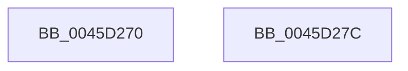

# RtlLengthSid

- RVA: `0x0045D270`–`0x0045D27D` (길이 `13` bytes)
- VA: `0x000000014045D270`
- 실행 섹션: `.text`
- PDB 이름 있음: `예`; PDB Function 태그: `아니요`
- unwind 정보 RVA: `0x000DB714`
- 디코드: `4`개 명령, `13/13` bytes 표시
- 미해석 바이트: `0` (있으면 어셈블리에 `.byte`로 보존)

> 이 문서는 커널 이미지의 기계어와 PDB 기호를 분석해 생성했습니다. 4번과 5번은 함수 원형과 자료형을 바이너리 사용 방식에서 추정한 C 해석이며 원본 소스 복구 결과는 아닙니다.

## 1. Dependencies

- 직접 호출 지점: **0**; 고유 호출 대상: **0**
- 직접 호출자로 확인된 함수: **55**
- RIP 상대 이미지 참조: **0**

### Outgoing calls
- 직접 디코드된 call 명령이 없습니다.

### Direct callers
- [DbgkpCreateNotificationEvent](../../page/71/DbgkpCreateNotificationEvent_function_00710480.md) at `0x00710520`
- [DbgkpCreateNotificationEvent](../../page/71/DbgkpCreateNotificationEvent_function_00710480.md) at `0x0071052E`
- [DbgkpCreateNotificationEvent](../../page/71/DbgkpCreateNotificationEvent_function_00710480.md) at `0x0071053C`
- [DbgkpCreateNotificationEvent](../../page/71/DbgkpCreateNotificationEvent_function_00710480.md) at `0x0071054A`
- [DbgkpCreateNotificationEvent](../../page/71/DbgkpCreateNotificationEvent_function_00710480.md) at `0x00710555`
- [IopCheckGetQuotaBufferValidity](../../page/71/IopCheckGetQuotaBufferValidity_function_0071AF24.md) at `0x0071AF5E`
- [IoCheckQuotaBufferValidity](../../page/71/IoCheckQuotaBufferValidity_function_0071CFD0.md) at `0x0071D02A`
- [PiAuCheckTokenMembership](../../page/73/PiAuCheckTokenMembership_function_00731348.md) at `0x007313A3`
- [PiAuGetServiceStateSecurityObject](../../page/73/PiAuGetServiceStateSecurityObject_function_007314F0.md) at `0x00731530`
- [PiAuGetServiceStateSecurityObject](../../page/73/PiAuGetServiceStateSecurityObject_function_007314F0.md) at `0x0073153E`
- [PiAuGetServiceStateSecurityObject](../../page/73/PiAuGetServiceStateSecurityObject_function_007314F0.md) at `0x0073154C`
- [PiAuGetStateDirectorySecurityObject](../../page/73/PiAuGetStateDirectorySecurityObject_function_00731738.md) at `0x00731778`
- [PiAuGetStateDirectorySecurityObject](../../page/73/PiAuGetStateDirectorySecurityObject_function_00731738.md) at `0x00731786`
- [PiAuGetStateDirectorySecurityObject](../../page/73/PiAuGetStateDirectorySecurityObject_function_00731738.md) at `0x00731794`
- [ObCreateKernelObjectsSD](../../page/74/ObCreateKernelObjectsSD_function_0074D7A8.md) at `0x0074D7D5`
- [ObCreateKernelObjectsSD](../../page/74/ObCreateKernelObjectsSD_function_0074D7A8.md) at `0x0074D7E3`
- [ObCreateKernelObjectsSD](../../page/74/ObCreateKernelObjectsSD_function_0074D7A8.md) at `0x0074D7F1`
- [ObpGetDosDevicesProtection](../../page/74/ObpGetDosDevicesProtection_function_0074E2BC.md) at `0x0074E2F7`
- [ObpGetDosDevicesProtection](../../page/74/ObpGetDosDevicesProtection_function_0074E2BC.md) at `0x0074E305`
- [ObpGetDosDevicesProtection](../../page/74/ObpGetDosDevicesProtection_function_0074E2BC.md) at `0x0074E313`
- [ObpGetDosDevicesProtection](../../page/74/ObpGetDosDevicesProtection_function_0074E2BC.md) at `0x0074E325`
- [ObpGetDosDevicesProtection](../../page/74/ObpGetDosDevicesProtection_function_0074E2BC.md) at `0x0074E486`
- [ObpGetDosDevicesProtection](../../page/74/ObpGetDosDevicesProtection_function_0074E2BC.md) at `0x0074E494`
- [ObpCreateDefaultObjectTypeSD](../../page/74/ObpCreateDefaultObjectTypeSD_function_0074F04C.md) at `0x0074F06F`
- [ObpCreateDefaultObjectTypeSD](../../page/74/ObpCreateDefaultObjectTypeSD_function_0074F04C.md) at `0x0074F07D`
- [ObpCreateDefaultObjectTypeSD](../../page/74/ObpCreateDefaultObjectTypeSD_function_0074F04C.md) at `0x0074F08B`
- [PfpCreateEventInternal](../../page/75/PfpCreateEventInternal_function_00753480.md) at `0x007534F3`
- [PfpCreateEventInternal](../../page/75/PfpCreateEventInternal_function_00753480.md) at `0x00753501`
- [PspSessionObjectCreate](../../page/78/PspSessionObjectCreate_function_007892A8.md) at `0x00789321`
- [PspSessionObjectCreate](../../page/78/PspSessionObjectCreate_function_007892A8.md) at `0x0078932F`
- [RtlReplaceSidInSd](../../page/78/RtlReplaceSidInSd_function_0078E6E0.md) at `0x0078E880`
- [RtlReplaceSidInSd](../../page/78/RtlReplaceSidInSd_function_0078E6E0.md) at `0x0078E956`
- [RtlpSysVolCreateSecurityDescriptor](../../page/79/RtlpSysVolCreateSecurityDescriptor_function_00791654.md) at `0x007916E4`
- [SddlAddAccessFilterAce](../../page/7A/SddlAddAccessFilterAce_function_007A4D58.md) at `0x007A4EBB`
- [SddlAddAccessFilterAce](../../page/7A/SddlAddAccessFilterAce_function_007A4D58.md) at `0x007A4F0A`
- [SddlAddAccessFilterAce](../../page/7A/SddlAddAccessFilterAce_function_007A4D58.md) at `0x007A4F24`
- [SddlAddProcessTrustLabelAce](../../page/7A/SddlAddProcessTrustLabelAce_function_007A4F94.md) at `0x007A505F`
- [SddlAddProcessTrustLabelAce](../../page/7A/SddlAddProcessTrustLabelAce_function_007A4F94.md) at `0x007A5096`
- [SddlAddScopedPolicyIDAce](../../page/7A/SddlAddScopedPolicyIDAce_function_007A50F4.md) at `0x007A51BF`
- [SddlAddScopedPolicyIDAce](../../page/7A/SddlAddScopedPolicyIDAce_function_007A50F4.md) at `0x007A51F6`
- [SmKmStoreFileMakeSecurityDescriptor](../../page/7A/SmKmStoreFileMakeSecurityDescriptor_function_007A9988.md) at `0x007A9ACB`
- [SmKmStoreFileMakeSecurityDescriptor](../../page/7A/SmKmStoreFileMakeSecurityDescriptor_function_007A9988.md) at `0x007A9AD5`
- [SmKmStoreFileMakeSecurityDescriptor](../../page/7A/SmKmStoreFileMakeSecurityDescriptor_function_007A9988.md) at `0x007A9ADF`
- [WdipSemSqmInit](../../page/7B/WdipSemSqmInit_function_007B1E98.md) at `0x007B1ED6`
- [ExpInitFullProcessSecurityInfo](../../page/7C/ExpInitFullProcessSecurityInfo_function_007C43D0.md) at `0x007C44DF`
- [NtSetUuidSeed](../../page/7D/NtSetUuidSeed_function_007D0DD0.md) at `0x007D0F01`
- [MiCreatePagingFile](../../page/7F/MiCreatePagingFile_function_007FEFF4.md) at `0x007FF32A`
- [MiCreatePagingFile](../../page/7F/MiCreatePagingFile_function_007FEFF4.md) at `0x007FF338`
- [MiCompareUserSidHotPatchNodes](../../page/80/MiCompareUserSidHotPatchNodes_function_00803144.md) at `0x00803171`
- [MiCompareUserSidHotPatchNodes](../../page/80/MiCompareUserSidHotPatchNodes_function_00803144.md) at `0x0080317B`
- [MiFindUserSidHotPatchContext](../../page/80/MiFindUserSidHotPatchContext_function_0080360C.md) at `0x00803623`
- [MiCreateMemoryEventSD](../../page/81/MiCreateMemoryEventSD_function_00810F40.md) at `0x00810F77`
- [MiCreateMemoryEventSD](../../page/81/MiCreateMemoryEventSD_function_00810F40.md) at `0x00810F85`
- [MiCreateMemoryEventSD](../../page/81/MiCreateMemoryEventSD_function_00810F40.md) at `0x00810F93`
- [MiCreateMemoryEventSD](../../page/81/MiCreateMemoryEventSD_function_00810F40.md) at `0x00810FA1`
- [MiCreateMemoryEventSD](../../page/81/MiCreateMemoryEventSD_function_00810F40.md) at `0x00810FAF`
- [PnpGetEnumSecurityDescriptor](../../page/83/PnpGetEnumSecurityDescriptor_function_00831FCC.md) at `0x00832125`
- [PnpGetEnumSecurityDescriptor](../../page/83/PnpGetEnumSecurityDescriptor_function_00831FCC.md) at `0x00832130`
- [PnpGetEnumSecurityDescriptor](../../page/83/PnpGetEnumSecurityDescriptor_function_00831FCC.md) at `0x0083213B`
- [DrvDbGetSecurityDescriptor](../../page/83/DrvDbGetSecurityDescriptor_function_0083580C.md) at `0x008359C4`
- [DrvDbGetSecurityDescriptor](../../page/83/DrvDbGetSecurityDescriptor_function_0083580C.md) at `0x008359CE`
- [DrvDbGetSecurityDescriptor](../../page/83/DrvDbGetSecurityDescriptor_function_0083580C.md) at `0x008359D8`
- [ObpGetSilosRootDirectory](../../page/83/ObpGetSilosRootDirectory_function_0083CF00.md) at `0x0083CF60`
- [ObpGetSilosRootDirectory](../../page/83/ObpGetSilosRootDirectory_function_0083CF00.md) at `0x0083CF6E`
- [SepAppendAceToTokenObjectAcl](../../page/8B/SepAppendAceToTokenObjectAcl_function_008B6430.md) at `0x008B6638`
- [RtlpCreateServerAcl](../../page/8B/RtlpCreateServerAcl_function_008BCF58.md) at `0x008BD12E`
- [sub_0090B43E](../../page/90/Unknown_function_0090B43E.md) at `0x0090B763`
- [PiUEventInitClientRegistrationContext](../../page/91/PiUEventInitClientRegistrationContext_function_00916A54.md) at `0x00916B7F`
- [PiUEventInitClientRegistrationContext](../../page/91/PiUEventInitClientRegistrationContext_function_00916A54.md) at `0x00916B8D`
- [PiUEventInitClientRegistrationContext](../../page/91/PiUEventInitClientRegistrationContext_function_00916A54.md) at `0x00916B9B`
- [PiUEventInitClientRegistrationContext](../../page/91/PiUEventInitClientRegistrationContext_function_00916A54.md) at `0x00916BA5`
- [PiUEventInitClientRegistrationContext](../../page/91/PiUEventInitClientRegistrationContext_function_00916A54.md) at `0x00916BB0`
- [BiCreateKeySecurityDescriptor](../../page/91/BiCreateKeySecurityDescriptor_function_00916D6C.md) at `0x00916DA3`
- [BiCreateKeySecurityDescriptor](../../page/91/BiCreateKeySecurityDescriptor_function_00916D6C.md) at `0x00916DAD`
- [BiCreateKeySecurityDescriptor](../../page/91/BiCreateKeySecurityDescriptor_function_00916D6C.md) at `0x00916DBA`
- [BiCreateKeySecurityDescriptor](../../page/91/BiCreateKeySecurityDescriptor_function_00916D6C.md) at `0x00916EAC`
- [BiCreateKeySecurityDescriptor](../../page/91/BiCreateKeySecurityDescriptor_function_00916D6C.md) at `0x00916EC8`
- [LocalGetAclForString](../../page/92/LocalGetAclForString_function_00927F30.md) at `0x00928433`
- [LocalGetAclForString](../../page/92/LocalGetAclForString_function_00927F30.md) at `0x009289CC`
- [LocalGetAclForString](../../page/92/LocalGetAclForString_function_00927F30.md) at `0x009289EC`
- [sub_0092949C](../../page/92/Unknown_function_0092949C.md) at `0x00929598`
- [RtlpCopyEffectiveAce](../../page/92/RtlpCopyEffectiveAce_function_0092E530.md) at `0x0092E9B8`
- [RtlpCopyEffectiveAce](../../page/92/RtlpCopyEffectiveAce_function_0092E530.md) at `0x0092E9CB`
- [sub_00968AF6](../../page/96/Unknown_function_00968AF6.md) at `0x00969942`
- [sub_00968AF6](../../page/96/Unknown_function_00968AF6.md) at `0x00969950`
- [sub_00968AF6](../../page/96/Unknown_function_00968AF6.md) at `0x0096995E`
- [sub_00968AF6](../../page/96/Unknown_function_00968AF6.md) at `0x00969EB2`
- [sub_00968AF6](../../page/96/Unknown_function_00968AF6.md) at `0x00969EC0`
- [sub_00968AF6](../../page/96/Unknown_function_00968AF6.md) at `0x00969ECE`
- [PiDevCfgGetKeySecurityDescriptor](../../page/99/PiDevCfgGetKeySecurityDescriptor_function_00996240.md) at `0x0099642A`
- [CmpBuildAdminInformation](../../page/9A/CmpBuildAdminInformation_function_009A8884.md) at `0x009A890C`
- [SddlAddMandatoryAce](../../page/9A/SddlAddMandatoryAce_function_009A98AC.md) at `0x009A998F`
- [SddlAddMandatoryAce](../../page/9A/SddlAddMandatoryAce_function_009A98AC.md) at `0x009A99BE`
- [ExWnfHiveUnloaded](../../page/9A/ExWnfHiveUnloaded_function_009AF900.md) at `0x009AF9EC`
- [ObpCaptureBoundaryDescriptor](../../page/9C/ObpCaptureBoundaryDescriptor_function_009C9738.md) at `0x009C99F1`
- [SeCaptureSidAndAttributesArray](../../page/9C/SeCaptureSidAndAttributesArray_function_009C9D70.md) at `0x009C9FE6`
- [PspRemoveQuotaBlock](../../page/9D/PspRemoveQuotaBlock_function_009DAA00.md) at `0x009DAA51`
- [LocalGetAceCondition](../../page/A0/LocalGetAceCondition_function_00A010BC.md) at `0x00A01137`
- [LocalGetAceCondition](../../page/A0/LocalGetAceCondition_function_00A010BC.md) at `0x00A01150`
- [LocalGetAceCondition](../../page/A0/LocalGetAceCondition_function_00A010BC.md) at `0x00A01200`
- [_CmGetRegKeySecurityDescriptor](../../page/A8/_CmGetRegKeySecurityDescriptor_function_00A83F34.md) at `0x00A84058`
- [_CmGetRegKeySecurityDescriptor](../../page/A8/_CmGetRegKeySecurityDescriptor_function_00A83F34.md) at `0x00A84063`
- [_CmGetRegKeySecurityDescriptor](../../page/A8/_CmGetRegKeySecurityDescriptor_function_00A83F34.md) at `0x00A8406E`
- [_CmGetRegKeySecurityDescriptor](../../page/A8/_CmGetRegKeySecurityDescriptor_function_00A83F34.md) at `0x00A84080`
- [EtwpTiSerializeTokenGroups](../../page/A8/EtwpTiSerializeTokenGroups_function_00A87B20.md) at `0x00A87B64`
- [EtwpTiSerializeTokenGroups](../../page/A8/EtwpTiSerializeTokenGroups_function_00A87B20.md) at `0x00A87BAC`
- [EtwpTiSerializeTokenGroups](../../page/A8/EtwpTiSerializeTokenGroups_function_00A87B20.md) at `0x00A87BC4`
- [_PnpGetPropertiesSecurityDescriptor](../../page/A9/_PnpGetPropertiesSecurityDescriptor_function_00A91B8C.md) at `0x00A91BEA`
- [EtwpTiFillTokenIdentity](../../page/A9/EtwpTiFillTokenIdentity_function_00A97594.md) at `0x00A9760B`
- [EtwpTiFillTokenIdentity](../../page/A9/EtwpTiFillTokenIdentity_function_00A97594.md) at `0x00A97646`
- [MiLoadHotPatchForUserSid](../../page/AB/MiLoadHotPatchForUserSid_function_00AB4F08.md) at `0x00AB4FD7`
- [LocalGetRelativeAttributeForString](../../page/AC/LocalGetRelativeAttributeForString_function_00AC74E4.md) at `0x00AC78B1`
- [LocalGetRelativeAttributeForString](../../page/AC/LocalGetRelativeAttributeForString_function_00AC74E4.md) at `0x00AC7D76`
- [sub_00B22C34](../../page/B2/Unknown_function_00B22C34.md) at `0x00B22D59`
- [sub_00B22C34](../../page/B2/Unknown_function_00B22C34.md) at `0x00B22D79`
- [sub_00B22C34](../../page/B2/Unknown_function_00B22C34.md) at `0x00B22E74`
- [sub_00B22C34](../../page/B2/Unknown_function_00B22C34.md) at `0x00B22EB8`
- [sub_00B22F88](../../page/B2/Unknown_function_00B22F88.md) at `0x00B22FA8`
- [sub_00B2D76A](../../page/B2/Unknown_function_00B2D76A.md) at `0x00B2D76D`
- [sub_00B32FE4](../../page/B3/Unknown_function_00B32FE4.md) at `0x00B33276`
- [ViInitializeLocalSystemDescriptor](../../pagevrfy/B9/ViInitializeLocalSystemDescriptor_function_00B936F8.md) at `0x00B93762`

### Static image references
- 디코드된 RIP-relative 메모리 참조가 없습니다.

## 2. Other-region calls and transfers

- 다른 실행 섹션으로 향하는 call: **0**
- 별도 외부 분기/꼬리 이동을 확인하지 못했습니다.

## 3. Assembly (complete function range)

```asm
0045D270  0F B6 41 01                     movzx eax, byte ptr [rcx + 1]
0045D274  8D 04 85 08 00 00 00            lea eax, [rax*4 + 8]
0045D27B  C3                              ret
0045D27C  CC                              int3
```

## 4. C-style interpretation (structured pseudocode)

```c
__int64 __fastcall RtlLengthSid(__int64 a1)
{
    return *(unsigned __int8 *)(a1 + 1) * 4 + 8;
}
```

## 5. (Beta) C Style

```c
int64_t RtlLengthSid(void *Arg1)
{
    uint8_t *arg1 = (uint8_t *)Arg1;

    return *(uint8_t *)(arg1 + 0x1) * 4 + 8;
}
```

### 관측된 메모리 오프셋

구조체 형식이 확인되지 않은 접근은 인자 기준의 오프셋으로만 기록했습니다.

| 기준 인자 | 오프셋 표현 | 폭 (bit) | 접근 |
|---|---:|---:|---|
| `Arg1` | `+ 0x1` | `8` | `R` |

## 6. Execution-region graph

[열기: 2D/3D 그래프와 함수 탐색 컨트롤 패널](../../../control-panel.html?section=text&rva=0x0045D270&view=graph)

- 2D 그래프는 위에서 아래로 흐르고, 3D 그래프는 빈 공간을 드래그해 회전합니다. Shift+드래그는 이동, 휠은 확대·축소, 함수 노드 선택은 대상 보고서 이동입니다.

### Static fallback


