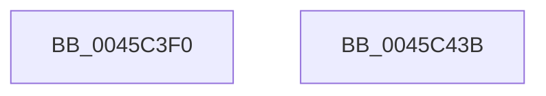

# RtlQueryPackageClaims

- RVA: `0x0045C3F0`–`0x0045C43C` (길이 `76` bytes)
- VA: `0x000000014045C3F0`
- 실행 섹션: `.text`
- PDB 이름 있음: `예`; PDB Function 태그: `아니요`
- unwind 정보 RVA: `0x0005CC98`
- 디코드: `16`개 명령, `76/76` bytes 표시
- 미해석 바이트: `0` (있으면 어셈블리에 `.byte`로 보존)

> 이 문서는 커널 이미지의 기계어와 PDB 기호를 분석해 생성했습니다. 4번과 5번은 함수 원형과 자료형을 바이너리 사용 방식에서 추정한 C 해석이며 원본 소스 복구 결과는 아닙니다.

## 1. Dependencies

- 직접 호출 지점: **1**; 고유 호출 대상: **1**
- 직접 호출자로 확인된 함수: **6**
- RIP 상대 이미지 참조: **0**

### Outgoing calls
- `0x0045C431` → [RtlQueryPackageClaimsEx](../5E/RtlQueryPackageClaimsEx_function_005EDFE8.md) (function, `0x005EDFE8`)

### Direct callers
- [SepDesktopAppxSubProcessToken](SepDesktopAppxSubProcessToken_function_0045BD90.md) at `0x0045BE9C`
- [SepDesktopAppxSubProcessToken](SepDesktopAppxSubProcessToken_function_0045BD90.md) at `0x0045C15B`
- [SepVerifyDesktopAppPolicyOverrideCaller](SepVerifyDesktopAppPolicyOverrideCaller_function_0045C1F0.md) at `0x0045C29C`
- [RtlQueryPackageIdentityEx](RtlQueryPackageIdentityEx_function_0045C320.md) at `0x0045C366`
- [RtlQueryPackageIdentity](RtlQueryPackageIdentity_function_0045C390.md) at `0x0045C3BA`
- [sub_006F1F12](../6F/Unknown_function_006F1F12.md) at `0x006F1F6F`
- [SeDuplicateTokenWithPredictedClaims](../../page/6F/SeDuplicateTokenWithPredictedClaims_function_006FD084.md) at `0x006FD0FE`

### Static image references
- 디코드된 RIP-relative 메모리 참조가 없습니다.

## 2. Other-region calls and transfers

- 다른 실행 섹션으로 향하는 call: **0**
- 별도 외부 분기/꼬리 이동을 확인하지 못했습니다.

## 3. Assembly (complete function range)

```asm
0045C3F0  4C 8B DC                        mov r11, rsp
0045C3F3  48 83 EC 58                     sub rsp, 0x58
0045C3F7  48 8B 84 24 98 00 00 00         mov rax, qword ptr [rsp + 0x98]
0045C3FF  49 89 43 F0                     mov qword ptr [r11 - 0x10], rax
0045C403  48 8B 84 24 90 00 00 00         mov rax, qword ptr [rsp + 0x90]
0045C40B  49 89 43 E8                     mov qword ptr [r11 - 0x18], rax
0045C40F  48 8B 84 24 88 00 00 00         mov rax, qword ptr [rsp + 0x88]
0045C417  49 89 43 E0                     mov qword ptr [r11 - 0x20], rax
0045C41B  49 83 63 D8 00                  and qword ptr [r11 - 0x28], 0
0045C420  48 8B 84 24 80 00 00 00         mov rax, qword ptr [rsp + 0x80]
0045C428  49 83 63 D0 00                  and qword ptr [r11 - 0x30], 0
0045C42D  49 89 43 C8                     mov qword ptr [r11 - 0x38], rax
0045C431  E8 B2 1B 19 00                  call 0x1405edfe8
0045C436  48 83 C4 58                     add rsp, 0x58
0045C43A  C3                              ret
0045C43B  CC                              int3
```

## 4. C-style interpretation (structured pseudocode)

```c
__int64 __fastcall RtlQueryPackageClaims(__int64 a1, __int64 a2, __int64 a3, __int64 a4, __int64 a5, __int64 a6, __int64 a7, __int64 a8)
{
    __int64 result;
    __int64 v_rsp;

    v_rsp = (v_rsp) - (88);
    *(unsigned __int64 *)(v_rsp - 16) = a8;
    *(unsigned __int64 *)(v_rsp - 24) = a7;
    *(unsigned __int64 *)(v_rsp - 32) = a6;
    *(unsigned __int64 *)(v_rsp - 56) = a5;
    result = RtlQueryPackageClaimsEx(a1, a2, a3, a4);
    v_rsp = (v_rsp) + (88);
    return result;
}
```

## 5. (Beta) C Style

```c
int64_t RtlQueryPackageClaims(int64_t Arg1, int64_t Arg2, int64_t Arg3, int64_t Arg4, int64_t Arg5, int64_t Arg6, int64_t Arg7, int64_t Arg8)
{
    int64_t result;
    int64_t local_rsp;

    local_rsp = (local_rsp) - (88);
    *(uint64_t *)(local_rsp - 0x10) = Arg8;
    *(uint64_t *)(local_rsp - 0x18) = Arg7;
    *(uint64_t *)(local_rsp - 0x20) = Arg6;
    *(uint64_t *)(local_rsp - 0x38) = Arg5;
    result = RtlQueryPackageClaimsEx(Arg1, Arg2, Arg3, Arg4);
    local_rsp = (local_rsp) + (88);
    return result;
}
```

## 6. Execution-region graph

[열기: 2D/3D 그래프와 함수 탐색 컨트롤 패널](../../../control-panel.html?section=text&rva=0x0045C3F0&view=graph)

- 2D 그래프는 위에서 아래로 흐르고, 3D 그래프는 빈 공간을 드래그해 회전합니다. Shift+드래그는 이동, 휠은 확대·축소, 함수 노드 선택은 대상 보고서 이동입니다.

### Static fallback


