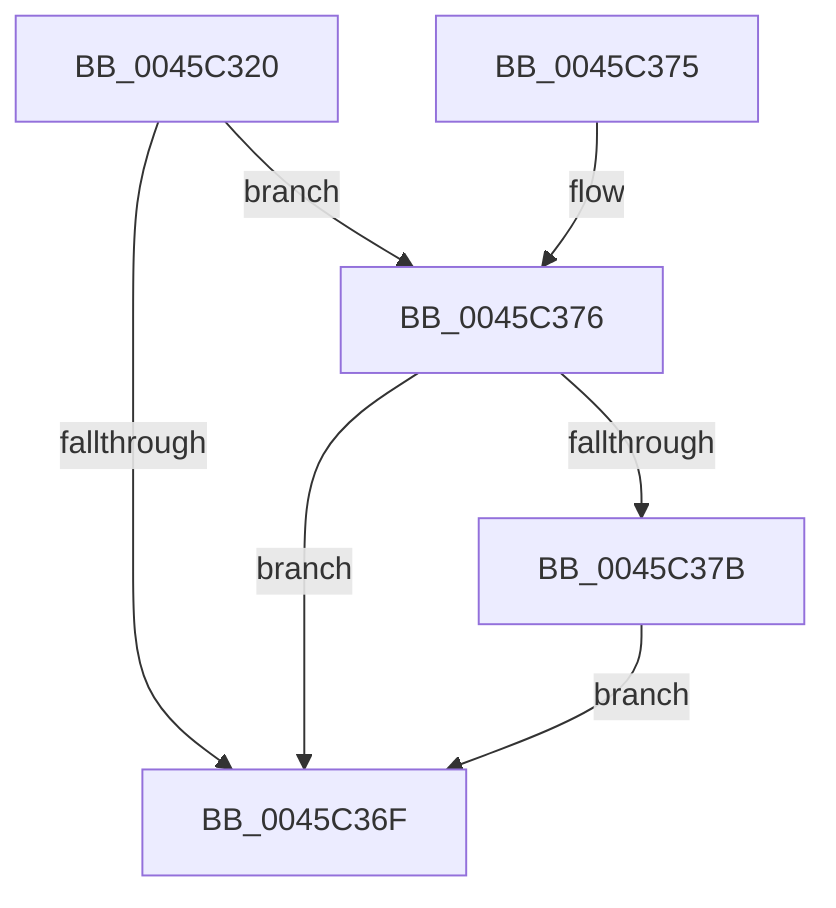

# RtlQueryPackageIdentityEx

- RVA: `0x0045C320`–`0x0045C384` (길이 `100` bytes)
- VA: `0x000000014045C320`
- 실행 섹션: `.text`
- PDB 이름 있음: `예`; PDB Function 태그: `아니요`
- unwind 정보 RVA: `0x000A94E0`
- 디코드: `28`개 명령, `100/100` bytes 표시
- 미해석 바이트: `0` (있으면 어셈블리에 `.byte`로 보존)

> 이 문서는 커널 이미지의 기계어와 PDB 기호를 분석해 생성했습니다. 4번과 5번은 함수 원형과 자료형을 바이너리 사용 방식에서 추정한 C 해석이며 원본 소스 복구 결과는 아닙니다.

## 1. Dependencies

- 직접 호출 지점: **1**; 고유 호출 대상: **1**
- 직접 호출자로 확인된 함수: **1**
- RIP 상대 이미지 참조: **0**

### Outgoing calls
- `0x0045C366` → [RtlQueryPackageClaims](RtlQueryPackageClaims_function_0045C3F0.md) (function, `0x0045C3F0`)

### Direct callers
- [PspIdentityBasedJobBreakaway](../../page/A8/PspIdentityBasedJobBreakaway_function_00A899CC.md) at `0x00A89A6B`
- [PspIdentityBasedJobBreakaway](../../page/A8/PspIdentityBasedJobBreakaway_function_00A899CC.md) at `0x00A89AF4`

### Static image references
- 디코드된 RIP-relative 메모리 참조가 없습니다.

## 2. Other-region calls and transfers

- 다른 실행 섹션으로 향하는 call: **0**
- 별도 외부 분기/꼬리 이동을 확인하지 못했습니다.

## 3. Assembly (complete function range)

```asm
0045C320  4C 8B DC                        mov r11, rsp
0045C323  53                              push rbx
0045C324  48 83 EC 50                     sub rsp, 0x50
0045C328  49 83 63 E8 00                  and qword ptr [r11 - 0x18], 0
0045C32D  48 8B 9C 24 90 00 00 00         mov rbx, qword ptr [rsp + 0x90]
0045C335  48 8B C3                        mov rax, rbx
0045C338  48 F7 D8                        neg rax
0045C33B  49 8D 43 E8                     lea rax, [r11 - 0x18]
0045C33F  4D 1B D2                        sbb r10, r10
0045C342  49 83 63 E0 00                  and qword ptr [r11 - 0x20], 0
0045C347  4C 23 D0                        and r10, rax
0045C34A  48 8B 84 24 88 00 00 00         mov rax, qword ptr [rsp + 0x88]
0045C352  4D 89 53 D8                     mov qword ptr [r11 - 0x28], r10
0045C356  49 89 43 D0                     mov qword ptr [r11 - 0x30], rax
0045C35A  48 8B 84 24 80 00 00 00         mov rax, qword ptr [rsp + 0x80]
0045C362  49 89 43 C8                     mov qword ptr [r11 - 0x38], rax
0045C366  E8 85 00 00 00                  call 0x14045c3f0
0045C36B  85 C0                           test eax, eax
0045C36D  79 07                           jns 0x14045c376
0045C36F  48 83 C4 50                     add rsp, 0x50
0045C373  5B                              pop rbx
0045C374  C3                              ret
0045C375  CC                              int3
0045C376  48 85 DB                        test rbx, rbx
0045C379  74 F4                           je 0x14045c36f
0045C37B  8B 4C 24 40                     mov ecx, dword ptr [rsp + 0x40]
0045C37F  48 89 0B                        mov qword ptr [rbx], rcx
0045C382  EB EB                           jmp 0x14045c36f
```

## 4. C-style interpretation (structured pseudocode)

```c
__int64 __fastcall RtlQueryPackageIdentityEx(__int64 a1, __int64 a2, __int64 a3, __int64 a4, __int64 a5, __int64 a6, __int64 a7)
{
    __int64 result;
    __int64 v_r10;
    __int64 v_rsp;
    unsigned int v_stack_p40;

    v_rsp = (v_rsp) - (80);
    result = -(a7);
    v_r10 = (v_r10) & (v_rsp - 24);
    *(unsigned __int64 *)(v_rsp - 40) = v_r10;
    *(unsigned __int64 *)(v_rsp - 48) = a6;
    *(unsigned __int64 *)(v_rsp - 56) = a5;
    result = RtlQueryPackageClaims(a1, a2, a3, a4);
    if (!sign_flag) goto loc_0045C376;
loc_0045C36F:
    v_rsp = (v_rsp) + (80);
    return result;
loc_0045C376:
    if (a7 == 0) goto loc_0045C36F;
    *(unsigned __int64 *)(a7) = (unsigned int)(v_stack_p40);
    goto loc_0045C36F;
}
```

## 5. (Beta) C Style

```c
int64_t RtlQueryPackageIdentityEx(int64_t Arg1, int64_t Arg2, int64_t Arg3, int64_t Arg4, int64_t Arg5, int64_t Arg6, int64_t Arg7)
{
    int64_t result;
    int64_t local_r10;
    int64_t local_rsp;
    uint32_t v_stack_p40;

    local_rsp = (local_rsp) - (80);
    result = -(Arg7);
    local_r10 = (local_r10) & (local_rsp - 24);
    *(uint64_t *)(local_rsp - 0x28) = local_r10;
    *(uint64_t *)(local_rsp - 0x30) = Arg6;
    *(uint64_t *)(local_rsp - 0x38) = Arg5;
    result = RtlQueryPackageClaims(Arg1, Arg2, Arg3, Arg4);
    if (!sign_flag) goto loc_0045C376;
loc_0045C36F:
    local_rsp = (local_rsp) + (80);
    return result;
loc_0045C376:
    if (Arg7 == 0) goto loc_0045C36F;
    *(uint64_t *)(Arg7) = (uint32_t)(v_stack_p40);
    goto loc_0045C36F;
}
```

## 6. Execution-region graph

[열기: 2D/3D 그래프와 함수 탐색 컨트롤 패널](../../../control-panel.html?section=text&rva=0x0045C320&view=graph)

- 2D 그래프는 위에서 아래로 흐르고, 3D 그래프는 빈 공간을 드래그해 회전합니다. Shift+드래그는 이동, 휠은 확대·축소, 함수 노드 선택은 대상 보고서 이동입니다.

### Static fallback


