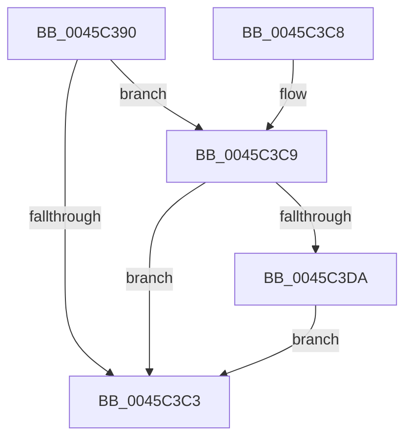

# RtlQueryPackageIdentity

- RVA: `0x0045C390`–`0x0045C3E4` (길이 `84` bytes)
- VA: `0x000000014045C390`
- 실행 섹션: `.text`
- PDB 이름 있음: `예`; PDB Function 태그: `아니요`
- unwind 정보 RVA: `0x000A94EC`
- 디코드: `23`개 명령, `84/84` bytes 표시
- 미해석 바이트: `0` (있으면 어셈블리에 `.byte`로 보존)

> 이 문서는 커널 이미지의 기계어와 PDB 기호를 분석해 생성했습니다. 4번과 5번은 함수 원형과 자료형을 바이너리 사용 방식에서 추정한 C 해석이며 원본 소스 복구 결과는 아닙니다.

## 1. Dependencies

- 직접 호출 지점: **1**; 고유 호출 대상: **1**
- 직접 호출자로 확인된 함수: **5**
- RIP 상대 이미지 참조: **0**

### Outgoing calls
- `0x0045C3BA` → [RtlQueryPackageClaims](RtlQueryPackageClaims_function_0045C3F0.md) (function, `0x0045C3F0`)

### Direct callers
- [EtwpQueryTokenPackageInfo](../../page/8A/EtwpQueryTokenPackageInfo_function_008A5878.md) at `0x008A5B0E`
- [ExpGetProcessInformation](../../page/91/ExpGetProcessInformation_function_0091A878.md) at `0x0091B79C`
- [PfSnCheckModernApp](../../page/95/PfSnCheckModernApp_function_0095FFF8.md) at `0x00960072`
- [PopEtGetProcessSidAndPackageIdentity](../../page/98/PopEtGetProcessSidAndPackageIdentity_function_0098FD2C.md) at `0x0098FDFD`
- [sub_00B47918](../../page/B4/Unknown_function_00B47918.md) at `0x00B47977`

### Static image references
- 디코드된 RIP-relative 메모리 참조가 없습니다.

## 2. Other-region calls and transfers

- 다른 실행 섹션으로 향하는 call: **0**
- 별도 외부 분기/꼬리 이동을 확인하지 못했습니다.

## 3. Assembly (complete function range)

```asm
0045C390  4C 8B DC                        mov r11, rsp
0045C393  48 83 EC 58                     sub rsp, 0x58
0045C397  49 83 63 E0 00                  and qword ptr [r11 - 0x20], 0
0045C39C  49 8D 43 E8                     lea rax, [r11 - 0x18]
0045C3A0  49 83 63 E8 00                  and qword ptr [r11 - 0x18], 0
0045C3A5  49 89 43 D8                     mov qword ptr [r11 - 0x28], rax
0045C3A9  48 8B 84 24 80 00 00 00         mov rax, qword ptr [rsp + 0x80]
0045C3B1  49 83 63 D0 00                  and qword ptr [r11 - 0x30], 0
0045C3B6  49 89 43 C8                     mov qword ptr [r11 - 0x38], rax
0045C3BA  E8 31 00 00 00                  call 0x14045c3f0
0045C3BF  85 C0                           test eax, eax
0045C3C1  79 06                           jns 0x14045c3c9
0045C3C3  48 83 C4 58                     add rsp, 0x58
0045C3C7  C3                              ret
0045C3C8  CC                              int3
0045C3C9  48 8B 94 24 88 00 00 00         mov rdx, qword ptr [rsp + 0x88]
0045C3D1  8B 4C 24 40                     mov ecx, dword ptr [rsp + 0x40]
0045C3D5  48 85 D2                        test rdx, rdx
0045C3D8  74 E9                           je 0x14045c3c3
0045C3DA  48 85 C9                        test rcx, rcx
0045C3DD  0F 95 C1                        setne cl
0045C3E0  88 0A                           mov byte ptr [rdx], cl
0045C3E2  EB DF                           jmp 0x14045c3c3
```

## 4. C-style interpretation (structured pseudocode)

```c
__int64 __fastcall RtlQueryPackageIdentity(__int64 a1, __int64 a2, __int64 a3, __int64 a4, __int64 a5, __int64 a6)
{
    __int64 result;
    __int64 v_rsp;
    unsigned int v_stack_p40;

    v_rsp = (v_rsp) - (88);
    *(unsigned __int64 *)(v_rsp - 40) = v_rsp - 24;
    *(unsigned __int64 *)(v_rsp - 56) = a5;
    result = RtlQueryPackageClaims(a1, a2, a3, a4);
    if (!sign_flag) goto loc_0045C3C9;
loc_0045C3C3:
    v_rsp = (v_rsp) + (88);
    return result;
loc_0045C3C9:
    if (a6 == 0) goto loc_0045C3C3;
    a1 = ((unsigned int)(v_stack_p40) != 0) ? 1 : 0;
    *(unsigned __int8 *)(a6) = (unsigned __int8)(a1);
    goto loc_0045C3C3;
}
```

## 5. (Beta) C Style

```c
int64_t RtlQueryPackageIdentity(int64_t Arg1, int64_t Arg2, int64_t Arg3, int64_t Arg4, int64_t Arg5, int64_t Arg6)
{
    int64_t result;
    int64_t local_rsp;
    uint32_t v_stack_p40;

    local_rsp = (local_rsp) - (88);
    *(uint64_t *)(local_rsp - 0x28) = local_rsp - 24;
    *(uint64_t *)(local_rsp - 0x38) = Arg5;
    result = RtlQueryPackageClaims(Arg1, Arg2, Arg3, Arg4);
    if (!sign_flag) goto loc_0045C3C9;
loc_0045C3C3:
    local_rsp = (local_rsp) + (88);
    return result;
loc_0045C3C9:
    if (Arg6 == 0) goto loc_0045C3C3;
    Arg1 = ((uint32_t)(v_stack_p40) != 0) ? 1 : 0;
    *(uint8_t *)(Arg6) = (uint8_t)(Arg1);
    goto loc_0045C3C3;
}
```

## 6. Execution-region graph

[열기: 2D/3D 그래프와 함수 탐색 컨트롤 패널](../../../control-panel.html?section=text&rva=0x0045C390&view=graph)

- 2D 그래프는 위에서 아래로 흐르고, 3D 그래프는 빈 공간을 드래그해 회전합니다. Shift+드래그는 이동, 휠은 확대·축소, 함수 노드 선택은 대상 보고서 이동입니다.

### Static fallback


