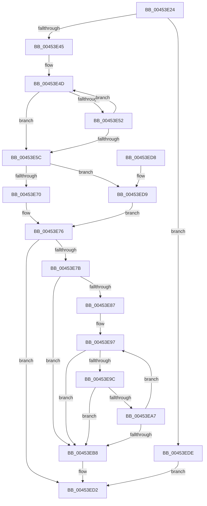

# RtlStringCbCatW

- RVA: `0x00453E24`–`0x00453EE5` (길이 `193` bytes)
- VA: `0x0000000140453E24`
- 실행 섹션: `.text`
- PDB 이름 있음: `예`; PDB Function 태그: `아니요`
- unwind 정보 RVA: `0x000A78D8`
- 디코드: `60`개 명령, `193/193` bytes 표시
- 미해석 바이트: `0` (있으면 어셈블리에 `.byte`로 보존)

> 이 문서는 커널 이미지의 기계어와 PDB 기호를 분석해 생성했습니다. 4번과 5번은 함수 원형과 자료형을 바이너리 사용 방식에서 추정한 C 해석이며 원본 소스 복구 결과는 아닙니다.

## 1. Dependencies

- 직접 호출 지점: **0**; 고유 호출 대상: **0**
- 직접 호출자로 확인된 함수: **7**
- RIP 상대 이미지 참조: **0**

### Outgoing calls
- 직접 디코드된 call 명령이 없습니다.

### Direct callers
- [SeSetLearningModeObjectInformation](../4C/SeSetLearningModeObjectInformation_function_004C7098.md) at `0x004C726E`
- [SeSetLearningModeObjectInformation](../4C/SeSetLearningModeObjectInformation_function_004C7098.md) at `0x004C7281`
- [PfSnParametersRead](../../page/75/PfSnParametersRead_function_00752970.md) at `0x00752ABE`
- [PfSnParametersRead](../../page/75/PfSnParametersRead_function_00752970.md) at `0x00752B1A`
- [PfSnParametersRead](../../page/75/PfSnParametersRead_function_00752970.md) at `0x00752B78`
- [RtlpGetDynamicTimeZoneInfoHandle](../../page/78/RtlpGetDynamicTimeZoneInfoHandle_function_0078FD78.md) at `0x0078FDD4`
- [RtlpGetDynamicTimeZoneInfoHandle](../../page/78/RtlpGetDynamicTimeZoneInfoHandle_function_0078FD78.md) at `0x0078FDEB`
- [PerfDiagpStartPerfDiagLogger](../../page/7A/PerfDiagpStartPerfDiagLogger_function_007AF144.md) at `0x007AF1AF`
- [PnpConcatPWSTR](../../page/99/PnpConcatPWSTR_function_00990A00.md) at `0x00990B0B`
- [WmipIncludeStaticNames](../../page/9D/WmipIncludeStaticNames_function_009DF754.md) at `0x009DF908`
- [VhdInitialize](../../init/C6/VhdInitialize_function_00C6DBB4.md) at `0x00C6DDB8`

### Static image references
- 디코드된 RIP-relative 메모리 참조가 없습니다.

## 2. Other-region calls and transfers

- 다른 실행 섹션으로 향하는 call: **0**
- 별도 외부 분기/꼬리 이동을 확인하지 못했습니다.

## 3. Assembly (complete function range)

```asm
00453E24  48 89 5C 24 08                  mov qword ptr [rsp + 8], rbx
00453E29  4C 8B CA                        mov r9, rdx
00453E2C  4D 8B D8                        mov r11, r8
00453E2F  49 D1 E9                        shr r9, 1
00453E32  4C 8B D1                        mov r10, rcx
00453E35  49 8D 41 FF                     lea rax, [r9 - 1]
00453E39  48 3D FE FF FF 7F               cmp rax, 0x7ffffffe
00453E3F  0F 87 99 00 00 00               ja 0x140453ede
00453E45  49 8B D1                        mov rdx, r9
00453E48  48 8B C1                        mov rax, rcx
00453E4B  33 DB                           xor ebx, ebx
00453E4D  66 39 18                        cmp word ptr [rax], bx
00453E50  74 0A                           je 0x140453e5c
00453E52  48 83 C0 02                     add rax, 2
00453E56  48 83 EA 01                     sub rdx, 1
00453E5A  75 F1                           jne 0x140453e4d
00453E5C  48 8B C2                        mov rax, rdx
00453E5F  48 F7 D8                        neg rax
00453E62  1B C0                           sbb eax, eax
00453E64  F7 D0                           not eax
00453E66  25 0D 00 00 C0                  and eax, 0xc000000d
00453E6B  48 85 D2                        test rdx, rdx
00453E6E  74 69                           je 0x140453ed9
00453E70  4D 8B C1                        mov r8, r9
00453E73  4C 2B C2                        sub r8, rdx
00453E76  48 85 D2                        test rdx, rdx
00453E79  74 57                           je 0x140453ed2
00453E7B  49 8B C9                        mov rcx, r9
00453E7E  4B 8D 14 42                     lea rdx, [r10 + r8*2]
00453E82  49 2B C8                        sub rcx, r8
00453E85  74 31                           je 0x140453eb8
00453E87  4D 2B C1                        sub r8, r9
00453E8A  49 8D 80 FE FF FF 7F            lea rax, [r8 + 0x7ffffffe]
00453E91  48 03 C1                        add rax, rcx
00453E94  4C 2B DA                        sub r11, rdx
00453E97  48 85 C0                        test rax, rax
00453E9A  74 1C                           je 0x140453eb8
00453E9C  45 0F B7 04 13                  movzx r8d, word ptr [r11 + rdx]
00453EA1  66 45 85 C0                     test r8w, r8w
00453EA5  74 11                           je 0x140453eb8
00453EA7  66 44 89 02                     mov word ptr [rdx], r8w
00453EAB  48 FF C8                        dec rax
00453EAE  48 83 C2 02                     add rdx, 2
00453EB2  48 83 E9 01                     sub rcx, 1
00453EB6  75 DF                           jne 0x140453e97
00453EB8  48 85 C9                        test rcx, rcx
00453EBB  48 8D 42 FE                     lea rax, [rdx - 2]
00453EBF  48 0F 45 C2                     cmovne rax, rdx
00453EC3  48 F7 D9                        neg rcx
00453EC6  66 89 18                        mov word ptr [rax], bx
00453EC9  1B C0                           sbb eax, eax
00453ECB  F7 D0                           not eax
00453ECD  25 05 00 00 80                  and eax, 0x80000005
00453ED2  48 8B 5C 24 08                  mov rbx, qword ptr [rsp + 8]
00453ED7  C3                              ret
00453ED8  CC                              int3
00453ED9  4C 8B C3                        mov r8, rbx
00453EDC  EB 98                           jmp 0x140453e76
00453EDE  B8 0D 00 00 C0                  mov eax, 0xc000000d
00453EE3  EB ED                           jmp 0x140453ed2
```

## 4. C-style interpretation (structured pseudocode)

```c
__int64 __fastcall RtlStringCbCatW(__int64 a1, __int64 a2, __int64 a3)
{
    __int64 result;
    __int64 v_r11;
    __int64 v_rbx;
    unsigned __int64 v_stack_p8;

    v_stack_p8 = v_rbx;
    a4 = (a2) >> (1);
    if ((a4 - 1) > 0x7FFFFFFEULL) goto loc_00453EDE;
    v_rbx = 0;
loc_00453E4D:
    if ((*(unsigned __int16 *)(a1)) == 0) goto loc_00453E5C;
    result = (a1) + (2);
    a2 = (a4) - (1);
    if (condition_is_not_equal) goto loc_00453E4D;
loc_00453E5C:
    result = -(a2);
    result = (unsigned int)(~(result));
    result = (unsigned int)((result) & (0xC000000DULL));
    if (a2 == 0) goto loc_00453ED9;
    a3 = (a4) - (a2);
loc_00453E76:
    if (a2 == 0) goto loc_00453ED2;
    a1 = (a4) - (a3);
    if (condition_is_equal) goto loc_00453EB8;
    a3 = (a3) - (a4);
    result = (a3 + 2147483646) + (a1);
    v_r11 = (a3) - (a1 + a3 * 2);
loc_00453E97:
    if (result == 0) goto loc_00453EB8;
    if ((unsigned __int16)(*(unsigned __int16 *)(v_r11 + a1 + a3 * 2 * 1)) == 0) goto loc_00453EB8;
    *(unsigned __int16 *)(a1 + a3 * 2) = (unsigned __int16)(*(unsigned __int16 *)(v_r11 + a1 + a3 * 2 * 1));
    result = (result) - 1;
    a2 = (a1 + a3 * 2) + (2);
    a1 = (a1) - (1);
    if (condition_is_not_equal) goto loc_00453E97;
loc_00453EB8:
    result = a2 - 2;
    if (a1 != 0) { result = a2; }
    a1 = -(a1);
    *(unsigned __int16 *)(result) = 0;
    result = (unsigned int)(~(result));
    result = (unsigned int)((result) & (0x80000005ULL));
loc_00453ED2:
    return result;
loc_00453ED9:
    goto loc_00453E76;
loc_00453EDE:
    goto loc_00453ED2;
}
```

## 5. (Beta) C Style

```c
int64_t RtlStringCbCatW(void *Arg1, int64_t Arg2, void *Arg3)
{
    uint8_t *arg1 = (uint8_t *)Arg1;
    uint8_t *arg3 = (uint8_t *)Arg3;

    int64_t result;
    int64_t local_r11;
    int64_t local_rbx;
    uint64_t v_stack_p8;

    v_stack_p8 = local_rbx;
    a4 = (Arg2) >> (1);
    if ((a4 - 1) > 0x7FFFFFFEULL) goto loc_00453EDE;
    local_rbx = 0;
loc_00453E4D:
    if ((*(uint16_t *)(arg1)) == 0) goto loc_00453E5C;
    result = (Arg1) + (2);
    Arg2 = (a4) - (1);
    if (condition_is_not_equal) goto loc_00453E4D;
loc_00453E5C:
    result = -(Arg2);
    result = (uint32_t)(~(result));
    result = (uint32_t)((result) & (0xC000000DULL));
    if (Arg2 == 0) goto loc_00453ED9;
    Arg3 = (a4) - (Arg2);
loc_00453E76:
    if (Arg2 == 0) goto loc_00453ED2;
    Arg1 = (a4) - (Arg3);
    if (condition_is_equal) goto loc_00453EB8;
    Arg3 = (Arg3) - (a4);
    result = (Arg3 + 2147483646) + (Arg1);
    local_r11 = (Arg3) - (Arg1 + Arg3 * 2);
loc_00453E97:
    if (result == 0) goto loc_00453EB8;
    if ((uint16_t)(*(uint16_t *)(local_r11 + arg1 + arg3 * 2 * 1)) == 0) goto loc_00453EB8;
    *(uint16_t *)(arg1 + arg3 * 2) = (uint16_t)(*(uint16_t *)(local_r11 + arg1 + arg3 * 2 * 1));
    result = (result) - 1;
    Arg2 = (Arg1 + Arg3 * 2) + (2);
    Arg1 = (Arg1) - (1);
    if (condition_is_not_equal) goto loc_00453E97;
loc_00453EB8:
    result = Arg2 - 2;
    if (Arg1 != NULL) { result = Arg2; }
    Arg1 = -(Arg1);
    *(uint16_t *)(result) = 0;
    result = (uint32_t)(~(result));
    result = (uint32_t)((result) & (0x80000005ULL));
loc_00453ED2:
    return result;
loc_00453ED9:
    goto loc_00453E76;
loc_00453EDE:
    goto loc_00453ED2;
}
```

### 관측된 메모리 오프셋

구조체 형식이 확인되지 않은 접근은 인자 기준의 오프셋으로만 기록했습니다.

| 기준 인자 | 오프셋 표현 | 폭 (bit) | 접근 |
|---|---:|---:|---|
| `Arg1` | `- 0x2` | `64` | `R` |
| `Arg1` | `+ 0x0` | `16` | `R` |
| `Arg1` | `+ 0x0` | `16` | `W` |
| `Arg1` | `+ 0x0 + r8*2` | `64` | `R` |
| `Arg3` | `+ 0x0 + rdx*1` | `16` | `R` |

## 6. Execution-region graph

[열기: 2D/3D 그래프와 함수 탐색 컨트롤 패널](../../../control-panel.html?section=text&rva=0x00453E24&view=graph)

- 2D 그래프는 위에서 아래로 흐르고, 3D 그래프는 빈 공간을 드래그해 회전합니다. Shift+드래그는 이동, 휠은 확대·축소, 함수 노드 선택은 대상 보고서 이동입니다.

### Static fallback


