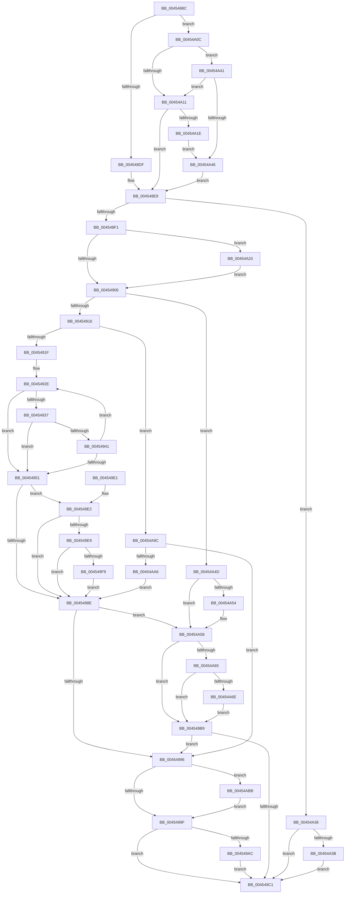

# RtlStringCbCopyExW

- RVA: `0x0045488C`–`0x00454AC4` (길이 `568` bytes)
- VA: `0x000000014045488C`
- 실행 섹션: `.text`
- PDB 이름 있음: `예`; PDB Function 태그: `아니요`
- unwind 정보 RVA: `0x000A79D0`
- 디코드: `154`개 명령, `568/568` bytes 표시
- 미해석 바이트: `0` (있으면 어셈블리에 `.byte`로 보존)

> 이 문서는 커널 이미지의 기계어와 PDB 기호를 분석해 생성했습니다. 4번과 5번은 함수 원형과 자료형을 바이너리 사용 방식에서 추정한 C 해석이며 원본 소스 복구 결과는 아닙니다.

## 1. Dependencies

- 직접 호출 지점: **2**; 고유 호출 대상: **2**
- 직접 호출자로 확인된 함수: **6**
- RIP 상대 이미지 참조: **1**

### Outgoing calls
- `0x00454A05` → [memset](../6C/memset_function_006C6C40.md) (function, `0x006C6C40`)
- `0x00454A88` → [RtlStringExHandleOtherFlagsW](../41/RtlStringExHandleOtherFlagsW_function_0041E3F0.md) (function, `0x0041E3F0`)

### Direct callers
- [PnpMultiSzAppend](../../page/9D/PnpMultiSzAppend_function_009D04D8.md) at `0x009D056D`
- [PnpMultiSzAppend](../../page/9D/PnpMultiSzAppend_function_009D04D8.md) at `0x009D0601`
- [_CmGetDeviceMappedPropertyFromComposite](../../page/9D/_CmGetDeviceMappedPropertyFromComposite_function_009D1684.md) at `0x009D196D`
- [PiDqConvertQueryFlagsToString](../../page/AD/PiDqConvertQueryFlagsToString_function_00AD69EC.md) at `0x00AD6A73`
- [PiDqConvertQueryFlagsToString](../../page/AD/PiDqConvertQueryFlagsToString_function_00AD69EC.md) at `0x00AD6AB7`
- [PiDqConvertQueryFlagsToString](../../page/AD/PiDqConvertQueryFlagsToString_function_00AD69EC.md) at `0x00AD6AFB`
- [PiDqConvertQueryFlagsToString](../../page/AD/PiDqConvertQueryFlagsToString_function_00AD69EC.md) at `0x00AD6B36`
- [ExpressionConvertToString](../../page/AD/ExpressionConvertToString_function_00AD83F8.md) at `0x00AD8510`
- [ExpressionConvertToString](../../page/AD/ExpressionConvertToString_function_00AD83F8.md) at `0x00AD856A`
- [ExpressionConvertToString](../../page/AD/ExpressionConvertToString_function_00AD83F8.md) at `0x00AD85B8`
- [ExpressionConvertToString](../../page/AD/ExpressionConvertToString_function_00AD83F8.md) at `0x00AD8603`
- [ExpressionConvertToString](../../page/AD/ExpressionConvertToString_function_00AD83F8.md) at `0x00AD8734`
- [ExpressionConvertToString](../../page/AD/ExpressionConvertToString_function_00AD83F8.md) at `0x00AD87BA`
- [ConvertDevpropertyToString](../../page/AF/ConvertDevpropertyToString_function_00AFA7B8.md) at `0x00AFAA9E`
- [ConvertDevpropertyToString](../../page/AF/ConvertDevpropertyToString_function_00AFA7B8.md) at `0x00AFAC99`
- [sub_00B444BA](../../page/B4/Unknown_function_00B444BA.md) at `0x00B445E5`

### Static image references
- `0x00454A23` → RVA `0x006C8EC0` (` ?? ::FNODOBFM::`string'`; read)

## 2. Other-region calls and transfers

- 다른 실행 섹션으로 향하는 call: **0**
- 별도 외부 분기/꼬리 이동을 확인하지 못했습니다.

## 3. Assembly (complete function range)

```asm
0045488C  48 89 5C 24 08                  mov qword ptr [rsp + 8], rbx
00454891  48 89 6C 24 18                  mov qword ptr [rsp + 0x18], rbp
00454896  48 89 74 24 20                  mov qword ptr [rsp + 0x20], rsi
0045489B  57                              push rdi
0045489C  41 54                           push r12
0045489E  41 55                           push r13
004548A0  41 56                           push r14
004548A2  41 57                           push r15
004548A4  48 83 EC 40                     sub rsp, 0x40
004548A8  44 8B BC 24 98 00 00 00         mov r15d, dword ptr [rsp + 0x98]
004548B0  48 8B FA                        mov rdi, rdx
004548B3  48 8B F1                        mov rsi, rcx
004548B6  48 D1 EF                        shr rdi, 1
004548B9  45 33 ED                        xor r13d, r13d
004548BC  41 8B CF                        mov ecx, r15d
004548BF  4C 8B F2                        mov r14, rdx
004548C2  4D 8B E1                        mov r12, r9
004548C5  41 8B DD                        mov ebx, r13d
004548C8  BA 0D 00 00 C0                  mov edx, 0xc000000d
004548CD  41 BA FE FF FF 7F               mov r10d, 0x7ffffffe
004548D3  81 E1 00 01 00 00               and ecx, 0x100
004548D9  0F 85 2D 01 00 00               jne 0x140454a0c
004548DF  48 8D 47 FF                     lea rax, [rdi - 1]
004548E3  49 3B C2                        cmp rax, r10
004548E6  0F 47 DA                        cmova ebx, edx
004548E9  85 DB                           test ebx, ebx
004548EB  0F 88 45 01 00 00               js 0x140454a36
004548F1  48 89 74 24 78                  mov qword ptr [rsp + 0x78], rsi
004548F6  48 8B EE                        mov rbp, rsi
004548F9  48 89 7C 24 30                  mov qword ptr [rsp + 0x30], rdi
004548FE  85 C9                           test ecx, ecx
00454900  0F 85 1A 01 00 00               jne 0x140454a20
00454906  41 8B DD                        mov ebx, r13d
00454909  41 F7 C7 00 E0 FF FF            test r15d, 0xffffe000
00454910  0F 85 37 01 00 00               jne 0x140454a4d
00454916  48 85 FF                        test rdi, rdi
00454919  0F 84 7D 01 00 00               je 0x140454a9c
0045491F  4C 2B D7                        sub r10, rdi
00454922  48 8B D7                        mov rdx, rdi
00454925  4C 2B C6                        sub r8, rsi
00454928  48 8B CE                        mov rcx, rsi
0045492B  4D 8B CD                        mov r9, r13
0045492E  49 8D 04 12                     lea rax, [r10 + rdx]
00454932  48 85 C0                        test rax, rax
00454935  74 1A                           je 0x140454951
00454937  41 0F B7 04 08                  movzx eax, word ptr [r8 + rcx]
0045493C  66 85 C0                        test ax, ax
0045493F  74 10                           je 0x140454951
00454941  66 89 01                        mov word ptr [rcx], ax
00454944  49 FF C1                        inc r9
00454947  48 83 C1 02                     add rcx, 2
0045494B  48 83 EA 01                     sub rdx, 1
0045494F  75 DD                           jne 0x14045492e
00454951  48 85 D2                        test rdx, rdx
00454954  48 8D 41 FE                     lea rax, [rcx - 2]
00454958  48 0F 45 C1                     cmovne rax, rcx
0045495C  49 8D 49 FF                     lea rcx, [r9 - 1]
00454960  49 0F 45 C9                     cmovne rcx, r9
00454964  66 44 89 28                     mov word ptr [rax], r13w
00454968  48 8B C2                        mov rax, rdx
0045496B  48 F7 D8                        neg rax
0045496E  48 8D 2C 4E                     lea rbp, [rsi + rcx*2]
00454972  48 89 6C 24 78                  mov qword ptr [rsp + 0x78], rbp
00454977  1B DB                           sbb ebx, ebx
00454979  48 2B F9                        sub rdi, rcx
0045497C  F7 D3                           not ebx
0045497E  48 89 7C 24 30                  mov qword ptr [rsp + 0x30], rdi
00454983  81 E3 05 00 00 80               and ebx, 0x80000005
00454989  48 85 D2                        test rdx, rdx
0045498C  75 54                           jne 0x1404549e2
0045498E  85 DB                           test ebx, ebx
00454990  0F 88 C2 00 00 00               js 0x140454a58
00454996  4D 85 E4                        test r12, r12
00454999  0F 85 1C 01 00 00               jne 0x140454abb
0045499F  48 8B 8C 24 90 00 00 00         mov rcx, qword ptr [rsp + 0x90]
004549A7  48 85 C9                        test rcx, rcx
004549AA  74 15                           je 0x1404549c1
004549AC  41 83 E6 01                     and r14d, 1
004549B0  49 8D 04 7E                     lea rax, [r14 + rdi*2]
004549B4  48 89 01                        mov qword ptr [rcx], rax
004549B7  EB 08                           jmp 0x1404549c1
004549B9  81 FB 05 00 00 80               cmp ebx, 0x80000005
004549BF  74 D5                           je 0x140454996
004549C1  4C 8D 5C 24 40                  lea r11, [rsp + 0x40]
004549C6  8B C3                           mov eax, ebx
004549C8  49 8B 5B 30                     mov rbx, qword ptr [r11 + 0x30]
004549CC  49 8B 6B 40                     mov rbp, qword ptr [r11 + 0x40]
004549D0  49 8B 73 48                     mov rsi, qword ptr [r11 + 0x48]
004549D4  49 8B E3                        mov rsp, r11
004549D7  41 5F                           pop r15
004549D9  41 5E                           pop r14
004549DB  41 5D                           pop r13
004549DD  41 5C                           pop r12
004549DF  5F                              pop rdi
004549E0  C3                              ret
004549E1  CC                              int3
004549E2  41 0F BA E7 09                  bt r15d, 9
004549E7  73 A5                           jae 0x14045498e
004549E9  49 8B C6                        mov rax, r14
004549EC  83 E0 01                        and eax, 1
004549EF  4C 8D 04 78                     lea r8, [rax + rdi*2]
004549F3  49 83 F8 02                     cmp r8, 2
004549F7  76 95                           jbe 0x14045498e
004549F9  49 83 C0 FE                     add r8, -2
004549FD  41 0F B6 D7                     movzx edx, r15b
00454A01  48 8D 4D 02                     lea rcx, [rbp + 2]
00454A05  E8 36 22 27 00                  call 0x1406c6c40
00454A0A  EB 82                           jmp 0x14045498e
00454A0C  48 85 F6                        test rsi, rsi
00454A0F  74 30                           je 0x140454a41
00454A11  48 81 FF FF FF FF 7F            cmp rdi, 0x7fffffff
00454A18  0F 86 CB FE FF FF               jbe 0x1404548e9
00454A1E  EB 26                           jmp 0x140454a46
00454A20  4D 85 C0                        test r8, r8
00454A23  48 8D 05 96 44 27 00            lea rax, [rip + 0x274496]
00454A2A  49 0F 45 C0                     cmovne rax, r8
00454A2E  4C 8B C0                        mov r8, rax
00454A31  E9 D0 FE FF FF                  jmp 0x140454906
00454A36  48 85 FF                        test rdi, rdi
00454A39  74 86                           je 0x1404549c1
00454A3B  66 44 89 2E                     mov word ptr [rsi], r13w
00454A3F  EB 80                           jmp 0x1404549c1
00454A41  48 85 FF                        test rdi, rdi
00454A44  74 CB                           je 0x140454a11
00454A46  8B DA                           mov ebx, edx
00454A48  E9 9C FE FF FF                  jmp 0x1404548e9
00454A4D  8B DA                           mov ebx, edx
00454A4F  48 85 FF                        test rdi, rdi
00454A52  74 04                           je 0x140454a58
00454A54  66 44 89 2E                     mov word ptr [rsi], r13w
00454A58  41 F7 C7 00 1C 00 00            test r15d, 0x1c00
00454A5F  0F 84 54 FF FF FF               je 0x1404549b9
00454A65  4D 85 F6                        test r14, r14
00454A68  0F 84 4B FF FF FF               je 0x1404549b9
00454A6E  48 8D 44 24 30                  lea rax, [rsp + 0x30]
00454A73  44 89 7C 24 28                  mov dword ptr [rsp + 0x28], r15d
00454A78  4C 8D 4C 24 78                  lea r9, [rsp + 0x78]
00454A7D  48 89 44 24 20                  mov qword ptr [rsp + 0x20], rax
00454A82  49 8B D6                        mov rdx, r14
00454A85  48 8B CE                        mov rcx, rsi
00454A88  E8 63 99 FC FF                  call 0x14041e3f0
00454A8D  48 8B 6C 24 78                  mov rbp, qword ptr [rsp + 0x78]
00454A92  48 8B 7C 24 30                  mov rdi, qword ptr [rsp + 0x30]
00454A97  E9 1D FF FF FF                  jmp 0x1404549b9
00454A9C  66 45 39 28                     cmp word ptr [r8], r13w
00454AA0  0F 84 F0 FE FF FF               je 0x140454996
00454AA6  48 8B C6                        mov rax, rsi
00454AA9  48 F7 D8                        neg rax
00454AAC  1B DB                           sbb ebx, ebx
00454AAE  81 E3 F8 FF FF BF               and ebx, 0xbffffff8
00454AB4  03 DA                           add ebx, edx
00454AB6  E9 D3 FE FF FF                  jmp 0x14045498e
00454ABB  49 89 2C 24                     mov qword ptr [r12], rbp
00454ABF  E9 DB FE FF FF                  jmp 0x14045499f
```

## 4. C-style interpretation (structured pseudocode)

```c
__int64 __fastcall RtlStringCbCopyExW(__int64 a1, __int64 a2, __int64 a3, __int64 a4, __int64 a5, unsigned int a6)
{
    __int64 result;
    __int64 v_r10;
    __int64 v_r13;
    __int64 v_r14;
    __int64 v_rbx;
    __int64 v_rdi;
    __int64 v_rsp;
    unsigned __int64 v_stack_m10;
    unsigned int v_stack_m18;
    unsigned __int64 v_stack_m20;
    unsigned __int64 v_stack_m28;
    unsigned __int64 v_stack_m38;
    unsigned __int64 v_stack_p10;
    unsigned __int64 v_stack_p18;
    unsigned __int64 v_stack_p20;
    unsigned __int64 v_stack_p38;
    unsigned __int64 v_stack_p8;

    v_stack_p8 = v_rbx;
    v_stack_p18 = v_rbp;
    v_stack_p20 = v_rsi;
    v_rsp = (v_rsp) - (64);
    v_rdi = (a2) >> (1);
    v_r13 = 0;
    a1 = (unsigned int)(((unsigned int)((unsigned int)((unsigned int)(a6)))) & (256));
    if (condition_is_not_equal) goto loc_00454A0C;
    v_rbx = 0;
    if ((v_rdi - 1) > ((unsigned int)(0x7FFFFFFEULL))) { v_rbx = (unsigned int)((unsigned int)(0xC000000DULL)); }
loc_004548E9:
    if (sign_flag) goto loc_00454A36;
    v_stack_p10 = a1;
    v_stack_m38 = v_rdi;
    if ((unsigned int)(a1) != 0) goto loc_00454A20;
loc_00454906:
    if ((((unsigned int)((unsigned int)(a6))) & (0xFFFFE000ULL)) != 0) goto loc_00454A4D;
    if (v_rdi == 0) goto loc_00454A9C;
    v_r10 = ((unsigned int)(0x7FFFFFFEULL)) - (v_rdi);
    a3 = (a3) - (a1);
loc_0045492E:
    if (v_r10 + v_rdi * 1 == 0) goto loc_00454951;
    if ((unsigned __int16)(*(unsigned __int16 *)(a3 + a1 * 1)) == 0) goto loc_00454951;
    *(unsigned __int16 *)(a1) = (unsigned __int16)(*(unsigned __int16 *)(a3 + a1 * 1));
    a4 = (0) + 1;
    a1 = (a1) + (2);
    a2 = (v_rdi) - (1);
    if (condition_is_not_equal) goto loc_0045492E;
loc_00454951:
    result = a1 - 2;
    if (a2 != 0) { result = a1; }
    a1 = a4 - 1;
    if (a2 != 0) { a1 = a4; }
    *(unsigned __int16 *)(result) = 0;
    result = -(a2);
    v_stack_p10 = a1 + a1 * 2;
    v_rdi = (v_rdi) - (a1);
    v_rbx = (unsigned int)(~(0));
    v_stack_m38 = v_rdi;
    v_rbx = (unsigned int)((v_rbx) & (0x80000005ULL));
    if (a2 != 0) goto loc_004549E2;
loc_0045498E:
    if (sign_flag) goto loc_00454A58;
loc_00454996:
    if (a4 != 0) goto loc_00454ABB;
loc_0045499F:
    if (a5 == 0) goto loc_004549C1;
    v_r14 = (unsigned int)((a2) & (1));
    *(unsigned __int64 *)(a5) = v_r14 + v_rdi * 2;
    goto loc_004549C1;
loc_004549B9:
    if (((unsigned int)(v_rbx)) == 0x80000005ULL) goto loc_00454996;
loc_004549C1:
    return (unsigned int)((unsigned int)(v_rbx));
loc_004549E2:
    if (((unsigned int)(v_rbx)) >= 0x80000005ULL) goto loc_0045498E;
    result = (unsigned int)((v_r14) & (1));
    if ((result + v_rdi * 2) <= 2) goto loc_0045498E;
    a3 = (result + v_rdi * 2) + (-2);
    result = memset(*(unsigned __int64 *)(v_stack_m28 + 64) + 2, (unsigned __int8)((unsigned int)(a6)), a3, a4);
    goto loc_0045498E;
loc_00454A0C:
    if (*(unsigned __int64 *)(v_stack_m28 + 72) == 0) goto loc_00454A41;
loc_00454A11:
    if (v_rdi <= 0x7FFFFFFFULL) goto loc_004548E9;
    goto loc_00454A46;
loc_00454A20:
    result = v_rip + 2573462;
    if (a3 != 0) { result = a3; }
    goto loc_00454906;
loc_00454A36:
    if (v_rdi == 0) goto loc_004549C1;
    *(unsigned __int16 *)(*(unsigned __int64 *)(v_stack_m28 + 72)) = 0;
    goto loc_004549C1;
loc_00454A41:
    if (v_rdi == 0) goto loc_00454A11;
loc_00454A46:
    goto loc_004548E9;
loc_00454A4D:
    if (v_rdi != 0) {
        *(unsigned __int16 *)(*(unsigned __int64 *)(v_stack_m28 + 72)) = 0;
    }
    if ((((unsigned int)((unsigned int)(a6))) & (0x1C00ULL)) == 0) goto loc_004549B9;
    if (v_r14 == 0) goto loc_004549B9;
    v_stack_m18 = (unsigned int)((unsigned int)(a6));
    v_stack_m20 = v_stack_m10;
    result = RtlStringExHandleOtherFlagsW(*(unsigned __int64 *)(v_stack_m28 + 72), v_r14, result, v_stack_p38);
    goto loc_004549B9;
loc_00454A9C:
    if ((*(unsigned __int16 *)(result)) == 0) goto loc_00454996;
    result = -(*(unsigned __int64 *)(v_stack_m28 + 72));
    v_rbx = (unsigned int)(((unsigned int)((unsigned int)((unsigned __int8)((unsigned int)(a6))))) & (0xBFFFFFF8ULL));
    v_rbx = (unsigned int)((v_rbx) + ((unsigned int)(v_r14)));
    goto loc_0045498E;
loc_00454ABB:
    *(unsigned __int64 *)(a4) = v_stack_p38;
    goto loc_0045499F;
}
```

## 5. (Beta) C Style

```c
int64_t RtlStringCbCopyExW(int64_t Arg1, void *Arg2, int64_t Arg3, int64_t Arg4, int64_t Arg5, uint32_t Arg6)
{
    uint8_t *arg2 = (uint8_t *)Arg2;

    int64_t result;
    int64_t local_r10;
    int64_t local_r13;
    int64_t local_r14;
    int64_t local_rbx;
    int64_t local_rdi;
    int64_t local_rsp;
    uint64_t v_stack_m10;
    uint32_t v_stack_m18;
    uint64_t v_stack_m20;
    uint64_t v_stack_m28;
    uint64_t v_stack_m38;
    uint64_t v_stack_p10;
    uint64_t v_stack_p18;
    uint64_t v_stack_p20;
    uint64_t v_stack_p38;
    uint64_t v_stack_p8;

    v_stack_p8 = local_rbx;
    v_stack_p18 = local_rbp;
    v_stack_p20 = local_rsi;
    local_rsp = (local_rsp) - (64);
    local_rdi = (Arg2) >> (1);
    local_r13 = 0;
    Arg1 = (uint32_t)(((uint32_t)((uint32_t)((uint32_t)(Arg6)))) & (256));
    if (condition_is_not_equal) goto loc_00454A0C;
    local_rbx = 0;
    if ((local_rdi - 1) > ((uint32_t)(0x7FFFFFFEULL))) { local_rbx = (uint32_t)((uint32_t)(0xC000000DULL)); }
loc_004548E9:
    if (sign_flag) goto loc_00454A36;
    v_stack_p10 = Arg1;
    v_stack_m38 = local_rdi;
    if ((uint32_t)(Arg1) != 0) goto loc_00454A20;
loc_00454906:
    if ((((uint32_t)((uint32_t)(Arg6))) & (0xFFFFE000ULL)) != 0) goto loc_00454A4D;
    if (local_rdi == 0) goto loc_00454A9C;
    local_r10 = ((uint32_t)(0x7FFFFFFEULL)) - (local_rdi);
    Arg3 = (Arg3) - (Arg1);
loc_0045492E:
    if (local_r10 + local_rdi * 1 == 0) goto loc_00454951;
    if ((uint16_t)(*(uint16_t *)(Arg3 + Arg1 * 1)) == 0) goto loc_00454951;
    *(uint16_t *)(Arg1) = (uint16_t)(*(uint16_t *)(Arg3 + Arg1 * 1));
    Arg4 = (0) + 1;
    Arg1 = (Arg1) + (2);
    Arg2 = (local_rdi) - (1);
    if (condition_is_not_equal) goto loc_0045492E;
loc_00454951:
    result = Arg1 - 2;
    if (Arg2 != NULL) { result = Arg1; }
    Arg1 = Arg4 - 1;
    if (Arg2 != NULL) { Arg1 = Arg4; }
    *(uint16_t *)(result) = 0;
    result = -(Arg2);
    v_stack_p10 = Arg1 + Arg1 * 2;
    local_rdi = (local_rdi) - (Arg1);
    local_rbx = (uint32_t)(~(0));
    v_stack_m38 = local_rdi;
    local_rbx = (uint32_t)((local_rbx) & (0x80000005ULL));
    if (Arg2 != NULL) goto loc_004549E2;
loc_0045498E:
    if (sign_flag) goto loc_00454A58;
loc_00454996:
    if (Arg4 != 0) goto loc_00454ABB;
loc_0045499F:
    if (Arg5 == 0) goto loc_004549C1;
    local_r14 = (uint32_t)((Arg2) & (1));
    *(uint64_t *)(Arg5) = local_r14 + local_rdi * 2;
    goto loc_004549C1;
loc_004549B9:
    if (((uint32_t)(local_rbx)) == 0x80000005ULL) goto loc_00454996;
loc_004549C1:
    return (uint32_t)((uint32_t)(local_rbx));
loc_004549E2:
    if (((uint32_t)(local_rbx)) >= 0x80000005ULL) goto loc_0045498E;
    result = (uint32_t)((local_r14) & (1));
    if ((result + local_rdi * 2) <= 2) goto loc_0045498E;
    Arg3 = (result + local_rdi * 2) + (-2);
    result = memset(*(uint64_t *)(v_stack_m28 + 0x40) + 2, (uint8_t)((uint32_t)(Arg6)), Arg3, Arg4);
    goto loc_0045498E;
loc_00454A0C:
    if (*(uint64_t *)(v_stack_m28 + 0x48) == 0) goto loc_00454A41;
loc_00454A11:
    if (local_rdi <= 0x7FFFFFFFULL) goto loc_004548E9;
    goto loc_00454A46;
loc_00454A20:
    result = v_rip + 2573462;
    if (Arg3 != 0) { result = Arg3; }
    goto loc_00454906;
loc_00454A36:
    if (local_rdi == 0) goto loc_004549C1;
    *(uint16_t *)(*(uint64_t *)(v_stack_m28 + 0x48)) = 0;
    goto loc_004549C1;
loc_00454A41:
    if (local_rdi == 0) goto loc_00454A11;
loc_00454A46:
    goto loc_004548E9;
loc_00454A4D:
    if (local_rdi != 0) {
        *(uint16_t *)(*(uint64_t *)(v_stack_m28 + 0x48)) = 0;
    }
    if ((((uint32_t)((uint32_t)(Arg6))) & (0x1C00ULL)) == 0) goto loc_004549B9;
    if (local_r14 == 0) goto loc_004549B9;
    v_stack_m18 = (uint32_t)((uint32_t)(Arg6));
    v_stack_m20 = v_stack_m10;
    result = RtlStringExHandleOtherFlagsW(*(uint64_t *)(v_stack_m28 + 0x48), local_r14, result, v_stack_p38);
    goto loc_004549B9;
loc_00454A9C:
    if ((*(uint16_t *)(result)) == 0) goto loc_00454996;
    result = -(*(uint64_t *)(v_stack_m28 + 0x48));
    local_rbx = (uint32_t)(((uint32_t)((uint32_t)((uint8_t)((uint32_t)(Arg6))))) & (0xBFFFFFF8ULL));
    local_rbx = (uint32_t)((local_rbx) + ((uint32_t)(local_r14)));
    goto loc_0045498E;
loc_00454ABB:
    *(uint64_t *)(Arg4) = v_stack_p38;
    goto loc_0045499F;
}
```

### 관측된 메모리 오프셋

구조체 형식이 확인되지 않은 접근은 인자 기준의 오프셋으로만 기록했습니다.

| 기준 인자 | 오프셋 표현 | 폭 (bit) | 접근 |
|---|---:|---:|---|
| `Arg2` | `+ 0x0 + rdi*2` | `64` | `R` |

## 6. Execution-region graph

[열기: 2D/3D 그래프와 함수 탐색 컨트롤 패널](../../../control-panel.html?section=text&rva=0x0045488C&view=graph)

- 2D 그래프는 위에서 아래로 흐르고, 3D 그래프는 빈 공간을 드래그해 회전합니다. Shift+드래그는 이동, 휠은 확대·축소, 함수 노드 선택은 대상 보고서 이동입니다.

### Static fallback


