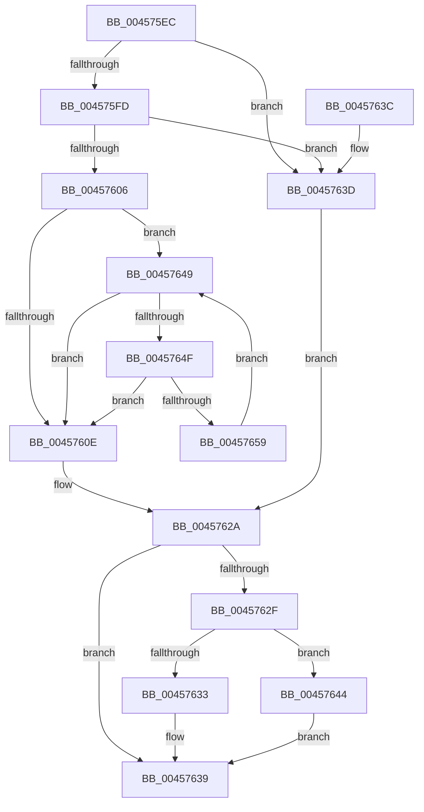

# RtlStringCbLengthW

- RVA: `0x004575EC`–`0x0045765B` (길이 `111` bytes)
- VA: `0x00000001404575EC`
- 실행 섹션: `.text`
- PDB 이름 있음: `예`; PDB Function 태그: `아니요`
- unwind 정보 RVA: `0x000DB714`
- 디코드: `39`개 명령, `111/111` bytes 표시
- 미해석 바이트: `0` (있으면 어셈블리에 `.byte`로 보존)

> 이 문서는 커널 이미지의 기계어와 PDB 기호를 분석해 생성했습니다. 4번과 5번은 함수 원형과 자료형을 바이너리 사용 방식에서 추정한 C 해석이며 원본 소스 복구 결과는 아닙니다.

## 1. Dependencies

- 직접 호출 지점: **0**; 고유 호출 대상: **0**
- 직접 호출자로 확인된 함수: **14**
- RIP 상대 이미지 참조: **0**

### Outgoing calls
- 직접 디코드된 call 명령이 없습니다.

### Direct callers
- [AuthzBasepConvertRelativeToAbsoluteTokenAttribute](../4B/AuthzBasepConvertRelativeToAbsoluteTokenAttribute_function_004B97BC.md) at `0x004B99DE`
- [AuthzBasepConvertRelativeToAbsoluteTokenAttribute](../4B/AuthzBasepConvertRelativeToAbsoluteTokenAttribute_function_004B97BC.md) at `0x004B9C2D`
- [IoReportDetectedDevice](../../page/72/IoReportDetectedDevice_function_00725CD0.md) at `0x007262CA`
- [PopFxValidateReturnedUnicodeString](../../page/75/PopFxValidateReturnedUnicodeString_function_0075A708.md) at `0x0075A7A1`
- [PpmRegisterProfiles](../../page/77/PpmRegisterProfiles_function_007709F0.md) at `0x00770A76`
- [RtlpConvertAbsoluteToRelativeSecurityAttribute](../../page/78/RtlpConvertAbsoluteToRelativeSecurityAttribute_function_0078DD5C.md) at `0x0078DDD6`
- [RtlpConvertAbsoluteToRelativeSecurityAttribute](../../page/78/RtlpConvertAbsoluteToRelativeSecurityAttribute_function_0078DD5C.md) at `0x0078DE82`
- [RtlpConvertAbsoluteToRelativeSecurityAttribute](../../page/78/RtlpConvertAbsoluteToRelativeSecurityAttribute_function_0078DD5C.md) at `0x0078E017`
- [RtlpGetTokenNamedObjectPath](../../page/78/RtlpGetTokenNamedObjectPath_function_0078ED40.md) at `0x0078F1AE`
- [AslpFileVerStringBlockGetValue](../../page/82/AslpFileVerStringBlockGetValue_function_00821370.md) at `0x008213EF`
- [RtlpPopulateLanguageConfigList](../../page/83/RtlpPopulateLanguageConfigList_function_0083EF20.md) at `0x0083F121`
- [PiSwIrpStartCreateWorker](../../page/8D/PiSwIrpStartCreateWorker_function_008DB398.md) at `0x008DB806`
- [NtPowerInformation](../../page/95/NtPowerInformation_function_00955D80.md) at `0x00956B14`
- [NtPowerInformation](../../page/95/NtPowerInformation_function_00955D80.md) at `0x009579DE`
- [LocalGetStringForRelativeAttribute](../../page/A0/LocalGetStringForRelativeAttribute_function_00A02C38.md) at `0x00A02D1D`
- [LocalGetStringForRelativeAttribute](../../page/A0/LocalGetStringForRelativeAttribute_function_00A02C38.md) at `0x00A02F6A`
- [PopPowerInformationInternal](../../page/A8/PopPowerInformationInternal_function_00A8B7C0.md) at `0x00A8C651`
- [PopIdleWakeGenerateDescriptionString](../../page/AB/PopIdleWakeGenerateDescriptionString_function_00ABD584.md) at `0x00ABD6B8`
- [PopIdleWakeGenerateDescriptionString](../../page/AB/PopIdleWakeGenerateDescriptionString_function_00ABD584.md) at `0x00ABD6DC`
- [sub_00B3ECD6](../../page/B3/Unknown_function_00B3ECD6.md) at `0x00B3ED54`

### Static image references
- 디코드된 RIP-relative 메모리 참조가 없습니다.

## 2. Other-region calls and transfers

- 다른 실행 섹션으로 향하는 call: **0**
- 별도 외부 분기/꼬리 이동을 확인하지 못했습니다.

## 3. Assembly (complete function range)

```asm
004575EC  45 33 D2                        xor r10d, r10d
004575EF  48 D1 EA                        shr rdx, 1
004575F2  4D 8B C8                        mov r9, r8
004575F5  41 8B C2                        mov eax, r10d
004575F8  48 85 C9                        test rcx, rcx
004575FB  74 40                           je 0x14045763d
004575FD  48 81 FA FF FF FF 7F            cmp rdx, 0x7fffffff
00457604  77 37                           ja 0x14045763d
00457606  4C 8B C2                        mov r8, rdx
00457609  48 85 D2                        test rdx, rdx
0045760C  75 3B                           jne 0x140457649
0045760E  49 8B C0                        mov rax, r8
00457611  48 F7 D8                        neg rax
00457614  1B C9                           sbb ecx, ecx
00457616  49 2B D0                        sub rdx, r8
00457619  F7 D1                           not ecx
0045761B  81 E1 0D 00 00 C0               and ecx, 0xc000000d
00457621  49 F7 D8                        neg r8
00457624  48 1B C0                        sbb rax, rax
00457627  48 23 C2                        and rax, rdx
0045762A  4D 85 C9                        test r9, r9
0045762D  74 0A                           je 0x140457639
0045762F  85 C9                           test ecx, ecx
00457631  78 11                           js 0x140457644
00457633  48 03 C0                        add rax, rax
00457636  49 89 01                        mov qword ptr [r9], rax
00457639  8B C1                           mov eax, ecx
0045763B  C3                              ret
0045763C  CC                              int3
0045763D  B9 0D 00 00 C0                  mov ecx, 0xc000000d
00457642  EB E6                           jmp 0x14045762a
00457644  4D 89 11                        mov qword ptr [r9], r10
00457647  EB F0                           jmp 0x140457639
00457649  66 44 39 11                     cmp word ptr [rcx], r10w
0045764D  74 BF                           je 0x14045760e
0045764F  48 83 C1 02                     add rcx, 2
00457653  49 83 E8 01                     sub r8, 1
00457657  74 B5                           je 0x14045760e
00457659  EB EE                           jmp 0x140457649
```

## 4. C-style interpretation (structured pseudocode)

```c
__int64 __fastcall RtlStringCbLengthW(__int64 a1, __int64 a2, __int64 a3)
{
    __int64 result;
    __int64 v_r10;

    v_r10 = 0;
    a2 = (a2) >> (1);
    if (a1 == 0) goto loc_0045763D;
    if (a2 > 0x7FFFFFFFULL) goto loc_0045763D;
    if (a2 != 0) goto loc_00457649;
loc_0045760E:
    result = -(a2);
    a2 = (a2) - (a2);
    a1 = (unsigned int)(~(a1));
    a1 = (unsigned int)((a1) & (0xC000000DULL));
    a3 = -(a2);
    result = (result) & (a2);
loc_0045762A:
    if (a3 == 0) goto loc_00457639;
    if (sign_flag) goto loc_00457644;
    result = (result) + (result);
    *(unsigned __int64 *)(a3) = result;
loc_00457639:
    return (unsigned int)((unsigned int)(a1));
loc_0045763D:
    goto loc_0045762A;
loc_00457644:
    *(unsigned __int64 *)(a3) = 0;
    goto loc_00457639;
loc_00457649:
    if ((*(unsigned __int16 *)((unsigned int)(0xC000000DULL))) == 0) goto loc_0045760E;
    a1 = ((unsigned int)(0xC000000DULL)) + (2);
    a3 = (a3) - (1);
    if (condition_is_equal) goto loc_0045760E;
    goto loc_00457649;
}
```

## 5. (Beta) C Style

```c
int64_t RtlStringCbLengthW(int64_t Arg1, int64_t Arg2, int64_t Arg3)
{
    int64_t result;
    int64_t local_r10;

    local_r10 = 0;
    Arg2 = (Arg2) >> (1);
    if (Arg1 == 0) goto loc_0045763D;
    if (Arg2 > 0x7FFFFFFFULL) goto loc_0045763D;
    if (Arg2 != 0) goto loc_00457649;
loc_0045760E:
    result = -(Arg2);
    Arg2 = (Arg2) - (Arg2);
    Arg1 = (uint32_t)(~(Arg1));
    Arg1 = (uint32_t)((Arg1) & (0xC000000DULL));
    Arg3 = -(Arg2);
    result = (result) & (Arg2);
loc_0045762A:
    if (Arg3 == 0) goto loc_00457639;
    if (sign_flag) goto loc_00457644;
    result = (result) + (result);
    *(uint64_t *)(Arg3) = result;
loc_00457639:
    return (uint32_t)((uint32_t)(Arg1));
loc_0045763D:
    goto loc_0045762A;
loc_00457644:
    *(uint64_t *)(Arg3) = 0;
    goto loc_00457639;
loc_00457649:
    if ((*(uint16_t *)((uint32_t)(0xC000000DULL))) == 0) goto loc_0045760E;
    Arg1 = ((uint32_t)(0xC000000DULL)) + (2);
    Arg3 = (Arg3) - (1);
    if (condition_is_equal) goto loc_0045760E;
    goto loc_00457649;
}
```

## 6. Execution-region graph

[열기: 2D/3D 그래프와 함수 탐색 컨트롤 패널](../../../control-panel.html?section=text&rva=0x004575EC&view=graph)

- 2D 그래프는 위에서 아래로 흐르고, 3D 그래프는 빈 공간을 드래그해 회전합니다. Shift+드래그는 이동, 휠은 확대·축소, 함수 노드 선택은 대상 보고서 이동입니다.

### Static fallback


