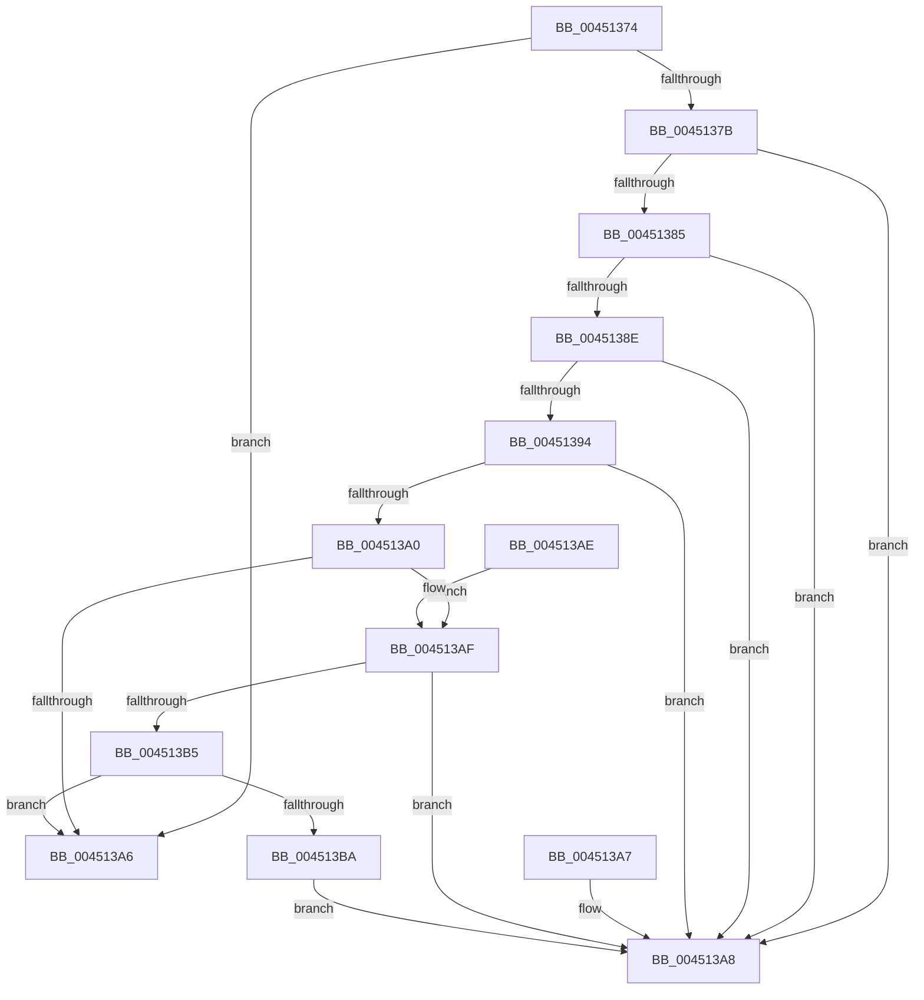

# RtlUnicodeStringValidateEx

- RVA: `0x00451374`–`0x004513BC` (길이 `72` bytes)
- VA: `0x0000000140451374`
- 실행 섹션: `.text`
- PDB 이름 있음: `예`; PDB Function 태그: `아니요`
- unwind 정보 RVA: `0x000DB714`
- 디코드: `26`개 명령, `72/72` bytes 표시
- 미해석 바이트: `0` (있으면 어셈블리에 `.byte`로 보존)

> 이 문서는 커널 이미지의 기계어와 PDB 기호를 분석해 생성했습니다. 4번과 5번은 함수 원형과 자료형을 바이너리 사용 방식에서 추정한 C 해석이며 원본 소스 복구 결과는 아닙니다.

## 1. Dependencies

- 직접 호출 지점: **0**; 고유 호출 대상: **0**
- 직접 호출자로 확인된 함수: **1**
- RIP 상대 이미지 참조: **0**

### Outgoing calls
- 직접 디코드된 call 명령이 없습니다.

### Direct callers
- [NtSetCachedSigningLevel2](../../page/97/NtSetCachedSigningLevel2_function_00973720.md) at `0x00973913`

### Static image references
- 디코드된 RIP-relative 메모리 참조가 없습니다.

## 2. Other-region calls and transfers

- 다른 실행 섹션으로 향하는 call: **0**
- 별도 외부 분기/꼬리 이동을 확인하지 못했습니다.

## 3. Assembly (complete function range)

```asm
00451374  33 C0                           xor eax, eax
00451376  48 85 C9                        test rcx, rcx
00451379  74 2B                           je 0x1404513a6
0045137B  44 0F B7 01                     movzx r8d, word ptr [rcx]
0045137F  41 F6 C0 01                     test r8b, 1
00451383  75 23                           jne 0x1404513a8
00451385  0F B7 51 02                     movzx edx, word ptr [rcx + 2]
00451389  F6 C2 01                        test dl, 1
0045138C  75 1A                           jne 0x1404513a8
0045138E  66 44 3B C2                     cmp r8w, dx
00451392  77 14                           ja 0x1404513a8
00451394  41 B9 FE FF 00 00               mov r9d, 0xfffe
0045139A  66 41 3B D1                     cmp dx, r9w
0045139E  77 08                           ja 0x1404513a8
004513A0  48 39 41 08                     cmp qword ptr [rcx + 8], rax
004513A4  74 09                           je 0x1404513af
004513A6  C3                              ret
004513A7  CC                              int3
004513A8  B8 0D 00 00 C0                  mov eax, 0xc000000d
004513AD  C3                              ret
004513AE  CC                              int3
004513AF  66 45 85 C0                     test r8w, r8w
004513B3  75 F3                           jne 0x1404513a8
004513B5  66 85 D2                        test dx, dx
004513B8  74 EC                           je 0x1404513a6
004513BA  EB EC                           jmp 0x1404513a8
```

## 4. C-style interpretation (structured pseudocode)

```c
__int64 __fastcall RtlUnicodeStringValidateEx(__int64 a1)
{
    __int64 result;

    result = 0;
    if (a1 == 0) goto loc_004513A6;
    if ((((unsigned __int8)(*(unsigned __int16 *)(a1))) & (1)) != 0) goto loc_004513A8;
    if ((((unsigned __int8)(*(unsigned __int16 *)(a1 + 2))) & (1)) != 0) goto loc_004513A8;
    if (((unsigned __int16)(*(unsigned __int16 *)(a1))) > ((unsigned __int16)(*(unsigned __int16 *)(a1 + 2)))) goto loc_004513A8;
    if (((unsigned __int16)(*(unsigned __int16 *)(a1 + 2))) > ((unsigned __int16)((unsigned int)(0xFFFEULL)))) goto loc_004513A8;
    if ((*(unsigned __int64 *)(a1 + 8)) == 0) goto loc_004513AF;
loc_004513A6:
    return result;
loc_004513A8:
    return (unsigned int)(0xC000000DULL);
loc_004513AF:
    if ((unsigned __int16)(*(unsigned __int16 *)(a1)) != 0) goto loc_004513A8;
    if ((unsigned __int16)(*(unsigned __int16 *)(a1 + 2)) == 0) goto loc_004513A6;
    goto loc_004513A8;
}
```

## 5. (Beta) C Style

```c
int64_t RtlUnicodeStringValidateEx(int64_t Arg1)
{
    int64_t result;

    result = 0;
    if (Arg1 == 0) goto loc_004513A6;
    if ((((uint8_t)(*(uint16_t *)(Arg1))) & (1)) != 0) goto loc_004513A8;
    if ((((uint8_t)(*(uint16_t *)(Arg1 + 0x2))) & (1)) != 0) goto loc_004513A8;
    if (((uint16_t)(*(uint16_t *)(Arg1))) > ((uint16_t)(*(uint16_t *)(Arg1 + 0x2)))) goto loc_004513A8;
    if (((uint16_t)(*(uint16_t *)(Arg1 + 0x2))) > ((uint16_t)((uint32_t)(0xFFFEULL)))) goto loc_004513A8;
    if ((*(uint64_t *)(Arg1 + 0x8)) == 0) goto loc_004513AF;
loc_004513A6:
    return result;
loc_004513A8:
    return (uint32_t)(0xC000000DULL);
loc_004513AF:
    if ((uint16_t)(*(uint16_t *)(Arg1)) != 0) goto loc_004513A8;
    if ((uint16_t)(*(uint16_t *)(Arg1 + 0x2)) == 0) goto loc_004513A6;
    goto loc_004513A8;
}
```

## 6. Execution-region graph

[열기: 2D/3D 그래프와 함수 탐색 컨트롤 패널](../../../control-panel.html?section=text&rva=0x00451374&view=graph)

- 2D 그래프는 위에서 아래로 흐르고, 3D 그래프는 빈 공간을 드래그해 회전합니다. Shift+드래그는 이동, 휠은 확대·축소, 함수 노드 선택은 대상 보고서 이동입니다.

### Static fallback


