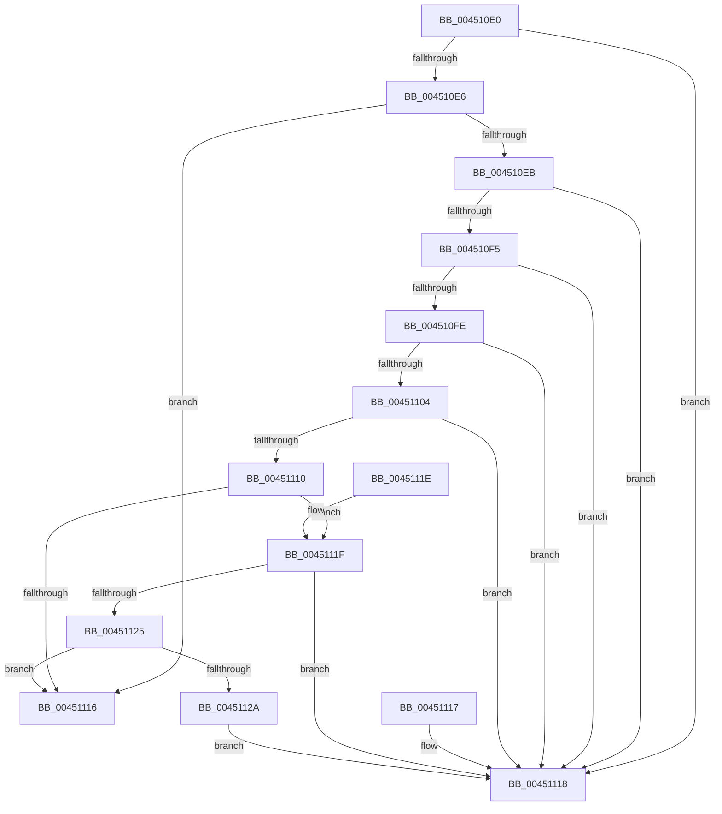

# RtlValidateUnicodeString

- RVA: `0x004510E0`–`0x0045112C` (길이 `76` bytes)
- VA: `0x00000001404510E0`
- 실행 섹션: `.text`
- PDB 이름 있음: `예`; PDB Function 태그: `아니요`
- unwind 정보 RVA: `0x000DB714`
- 디코드: `28`개 명령, `76/76` bytes 표시
- 미해석 바이트: `0` (있으면 어셈블리에 `.byte`로 보존)

> 이 문서는 커널 이미지의 기계어와 PDB 기호를 분석해 생성했습니다. 4번과 5번은 함수 원형과 자료형을 바이너리 사용 방식에서 추정한 C 해석이며 원본 소스 복구 결과는 아닙니다.

## 1. Dependencies

- 직접 호출 지점: **0**; 고유 호출 대상: **0**
- 직접 호출자로 확인된 함수: **1**
- RIP 상대 이미지 참조: **0**

### Outgoing calls
- 직접 디코드된 call 명령이 없습니다.

### Direct callers
- [RtlDuplicateUnicodeString](../../page/93/RtlDuplicateUnicodeString_function_009321F0.md) at `0x0093224A`

### Static image references
- 디코드된 RIP-relative 메모리 참조가 없습니다.

## 2. Other-region calls and transfers

- 다른 실행 섹션으로 향하는 call: **0**
- 별도 외부 분기/꼬리 이동을 확인하지 못했습니다.

## 3. Assembly (complete function range)

```asm
004510E0  33 C0                           xor eax, eax
004510E2  85 C9                           test ecx, ecx
004510E4  75 32                           jne 0x140451118
004510E6  48 85 D2                        test rdx, rdx
004510E9  74 2B                           je 0x140451116
004510EB  44 0F B7 02                     movzx r8d, word ptr [rdx]
004510EF  41 F6 C0 01                     test r8b, 1
004510F3  75 23                           jne 0x140451118
004510F5  0F B7 4A 02                     movzx ecx, word ptr [rdx + 2]
004510F9  F6 C1 01                        test cl, 1
004510FC  75 1A                           jne 0x140451118
004510FE  66 44 3B C1                     cmp r8w, cx
00451102  77 14                           ja 0x140451118
00451104  41 B9 FE FF 00 00               mov r9d, 0xfffe
0045110A  66 41 3B C9                     cmp cx, r9w
0045110E  77 08                           ja 0x140451118
00451110  48 39 42 08                     cmp qword ptr [rdx + 8], rax
00451114  74 09                           je 0x14045111f
00451116  C3                              ret
00451117  CC                              int3
00451118  B8 0D 00 00 C0                  mov eax, 0xc000000d
0045111D  C3                              ret
0045111E  CC                              int3
0045111F  66 45 85 C0                     test r8w, r8w
00451123  75 F3                           jne 0x140451118
00451125  66 85 C9                        test cx, cx
00451128  74 EC                           je 0x140451116
0045112A  EB EC                           jmp 0x140451118
```

## 4. C-style interpretation (structured pseudocode)

```c
__int64 __fastcall RtlValidateUnicodeString(int a1, __int64 a2)
{
    __int64 result;

    result = 0;
    if (a1 != 0) goto loc_00451118;
    if (a2 == 0) goto loc_00451116;
    if ((((unsigned __int8)(*(unsigned __int16 *)(a2))) & (1)) != 0) goto loc_00451118;
    if ((((unsigned __int8)(*(unsigned __int16 *)(a2 + 2))) & (1)) != 0) goto loc_00451118;
    if (((unsigned __int16)(*(unsigned __int16 *)(a2))) > ((unsigned __int16)(*(unsigned __int16 *)(a2 + 2)))) goto loc_00451118;
    if (((unsigned __int16)(*(unsigned __int16 *)(a2 + 2))) > ((unsigned __int16)((unsigned int)(0xFFFEULL)))) goto loc_00451118;
    if ((*(unsigned __int64 *)(a2 + 8)) == 0) goto loc_0045111F;
loc_00451116:
    return result;
loc_00451118:
    return (unsigned int)(0xC000000DULL);
loc_0045111F:
    if ((unsigned __int16)(*(unsigned __int16 *)(a2)) != 0) goto loc_00451118;
    if ((unsigned __int16)(*(unsigned __int16 *)(a2 + 2)) == 0) goto loc_00451116;
    goto loc_00451118;
}
```

## 5. (Beta) C Style

```c
int64_t RtlValidateUnicodeString(int32_t Arg1, int64_t Arg2)
{
    int64_t result;

    result = 0;
    if (Arg1 != 0) goto loc_00451118;
    if (Arg2 == 0) goto loc_00451116;
    if ((((uint8_t)(*(uint16_t *)(Arg2))) & (1)) != 0) goto loc_00451118;
    if ((((uint8_t)(*(uint16_t *)(Arg2 + 0x2))) & (1)) != 0) goto loc_00451118;
    if (((uint16_t)(*(uint16_t *)(Arg2))) > ((uint16_t)(*(uint16_t *)(Arg2 + 0x2)))) goto loc_00451118;
    if (((uint16_t)(*(uint16_t *)(Arg2 + 0x2))) > ((uint16_t)((uint32_t)(0xFFFEULL)))) goto loc_00451118;
    if ((*(uint64_t *)(Arg2 + 0x8)) == 0) goto loc_0045111F;
loc_00451116:
    return result;
loc_00451118:
    return (uint32_t)(0xC000000DULL);
loc_0045111F:
    if ((uint16_t)(*(uint16_t *)(Arg2)) != 0) goto loc_00451118;
    if ((uint16_t)(*(uint16_t *)(Arg2 + 0x2)) == 0) goto loc_00451116;
    goto loc_00451118;
}
```

## 6. Execution-region graph

[열기: 2D/3D 그래프와 함수 탐색 컨트롤 패널](../../../control-panel.html?section=text&rva=0x004510E0&view=graph)

- 2D 그래프는 위에서 아래로 흐르고, 3D 그래프는 빈 공간을 드래그해 회전합니다. Shift+드래그는 이동, 휠은 확대·축소, 함수 노드 선택은 대상 보고서 이동입니다.

### Static fallback


