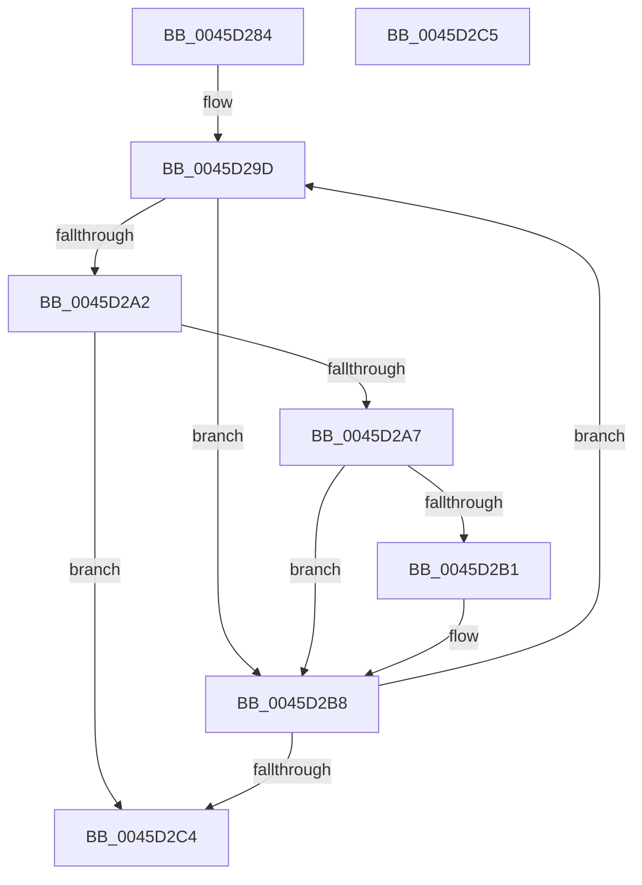

# RtlpApplyGenericRetpolineFixup

- RVA: `0x0045D284`–`0x0045D2C6` (길이 `66` bytes)
- VA: `0x000000014045D284`
- 실행 섹션: `.text`
- PDB 이름 있음: `예`; PDB Function 태그: `아니요`
- unwind 정보 RVA: `0x000DB714`
- 디코드: `23`개 명령, `66/66` bytes 표시
- 미해석 바이트: `0` (있으면 어셈블리에 `.byte`로 보존)

> 이 문서는 커널 이미지의 기계어와 PDB 기호를 분석해 생성했습니다. 4번과 5번은 함수 원형과 자료형을 바이너리 사용 방식에서 추정한 C 해석이며 원본 소스 복구 결과는 아닙니다.

## 1. Dependencies

- 직접 호출 지점: **0**; 고유 호출 대상: **0**
- 직접 호출자로 확인된 함수: **3**
- RIP 상대 이미지 참조: **0**

### Outgoing calls
- 직접 디코드된 call 명령이 없습니다.

### Direct callers
- [RtlApplyImportRelocationToImage](../6A/RtlApplyImportRelocationToImage_function_006A98F8.md) at `0x006A997A`
- [RtlApplyIndirectRelocationToImage](../6A/RtlApplyIndirectRelocationToImage_function_006A999C.md) at `0x006A9A14`
- [RtlApplySwitchJumpRelocationToImage](../6A/RtlApplySwitchJumpRelocationToImage_function_006A9A38.md) at `0x006A9AB0`

### Static image references
- 디코드된 RIP-relative 메모리 참조가 없습니다.

## 2. Other-region calls and transfers

- 다른 실행 섹션으로 향하는 call: **0**
- 별도 외부 분기/꼬리 이동을 확인하지 못했습니다.

## 3. Assembly (complete function range)

```asm
0045D284  49 63 C1                        movsxd rax, r9d
0045D287  45 33 D2                        xor r10d, r10d
0045D28A  44 8B DA                        mov r11d, edx
0045D28D  4D 8B C8                        mov r9, r8
0045D290  4C 2B C8                        sub r9, rax
0045D293  4C 03 D9                        add r11, rcx
0045D296  4C 2B C9                        sub r9, rcx
0045D299  48 8D 14 08                     lea rdx, [rax + rcx]
0045D29D  48 3B D1                        cmp rdx, rcx
0045D2A0  72 16                           jb 0x14045d2b8
0045D2A2  49 3B D3                        cmp rdx, r11
0045D2A5  73 1D                           jae 0x14045d2c4
0045D2A7  41 0F B7 00                     movzx eax, word ptr [r8]
0045D2AB  44 0F A3 D0                     bt eax, r10d
0045D2AF  73 07                           jae 0x14045d2b8
0045D2B1  41 8A 44 11 02                  mov al, byte ptr [r9 + rdx + 2]
0045D2B6  88 02                           mov byte ptr [rdx], al
0045D2B8  41 FF C2                        inc r10d
0045D2BB  48 FF C2                        inc rdx
0045D2BE  41 83 FA 0C                     cmp r10d, 0xc
0045D2C2  72 D9                           jb 0x14045d29d
0045D2C4  C3                              ret
0045D2C5  CC                              int3
```

## 4. C-style interpretation (structured pseudocode)

```c
__int64 __fastcall RtlpApplyGenericRetpolineFixup(__int64 a1, int a2, __int64 a3, int a4)
{
    __int64 result;
    __int64 v_r10;
    __int64 v_r11;

    v_r10 = 0;
    a4 = (a3) - ((int)(a4));
    v_r11 = ((unsigned int)(a2)) + (a1);
    a4 = (a4) - (a1);
loc_0045D29D:
    if (((int)(a4) + a1 * 1) < a1) goto loc_0045D2B8;
    if (((int)(a4) + a1 * 1) >= v_r11) goto loc_0045D2C4;
    result = *(unsigned __int16 *)(a3);
    if (((int)(a4) + a1 * 1) < v_r11) {
        result = *(unsigned __int8 *)(a4 + (int)(a4) + a1 * 1 * 1 + 2);
        *(unsigned __int8 *)((int)(a4) + a1 * 1) = (unsigned __int8)(result);
    }
    v_r10 = (unsigned int)((v_r10) + 1);
    a2 = ((int)(a4) + a1 * 1) + 1;
    if (((unsigned int)(v_r10)) < 12) goto loc_0045D29D;
loc_0045D2C4:
    return result;
}
```

## 5. (Beta) C Style

```c
int64_t RtlpApplyGenericRetpolineFixup(int64_t Arg1, int32_t Arg2, void *Arg3, void *Arg4)
{
    uint8_t *arg3 = (uint8_t *)Arg3;
    uint8_t *arg4 = (uint8_t *)Arg4;

    int64_t result;
    int64_t local_r10;
    int64_t local_r11;

    local_r10 = 0;
    Arg4 = (Arg3) - ((int32_t)(Arg4));
    local_r11 = ((uint32_t)(Arg2)) + (Arg1);
    Arg4 = (Arg4) - (Arg1);
loc_0045D29D:
    if (((int32_t)(Arg4) + Arg1 * 1) < Arg1) goto loc_0045D2B8;
    if (((int32_t)(Arg4) + Arg1 * 1) >= local_r11) goto loc_0045D2C4;
    result = *(uint16_t *)(arg3);
    if (((int32_t)(Arg4) + Arg1 * 1) < local_r11) {
        result = *(uint8_t *)(arg4 + (int32_t)(arg4) + Arg1 * 1 * 1 + 0x2);
        *(uint8_t *)((int32_t)(arg4) + Arg1 * 1) = (uint8_t)(result);
    }
    local_r10 = (uint32_t)((local_r10) + 1);
    Arg2 = ((int32_t)(Arg4) + Arg1 * 1) + 1;
    if (((uint32_t)(local_r10)) < 12) goto loc_0045D29D;
loc_0045D2C4:
    return result;
}
```

### 관측된 메모리 오프셋

구조체 형식이 확인되지 않은 접근은 인자 기준의 오프셋으로만 기록했습니다.

| 기준 인자 | 오프셋 표현 | 폭 (bit) | 접근 |
|---|---:|---:|---|
| `Arg3` | `+ 0x0` | `16` | `R` |
| `Arg3` | `+ 0x2 + rdx*1` | `8` | `R` |
| `Arg4` | `+ 0x0 + rcx*1` | `64` | `R` |

## 6. Execution-region graph

[열기: 2D/3D 그래프와 함수 탐색 컨트롤 패널](../../../control-panel.html?section=text&rva=0x0045D284&view=graph)

- 2D 그래프는 위에서 아래로 흐르고, 3D 그래프는 빈 공간을 드래그해 회전합니다. Shift+드래그는 이동, 휠은 확대·축소, 함수 노드 선택은 대상 보고서 이동입니다.

### Static fallback


