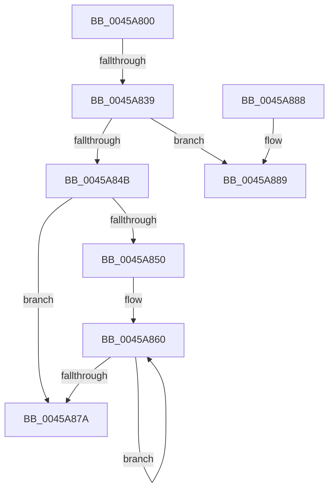

# RtlpComputeCrcInternal

- RVA: `0x0045A800`–`0x0045A88D` (길이 `141` bytes)
- VA: `0x000000014045A800`
- 실행 섹션: `.text`
- PDB 이름 있음: `예`; PDB Function 태그: `예`
- unwind 정보 RVA: `0x000A8FF4`
- 디코드: `48`개 명령, `141/141` bytes 표시
- 미해석 바이트: `0` (있으면 어셈블리에 `.byte`로 보존)

> 이 문서는 커널 이미지의 기계어와 PDB 기호를 분석해 생성했습니다. 4번과 5번은 함수 원형과 자료형을 바이너리 사용 방식에서 추정한 C 해석이며 원본 소스 복구 결과는 아닙니다.

## 1. Dependencies

- 직접 호출 지점: **0**; 고유 호출 대상: **0**
- 직접 호출자로 확인된 함수: **7**
- RIP 상대 이미지 참조: **0**

### Outgoing calls
- 직접 디코드된 call 명령이 없습니다.

### Direct callers
- [IopLiveDumpWriteDumpFile](../3F/IopLiveDumpWriteDumpFile_function_003F6360.md) at `0x003F657C`
- [IopLiveDumpWriteDumpFile](../3F/IopLiveDumpWriteDumpFile_function_003F6360.md) at `0x003F65B8`
- [RtlCrc32](RtlCrc32_function_0045A770.md) at `0x0045A7BA`
- [IopLiveDumpBufferDumpData](../59/IopLiveDumpBufferDumpData_function_0059A938.md) at `0x0059AB18`
- [PopEnsureErratumSubscribed](../5D/PopEnsureErratumSubscribed_function_005D46A0.md) at `0x005D46EA`
- [PopEnsureErratumSubscribed](../5D/PopEnsureErratumSubscribed_function_005D46A0.md) at `0x005D46FE`
- [PopEnsureErratumSubscribed](../5D/PopEnsureErratumSubscribed_function_005D46A0.md) at `0x005D4716`
- [RtlCrc64](../5E/RtlCrc64_function_005E8B00.md) at `0x005E8B0B`
- [MdlInvariantPostProcessing1](../61/MdlInvariantPostProcessing1_function_00613AE0.md) at `0x00613C22`
- [MdlInvariantPostProcessing1](../61/MdlInvariantPostProcessing1_function_00613AE0.md) at `0x00613C6A`
- [MdlInvariantPostProcessing1](../61/MdlInvariantPostProcessing1_function_00613AE0.md) at `0x00613C96`
- [MdlInvariantPreProcessing1](../61/MdlInvariantPreProcessing1_function_00613CEC.md) at `0x00613DFB`
- [MdlInvariantPreProcessing1](../61/MdlInvariantPreProcessing1_function_00613CEC.md) at `0x00613EFB`

### Static image references
- 디코드된 RIP-relative 메모리 참조가 없습니다.

## 2. Other-region calls and transfers

- 다른 실행 섹션으로 향하는 call: **0**
- call이 아닌 외부 분기/꼬리 이동: **1**
  - `0x0045A833` → [sub_0045AC71](Unknown_function_0045AC71.md) (`tail-transfer`)

## 3. Assembly (complete function range)

```asm
0045A800  4C 89 4C 24 20                  mov qword ptr [rsp + 0x20], r9
0045A805  53                              push rbx
0045A806  55                              push rbp
0045A807  56                              push rsi
0045A808  57                              push rdi
0045A809  41 57                           push r15
0045A80B  48 83 EC 10                     sub rsp, 0x10
0045A80F  49 8B 69 20                     mov rbp, qword ptr [r9 + 0x20]
0045A813  33 DB                           xor ebx, ebx
0045A815  48 8B C5                        mov rax, rbp
0045A818  48 89 6C 24 48                  mov qword ptr [rsp + 0x48], rbp
0045A81D  49 33 C0                        xor rax, r8
0045A820  4D 8B F9                        mov r15, r9
0045A823  4C 8B C1                        mov r8, rcx
0045A826  48 8B FA                        mov rdi, rdx
0045A829  49 F7 D8                        neg r8
0045A82C  48 8B F1                        mov rsi, rcx
0045A82F  41 83 E0 07                     and r8d, 7
0045A833  0F 85 38 04 00 00               jne 0x14045ac71
0045A839  48 8B CF                        mov rcx, rdi
0045A83C  48 8B D7                        mov rdx, rdi
0045A83F  83 E1 1F                        and ecx, 0x1f
0045A842  48 2B D1                        sub rdx, rcx
0045A845  48 83 FA 40                     cmp rdx, 0x40
0045A849  73 3E                           jae 0x14045a889
0045A84B  48 85 FF                        test rdi, rdi
0045A84E  74 2A                           je 0x14045a87a
0045A850  4D 8B 47 08                     mov r8, qword ptr [r15 + 8]
0045A854  0F 1F 40 00                     nop dword ptr [rax]
0045A858  0F 1F 84 00 00 00 00 00         nop dword ptr [rax + rax]
0045A860  0F B6 0C 33                     movzx ecx, byte ptr [rbx + rsi]
0045A864  48 FF C3                        inc rbx
0045A867  48 33 C8                        xor rcx, rax
0045A86A  48 C1 E8 08                     shr rax, 8
0045A86E  0F B6 D1                        movzx edx, cl
0045A871  49 33 04 D0                     xor rax, qword ptr [r8 + rdx*8]
0045A875  48 3B DF                        cmp rbx, rdi
0045A878  72 E6                           jb 0x14045a860
0045A87A  48 33 C5                        xor rax, rbp
0045A87D  48 83 C4 10                     add rsp, 0x10
0045A881  41 5F                           pop r15
0045A883  5F                              pop rdi
0045A884  5E                              pop rsi
0045A885  5D                              pop rbp
0045A886  5B                              pop rbx
0045A887  C3                              ret
0045A888  CC                              int3
0045A889  48 83 C2 E0                     add rdx, -0x20
```

## 4. C-style interpretation (structured pseudocode)

```c
__int64 __fastcall RtlpComputeCrcInternal(__int64 a1, __int64 a2, __int64 a3, __int64 a4)
{
    __int64 result;
    __int64 v_rbx;
    __int64 v_rsp;
    unsigned __int64 v_stack_p10;
    unsigned __int64 v_stack_p20;

    v_stack_p20 = a4;
    v_rsp = (v_rsp) - (16);
    v_rbx = 0;
    v_stack_p10 = *(unsigned __int64 *)(a4 + 32);
    result = (*(unsigned __int64 *)(a4 + 32)) ^ (a3);
    a3 = -(a1);
    a3 = (unsigned int)((a3) & (7));
    a1 = (unsigned int)((a2) & (31));
    a2 = (a2) - (a1);
    if (a2 >= 64) goto loc_0045A889;
    if (a2 == 0) goto loc_0045A87A;
loc_0045A860:
    v_rbx = (v_rbx) + 1;
    a1 = (*(unsigned __int8 *)(v_rbx + a1 * 1)) ^ (result);
    result = (result) >> (8);
    result = (result) ^ (*(unsigned __int64 *)(*(unsigned __int64 *)(a4 + 8) + (unsigned __int8)(a1) * 8));
    if (v_rbx < a2) goto loc_0045A860;
loc_0045A87A:
    result = (result) ^ (*(unsigned __int64 *)(a4 + 32));
    v_rsp = (v_rsp) + (16);
    return result;
loc_0045A889:
    a2 = ((unsigned __int8)(a1)) + (-32);
    return result;
}
```

## 5. (Beta) C Style

```c
int64_t RtlpComputeCrcInternal(int64_t Arg1, int64_t Arg2, int64_t Arg3, void *Arg4)
{
    uint8_t *arg4 = (uint8_t *)Arg4;

    int64_t result;
    int64_t local_rbx;
    int64_t local_rsp;
    uint64_t v_stack_p10;
    uint64_t v_stack_p20;

    v_stack_p20 = Arg4;
    local_rsp = (local_rsp) - (16);
    local_rbx = 0;
    v_stack_p10 = *(uint64_t *)(arg4 + 0x20);
    result = (*(uint64_t *)(arg4 + 0x20)) ^ (Arg3);
    Arg3 = -(Arg1);
    Arg3 = (uint32_t)((Arg3) & (7));
    Arg1 = (uint32_t)((Arg2) & (31));
    Arg2 = (Arg2) - (Arg1);
    if (Arg2 >= 64) goto loc_0045A889;
    if (Arg2 == 0) goto loc_0045A87A;
loc_0045A860:
    local_rbx = (local_rbx) + 1;
    Arg1 = (*(uint8_t *)(local_rbx + Arg1 * 1)) ^ (result);
    result = (result) >> (8);
    result = (result) ^ (*(uint64_t *)(*(uint64_t *)(arg4 + 0x8) + (uint8_t)(Arg1) * 8));
    if (local_rbx < Arg2) goto loc_0045A860;
loc_0045A87A:
    result = (result) ^ (*(uint64_t *)(arg4 + 0x20));
    local_rsp = (local_rsp) + (16);
    return result;
loc_0045A889:
    Arg2 = ((uint8_t)(Arg1)) + (-32);
    return result;
}
```

### 관측된 메모리 오프셋

구조체 형식이 확인되지 않은 접근은 인자 기준의 오프셋으로만 기록했습니다.

| 기준 인자 | 오프셋 표현 | 폭 (bit) | 접근 |
|---|---:|---:|---|
| `Arg4` | `+ 0x8` | `64` | `R` |
| `Arg4` | `+ 0x20` | `64` | `R` |

## 6. Execution-region graph

[열기: 2D/3D 그래프와 함수 탐색 컨트롤 패널](../../../control-panel.html?section=text&rva=0x0045A800&view=graph)

- 2D 그래프는 위에서 아래로 흐르고, 3D 그래프는 빈 공간을 드래그해 회전합니다. Shift+드래그는 이동, 휠은 확대·축소, 함수 노드 선택은 대상 보고서 이동입니다.

### Static fallback


