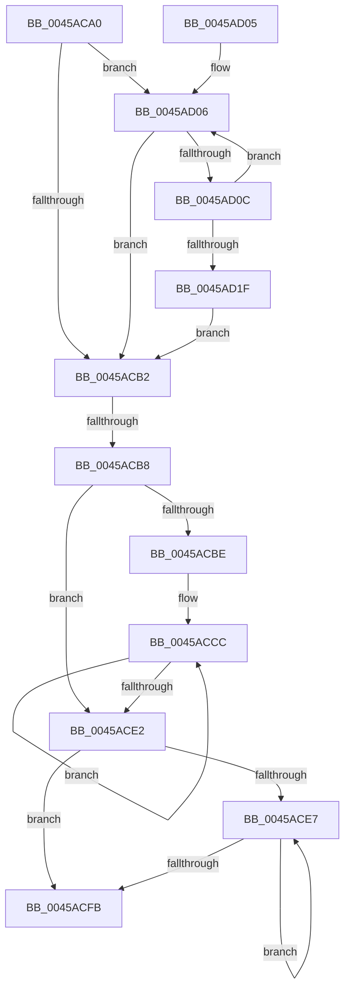

# RtlpCrc32c

- RVA: `0x0045ACA0`–`0x0045AD21` (길이 `129` bytes)
- VA: `0x000000014045ACA0`
- 실행 섹션: `.text`
- PDB 이름 있음: `예`; PDB Function 태그: `예`
- unwind 정보 RVA: `0x000A9064`
- 디코드: `42`개 명령, `129/129` bytes 표시
- 미해석 바이트: `0` (있으면 어셈블리에 `.byte`로 보존)

> 이 문서는 커널 이미지의 기계어와 PDB 기호를 분석해 생성했습니다. 4번과 5번은 함수 원형과 자료형을 바이너리 사용 방식에서 추정한 C 해석이며 원본 소스 복구 결과는 아닙니다.

## 1. Dependencies

- 직접 호출 지점: **0**; 고유 호출 대상: **0**
- 직접 호출자로 확인된 함수: **1**
- RIP 상대 이미지 참조: **0**

### Outgoing calls
- 직접 디코드된 call 명령이 없습니다.

### Direct callers
- [RtlCrc32](RtlCrc32_function_0045A770.md) at `0x0045A79A`

### Static image references
- 디코드된 RIP-relative 메모리 참조가 없습니다.

## 2. Other-region calls and transfers

- 다른 실행 섹션으로 향하는 call: **0**
- call이 아닌 외부 분기/꼬리 이동: **1**
  - `0x0045ACB6` → [sub_0045AD21](Unknown_function_0045AD21.md) (`tail-transfer`)

## 3. Assembly (complete function range)

```asm
0045ACA0  40 55                           push rbp
0045ACA2  41 56                           push r14
0045ACA4  48 8B EA                        mov rbp, rdx
0045ACA7  4C 8B F1                        mov r14, rcx
0045ACAA  41 F7 D0                        not r8d
0045ACAD  48 85 D2                        test rdx, rdx
0045ACB0  75 54                           jne 0x14045ad06
0045ACB2  48 83 FD 40                     cmp rbp, 0x40
0045ACB6  73 69                           jae 0x14045ad21
0045ACB8  48 83 FD 08                     cmp rbp, 8
0045ACBC  72 24                           jb 0x14045ace2
0045ACBE  48 8B CD                        mov rcx, rbp
0045ACC1  48 C1 E9 03                     shr rcx, 3
0045ACC5  48 6B C1 F8                     imul rax, rcx, -8
0045ACC9  48 03 E8                        add rbp, rax
0045ACCC  49 8B 06                        mov rax, qword ptr [r14]
0045ACCF  49 83 C6 08                     add r14, 8
0045ACD3  45 8B C0                        mov r8d, r8d
0045ACD6  F2 4C 0F 38 F1 C0               crc32 r8, rax
0045ACDC  48 83 E9 01                     sub rcx, 1
0045ACE0  75 EA                           jne 0x14045accc
0045ACE2  48 85 ED                        test rbp, rbp
0045ACE5  74 14                           je 0x14045acfb
0045ACE7  41 0F B6 06                     movzx eax, byte ptr [r14]
0045ACEB  4D 8D 76 01                     lea r14, [r14 + 1]
0045ACEF  F2 44 0F 38 F0 C0               crc32 r8d, al
0045ACF5  48 83 ED 01                     sub rbp, 1
0045ACF9  75 EC                           jne 0x14045ace7
0045ACFB  41 F7 D0                        not r8d
0045ACFE  41 8B C0                        mov eax, r8d
0045AD01  41 5E                           pop r14
0045AD03  5D                              pop rbp
0045AD04  C3                              ret
0045AD05  CC                              int3
0045AD06  41 F6 C6 07                     test r14b, 7
0045AD0A  74 A6                           je 0x14045acb2
0045AD0C  41 0F B6 06                     movzx eax, byte ptr [r14]
0045AD10  49 FF C6                        inc r14
0045AD13  F2 44 0F 38 F0 C0               crc32 r8d, al
0045AD19  48 83 ED 01                     sub rbp, 1
0045AD1D  75 E7                           jne 0x14045ad06
0045AD1F  EB 91                           jmp 0x14045acb2
```

## 4. C-style interpretation (structured pseudocode)

```c
__int64 __fastcall RtlpCrc32c(__int64 a1, __int64 a2, int a3)
{
    __int64 result;
    __int64 v_r14;
    __int64 v_rbp;

    a3 = (unsigned int)(~(a3));
    if (a2 != 0) goto loc_0045AD06;
loc_0045ACB2:
    if (a2 < 8) goto loc_0045ACE2;
    a1 = (a2) >> (3);
    result = (result) * (a1);
    v_rbp = (a2) + (result);
loc_0045ACCC:
    v_r14 = (a1) + (8);
    a1 = (a1) - (1);
    if (condition_is_not_equal) goto loc_0045ACCC;
loc_0045ACE2:
    if (v_rbp == 0) goto loc_0045ACFB;
loc_0045ACE7:
    v_rbp = (v_rbp) - (1);
    if (condition_is_not_equal) goto loc_0045ACE7;
loc_0045ACFB:
    a3 = (unsigned int)(~((unsigned int)(a3)));
    return (unsigned int)(a3);
loc_0045AD06:
    if ((((unsigned __int8)(v_r14 + 1)) & (7)) == 0) goto loc_0045ACB2;
    v_r14 = (v_r14 + 1) + 1;
    v_rbp = (v_rbp) - (1);
    if (condition_is_not_equal) goto loc_0045AD06;
    goto loc_0045ACB2;
}
```

## 5. (Beta) C Style

```c
int64_t RtlpCrc32c(int64_t Arg1, int64_t Arg2, int32_t Arg3)
{
    int64_t result;
    int64_t local_r14;
    int64_t local_rbp;

    Arg3 = (uint32_t)(~(Arg3));
    if (Arg2 != 0) goto loc_0045AD06;
loc_0045ACB2:
    if (Arg2 < 8) goto loc_0045ACE2;
    Arg1 = (Arg2) >> (3);
    result = (result) * (Arg1);
    local_rbp = (Arg2) + (result);
loc_0045ACCC:
    local_r14 = (Arg1) + (8);
    Arg1 = (Arg1) - (1);
    if (condition_is_not_equal) goto loc_0045ACCC;
loc_0045ACE2:
    if (local_rbp == 0) goto loc_0045ACFB;
loc_0045ACE7:
    local_rbp = (local_rbp) - (1);
    if (condition_is_not_equal) goto loc_0045ACE7;
loc_0045ACFB:
    Arg3 = (uint32_t)(~((uint32_t)(Arg3)));
    return (uint32_t)(Arg3);
loc_0045AD06:
    if ((((uint8_t)(local_r14 + 1)) & (7)) == 0) goto loc_0045ACB2;
    local_r14 = (local_r14 + 1) + 1;
    local_rbp = (local_rbp) - (1);
    if (condition_is_not_equal) goto loc_0045AD06;
    goto loc_0045ACB2;
}
```

## 6. Execution-region graph

[열기: 2D/3D 그래프와 함수 탐색 컨트롤 패널](../../../control-panel.html?section=text&rva=0x0045ACA0&view=graph)

- 2D 그래프는 위에서 아래로 흐르고, 3D 그래프는 빈 공간을 드래그해 회전합니다. Shift+드래그는 이동, 휠은 확대·축소, 함수 노드 선택은 대상 보고서 이동입니다.

### Static fallback


