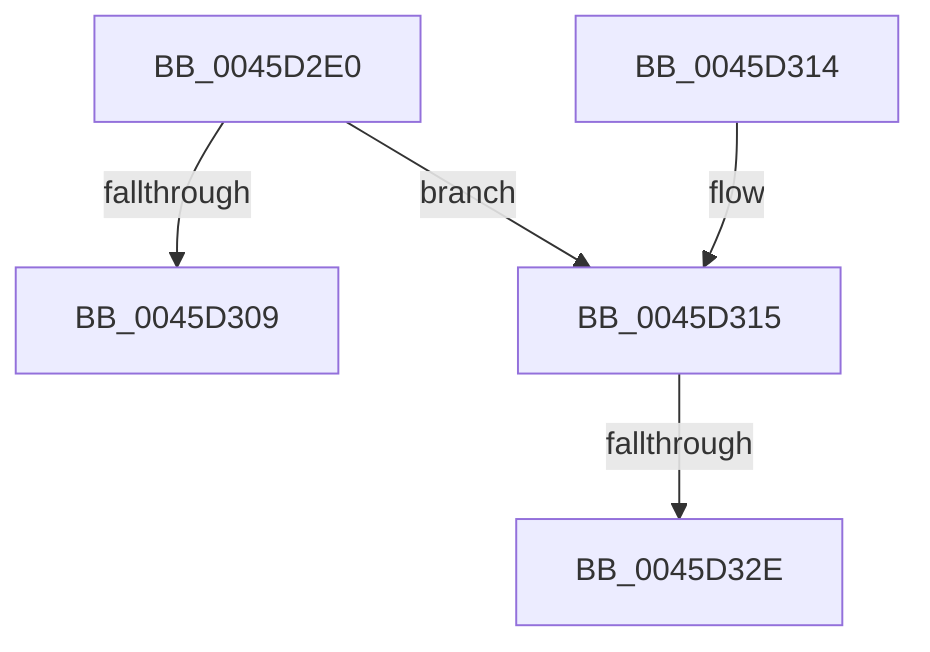

# RtlpGetStackLimitsEx

- RVA: `0x0045D2E0`–`0x0045D33E` (길이 `94` bytes)
- VA: `0x000000014045D2E0`
- 실행 섹션: `.text`
- PDB 이름 있음: `예`; PDB Function 태그: `예`
- unwind 정보 RVA: `0x000A95D8`
- 디코드: `27`개 명령, `94/94` bytes 표시
- 미해석 바이트: `0` (있으면 어셈블리에 `.byte`로 보존)

> 이 문서는 커널 이미지의 기계어와 PDB 기호를 분석해 생성했습니다. 4번과 5번은 함수 원형과 자료형을 바이너리 사용 방식에서 추정한 C 해석이며 원본 소스 복구 결과는 아닙니다.

## 1. Dependencies

- 직접 호출 지점: **2**; 고유 호출 대상: **2**
- 직접 호출자로 확인된 함수: **3**
- RIP 상대 이미지 참조: **0**

### Outgoing calls
- `0x0045D300` → [KeQueryCurrentStackInformationEx](../2F/KeQueryCurrentStackInformationEx_function_002F7CD0.md) (function, `0x002F7CD0`)
- `0x0045D338` → [KeBugCheckEx](../4F/KeBugCheckEx_function_004FD660.md) (function, `0x004FD660`)

### Direct callers
- [RtlDispatchException](../2F/RtlDispatchException_function_002F22A0.md) at `0x002F2387`
- [RtlDispatchException](../2F/RtlDispatchException_function_002F22A0.md) at `0x002F2555`
- [RtlDispatchException](../2F/RtlDispatchException_function_002F22A0.md) at `0x002F26F1`
- [RtlUnwindEx](../2F/RtlUnwindEx_function_002F2830.md) at `0x002F2CD4`
- [RtlUnwindEx](../2F/RtlUnwindEx_function_002F2830.md) at `0x002F2EA3`
- [sub_006DF0C8](../6D/Unknown_function_006DF0C8.md) at `0x006DF202`

### Static image references
- 디코드된 RIP-relative 메모리 참조가 없습니다.

## 2. Other-region calls and transfers

- 다른 실행 섹션으로 향하는 call: **0**
- call이 아닌 외부 분기/꼬리 이동: **1**
  - `0x0045D328` → [sub_006F1FE8](../6F/Unknown_function_006F1FE8.md) (`tail-transfer`)

## 3. Assembly (complete function range)

```asm
0045D2E0  48 89 5C 24 08                  mov qword ptr [rsp + 8], rbx
0045D2E5  57                              push rdi
0045D2E6  48 83 EC 40                     sub rsp, 0x40
0045D2EA  83 64 24 30 00                  and dword ptr [rsp + 0x30], 0
0045D2EF  49 8B F9                        mov rdi, r9
0045D2F2  4D 8B C8                        mov r9, r8
0045D2F5  48 8B D9                        mov rbx, rcx
0045D2F8  4C 8B C2                        mov r8, rdx
0045D2FB  48 8D 54 24 30                  lea rdx, [rsp + 0x30]
0045D300  E8 CB A9 E9 FF                  call 0x1402f7cd0
0045D305  84 C0                           test al, al
0045D307  74 0C                           je 0x14045d315
0045D309  48 8B 5C 24 50                  mov rbx, qword ptr [rsp + 0x50]
0045D30E  48 83 C4 40                     add rsp, 0x40
0045D312  5F                              pop rdi
0045D313  C3                              ret
0045D314  CC                              int3
0045D315  48 8B 44 24 70                  mov rax, qword ptr [rsp + 0x70]
0045D31A  4C 8B CF                        mov r9, rdi
0045D31D  44 8B 44 24 30                  mov r8d, dword ptr [rsp + 0x30]
0045D322  48 8B D3                        mov rdx, rbx
0045D325  48 85 C0                        test rax, rax
0045D328  0F 84 BA 4C 29 00               je 0x1406f1fe8
0045D32E  B9 AA 01 00 00                  mov ecx, 0x1aa
0045D333  48 89 44 24 20                  mov qword ptr [rsp + 0x20], rax
0045D338  E8 23 03 0A 00                  call 0x1404fd660
0045D33D  CC                              int3
```

## 4. C-style interpretation (structured pseudocode)

```c
__int64 __fastcall RtlpGetStackLimitsEx(__int64 a1, __int64 a2, __int64 a3, __int64 a4, __int64 a5)
{
    __int64 result;
    __int64 v_rsp;
    unsigned int v_stack_m18;
    unsigned __int64 v_stack_p20;
    unsigned int v_stack_p30;
    unsigned __int64 v_stack_p8;

    v_stack_p8 = v_rbx;
    v_rsp = (v_rsp) - (64);
    result = KeQueryCurrentStackInformationEx(a1, v_stack_m18, a2, a3);
    if ((unsigned __int8)(result) == 0) goto loc_0045D315;
    v_rsp = (v_rsp) + (64);
    return result;
loc_0045D315:
    v_stack_p20 = a5;
    result = KeBugCheckEx(426, v_stack_p8, (unsigned int)(v_stack_p30), a4);
    return result;
}
```

## 5. (Beta) C Style

```c
int64_t RtlpGetStackLimitsEx(int64_t Arg1, int64_t Arg2, int64_t Arg3, int64_t Arg4, int64_t Arg5)
{
    int64_t result;
    int64_t local_rsp;
    uint32_t v_stack_m18;
    uint64_t v_stack_p20;
    uint32_t v_stack_p30;
    uint64_t v_stack_p8;

    v_stack_p8 = local_rbx;
    local_rsp = (local_rsp) - (64);
    result = KeQueryCurrentStackInformationEx(Arg1, v_stack_m18, Arg2, Arg3);
    if ((uint8_t)(result) == 0) goto loc_0045D315;
    local_rsp = (local_rsp) + (64);
    return result;
loc_0045D315:
    v_stack_p20 = Arg5;
    result = KeBugCheckEx(426, v_stack_p8, (uint32_t)(v_stack_p30), Arg4);
    return result;
}
```

## 6. Execution-region graph

[열기: 2D/3D 그래프와 함수 탐색 컨트롤 패널](../../../control-panel.html?section=text&rva=0x0045D2E0&view=graph)

- 2D 그래프는 위에서 아래로 흐르고, 3D 그래프는 빈 공간을 드래그해 회전합니다. Shift+드래그는 이동, 휠은 확대·축소, 함수 노드 선택은 대상 보고서 이동입니다.

### Static fallback


