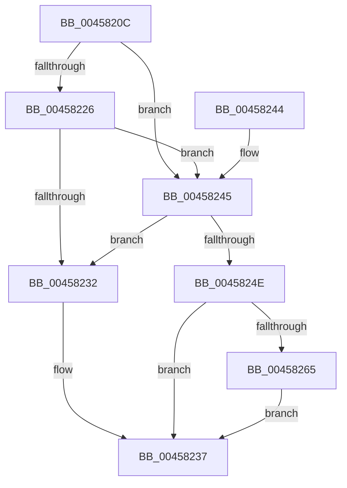

# RtlpHpHeapCheckCommitLimit

- RVA: `0x0045820C`–`0x00458280` (길이 `116` bytes)
- VA: `0x000000014045820C`
- 실행 섹션: `.text`
- PDB 이름 있음: `예`; PDB Function 태그: `아니요`
- unwind 정보 RVA: `0x000A82AC`
- 디코드: `35`개 명령, `116/116` bytes 표시
- 미해석 바이트: `0` (있으면 어셈블리에 `.byte`로 보존)

> 이 문서는 커널 이미지의 기계어와 PDB 기호를 분석해 생성했습니다. 4번과 5번은 함수 원형과 자료형을 바이너리 사용 방식에서 추정한 C 해석이며 원본 소스 복구 결과는 아닙니다.

## 1. Dependencies

- 직접 호출 지점: **1**; 고유 호출 대상: **1**
- 직접 호출자로 확인된 함수: **4**
- RIP 상대 이미지 참조: **1**

### Outgoing calls
- `0x00458279` → [RtlpLogHeapFailure](../35/RtlpLogHeapFailure_function_0035B7BC.md) (function, `0x0035B7BC`)

### Direct callers
- [RtlpAllocateHeap](../5E/RtlpAllocateHeap_function_005E8B1C.md) at `0x005E92E8`
- [RtlpExtendHeap](../5E/RtlpExtendHeap_function_005EA708.md) at `0x005EA876`
- [RtlpFindAndCommitPages](../5E/RtlpFindAndCommitPages_function_005EA95C.md) at `0x005EAA38`
- [RtlpInitializeHeapSegment](../5E/RtlpInitializeHeapSegment_function_005EB1DC.md) at `0x005EB2A1`

### Static image references
- `0x00458226` → RVA `0x00E28318` (`.data`; read)

## 2. Other-region calls and transfers

- 다른 실행 섹션으로 향하는 call: **0**
- 별도 외부 분기/꼬리 이동을 확인하지 못했습니다.

## 3. Assembly (complete function range)

```asm
0045820C  48 89 5C 24 08                  mov qword ptr [rsp + 8], rbx
00458211  57                              push rdi
00458212  48 83 EC 30                     sub rsp, 0x30
00458216  4D 8B 11                        mov r10, qword ptr [r9]
00458219  33 DB                           xor ebx, ebx
0045821B  49 8B F8                        mov rdi, r8
0045821E  4D 8B DA                        mov r11, r10
00458221  4D 85 D2                        test r10, r10
00458224  75 1F                           jne 0x140458245
00458226  4C 8B 15 EB 00 9D 00            mov r10, qword ptr [rip + 0x9d00eb]
0045822D  4D 85 D2                        test r10, r10
00458230  75 13                           jne 0x140458245
00458232  BB 01 00 00 00                  mov ebx, 1
00458237  8B C3                           mov eax, ebx
00458239  48 8B 5C 24 40                  mov rbx, qword ptr [rsp + 0x40]
0045823E  48 83 C4 30                     add rsp, 0x30
00458242  5F                              pop rdi
00458243  C3                              ret
00458244  CC                              int3
00458245  48 8D 04 11                     lea rax, [rcx + rdx]
00458249  49 3B C2                        cmp rax, r10
0045824C  76 E4                           jbe 0x140458232
0045824E  4D 85 DB                        test r11, r11
00458251  48 8D 05 C0 00 9D 00            lea rax, [rip + 0x9d00c0]
00458258  49 0F 45 C1                     cmovne rax, r9
0045825C  4C 8B 48 08                     mov r9, qword ptr [rax + 8]
00458260  4D 85 C9                        test r9, r9
00458263  74 D2                           je 0x140458237
00458265  48 89 54 24 28                  mov qword ptr [rsp + 0x28], rdx
0045826A  45 33 C0                        xor r8d, r8d
0045826D  48 89 4C 24 20                  mov qword ptr [rsp + 0x20], rcx
00458272  48 8B D7                        mov rdx, rdi
00458275  41 8D 48 15                     lea ecx, [r8 + 0x15]
00458279  E8 3E 35 F0 FF                  call 0x14035b7bc
0045827E  EB B7                           jmp 0x140458237
```

## 4. C-style interpretation (structured pseudocode)

```c
__int64 __fastcall RtlpHpHeapCheckCommitLimit(__int64 a1, __int64 a2, __int64 a3, __int64 a4)
{
    __int64 result;
    __int64 v_rbx;
    __int64 v_rsp;
    unsigned __int64 v_stack_p20;
    unsigned __int64 v_stack_p28;
    unsigned __int64 v_stack_p8;

    v_stack_p8 = v_rbx;
    v_rsp = (v_rsp) - (48);
    v_rbx = 0;
    if (*(unsigned __int64 *)(a4) != 0) goto loc_00458245;
    if (*(unsigned __int64 *)(v_rip + 10289387) != 0) goto loc_00458245;
loc_00458232:
loc_00458237:
    v_rsp = (v_rsp) + (48);
    return 1;
loc_00458245:
    if ((a1 + a2 * 1) <= (*(unsigned __int64 *)(v_rip + 10289387))) goto loc_00458232;
    result = v_rip + 10289344;
    if (*(unsigned __int64 *)(a4) != 0) { result = a4; }
    if (*(unsigned __int64 *)(result + 8) == 0) goto loc_00458237;
    v_stack_p28 = a2;
    a3 = 0;
    v_stack_p20 = a1;
    result = RtlpLogHeapFailure(a3 + 21, 0, a3, *(unsigned __int64 *)(result + 8));
    goto loc_00458237;
}
```

## 5. (Beta) C Style

```c
int64_t RtlpHpHeapCheckCommitLimit(void *Arg1, int64_t Arg2, int64_t Arg3, void *Arg4)
{
    uint8_t *arg1 = (uint8_t *)Arg1;
    uint8_t *arg4 = (uint8_t *)Arg4;

    int64_t result;
    int64_t local_rbx;
    int64_t local_rsp;
    uint64_t v_stack_p20;
    uint64_t v_stack_p28;
    uint64_t v_stack_p8;

    v_stack_p8 = local_rbx;
    local_rsp = (local_rsp) - (48);
    local_rbx = 0;
    if (*(uint64_t *)(arg4) != 0) goto loc_00458245;
    if (*(uint64_t *)(v_rip + 0x9D00EB) != 0) goto loc_00458245;
loc_00458232:
loc_00458237:
    local_rsp = (local_rsp) + (48);
    return 1;
loc_00458245:
    if ((Arg1 + Arg2 * 1) <= (*(uint64_t *)(v_rip + 0x9D00EB))) goto loc_00458232;
    result = v_rip + 10289344;
    if (*(uint64_t *)(arg4) != 0) { result = Arg4; }
    if (*(uint64_t *)(result + 0x8) == 0) goto loc_00458237;
    v_stack_p28 = Arg2;
    Arg3 = 0;
    v_stack_p20 = Arg1;
    result = RtlpLogHeapFailure(Arg3 + 21, 0, Arg3, *(uint64_t *)(result + 0x8));
    goto loc_00458237;
}
```

### 관측된 메모리 오프셋

구조체 형식이 확인되지 않은 접근은 인자 기준의 오프셋으로만 기록했습니다.

| 기준 인자 | 오프셋 표현 | 폭 (bit) | 접근 |
|---|---:|---:|---|
| `Arg1` | `+ 0x0 + rdx*1` | `64` | `R` |
| `Arg4` | `+ 0x0` | `64` | `R` |

## 6. Execution-region graph

[열기: 2D/3D 그래프와 함수 탐색 컨트롤 패널](../../../control-panel.html?section=text&rva=0x0045820C&view=graph)

- 2D 그래프는 위에서 아래로 흐르고, 3D 그래프는 빈 공간을 드래그해 회전합니다. Shift+드래그는 이동, 휠은 확대·축소, 함수 노드 선택은 대상 보고서 이동입니다.

### Static fallback


