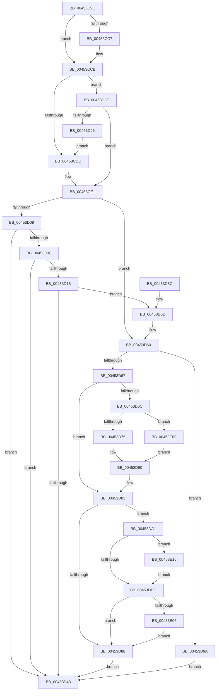

# RtlpQueryPackageIdentityAttributes

- RVA: `0x00453C9C`–`0x00453E1C` (길이 `384` bytes)
- VA: `0x0000000140453C9C`
- 실행 섹션: `.text`
- PDB 이름 있음: `예`; PDB Function 태그: `아니요`
- unwind 정보 RVA: `0x000A78BC`
- 디코드: `102`개 명령, `384/384` bytes 표시
- 미해석 바이트: `0` (있으면 어셈블리에 `.byte`로 보존)

> 이 문서는 커널 이미지의 기계어와 PDB 기호를 분석해 생성했습니다. 4번과 5번은 함수 원형과 자료형을 바이너리 사용 방식에서 추정한 C 해석이며 원본 소스 복구 결과는 아닙니다.

## 1. Dependencies

- 직접 호출 지점: **4**; 고유 호출 대상: **1**
- 직접 호출자로 확인된 함수: **2**
- RIP 상대 이미지 참조: **3**

### Outgoing calls
- `0x00453D00` → [SeQuerySecurityAttributesToken](../../page/9F/SeQuerySecurityAttributesToken_function_009F6410.md) (function, `0x009F6410`)
- `0x00453D3A` → [SeQuerySecurityAttributesToken](../../page/9F/SeQuerySecurityAttributesToken_function_009F6410.md) (function, `0x009F6410`)
- `0x00453DCF` → [SeQuerySecurityAttributesToken](../../page/9F/SeQuerySecurityAttributesToken_function_009F6410.md) (function, `0x009F6410`)
- `0x00453DFD` → [SeQuerySecurityAttributesToken](../../page/9F/SeQuerySecurityAttributesToken_function_009F6410.md) (function, `0x009F6410`)

### Direct callers
- [RtlQueryPackageClaimsEx](../5E/RtlQueryPackageClaimsEx_function_005EDFE8.md) at `0x005EE08E`
- [EtwpQueryPsmKey](../../page/7B/EtwpQueryPsmKey_function_007B8C40.md) at `0x007B8C79`

### Static image references
- `0x00453CEE` → RVA `0x00002AE0` (`.rdata`; read)
- `0x00453DAB` → RVA `0x00002B00` (`.rdata`; read)
- `0x00453DEA` → RVA `0x00002B10` (`.rdata`; read)

## 2. Other-region calls and transfers

- 다른 실행 섹션으로 향하는 call: **4**
  - `0x00453D00` → [SeQuerySecurityAttributesToken](../../page/9F/SeQuerySecurityAttributesToken_function_009F6410.md) (`.text` → `PAGE`)
  - `0x00453D3A` → [SeQuerySecurityAttributesToken](../../page/9F/SeQuerySecurityAttributesToken_function_009F6410.md) (`.text` → `PAGE`)
  - `0x00453DCF` → [SeQuerySecurityAttributesToken](../../page/9F/SeQuerySecurityAttributesToken_function_009F6410.md) (`.text` → `PAGE`)
  - `0x00453DFD` → [SeQuerySecurityAttributesToken](../../page/9F/SeQuerySecurityAttributesToken_function_009F6410.md) (`.text` → `PAGE`)
- 별도 외부 분기/꼬리 이동을 확인하지 못했습니다.

## 3. Assembly (complete function range)

```asm
00453C9C  48 89 5C 24 08                  mov qword ptr [rsp + 8], rbx
00453CA1  48 89 6C 24 18                  mov qword ptr [rsp + 0x18], rbp
00453CA6  48 89 74 24 20                  mov qword ptr [rsp + 0x20], rsi
00453CAB  57                              push rdi
00453CAC  41 56                           push r14
00453CAE  41 57                           push r15
00453CB0  48 83 EC 30                     sub rsp, 0x30
00453CB4  48 8B 5C 24 70                  mov rbx, qword ptr [rsp + 0x70]
00453CB9  49 8B F9                        mov rdi, r9
00453CBC  4D 8B F0                        mov r14, r8
00453CBF  4C 8B F9                        mov r15, rcx
00453CC2  48 85 DB                        test rbx, rbx
00453CC5  74 04                           je 0x140453ccb
00453CC7  48 83 23 00                     and qword ptr [rbx], 0
00453CCB  40 B6 01                        mov sil, 1
00453CCE  BD 01 00 00 00                  mov ebp, 1
00453CD3  48 85 FF                        test rdi, rdi
00453CD6  0F 84 B0 00 00 00               je 0x140453d8c
00453CDC  BD 02 00 00 00                  mov ebp, 2
00453CE1  48 8D 44 24 58                  lea rax, [rsp + 0x58]
00453CE6  4D 8B CE                        mov r9, r14
00453CE9  48 89 44 24 28                  mov qword ptr [rsp + 0x28], rax
00453CEE  48 8D 15 EB ED BA FF            lea rdx, [rip - 0x451215]
00453CF5  44 8B C5                        mov r8d, ebp
00453CF8  C7 44 24 20 30 03 00 00         mov dword ptr [rsp + 0x20], 0x330
00453D00  E8 0B 27 5A 00                  call 0x1409f6410
00453D05  85 C0                           test eax, eax
00453D07  79 57                           jns 0x140453d60
00453D09  3D 25 02 00 C0                  cmp eax, 0xc0000225
00453D0E  75 33                           jne 0x140453d43
00453D10  83 FD 01                        cmp ebp, 1
00453D13  74 2E                           je 0x140453d43
00453D15  48 8D 44 24 58                  lea rax, [rsp + 0x58]
00453D1A  4D 8B CE                        mov r9, r14
00453D1D  48 89 44 24 28                  mov qword ptr [rsp + 0x28], rax
00453D22  48 8D 15 B7 ED BA FF            lea rdx, [rip - 0x451249]
00453D29  41 B8 01 00 00 00               mov r8d, 1
00453D2F  C7 44 24 20 30 03 00 00         mov dword ptr [rsp + 0x20], 0x330
00453D37  49 8B CF                        mov rcx, r15
00453D3A  E8 D1 26 5A 00                  call 0x1409f6410
00453D3F  85 C0                           test eax, eax
00453D41  79 1A                           jns 0x140453d5d
00453D43  48 8B 5C 24 50                  mov rbx, qword ptr [rsp + 0x50]
00453D48  48 8B 6C 24 60                  mov rbp, qword ptr [rsp + 0x60]
00453D4D  48 8B 74 24 68                  mov rsi, qword ptr [rsp + 0x68]
00453D52  48 83 C4 30                     add rsp, 0x30
00453D56  41 5F                           pop r15
00453D58  41 5E                           pop r14
00453D5A  5F                              pop rdi
00453D5B  C3                              ret
00453D5C  CC                              int3
00453D5D  40 32 F6                        xor sil, sil
00453D60  41 83 7E 04 00                  cmp dword ptr [r14 + 4], 0
00453D65  74 33                           je 0x140453d9a
00453D67  48 85 FF                        test rdi, rdi
00453D6A  74 17                           je 0x140453d83
00453D6C  40 84 F6                        test sil, sil
00453D6F  0F 84 9A 00 00 00               je 0x140453e0f
00453D75  49 8B 46 08                     mov rax, qword ptr [r14 + 8]
00453D79  48 8B 48 48                     mov rcx, qword ptr [rax + 0x48]
00453D7D  48 8B 01                        mov rax, qword ptr [rcx]
00453D80  48 89 07                        mov qword ptr [rdi], rax
00453D83  48 85 DB                        test rbx, rbx
00453D86  75 19                           jne 0x140453da1
00453D88  33 C0                           xor eax, eax
00453D8A  EB B7                           jmp 0x140453d43
00453D8C  48 85 DB                        test rbx, rbx
00453D8F  0F 84 4C FF FF FF               je 0x140453ce1
00453D95  E9 42 FF FF FF                  jmp 0x140453cdc
00453D9A  B8 25 02 00 C0                  mov eax, 0xc0000225
00453D9F  EB A2                           jmp 0x140453d43
00453DA1  45 33 C9                        xor r9d, r9d
00453DA4  40 0F B6 C6                     movzx eax, sil
00453DA8  48 03 C0                        add rax, rax
00453DAB  48 8D 15 4E ED BA FF            lea rdx, [rip - 0x4512b2]
00453DB2  48 83 C8 01                     or rax, 1
00453DB6  49 8B CF                        mov rcx, r15
00453DB9  48 09 03                        or qword ptr [rbx], rax
00453DBC  48 8D 44 24 58                  lea rax, [rsp + 0x58]
00453DC1  48 89 44 24 28                  mov qword ptr [rsp + 0x28], rax
00453DC6  45 8D 41 01                     lea r8d, [r9 + 1]
00453DCA  83 64 24 20 00                  and dword ptr [rsp + 0x20], 0
00453DCF  E8 3C 26 5A 00                  call 0x1409f6410
00453DD4  BF 23 00 00 C0                  mov edi, 0xc0000023
00453DD9  3B C7                           cmp eax, edi
00453DDB  74 39                           je 0x140453e16
00453DDD  45 33 C9                        xor r9d, r9d
00453DE0  48 8D 44 24 58                  lea rax, [rsp + 0x58]
00453DE5  48 89 44 24 28                  mov qword ptr [rsp + 0x28], rax
00453DEA  48 8D 15 1F ED BA FF            lea rdx, [rip - 0x4512e1]
00453DF1  83 64 24 20 00                  and dword ptr [rsp + 0x20], 0
00453DF6  49 8B CF                        mov rcx, r15
00453DF9  45 8D 41 01                     lea r8d, [r9 + 1]
00453DFD  E8 0E 26 5A 00                  call 0x1409f6410
00453E02  3B C7                           cmp eax, edi
00453E04  75 82                           jne 0x140453d88
00453E06  48 83 0B 08                     or qword ptr [rbx], 8
00453E0A  E9 79 FF FF FF                  jmp 0x140453d88
00453E0F  33 C0                           xor eax, eax
00453E11  E9 6A FF FF FF                  jmp 0x140453d80
00453E16  48 83 0B 04                     or qword ptr [rbx], 4
00453E1A  EB C1                           jmp 0x140453ddd
```

## 4. C-style interpretation (structured pseudocode)

```c
__int64 __fastcall RtlpQueryPackageIdentityAttributes(__int64 a1, __int64 a2, __int64 a3, __int64 a4, __int64 a5)
{
    __int64 result;
    __int64 v_rsi;
    __int64 v_rsp;
    unsigned __int64 v_stack_m20;
    unsigned int v_stack_m28;
    unsigned __int64 v_stack_p10;
    unsigned __int64 v_stack_p18;
    unsigned __int64 v_stack_p20;
    unsigned __int64 v_stack_p28;
    unsigned __int64 v_stack_p58;
    unsigned __int64 v_stack_p8;

    v_stack_p8 = v_rbx;
    v_stack_p18 = v_rbp;
    v_stack_p20 = v_rsi;
    v_rsp = (v_rsp) - (48);
    if (a5 != 0) {
    }
    if (a4 == 0) goto loc_00453D8C;
loc_00453CDC:
loc_00453CE1:
    v_stack_m20 = v_stack_p10;
    v_stack_m28 = 816;
    result = SeQuerySecurityAttributesToken(a1, v_rip - 4526613, 2, a3);
    if (!sign_flag) goto loc_00453D60;
    if (((unsigned int)(result)) != 0xC0000225ULL) goto loc_00453D43;
    if (2 == 1) goto loc_00453D43;
    v_stack_m20 = v_stack_p10;
    v_stack_m28 = 816;
    result = SeQuerySecurityAttributesToken(a1, v_rip - 4526665, 1, a3);
    if (!sign_flag) goto loc_00453D5D;
loc_00453D43:
    v_rsp = (v_rsp) + (48);
    return result;
loc_00453D5D:
    v_rsi = 0;
loc_00453D60:
    if ((*(unsigned int *)(a3 + 4)) == 0) goto loc_00453D9A;
    if (a4 == 0) goto loc_00453D83;
    if (0 == 0) goto loc_00453E0F;
loc_00453D80:
    *(unsigned __int64 *)(a4) = *(unsigned __int64 *)(*(unsigned __int64 *)(*(unsigned __int64 *)(a3 + 8) + 72));
loc_00453D83:
    if (v_stack_p8 != 0) goto loc_00453DA1;
loc_00453D88:
    result = 0;
    goto loc_00453D43;
loc_00453D8C:
    if (v_stack_p8 == 0) goto loc_00453CE1;
    goto loc_00453CDC;
loc_00453D9A:
    goto loc_00453D43;
loc_00453DA1:
    a4 = 0;
    result = (0) + (0);
    result = (result) | (1);
    v_stack_p28 = v_stack_p58;
    result = SeQuerySecurityAttributesToken(a1, v_rip - 4526770, a4 + 1, a4);
    if (((unsigned int)(result)) == ((unsigned int)((unsigned int)(0xC0000023ULL)))) goto loc_00453E16;
loc_00453DDD:
    a4 = 0;
    v_stack_p28 = v_stack_p58;
    result = SeQuerySecurityAttributesToken(a1, v_rip - 4526817, a4 + 1, a4);
    if (((unsigned int)(result)) != ((unsigned int)((unsigned int)(0xC0000023ULL)))) goto loc_00453D88;
    goto loc_00453D88;
loc_00453E0F:
    result = 0;
    goto loc_00453D80;
loc_00453E16:
    goto loc_00453DDD;
}
```

## 5. (Beta) C Style

```c
int64_t RtlpQueryPackageIdentityAttributes(int64_t Arg1, int64_t Arg2, void *Arg3, int64_t Arg4, int64_t Arg5)
{
    uint8_t *arg3 = (uint8_t *)Arg3;

    int64_t result;
    int64_t local_rsi;
    int64_t local_rsp;
    uint64_t v_stack_m20;
    uint32_t v_stack_m28;
    uint64_t v_stack_p10;
    uint64_t v_stack_p18;
    uint64_t v_stack_p20;
    uint64_t v_stack_p28;
    uint64_t v_stack_p58;
    uint64_t v_stack_p8;

    v_stack_p8 = local_rbx;
    v_stack_p18 = local_rbp;
    v_stack_p20 = local_rsi;
    local_rsp = (local_rsp) - (48);
    if (Arg5 != 0) {
    }
    if (Arg4 == 0) goto loc_00453D8C;
loc_00453CDC:
loc_00453CE1:
    v_stack_m20 = v_stack_p10;
    v_stack_m28 = 816;
    result = SeQuerySecurityAttributesToken(Arg1, v_rip - 4526613, 2, Arg3);
    if (!sign_flag) goto loc_00453D60;
    if (((uint32_t)(result)) != 0xC0000225ULL) goto loc_00453D43;
    if (2 == 1) goto loc_00453D43;
    v_stack_m20 = v_stack_p10;
    v_stack_m28 = 816;
    result = SeQuerySecurityAttributesToken(Arg1, v_rip - 4526665, 1, Arg3);
    if (!sign_flag) goto loc_00453D5D;
loc_00453D43:
    local_rsp = (local_rsp) + (48);
    return result;
loc_00453D5D:
    local_rsi = 0;
loc_00453D60:
    if ((*(uint32_t *)(arg3 + 0x4)) == 0) goto loc_00453D9A;
    if (Arg4 == 0) goto loc_00453D83;
    if (0 == 0) goto loc_00453E0F;
loc_00453D80:
    *(uint64_t *)(Arg4) = *(uint64_t *)(*(uint64_t *)(*(uint64_t *)(arg3 + 0x8) + 0x48));
loc_00453D83:
    if (v_stack_p8 != 0) goto loc_00453DA1;
loc_00453D88:
    result = 0;
    goto loc_00453D43;
loc_00453D8C:
    if (v_stack_p8 == 0) goto loc_00453CE1;
    goto loc_00453CDC;
loc_00453D9A:
    goto loc_00453D43;
loc_00453DA1:
    Arg4 = 0;
    result = (0) + (0);
    result = (result) | (1);
    v_stack_p28 = v_stack_p58;
    result = SeQuerySecurityAttributesToken(Arg1, v_rip - 4526770, Arg4 + 1, Arg4);
    if (((uint32_t)(result)) == ((uint32_t)((uint32_t)(0xC0000023ULL)))) goto loc_00453E16;
loc_00453DDD:
    Arg4 = 0;
    v_stack_p28 = v_stack_p58;
    result = SeQuerySecurityAttributesToken(Arg1, v_rip - 4526817, Arg4 + 1, Arg4);
    if (((uint32_t)(result)) != ((uint32_t)((uint32_t)(0xC0000023ULL)))) goto loc_00453D88;
    goto loc_00453D88;
loc_00453E0F:
    result = 0;
    goto loc_00453D80;
loc_00453E16:
    goto loc_00453DDD;
}
```

### 관측된 메모리 오프셋

구조체 형식이 확인되지 않은 접근은 인자 기준의 오프셋으로만 기록했습니다.

| 기준 인자 | 오프셋 표현 | 폭 (bit) | 접근 |
|---|---:|---:|---|
| `Arg3` | `+ 0x4` | `32` | `R` |
| `Arg3` | `+ 0x8` | `64` | `R` |

## 6. Execution-region graph

[열기: 2D/3D 그래프와 함수 탐색 컨트롤 패널](../../../control-panel.html?section=text&rva=0x00453C9C&view=graph)

- 2D 그래프는 위에서 아래로 흐르고, 3D 그래프는 빈 공간을 드래그해 회전합니다. Shift+드래그는 이동, 휠은 확대·축소, 함수 노드 선택은 대상 보고서 이동입니다.

### Static fallback


