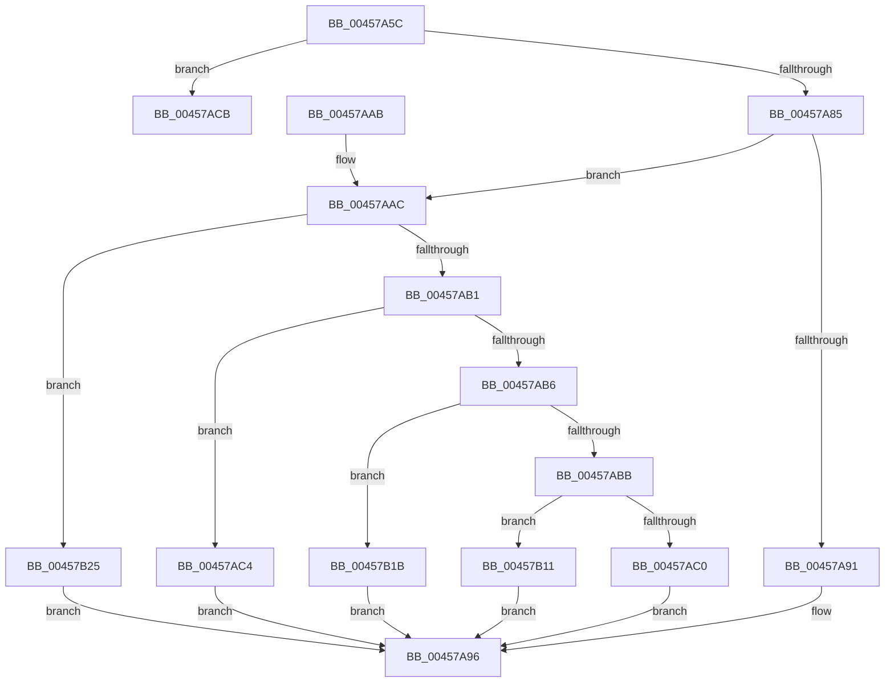

# RtlpVerCompare

- RVA: `0x00457A5C`–`0x00457B2F` (길이 `211` bytes)
- VA: `0x0000000140457A5C`
- 실행 섹션: `.text`
- PDB 이름 있음: `예`; PDB Function 태그: `예`
- unwind 정보 RVA: `0x000A8208`
- 디코드: `65`개 명령, `211/211` bytes 표시
- 미해석 바이트: `0` (있으면 어셈블리에 `.byte`로 보존)

> 이 문서는 커널 이미지의 기계어와 PDB 기호를 분석해 생성했습니다. 4번과 5번은 함수 원형과 자료형을 바이너리 사용 방식에서 추정한 C 해석이며 원본 소스 복구 결과는 아닙니다.

## 1. Dependencies

- 직접 호출 지점: **3**; 고유 호출 대상: **2**
- 직접 호출자로 확인된 함수: **2**
- RIP 상대 이미지 참조: **2**

### Outgoing calls
- `0x00457A9E` → [_security_check_cookie](../6A/_security_check_cookie_function_006AC640.md) (function, `0x006AC640`)
- `0x00457ADF` → [RtlStringCbPrintfA](../53/RtlStringCbPrintfA_function_0053BC0C.md) (function, `0x0053BC0C`)
- `0x00457AF8` → [RtlStringCbPrintfA](../53/RtlStringCbPrintfA_function_0053BC0C.md) (function, `0x0053BC0C`)

### Direct callers
- [RtlVerifyVersionInfo](RtlVerifyVersionInfo_function_00457670.md) at `0x004578CC`
- [RtlVerifyVersionInfo](RtlVerifyVersionInfo_function_00457670.md) at `0x00457994`
- [sub_006F1A86](../6F/Unknown_function_006F1A86.md) at `0x006F1ABA`
- [sub_006F1A86](../6F/Unknown_function_006F1A86.md) at `0x006F1B03`
- [sub_006F1A86](../6F/Unknown_function_006F1A86.md) at `0x006F1B31`

### Static image references
- `0x00457A64` → RVA `0x00E0A740` (`.data`; read)
- `0x00457ACE` → RVA `0x006CCD40` (` ?? ::FNODOBFM::`string'`; read)

## 2. Other-region calls and transfers

- 다른 실행 섹션으로 향하는 call: **0**
- call이 아닌 외부 분기/꼬리 이동: **1**
  - `0x00457B0C` → [sub_006F1B44](../6F/Unknown_function_006F1B44.md) (`tail-transfer`)

## 3. Assembly (complete function range)

```asm
00457A5C  40 53                           push rbx
00457A5E  56                              push rsi
00457A5F  57                              push rdi
00457A60  48 83 EC 60                     sub rsp, 0x60
00457A64  48 8B 05 D5 2C 9B 00            mov rax, qword ptr [rip + 0x9b2cd5]
00457A6B  48 33 C4                        xor rax, rsp
00457A6E  48 89 44 24 50                  mov qword ptr [rsp + 0x50], rax
00457A73  F6 84 24 A0 00 00 00 01         test byte ptr [rsp + 0xa0], 1
00457A7B  49 8B F1                        mov rsi, r9
00457A7E  41 8B F8                        mov edi, r8d
00457A81  8B D9                           mov ebx, ecx
00457A83  75 46                           jne 0x140457acb
00457A85  3B D7                           cmp edx, edi
00457A87  0F 94 C0                        sete al
00457A8A  88 06                           mov byte ptr [rsi], al
00457A8C  83 EB 01                        sub ebx, 1
00457A8F  75 1B                           jne 0x140457aac
00457A91  3B FA                           cmp edi, edx
00457A93  0F 94 C0                        sete al
00457A96  48 8B 4C 24 50                  mov rcx, qword ptr [rsp + 0x50]
00457A9B  48 33 CC                        xor rcx, rsp
00457A9E  E8 9D 4B 25 00                  call 0x1406ac640
00457AA3  48 83 C4 60                     add rsp, 0x60
00457AA7  5F                              pop rdi
00457AA8  5E                              pop rsi
00457AA9  5B                              pop rbx
00457AAA  C3                              ret
00457AAB  CC                              int3
00457AAC  83 EB 01                        sub ebx, 1
00457AAF  74 74                           je 0x140457b25
00457AB1  83 EB 01                        sub ebx, 1
00457AB4  74 0E                           je 0x140457ac4
00457AB6  83 EB 01                        sub ebx, 1
00457AB9  74 60                           je 0x140457b1b
00457ABB  83 FB 01                        cmp ebx, 1
00457ABE  74 51                           je 0x140457b11
00457AC0  32 C0                           xor al, al
00457AC2  EB D2                           jmp 0x140457a96
00457AC4  3B FA                           cmp edi, edx
00457AC6  0F 9D C0                        setge al
00457AC9  EB CB                           jmp 0x140457a96
00457ACB  44 8B CA                        mov r9d, edx
00457ACE  4C 8D 05 6B 52 27 00            lea r8, [rip + 0x27526b]
00457AD5  BA 14 00 00 00                  mov edx, 0x14
00457ADA  48 8D 4C 24 38                  lea rcx, [rsp + 0x38]
00457ADF  E8 28 41 0E 00                  call 0x14053bc0c
00457AE4  44 8B CF                        mov r9d, edi
00457AE7  4C 8D 05 52 52 27 00            lea r8, [rip + 0x275252]
00457AEE  BA 14 00 00 00                  mov edx, 0x14
00457AF3  48 8D 4C 24 20                  lea rcx, [rsp + 0x20]
00457AF8  E8 0F 41 0E 00                  call 0x14053bc0c
00457AFD  33 D2                           xor edx, edx
00457AFF  48 8D 44 24 20                  lea rax, [rsp + 0x20]
00457B04  4C 8D 44 24 38                  lea r8, [rsp + 0x38]
00457B09  4C 2B C0                        sub r8, rax
00457B0C  E9 33 A0 29 00                  jmp 0x1406f1b44
00457B11  3B FA                           cmp edi, edx
00457B13  0F 9E C0                        setle al
00457B16  E9 7B FF FF FF                  jmp 0x140457a96
00457B1B  3B FA                           cmp edi, edx
00457B1D  0F 9C C0                        setl al
00457B20  E9 71 FF FF FF                  jmp 0x140457a96
00457B25  3B FA                           cmp edi, edx
00457B27  0F 9F C0                        setg al
00457B2A  E9 67 FF FF FF                  jmp 0x140457a96
```

## 4. C-style interpretation (structured pseudocode)

```c
__int64 __fastcall RtlpVerCompare(int a1, int a2, int a3, __int64 a4, unsigned __int8 a5)
{
    __int64 result;
    __int64 v_rbx;
    __int64 v_rsp;
    unsigned __int64 v_stack_m28;
    unsigned __int64 v_stack_p20;
    unsigned __int64 v_stack_p38;

    v_rsp = (v_rsp) - (96);
    result = (*(unsigned __int64 *)(v_rip + 10169557)) ^ (v_rsp);
    v_stack_m28 = result;
    if (((a5) & (1)) != 0) goto loc_00457ACB;
    result = (a2 == ((unsigned int)((unsigned int)(a3)))) ? 1 : 0;
    *(unsigned __int8 *)(a4) = (unsigned __int8)(result);
    v_rbx = (unsigned int)(((unsigned int)(a1)) - (1));
    if (condition_is_not_equal) goto loc_00457AAC;
    result = (((unsigned int)((unsigned int)(a3))) == a2) ? 1 : 0;
loc_00457A96:
    a1 = (v_stack_m28) ^ (v_rsp);
    result = _security_check_cookie(a1, a2, a3, a4);
    v_rsp = (v_rsp) + (96);
    return result;
loc_00457AAC:
    v_rbx = (unsigned int)((v_rbx) - (1));
    if (condition_is_equal) goto loc_00457B25;
    v_rbx = (unsigned int)((v_rbx) - (1));
    if (condition_is_equal) goto loc_00457AC4;
    v_rbx = (unsigned int)((v_rbx) - (1));
    if (condition_is_equal) goto loc_00457B1B;
    if (((unsigned int)(v_rbx)) == 1) goto loc_00457B11;
    result = 0;
    goto loc_00457A96;
loc_00457AC4:
    result = (((unsigned int)((unsigned int)(a3))) >= a2) ? 1 : 0;
    goto loc_00457A96;
loc_00457ACB:
    result = RtlStringCbPrintfA(v_stack_p38, 20, v_rip + 2577003, (unsigned int)(a2));
    result = RtlStringCbPrintfA(v_stack_p20, 20, v_rip + 2576978, (unsigned int)((unsigned int)((unsigned int)(a3))));
    a2 = 0;
    a3 = (v_stack_p38) - (v_stack_p20);
loc_00457B11:
    result = (((unsigned int)((unsigned int)(a3))) <= 0) ? 1 : 0;
    goto loc_00457A96;
loc_00457B1B:
    result = (((unsigned int)((unsigned int)(a3))) < 0) ? 1 : 0;
    goto loc_00457A96;
loc_00457B25:
    result = (((unsigned int)((unsigned int)(a3))) > 0) ? 1 : 0;
    goto loc_00457A96;
}
```

## 5. (Beta) C Style

```c
int64_t RtlpVerCompare(int32_t Arg1, int32_t Arg2, int32_t Arg3, void *Arg4, uint8_t Arg5)
{
    uint8_t *arg4 = (uint8_t *)Arg4;

    int64_t result;
    int64_t local_rbx;
    int64_t local_rsp;
    uint64_t v_stack_m28;
    uint64_t v_stack_p20;
    uint64_t v_stack_p38;

    local_rsp = (local_rsp) - (96);
    result = (*(uint64_t *)(v_rip + 0x9B2CD5)) ^ (local_rsp);
    v_stack_m28 = result;
    if (((Arg5) & (1)) != 0) goto loc_00457ACB;
    result = (Arg2 == ((uint32_t)((uint32_t)(Arg3)))) ? 1 : 0;
    *(uint8_t *)(arg4) = (uint8_t)(result);
    local_rbx = (uint32_t)(((uint32_t)(Arg1)) - (1));
    if (condition_is_not_equal) goto loc_00457AAC;
    result = (((uint32_t)((uint32_t)(Arg3))) == Arg2) ? 1 : 0;
loc_00457A96:
    Arg1 = (v_stack_m28) ^ (local_rsp);
    result = _security_check_cookie(Arg1, Arg2, Arg3, Arg4);
    local_rsp = (local_rsp) + (96);
    return result;
loc_00457AAC:
    local_rbx = (uint32_t)((local_rbx) - (1));
    if (condition_is_equal) goto loc_00457B25;
    local_rbx = (uint32_t)((local_rbx) - (1));
    if (condition_is_equal) goto loc_00457AC4;
    local_rbx = (uint32_t)((local_rbx) - (1));
    if (condition_is_equal) goto loc_00457B1B;
    if (((uint32_t)(local_rbx)) == 1) goto loc_00457B11;
    result = 0;
    goto loc_00457A96;
loc_00457AC4:
    result = (((uint32_t)((uint32_t)(Arg3))) >= Arg2) ? 1 : 0;
    goto loc_00457A96;
loc_00457ACB:
    result = RtlStringCbPrintfA(v_stack_p38, 20, v_rip + 2577003, (uint32_t)(Arg2));
    result = RtlStringCbPrintfA(v_stack_p20, 20, v_rip + 2576978, (uint32_t)((uint32_t)((uint32_t)(Arg3))));
    Arg2 = 0;
    Arg3 = (v_stack_p38) - (v_stack_p20);
loc_00457B11:
    result = (((uint32_t)((uint32_t)(Arg3))) <= 0) ? 1 : 0;
    goto loc_00457A96;
loc_00457B1B:
    result = (((uint32_t)((uint32_t)(Arg3))) < 0) ? 1 : 0;
    goto loc_00457A96;
loc_00457B25:
    result = (((uint32_t)((uint32_t)(Arg3))) > 0) ? 1 : 0;
    goto loc_00457A96;
}
```

### 관측된 메모리 오프셋

구조체 형식이 확인되지 않은 접근은 인자 기준의 오프셋으로만 기록했습니다.

| 기준 인자 | 오프셋 표현 | 폭 (bit) | 접근 |
|---|---:|---:|---|
| `Arg4` | `+ 0x0` | `8` | `W` |

## 6. Execution-region graph

[열기: 2D/3D 그래프와 함수 탐색 컨트롤 패널](../../../control-panel.html?section=text&rva=0x00457A5C&view=graph)

- 2D 그래프는 위에서 아래로 흐르고, 3D 그래프는 빈 공간을 드래그해 회전합니다. Shift+드래그는 이동, 휠은 확대·축소, 함수 노드 선택은 대상 보고서 이동입니다.

### Static fallback


