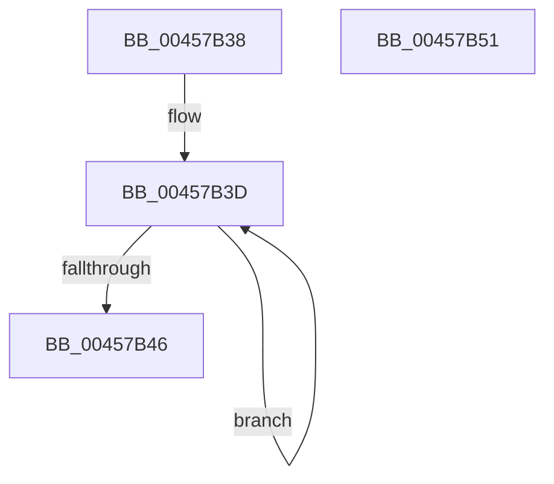

# RtlpVerGetConditionMask

- RVA: `0x00457B38`–`0x00457B52` (길이 `26` bytes)
- VA: `0x0000000140457B38`
- 실행 섹션: `.text`
- PDB 이름 있음: `예`; PDB Function 태그: `아니요`
- unwind 정보 RVA: `0x000DB714`
- 디코드: `11`개 명령, `26/26` bytes 표시
- 미해석 바이트: `0` (있으면 어셈블리에 `.byte`로 보존)

> 이 문서는 커널 이미지의 기계어와 PDB 기호를 분석해 생성했습니다. 4번과 5번은 함수 원형과 자료형을 바이너리 사용 방식에서 추정한 C 해석이며 원본 소스 복구 결과는 아닙니다.

## 1. Dependencies

- 직접 호출 지점: **0**; 고유 호출 대상: **0**
- 직접 호출자로 확인된 함수: **2**
- RIP 상대 이미지 참조: **0**

### Outgoing calls
- 직접 디코드된 call 명령이 없습니다.

### Direct callers
- [RtlVerifyVersionInfo](RtlVerifyVersionInfo_function_00457670.md) at `0x0045793A`
- [RtlVerifyVersionInfo](RtlVerifyVersionInfo_function_00457670.md) at `0x0045795E`
- [sub_006F1A86](../6F/Unknown_function_006F1A86.md) at `0x006F1A8C`
- [sub_006F1A86](../6F/Unknown_function_006F1A86.md) at `0x006F1A9B`
- [sub_006F1A86](../6F/Unknown_function_006F1A86.md) at `0x006F1AE3`
- [sub_006F1A86](../6F/Unknown_function_006F1A86.md) at `0x006F1B18`

### Static image references
- 디코드된 RIP-relative 메모리 참조가 없습니다.

## 2. Other-region calls and transfers

- 다른 실행 섹션으로 향하는 call: **0**
- 별도 외부 분기/꼬리 이동을 확인하지 못했습니다.

## 3. Assembly (complete function range)

```asm
00457B38  48 8B C1                        mov rax, rcx
00457B3B  33 C9                           xor ecx, ecx
00457B3D  44 8B C1                        mov r8d, ecx
00457B40  FF C1                           inc ecx
00457B42  D1 EA                           shr edx, 1
00457B44  75 F7                           jne 0x140457b3d
00457B46  43 8D 0C 40                     lea ecx, [r8 + r8*2]
00457B4A  48 D3 E8                        shr rax, cl
00457B4D  83 E0 07                        and eax, 7
00457B50  C3                              ret
00457B51  CC                              int3
```

## 4. C-style interpretation (structured pseudocode)

```c
__int64 __fastcall RtlpVerGetConditionMask(__int64 a1, int a2)
{
    __int64 result;

    a1 = 0;
loc_00457B3D:
    a1 = (unsigned int)((a1) + 1);
    a2 = (unsigned int)((a2) >> (1));
    if (condition_is_not_equal) goto loc_00457B3D;
    result = (a1) >> ((unsigned __int8)(0 + 0 * 2));
    result = (unsigned int)((result) & (7));
    return result;
}
```

## 5. (Beta) C Style

```c
int64_t RtlpVerGetConditionMask(int64_t Arg1, int32_t Arg2)
{
    int64_t result;

    Arg1 = 0;
loc_00457B3D:
    Arg1 = (uint32_t)((Arg1) + 1);
    Arg2 = (uint32_t)((Arg2) >> (1));
    if (condition_is_not_equal) goto loc_00457B3D;
    result = (Arg1) >> ((uint8_t)(0 + 0 * 2));
    result = (uint32_t)((result) & (7));
    return result;
}
```

## 6. Execution-region graph

[열기: 2D/3D 그래프와 함수 탐색 컨트롤 패널](../../../control-panel.html?section=text&rva=0x00457B38&view=graph)

- 2D 그래프는 위에서 아래로 흐르고, 3D 그래프는 빈 공간을 드래그해 회전합니다. Shift+드래그는 이동, 휠은 확대·축소, 함수 노드 선택은 대상 보고서 이동입니다.

### Static fallback


