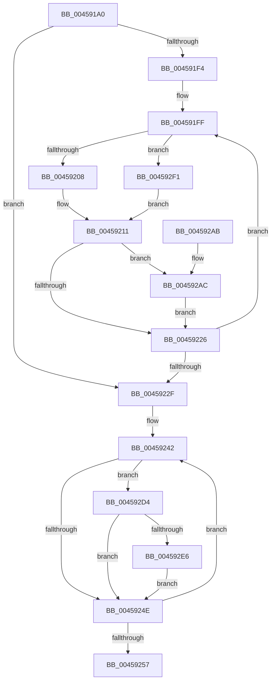

# ST_STORE&lt;SM_TRAITS&gt;::StCompactionPickPriority

- RVA: `0x004591A0`–`0x004592F8` (길이 `344` bytes)
- VA: `0x00000001404591A0`
- 실행 섹션: `.text`
- PDB 이름 있음: `예`; PDB Function 태그: `아니요`
- unwind 정보 RVA: `0x000A8E7C`
- 디코드: `89`개 명령, `344/344` bytes 표시
- 미해석 바이트: `0` (있으면 어셈블리에 `.byte`로 보존)

> 이 문서는 커널 이미지의 기계어와 PDB 기호를 분석해 생성했습니다. 4번과 5번은 함수 원형과 자료형을 바이너리 사용 방식에서 추정한 C 해석이며 원본 소스 복구 결과는 아닙니다.

## 1. Dependencies

- 직접 호출 지점: **3**; 고유 호출 대상: **3**
- 직접 호출자로 확인된 함수: **1**
- RIP 상대 이미지 참조: **1**

### Outgoing calls
- `0x004591E0` → [memset](../6C/memset_function_006C6C40.md) (function, `0x006C6C40`)
- `0x0045927C` → [memcpy](../6C/memcpy_function_006C6840.md) (function, `0x006C6840`)
- `0x0045928E` → [_security_check_cookie](../6A/_security_check_cookie_function_006AC640.md) (function, `0x006AC640`)

### Direct callers
- [ST_STORE&lt;SM_TRAITS&gt;::StCompactionPerformInMem](../41/ST_STORE_SM_TRAITS_StCompactionPerformInMem_function_004111D8.md) at `0x0041126D`

### Static image references
- `0x004591B5` → RVA `0x00E0A740` (`.data`; read)

## 2. Other-region calls and transfers

- 다른 실행 섹션으로 향하는 call: **0**
- 별도 외부 분기/꼬리 이동을 확인하지 못했습니다.

## 3. Assembly (complete function range)

```asm
004591A0  48 89 5C 24 08                  mov qword ptr [rsp + 8], rbx
004591A5  48 89 6C 24 18                  mov qword ptr [rsp + 0x18], rbp
004591AA  56                              push rsi
004591AB  57                              push rdi
004591AC  41 56                           push r14
004591AE  48 81 EC 70 01 00 00            sub rsp, 0x170
004591B5  48 8B 05 84 15 9B 00            mov rax, qword ptr [rip + 0x9b1584]
004591BC  48 33 C4                        xor rax, rsp
004591BF  48 89 84 24 60 01 00 00         mov qword ptr [rsp + 0x160], rax
004591C7  41 8B D8                        mov ebx, r8d
004591CA  48 8B FA                        mov rdi, rdx
004591CD  48 8B F1                        mov rsi, rcx
004591D0  33 D2                           xor edx, edx
004591D2  41 B8 40 01 00 00               mov r8d, 0x140
004591D8  48 8D 4C 24 20                  lea rcx, [rsp + 0x20]
004591DD  49 8B E9                        mov rbp, r9
004591E0  E8 5B DA 26 00                  call 0x1406c6c40
004591E5  4C 8D 1C DF                     lea r11, [rdi + rbx*8]
004591E9  41 BE 04 00 00 00               mov r14d, 4
004591EF  49 3B FB                        cmp rdi, r11
004591F2  73 3B                           jae 0x14045922f
004591F4  44 8B 86 08 03 00 00            mov r8d, dword ptr [rsi + 0x308]
004591FB  45 0F B6 C0                     movzx r8d, r8b
004591FF  45 85 C0                        test r8d, r8d
00459202  0F 85 E9 00 00 00               jne 0x1404592f1
00459208  48 8B 07                        mov rax, qword ptr [rdi]
0045920B  0F B7 08                        movzx ecx, word ptr [rax]
0045920E  C1 E9 0D                        shr ecx, 0xd
00459211  44 8B C9                        mov r9d, ecx
00459214  48 8D 0C 89                     lea rcx, [rcx + rcx*4]
00459218  44 8B 54 CC 20                  mov r10d, dword ptr [rsp + rcx*8 + 0x20]
0045921D  45 3B D6                        cmp r10d, r14d
00459220  0F 82 86 00 00 00               jb 0x1404592ac
00459226  48 83 C7 08                     add rdi, 8
0045922A  49 3B FB                        cmp rdi, r11
0045922D  72 D0                           jb 0x1404591ff
0045922F  41 83 C9 FF                     or r9d, 0xffffffff
00459233  48 8D 94 24 3C 01 00 00         lea rdx, [rsp + 0x13c]
0045923B  45 33 C0                        xor r8d, r8d
0045923E  41 8D 48 07                     lea ecx, [r8 + 7]
00459242  8B 42 FC                        mov eax, dword ptr [rdx - 4]
00459245  83 F8 01                        cmp eax, 1
00459248  0F 87 86 00 00 00               ja 0x1404592d4
0045924E  48 83 EA 28                     sub rdx, 0x28
00459252  83 E9 01                        sub ecx, 1
00459255  79 EB                           jns 0x140459242
00459257  49 63 C1                        movsxd rax, r9d
0045925A  48 8B CD                        mov rcx, rbp
0045925D  48 8D 14 80                     lea rdx, [rax + rax*4]
00459261  8B 5C D4 20                     mov ebx, dword ptr [rsp + rdx*8 + 0x20]
00459265  48 8D 44 24 28                  lea rax, [rsp + 0x28]
0045926A  41 3B DE                        cmp ebx, r14d
0045926D  48 8D 14 D0                     lea rdx, [rax + rdx*8]
00459271  41 0F 47 DE                     cmova ebx, r14d
00459275  44 8B C3                        mov r8d, ebx
00459278  49 C1 E0 03                     shl r8, 3
0045927C  E8 BF D5 26 00                  call 0x1406c6840
00459281  8B C3                           mov eax, ebx
00459283  48 8B 8C 24 60 01 00 00         mov rcx, qword ptr [rsp + 0x160]
0045928B  48 33 CC                        xor rcx, rsp
0045928E  E8 AD 33 25 00                  call 0x1406ac640
00459293  4C 8D 9C 24 70 01 00 00         lea r11, [rsp + 0x170]
0045929B  49 8B 5B 20                     mov rbx, qword ptr [r11 + 0x20]
0045929F  49 8B 6B 30                     mov rbp, qword ptr [r11 + 0x30]
004592A3  49 8B E3                        mov rsp, r11
004592A6  41 5E                           pop r14
004592A8  5F                              pop rdi
004592A9  5E                              pop rsi
004592AA  C3                              ret
004592AB  CC                              int3
004592AC  48 8B 17                        mov rdx, qword ptr [rdi]
004592AF  41 8D 42 01                     lea eax, [r10 + 1]
004592B3  89 44 CC 20                     mov dword ptr [rsp + rcx*8 + 0x20], eax
004592B7  0F B7 02                        movzx eax, word ptr [rdx]
004592BA  25 FF 1F 00 00                  and eax, 0x1fff
004592BF  01 44 CC 24                     add dword ptr [rsp + rcx*8 + 0x24], eax
004592C3  4B 8D 0C 89                     lea rcx, [r9 + r9*4]
004592C7  49 03 CA                        add rcx, r10
004592CA  48 89 54 CC 28                  mov qword ptr [rsp + rcx*8 + 0x28], rdx
004592CF  E9 52 FF FF FF                  jmp 0x140459226
004592D4  0F AF 86 30 03 00 00            imul eax, dword ptr [rsi + 0x330]
004592DB  2B 02                           sub eax, dword ptr [rdx]
004592DD  44 3B C0                        cmp r8d, eax
004592E0  0F 83 68 FF FF FF               jae 0x14045924e
004592E6  44 8B C0                        mov r8d, eax
004592E9  44 8B C9                        mov r9d, ecx
004592EC  E9 5D FF FF FF                  jmp 0x14045924e
004592F1  33 C9                           xor ecx, ecx
004592F3  E9 19 FF FF FF                  jmp 0x140459211
```

## 4. C-style interpretation (structured pseudocode)

```c
__int64 __fastcall ST_STORE_SM_TRAITS___StCompactionPickPriority(__int64 a1, __int64 a2, int a3, __int64 a4)
{
    __int64 result;
    __int64 v_rbx;
    __int64 v_rdi;
    __int64 v_rsp;
    unsigned __int64 v_stack_m160;
    unsigned __int64 v_stack_m168;
    unsigned __int64 v_stack_m18;
    unsigned __int64 v_stack_m28;
    unsigned __int64 v_stack_m4C;
    unsigned __int64 v_stack_p18;
    unsigned __int64 v_stack_p8;

    v_stack_p8 = v_rbx;
    v_stack_p18 = v_rbp;
    v_rsp = (v_rsp) - (368);
    result = (*(unsigned __int64 *)(v_rip + 10163588)) ^ (v_rsp);
    v_stack_m28 = result;
    a2 = 0;
    result = memset(v_stack_m168, a2, 320, a4);
    if (0 >= (a2 + (unsigned int)(a3) * 8)) goto loc_0045922F;
loc_004591FF:
    if ((unsigned int)((unsigned __int8)((unsigned int)(*(unsigned int *)(a1 + 776)))) != 0) goto loc_004592F1;
    a1 = (unsigned int)((*(unsigned __int16 *)(*(unsigned __int64 *)(a2))) >> (13));
loc_00459211:
    if (((unsigned int)((unsigned int)(*(unsigned int *)(v_rsp + a1 + a1 * 4 * 8 + 32)))) < 4) goto loc_004592AC;
loc_00459226:
    v_rdi = (a2) + (8);
    if (v_rdi < (a2 + (unsigned int)(a3) * 8)) goto loc_004591FF;
loc_0045922F:
    a4 = (unsigned int)(((unsigned int)((unsigned int)(a1))) | (0xFFFFFFFFULL));
    a3 = 0;
loc_00459242:
    if (((unsigned int)((unsigned int)(*(unsigned int *)(v_stack_m4C - 4)))) > 1) goto loc_004592D4;
loc_0045924E:
    a2 = (v_stack_m4C) - (40);
    a1 = (unsigned int)((a3 + 7) - (1));
    if (!sign_flag) goto loc_00459242;
    v_rbx = (unsigned int)(*(unsigned int *)(v_rsp + (int)((unsigned int)(a4)) + (int)((unsigned int)(a4)) * 4 * 8 + 32));
    if (((unsigned int)((unsigned int)(*(unsigned int *)(v_rsp + (int)((unsigned int)(a4)) + (int)((unsigned int)(a4)) * 4 * 8 + 32)))) > 4) { v_rbx = 4; }
    a3 = ((unsigned int)((unsigned int)(v_rbx))) << (3);
    result = memcpy(a4, v_stack_m160 + (int)((unsigned int)(a4)) + (int)((unsigned int)(a4)) * 4 * 8, a3, a4);
    a1 = (v_stack_m28) ^ (v_rsp);
    result = _security_check_cookie(a1, v_stack_m160 + (int)((unsigned int)(a4)) + (int)((unsigned int)(a4)) * 4 * 8, a3, a4);
    return result;
loc_004592AC:
    *(unsigned int *)(v_stack_m18 + a1 * 8 + 32) = (unsigned int)((unsigned int)(*(unsigned int *)(v_rsp + a1 + a1 * 4 * 8 + 32)) + 1);
    result = (unsigned int)((*(unsigned __int16 *)(*(unsigned __int64 *)(v_rdi))) & (0x1FFFULL));
    a1 = (a4 + a4 * 4) + ((unsigned int)(*(unsigned int *)(v_rsp + a1 + a1 * 4 * 8 + 32)));
    *(unsigned __int64 *)(v_stack_m18 + a1 * 8 + 40) = *(unsigned __int64 *)(v_rdi);
    goto loc_00459226;
loc_004592D4:
    result = (unsigned int)((result) * (*(unsigned int *)(a1 + 816)));
    result = (unsigned int)((result) - (*(unsigned int *)(*(unsigned __int64 *)(v_rdi))));
    if (a3 >= ((unsigned int)(result))) goto loc_0045924E;
    goto loc_0045924E;
loc_004592F1:
    a1 = 0;
    goto loc_00459211;
}
```

## 5. (Beta) C Style

```c
int64_t ST_STORE_SM_TRAITS___StCompactionPickPriority(void *Arg1, void *Arg2, int32_t Arg3, int64_t Arg4)
{
    uint8_t *arg1 = (uint8_t *)Arg1;
    uint8_t *arg2 = (uint8_t *)Arg2;

    int64_t result;
    int64_t local_rbx;
    int64_t local_rdi;
    int64_t local_rsp;
    uint64_t v_stack_m160;
    uint64_t v_stack_m168;
    uint64_t v_stack_m18;
    uint64_t v_stack_m28;
    uint64_t v_stack_m4C;
    uint64_t v_stack_p18;
    uint64_t v_stack_p8;

    v_stack_p8 = local_rbx;
    v_stack_p18 = local_rbp;
    local_rsp = (local_rsp) - (368);
    result = (*(uint64_t *)(v_rip + 0x9B1584)) ^ (local_rsp);
    v_stack_m28 = result;
    Arg2 = 0;
    result = memset(v_stack_m168, Arg2, 320, Arg4);
    if (0 >= (Arg2 + (uint32_t)(Arg3) * 8)) goto loc_0045922F;
loc_004591FF:
    if ((uint32_t)((uint8_t)((uint32_t)(*(uint32_t *)(arg1 + 0x308)))) != 0) goto loc_004592F1;
    Arg1 = (uint32_t)((*(uint16_t *)(*(uint64_t *)(arg2))) >> (13));
loc_00459211:
    if (((uint32_t)((uint32_t)(*(uint32_t *)(local_rsp + arg1 + arg1 * 4 * 8 + 0x20)))) < 4) goto loc_004592AC;
loc_00459226:
    local_rdi = (Arg2) + (8);
    if (local_rdi < (Arg2 + (uint32_t)(Arg3) * 8)) goto loc_004591FF;
loc_0045922F:
    Arg4 = (uint32_t)(((uint32_t)((uint32_t)(Arg1))) | (0xFFFFFFFFULL));
    Arg3 = 0;
loc_00459242:
    if (((uint32_t)((uint32_t)(*(uint32_t *)(v_stack_m4C - 0x4)))) > 1) goto loc_004592D4;
loc_0045924E:
    Arg2 = (v_stack_m4C) - (40);
    Arg1 = (uint32_t)((Arg3 + 7) - (1));
    if (!sign_flag) goto loc_00459242;
    local_rbx = (uint32_t)(*(uint32_t *)(local_rsp + (int32_t)((uint32_t)(Arg4)) + (int32_t)((uint32_t)(Arg4)) * 4 * 8 + 0x20));
    if (((uint32_t)((uint32_t)(*(uint32_t *)(local_rsp + (int32_t)((uint32_t)(Arg4)) + (int32_t)((uint32_t)(Arg4)) * 4 * 8 + 0x20)))) > 4) { local_rbx = 4; }
    Arg3 = ((uint32_t)((uint32_t)(local_rbx))) << (3);
    result = memcpy(Arg4, v_stack_m160 + (int32_t)((uint32_t)(Arg4)) + (int32_t)((uint32_t)(Arg4)) * 4 * 8, Arg3, Arg4);
    Arg1 = (v_stack_m28) ^ (local_rsp);
    result = _security_check_cookie(Arg1, v_stack_m160 + (int32_t)((uint32_t)(Arg4)) + (int32_t)((uint32_t)(Arg4)) * 4 * 8, Arg3, Arg4);
    return result;
loc_004592AC:
    *(uint32_t *)(v_stack_m18 + arg1 * 8 + 0x20) = (uint32_t)((uint32_t)(*(uint32_t *)(local_rsp + arg1 + arg1 * 4 * 8 + 0x20)) + 1);
    result = (uint32_t)((*(uint16_t *)(*(uint64_t *)(local_rdi))) & (0x1FFFULL));
    Arg1 = (Arg4 + Arg4 * 4) + ((uint32_t)(*(uint32_t *)(local_rsp + arg1 + arg1 * 4 * 8 + 0x20)));
    *(uint64_t *)(v_stack_m18 + arg1 * 8 + 0x28) = *(uint64_t *)(local_rdi);
    goto loc_00459226;
loc_004592D4:
    result = (uint32_t)((result) * (*(uint32_t *)(arg1 + 0x330)));
    result = (uint32_t)((result) - (*(uint32_t *)(*(uint64_t *)(local_rdi))));
    if (Arg3 >= ((uint32_t)(result))) goto loc_0045924E;
    goto loc_0045924E;
loc_004592F1:
    Arg1 = 0;
    goto loc_00459211;
}
```

### 관측된 메모리 오프셋

구조체 형식이 확인되지 않은 접근은 인자 기준의 오프셋으로만 기록했습니다.

| 기준 인자 | 오프셋 표현 | 폭 (bit) | 접근 |
|---|---:|---:|---|
| `Arg1` | `+ 0x308` | `32` | `R` |
| `Arg1` | `+ 0x330` | `32` | `R` |
| `Arg2` | `+ 0x0 + rbx*8` | `64` | `R` |

## 6. Execution-region graph

[열기: 2D/3D 그래프와 함수 탐색 컨트롤 패널](../../../control-panel.html?section=text&rva=0x004591A0&view=graph)

- 2D 그래프는 위에서 아래로 흐르고, 3D 그래프는 빈 공간을 드래그해 회전합니다. Shift+드래그는 이동, 휠은 확대·축소, 함수 노드 선택은 대상 보고서 이동입니다.

### Static fallback


