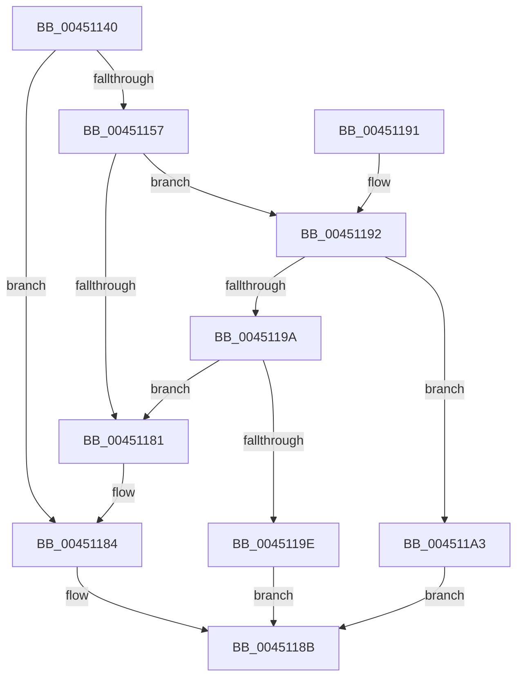

# ST_STORE&lt;SM_TRAITS&gt;::StDmCombineTargetCompare

- RVA: `0x00451140`–`0x004511AA` (길이 `106` bytes)
- VA: `0x0000000140451140`
- 실행 섹션: `.text`
- PDB 이름 있음: `예`; PDB Function 태그: `아니요`
- unwind 정보 RVA: `0x000A744C`
- 디코드: `35`개 명령, `106/106` bytes 표시
- 미해석 바이트: `0` (있으면 어셈블리에 `.byte`로 보존)

> 이 문서는 커널 이미지의 기계어와 PDB 기호를 분석해 생성했습니다. 4번과 5번은 함수 원형과 자료형을 바이너리 사용 방식에서 추정한 C 해석이며 원본 소스 복구 결과는 아닙니다.

## 1. Dependencies

- 직접 호출 지점: **0**; 고유 호출 대상: **0**
- 직접 호출자로 확인된 함수: **0**
- RIP 상대 이미지 참조: **0**

### Outgoing calls
- 직접 디코드된 call 명령이 없습니다.

### Direct callers
- 이 함수 시작 RVA로 연결되는 직접 call은 확인되지 않았습니다. 간접 호출은 완전히 역산할 수 없습니다.

### Static image references
- 디코드된 RIP-relative 메모리 참조가 없습니다.

## 2. Other-region calls and transfers

- 다른 실행 섹션으로 향하는 call: **0**
- 별도 외부 분기/꼬리 이동을 확인하지 못했습니다.

## 3. Assembly (complete function range)

```asm
00451140  48 89 5C 24 08                  mov qword ptr [rsp + 8], rbx
00451145  8B 42 04                        mov eax, dword ptr [rdx + 4]
00451148  4D 8B D8                        mov r11, r8
0045114B  45 8B 48 04                     mov r9d, dword ptr [r8 + 4]
0045114F  4C 8B D1                        mov r10, rcx
00451152  44 3B C8                        cmp r9d, eax
00451155  75 2D                           jne 0x140451184
00451157  44 8B 02                        mov r8d, dword ptr [rdx]
0045115A  48 8B 41 08                     mov rax, qword ptr [rcx + 8]
0045115E  41 8B 13                        mov edx, dword ptr [r11]
00451161  44 8B 88 28 03 00 00            mov r9d, dword ptr [rax + 0x328]
00451168  41 8B D9                        mov ebx, r9d
0045116B  8B 88 2C 03 00 00               mov ecx, dword ptr [rax + 0x32c]
00451171  41 23 D8                        and ebx, r8d
00451174  44 23 CA                        and r9d, edx
00451177  41 D3 E8                        shr r8d, cl
0045117A  D3 EA                           shr edx, cl
0045117C  44 3B C2                        cmp r8d, edx
0045117F  75 11                           jne 0x140451192
00451181  41 3B D9                        cmp ebx, r9d
00451184  1B C0                           sbb eax, eax
00451186  83 E0 FE                        and eax, 0xfffffffe
00451189  FF C0                           inc eax
0045118B  48 8B 5C 24 08                  mov rbx, qword ptr [rsp + 8]
00451190  C3                              ret
00451191  CC                              int3
00451192  41 8B 02                        mov eax, dword ptr [r10]
00451195  44 3B C0                        cmp r8d, eax
00451198  74 09                           je 0x1404511a3
0045119A  3B D0                           cmp edx, eax
0045119C  75 E3                           jne 0x140451181
0045119E  83 C8 FF                        or eax, 0xffffffff
004511A1  EB E8                           jmp 0x14045118b
004511A3  B8 01 00 00 00                  mov eax, 1
004511A8  EB E1                           jmp 0x14045118b
```

## 4. C-style interpretation (structured pseudocode)

```c
__int64 __fastcall ST_STORE_SM_TRAITS___StDmCombineTargetCompare(__int64 a1, __int64 a2, __int64 a3)
{
    __int64 result;
    __int64 v_rbx;
    unsigned __int64 v_stack_p8;

    v_stack_p8 = v_rbx;
    if (((unsigned int)((unsigned int)(*(unsigned int *)(a3 + 4)))) != ((unsigned int)((unsigned int)(*(unsigned int *)(a2 + 4))))) goto loc_00451184;
    v_rbx = (unsigned int)(((unsigned int)((unsigned int)((unsigned int)(*(unsigned int *)(*(unsigned __int64 *)(a1 + 8) + 808))))) & ((unsigned int)((unsigned int)(*(unsigned int *)(a2)))));
    a4 = (unsigned int)(((unsigned int)(*(unsigned int *)(*(unsigned __int64 *)(a1 + 8) + 808))) & ((unsigned int)((unsigned int)(*(unsigned int *)(a3)))));
    a3 = (unsigned int)(((unsigned int)(*(unsigned int *)(a2))) >> ((unsigned __int8)((unsigned int)(*(unsigned int *)(*(unsigned __int64 *)(a1 + 8) + 812)))));
    a2 = (unsigned int)(((unsigned int)(*(unsigned int *)(a3))) >> ((unsigned __int8)((unsigned int)(*(unsigned int *)(*(unsigned __int64 *)(a1 + 8) + 812)))));
    if (((unsigned int)(a3)) != ((unsigned int)(a2))) goto loc_00451192;
loc_00451181:
loc_00451184:
    result = (unsigned int)((*(unsigned __int64 *)(a1 + 8)) & (0xFFFFFFFEULL));
    result = (unsigned int)((result) + 1);
loc_0045118B:
    return result;
loc_00451192:
    if (((unsigned int)(a3)) == ((unsigned int)((unsigned int)(*(unsigned int *)(a1))))) goto loc_004511A3;
    if (((unsigned int)(a2)) != ((unsigned int)((unsigned int)(*(unsigned int *)(a1))))) goto loc_00451181;
    result = (unsigned int)(((unsigned int)(*(unsigned int *)(a1))) | (0xFFFFFFFFULL));
    goto loc_0045118B;
loc_004511A3:
    goto loc_0045118B;
}
```

## 5. (Beta) C Style

```c
int64_t ST_STORE_SM_TRAITS___StDmCombineTargetCompare(void *Arg1, void *Arg2, void *Arg3)
{
    uint8_t *arg1 = (uint8_t *)Arg1;
    uint8_t *arg2 = (uint8_t *)Arg2;
    uint8_t *arg3 = (uint8_t *)Arg3;

    int64_t result;
    int64_t local_rbx;
    uint64_t v_stack_p8;

    v_stack_p8 = local_rbx;
    if (((uint32_t)((uint32_t)(*(uint32_t *)(arg3 + 0x4)))) != ((uint32_t)((uint32_t)(*(uint32_t *)(arg2 + 0x4))))) goto loc_00451184;
    local_rbx = (uint32_t)(((uint32_t)((uint32_t)((uint32_t)(*(uint32_t *)(*(uint64_t *)(arg1 + 0x8) + 0x328))))) & ((uint32_t)((uint32_t)(*(uint32_t *)(arg2)))));
    a4 = (uint32_t)(((uint32_t)(*(uint32_t *)(*(uint64_t *)(arg1 + 0x8) + 0x328))) & ((uint32_t)((uint32_t)(*(uint32_t *)(arg3)))));
    Arg3 = (uint32_t)(((uint32_t)(*(uint32_t *)(arg2))) >> ((uint8_t)((uint32_t)(*(uint32_t *)(*(uint64_t *)(arg1 + 0x8) + 0x32C)))));
    Arg2 = (uint32_t)(((uint32_t)(*(uint32_t *)(arg3))) >> ((uint8_t)((uint32_t)(*(uint32_t *)(*(uint64_t *)(arg1 + 0x8) + 0x32C)))));
    if (((uint32_t)(Arg3)) != ((uint32_t)(Arg2))) goto loc_00451192;
loc_00451181:
loc_00451184:
    result = (uint32_t)((*(uint64_t *)(arg1 + 0x8)) & (0xFFFFFFFEULL));
    result = (uint32_t)((result) + 1);
loc_0045118B:
    return result;
loc_00451192:
    if (((uint32_t)(Arg3)) == ((uint32_t)((uint32_t)(*(uint32_t *)(arg1))))) goto loc_004511A3;
    if (((uint32_t)(Arg2)) != ((uint32_t)((uint32_t)(*(uint32_t *)(arg1))))) goto loc_00451181;
    result = (uint32_t)(((uint32_t)(*(uint32_t *)(arg1))) | (0xFFFFFFFFULL));
    goto loc_0045118B;
loc_004511A3:
    goto loc_0045118B;
}
```

### 관측된 메모리 오프셋

구조체 형식이 확인되지 않은 접근은 인자 기준의 오프셋으로만 기록했습니다.

| 기준 인자 | 오프셋 표현 | 폭 (bit) | 접근 |
|---|---:|---:|---|
| `Arg1` | `+ 0x0` | `32` | `R` |
| `Arg1` | `+ 0x8` | `64` | `R` |
| `Arg2` | `+ 0x0` | `32` | `R` |
| `Arg2` | `+ 0x4` | `32` | `R` |
| `Arg3` | `+ 0x0` | `32` | `R` |
| `Arg3` | `+ 0x4` | `32` | `R` |

## 6. Execution-region graph

[열기: 2D/3D 그래프와 함수 탐색 컨트롤 패널](../../../control-panel.html?section=text&rva=0x00451140&view=graph)

- 2D 그래프는 위에서 아래로 흐르고, 3D 그래프는 빈 공간을 드래그해 회전합니다. Shift+드래그는 이동, 휠은 확대·축소, 함수 노드 선택은 대상 보고서 이동입니다.

### Static fallback


