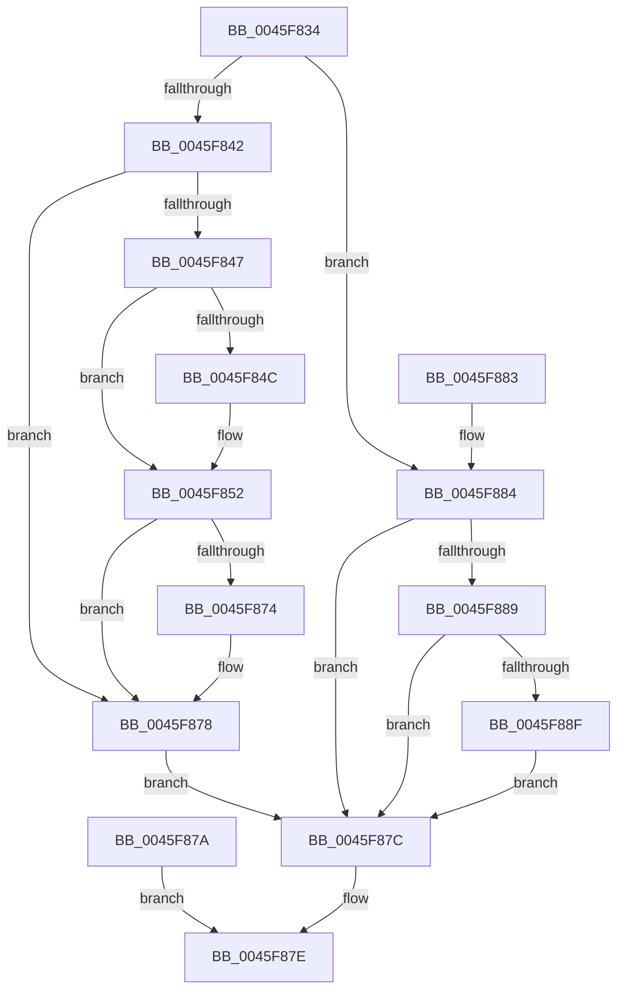

# SeCaptureObjectAttributeSecurityDescriptorPresent

- RVA: `0x0045F834`–`0x0045F895` (길이 `97` bytes)
- VA: `0x000000014045F834`
- 실행 섹션: `.text`
- PDB 이름 있음: `예`; PDB Function 태그: `아니요`
- unwind 정보 RVA: `0x000A9B28`
- 디코드: `33`개 명령, `97/97` bytes 표시
- 미해석 바이트: `0` (있으면 어셈블리에 `.byte`로 보존)

> 이 문서는 커널 이미지의 기계어와 PDB 기호를 분석해 생성했습니다. 4번과 5번은 함수 원형과 자료형을 바이너리 사용 방식에서 추정한 C 해석이며 원본 소스 복구 결과는 아닙니다.

## 1. Dependencies

- 직접 호출 지점: **1**; 고유 호출 대상: **1**
- 직접 호출자로 확인된 함수: **2**
- RIP 상대 이미지 참조: **0**

### Outgoing calls
- `0x0045F84C` → [ExRaiseDatatypeMisalignment](../../page/89/ExRaiseDatatypeMisalignment_function_00899FD0.md) (function, `0x00899FD0`)

### Direct callers
- [SepCreateTokenEx](../4E/SepCreateTokenEx_function_004E9CD0.md) at `0x004E9DE8`
- [NtDuplicateToken](../../page/8B/NtDuplicateToken_function_008B6DF0.md) at `0x008B6EA2`

### Static image references
- 디코드된 RIP-relative 메모리 참조가 없습니다.

## 2. Other-region calls and transfers

- 다른 실행 섹션으로 향하는 call: **1**
  - `0x0045F84C` → [ExRaiseDatatypeMisalignment](../../page/89/ExRaiseDatatypeMisalignment_function_00899FD0.md) (`.text` → `PAGE`)
- 별도 외부 분기/꼬리 이동을 확인하지 못했습니다.

## 3. Assembly (complete function range)

```asm
0045F834  48 83 EC 28                     sub rsp, 0x28
0045F838  45 33 C9                        xor r9d, r9d
0045F83B  45 88 08                        mov byte ptr [r8], r9b
0045F83E  84 D2                           test dl, dl
0045F840  74 42                           je 0x14045f884
0045F842  48 85 C9                        test rcx, rcx
0045F845  74 31                           je 0x14045f878
0045F847  F6 C1 03                        test cl, 3
0045F84A  74 06                           je 0x14045f852
0045F84C  E8 7F A7 43 00                  call 0x140899fd0
0045F851  CC                              int3
0045F852  48 B8 00 00 FF FF FF 7F 00 00   movabs rax, 0x7fffffff0000
0045F85C  48 3B C8                        cmp rcx, rax
0045F85F  48 0F 42 C1                     cmovb rax, rcx
0045F863  90                              nop
0045F864  8A 00                           mov al, byte ptr [rax]
0045F866  48 8B 41 20                     mov rax, qword ptr [rcx + 0x20]
0045F86A  48 89 44 24 40                  mov qword ptr [rsp + 0x40], rax
0045F86F  49 3B C1                        cmp rax, r9
0045F872  74 04                           je 0x14045f878
0045F874  41 C6 00 01                     mov byte ptr [r8], 1
0045F878  EB 02                           jmp 0x14045f87c
0045F87A  EB 02                           jmp 0x14045f87e
0045F87C  33 C0                           xor eax, eax
0045F87E  48 83 C4 28                     add rsp, 0x28
0045F882  C3                              ret
0045F883  CC                              int3
0045F884  48 85 C9                        test rcx, rcx
0045F887  74 F3                           je 0x14045f87c
0045F889  4C 39 49 20                     cmp qword ptr [rcx + 0x20], r9
0045F88D  74 ED                           je 0x14045f87c
0045F88F  41 C6 00 01                     mov byte ptr [r8], 1
0045F893  EB E7                           jmp 0x14045f87c
```

## 4. C-style interpretation (structured pseudocode)

```c
__int64 __fastcall SeCaptureObjectAttributeSecurityDescriptorPresent(__int64 a1, unsigned __int8 a2, __int64 a3, int a4)
{
    __int64 result;
    __int64 v_rsp;
    unsigned __int64 v_stack_p18;

    v_rsp = (v_rsp) - (40);
    a4 = 0;
    *(unsigned __int8 *)(a3) = 0;
    if (a2 == 0) goto loc_0045F884;
    if (a1 == 0) goto loc_0045F878;
    if ((((unsigned __int8)(a1)) & (3)) != 0) {
        result = ExRaiseDatatypeMisalignment(a1, a2, a3, a4);
    }
    if (a1 < result) { result = a1; }
    v_stack_p18 = *(unsigned __int64 *)(a1 + 32);
    if ((*(unsigned __int64 *)(a1 + 32)) != 0) {
        *(unsigned __int8 *)(a3) = 1;
    }
    goto loc_0045F87C;
loc_0045F87C:
    result = 0;
loc_0045F87E:
    v_rsp = (v_rsp) + (40);
    return result;
loc_0045F884:
    if (a1 == 0) goto loc_0045F87C;
    if ((*(unsigned __int64 *)(a1 + 32)) == 0) goto loc_0045F87C;
    *(unsigned __int8 *)(a3) = 1;
    goto loc_0045F87C;
}
```

## 5. (Beta) C Style

```c
int64_t SeCaptureObjectAttributeSecurityDescriptorPresent(int64_t Arg1, uint8_t Arg2, void *Arg3, int32_t Arg4)
{
    uint8_t *arg3 = (uint8_t *)Arg3;

    int64_t result;
    int64_t local_rsp;
    uint64_t v_stack_p18;

    local_rsp = (local_rsp) - (40);
    Arg4 = 0;
    *(uint8_t *)(arg3) = 0;
    if (Arg2 == 0) goto loc_0045F884;
    if (Arg1 == 0) goto loc_0045F878;
    if ((((uint8_t)(Arg1)) & (3)) != 0) {
        result = ExRaiseDatatypeMisalignment(Arg1, Arg2, Arg3, Arg4);
    }
    if (Arg1 < result) { result = Arg1; }
    v_stack_p18 = *(uint64_t *)(Arg1 + 0x20);
    if ((*(uint64_t *)(Arg1 + 0x20)) != 0) {
        *(uint8_t *)(arg3) = 1;
    }
    goto loc_0045F87C;
loc_0045F87C:
    result = 0;
loc_0045F87E:
    local_rsp = (local_rsp) + (40);
    return result;
loc_0045F884:
    if (Arg1 == 0) goto loc_0045F87C;
    if ((*(uint64_t *)(Arg1 + 0x20)) == 0) goto loc_0045F87C;
    *(uint8_t *)(arg3) = 1;
    goto loc_0045F87C;
}
```

### 관측된 메모리 오프셋

구조체 형식이 확인되지 않은 접근은 인자 기준의 오프셋으로만 기록했습니다.

| 기준 인자 | 오프셋 표현 | 폭 (bit) | 접근 |
|---|---:|---:|---|
| `Arg3` | `+ 0x0` | `8` | `W` |

## 6. Execution-region graph

[열기: 2D/3D 그래프와 함수 탐색 컨트롤 패널](../../../control-panel.html?section=text&rva=0x0045F834&view=graph)

- 2D 그래프는 위에서 아래로 흐르고, 3D 그래프는 빈 공간을 드래그해 회전합니다. Shift+드래그는 이동, 휠은 확대·축소, 함수 노드 선택은 대상 보고서 이동입니다.

### Static fallback


