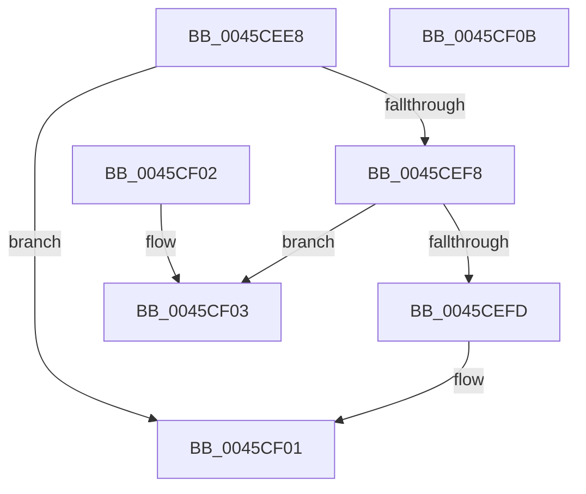

# SepDereferenceLuidToIndexEntry

- RVA: `0x0045CEE8`–`0x0045CF0C` (길이 `36` bytes)
- VA: `0x000000014045CEE8`
- 실행 섹션: `.text`
- PDB 이름 있음: `예`; PDB Function 태그: `아니요`
- unwind 정보 RVA: `0x000DB714`
- 디코드: `13`개 명령, `36/36` bytes 표시
- 미해석 바이트: `0` (있으면 어셈블리에 `.byte`로 보존)

> 이 문서는 커널 이미지의 기계어와 PDB 기호를 분석해 생성했습니다. 4번과 5번은 함수 원형과 자료형을 바이너리 사용 방식에서 추정한 C 해석이며 원본 소스 복구 결과는 아닙니다.

## 1. Dependencies

- 직접 호출 지점: **0**; 고유 호출 대상: **0**
- 직접 호출자로 확인된 함수: **2**
- RIP 상대 이미지 참조: **0**

### Outgoing calls
- 직접 디코드된 call 명령이 없습니다.

### Direct callers
- [SepRefDerefLuidToIndexEntryIfNecessary](../../page/9F/SepRefDerefLuidToIndexEntryIfNecessary_function_009FEFD8.md) at `0x009FEFF9`
- [SepSetProcessUniqueAttribute](../../page/A4/SepSetProcessUniqueAttribute_function_00A424C8.md) at `0x00A425AF`

### Static image references
- 디코드된 RIP-relative 메모리 참조가 없습니다.

## 2. Other-region calls and transfers

- 다른 실행 섹션으로 향하는 call: **0**
- 별도 외부 분기/꼬리 이동을 확인하지 못했습니다.

## 3. Assembly (complete function range)

```asm
0045CEE8  48 83 C8 FF                     or rax, 0xffffffffffffffff
0045CEEC  F0 48 0F C1 41 18               lock xadd qword ptr [rcx + 0x18], rax
0045CEF2  48 83 E8 01                     sub rax, 1
0045CEF6  7F 09                           jg 0x14045cf01
0045CEF8  48 85 C0                        test rax, rax
0045CEFB  75 06                           jne 0x14045cf03
0045CEFD  C6 41 30 01                     mov byte ptr [rcx + 0x30], 1
0045CF01  C3                              ret
0045CF02  CC                              int3
0045CF03  B9 0E 00 00 00                  mov ecx, 0xe
0045CF08  CD 29                           int 0x29
0045CF0A  C3                              ret
0045CF0B  CC                              int3
```

## 4. C-style interpretation (structured pseudocode)

```c
__int64 __fastcall SepDereferenceLuidToIndexEntry(__int64 a1)
{
    __int64 result;

    result = (result) | (-1);
    result = (result) - (1);
    if (condition_is_greater) goto loc_0045CF01;
    if (result != 0) goto loc_0045CF03;
    *(unsigned __int8 *)(a1 + 48) = 1;
loc_0045CF01:
    return result;
loc_0045CF03:
    return result;
}
```

## 5. (Beta) C Style

```c
int64_t SepDereferenceLuidToIndexEntry(void *Arg1)
{
    uint8_t *arg1 = (uint8_t *)Arg1;

    int64_t result;

    result = (result) | (-1);
    result = (result) - (1);
    if (condition_is_greater) goto loc_0045CF01;
    if (result != 0) goto loc_0045CF03;
    *(uint8_t *)(arg1 + 0x30) = 1;
loc_0045CF01:
    return result;
loc_0045CF03:
    return result;
}
```

### 관측된 메모리 오프셋

구조체 형식이 확인되지 않은 접근은 인자 기준의 오프셋으로만 기록했습니다.

| 기준 인자 | 오프셋 표현 | 폭 (bit) | 접근 |
|---|---:|---:|---|
| `Arg1` | `+ 0x18` | `64` | `R/W` |
| `Arg1` | `+ 0x30` | `8` | `W` |

## 6. Execution-region graph

[열기: 2D/3D 그래프와 함수 탐색 컨트롤 패널](../../../control-panel.html?section=text&rva=0x0045CEE8&view=graph)

- 2D 그래프는 위에서 아래로 흐르고, 3D 그래프는 빈 공간을 드래그해 회전합니다. Shift+드래그는 이동, 휠은 확대·축소, 함수 노드 선택은 대상 보고서 이동입니다.

### Static fallback


