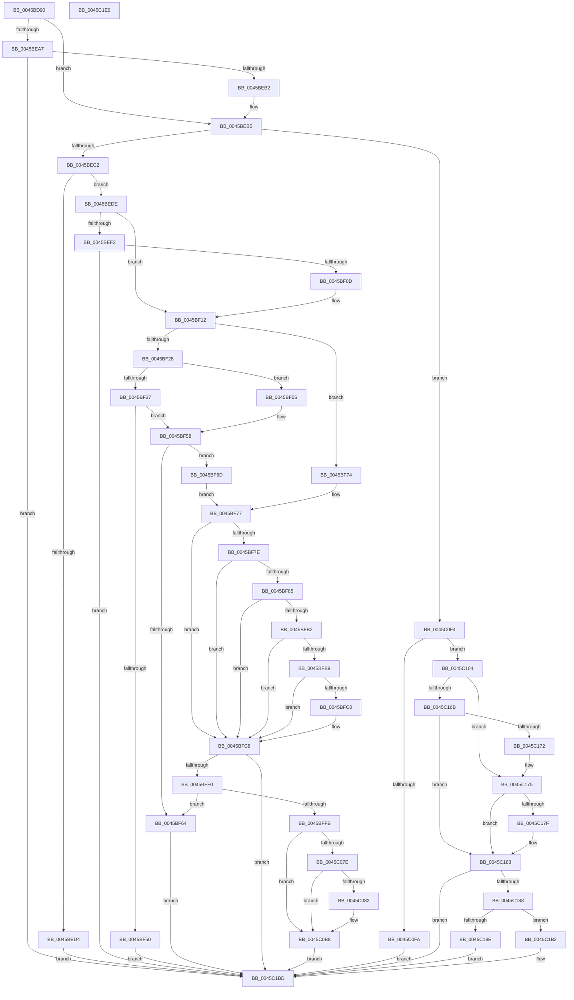

# SepDesktopAppxSubProcessToken

- RVA: `0x0045BD90`–`0x0045C1E7` (길이 `1,111` bytes)
- VA: `0x000000014045BD90`
- 실행 섹션: `.text`
- PDB 이름 있음: `예`; PDB Function 태그: `아니요`
- unwind 정보 RVA: `0x000A9484`
- 디코드: `279`개 명령, `1,111/1,111` bytes 표시
- 미해석 바이트: `0` (있으면 어셈블리에 `.byte`로 보존)

> 이 문서는 커널 이미지의 기계어와 PDB 기호를 분석해 생성했습니다. 4번과 5번은 함수 원형과 자료형을 바이너리 사용 방식에서 추정한 C 해석이며 원본 소스 복구 결과는 아닙니다.

## 1. Dependencies

- 직접 호출 지점: **17**; 고유 호출 대상: **14**
- 직접 호출자로 확인된 함수: **2**
- RIP 상대 이미지 참조: **8**

### Outgoing calls
- `0x0045BE9C` → [RtlQueryPackageClaims](RtlQueryPackageClaims_function_0045C3F0.md) (function, `0x0045C3F0`)
- `0x0045BEFE` → [SepDesktopAppModifyTokenBreakaway](../60/SepDesktopAppModifyTokenBreakaway_function_00608170.md) (function, `0x00608170`)
- `0x0045BF42` → [SepDesktopAppModifyTokenBreakaway](../60/SepDesktopAppModifyTokenBreakaway_function_00608170.md) (function, `0x00608170`)
- `0x0045BF5B` → [SepVerifyDesktopAppPolicyOverrideCaller](SepVerifyDesktopAppPolicyOverrideCaller_function_0045C1F0.md) (function, `0x0045C1F0`)
- `0x0045BFA9` → [ZwQueryLicenseValue](../6A/ZwQueryLicenseValue_function_006AFCF0.md) (function, `0x006AFCF0`)
- `0x0045BFE1` → [SepVerifyDesktopAppxImage](../60/SepVerifyDesktopAppxImage_function_0060885C.md) (function, `0x0060885C`)
- `0x0045C054` → [ExAcquireResourceExclusiveLite](../21/ExAcquireResourceExclusiveLite_function_00214E20.md) (function, `0x00214E20`)
- `0x0045C06E` → [AuthzBasepSetSecurityAttributesToken](../3A/AuthzBasepSetSecurityAttributesToken_function_003A8D1C.md) (function, `0x003A8D1C`)
- `0x0045C075` → [Feature_TrustedLaunchCiClaim__private_IsEnabledDeviceUsageNoInline](../60/Feature_TrustedLaunchCiClaim__private_IsEnabledDeviceUsageNoInline_function_0060753C.md) (function, `0x0060753C`)
- `0x0045C0A8` → [AuthzBasepSetSecurityAttributesToken](../3A/AuthzBasepSetSecurityAttributesToken_function_003A8D1C.md) (function, `0x003A8D1C`)
- `0x0045C0E1` → [ExReleaseResourceLite](../25/ExReleaseResourceLite_function_0025FA10.md) (function, `0x0025FA10`)
- `0x0045C0E6` → [KeLeaveCriticalRegion](../25/KeLeaveCriticalRegion_function_0025D8B0.md) (function, `0x0025D8B0`)
- `0x0045C12F` → [PsReferenceEffectiveToken](../../page/9A/PsReferenceEffectiveToken_function_009A2B40.md) (function, `0x009A2B40`)
- `0x0045C15B` → [RtlQueryPackageClaims](RtlQueryPackageClaims_function_0045C3F0.md) (function, `0x0045C3F0`)
- `0x0045C1AB` → [ObFastDereferenceObject](../3E/ObFastDereferenceObject_function_003ED5F0.md) (function, `0x003ED5F0`)
- `0x0045C1B8` → [ObfDereferenceObjectWithTag](../2F/ObfDereferenceObjectWithTag_function_002F78E0.md) (function, `0x002F78E0`)
- `0x0045C1C6` → [_security_check_cookie](../6A/_security_check_cookie_function_006AC640.md) (function, `0x006AC640`)

### Direct callers
- [SeDuplicateTokenWithPredictedClaims](../../page/6F/SeDuplicateTokenWithPredictedClaims_function_006FD084.md) at `0x006FD1AD`
- [SeSubProcessToken](../../page/AA/SeSubProcessToken_function_00AAD570.md) at `0x00AADB05`

### Static image references
- `0x0045BDAC` → RVA `0x00E0A740` (`.data`; read)
- `0x0045BDC1` → RVA `0x006CD230` (` ?? ::FNODOBFM::`string'`; read)
- `0x0045BDE7` → RVA `0x006CD250` (` ?? ::FNODOBFM::`string'`; read)
- `0x0045BE1D` → RVA `0x006CD200` (` ?? ::FNODOBFM::`string'`; read)
- `0x0045BE33` → RVA `0x006CD640` (` ?? ::FNODOBFM::`string'`; read)
- `0x0045BFA2` → RVA `0x00E08940` (`.data`; read)
- `0x0045C0B8` → RVA `0x00012D08` (`.rdata`; read)
- `0x0045C0C2` → RVA `0x00E0EBF0` (`.data`; read/write)

## 2. Other-region calls and transfers

- 다른 실행 섹션으로 향하는 call: **1**
  - `0x0045C12F` → [PsReferenceEffectiveToken](../../page/9A/PsReferenceEffectiveToken_function_009A2B40.md) (`.text` → `PAGE`)
- 별도 외부 분기/꼬리 이동을 확인하지 못했습니다.

## 3. Assembly (complete function range)

```asm
0045BD90  48 89 5C 24 20                  mov qword ptr [rsp + 0x20], rbx
0045BD95  55                              push rbp
0045BD96  56                              push rsi
0045BD97  57                              push rdi
0045BD98  41 54                           push r12
0045BD9A  41 55                           push r13
0045BD9C  41 56                           push r14
0045BD9E  41 57                           push r15
0045BDA0  48 8D 6C 24 B0                  lea rbp, [rsp - 0x50]
0045BDA5  48 81 EC 50 01 00 00            sub rsp, 0x150
0045BDAC  48 8B 05 8D E9 9A 00            mov rax, qword ptr [rip + 0x9ae98d]
0045BDB3  48 33 C4                        xor rax, rsp
0045BDB6  48 89 45 40                     mov qword ptr [rbp + 0x40], rax
0045BDBA  4C 8B AD B8 00 00 00            mov r13, qword ptr [rbp + 0xb8]
0045BDC1  48 8D 05 68 14 27 00            lea rax, [rip + 0x271468]
0045BDC8  4C 8B A5 C0 00 00 00            mov r12, qword ptr [rbp + 0xc0]
0045BDCF  45 33 FF                        xor r15d, r15d
0045BDD2  48 89 45 C8                     mov qword ptr [rbp - 0x38], rax
0045BDD6  0F 57 C0                        xorps xmm0, xmm0
0045BDD9  33 C0                           xor eax, eax
0045BDDB  4C 89 7C 24 38                  mov qword ptr [rsp + 0x38], r15
0045BDE0  48 89 45 E0                     mov qword ptr [rbp - 0x20], rax
0045BDE4  45 33 C9                        xor r9d, r9d
0045BDE7  48 8D 05 62 14 27 00            lea rax, [rip + 0x271462]
0045BDEE  4C 89 44 24 70                  mov qword ptr [rsp + 0x70], r8
0045BDF3  48 89 45 F0                     mov qword ptr [rbp - 0x10], rax
0045BDF7  45 33 C0                        xor r8d, r8d
0045BDFA  33 C0                           xor eax, eax
0045BDFC  48 89 55 A8                     mov qword ptr [rbp - 0x58], rdx
0045BE00  48 89 45 08                     mov qword ptr [rbp + 8], rax
0045BE04  33 D2                           xor edx, edx
0045BE06  45 88 7D 00                     mov byte ptr [r13], r15b
0045BE0A  48 8B F1                        mov rsi, rcx
0045BE0D  4C 89 7C 24 48                  mov qword ptr [rsp + 0x48], r15
0045BE12  45 8A F7                        mov r14b, r15b
0045BE15  8D 78 20                        lea edi, [rax + 0x20]
0045BE18  4C 89 7C 24 78                  mov qword ptr [rsp + 0x78], r15
0045BE1D  48 8D 05 DC 13 27 00            lea rax, [rip + 0x2713dc]
0045BE24  44 88 7C 24 40                  mov byte ptr [rsp + 0x40], r15b
0045BE29  48 89 45 18                     mov qword ptr [rbp + 0x18], rax
0045BE2D  33 C0                           xor eax, eax
0045BE2F  48 89 45 30                     mov qword ptr [rbp + 0x30], rax
0045BE33  48 8D 05 06 18 27 00            lea rax, [rip + 0x271806]
0045BE3A  48 89 45 88                     mov qword ptr [rbp - 0x78], rax
0045BE3E  33 C0                           xor eax, eax
0045BE40  48 89 45 A0                     mov qword ptr [rbp - 0x60], rax
0045BE44  48 8D 44 24 48                  lea rax, [rsp + 0x48]
0045BE49  48 89 44 24 30                  mov qword ptr [rsp + 0x30], rax
0045BE4E  4C 89 7C 24 28                  mov qword ptr [rsp + 0x28], r15
0045BE53  4C 89 7C 24 20                  mov qword ptr [rsp + 0x20], r15
0045BE58  C7 45 C0 1C 00 1E 00            mov dword ptr [rbp - 0x40], 0x1e001c
0045BE5F  0F 11 45 D0                     movups xmmword ptr [rbp - 0x30], xmm0
0045BE63  C7 45 E8 12 00 14 00            mov dword ptr [rbp - 0x18], 0x140012
0045BE6A  0F 11 45 F8                     movups xmmword ptr [rbp - 8], xmm0
0045BE6E  C7 45 10 1E 00 20 00            mov dword ptr [rbp + 0x10], 0x20001e
0045BE75  0F 11 45 20                     movups xmmword ptr [rbp + 0x20], xmm0
0045BE79  C7 45 80 1C 00 1E 00            mov dword ptr [rbp - 0x80], 0x1e001c
0045BE80  0F 11 45 90                     movups xmmword ptr [rbp - 0x70], xmm0
0045BE84  44 89 7C 24 50                  mov dword ptr [rsp + 0x50], r15d
0045BE89  44 89 7C 24 54                  mov dword ptr [rsp + 0x54], r15d
0045BE8E  44 89 7C 24 58                  mov dword ptr [rsp + 0x58], r15d
0045BE93  44 89 7C 24 5C                  mov dword ptr [rsp + 0x5c], r15d
0045BE98  45 88 3C 24                     mov byte ptr [r12], r15b
0045BE9C  E8 4F 05 00 00                  call 0x14045c3f0
0045BEA1  8B D8                           mov ebx, eax
0045BEA3  85 C0                           test eax, eax
0045BEA5  79 0E                           jns 0x14045beb5
0045BEA7  3D 25 02 00 C0                  cmp eax, 0xc0000225
0045BEAC  0F 85 0B 03 00 00               jne 0x14045c1bd
0045BEB2  41 8B DF                        mov ebx, r15d
0045BEB5  48 8B 44 24 48                  mov rax, qword ptr [rsp + 0x48]
0045BEBA  A8 04                           test al, 4
0045BEBC  0F 84 32 02 00 00               je 0x14045c0f4
0045BEC2  44 8B BD B0 00 00 00            mov r15d, dword ptr [rbp + 0xb0]
0045BEC9  41 8B CF                        mov ecx, r15d
0045BECC  83 E1 03                        and ecx, 3
0045BECF  80 F9 03                        cmp cl, 3
0045BED2  75 0A                           jne 0x14045bede
0045BED4  BB 0D 00 00 C0                  mov ebx, 0xc000000d
0045BED9  E9 DF 02 00 00                  jmp 0x14045c1bd
0045BEDE  40 84 C7                        test dil, al
0045BEE1  BF 01 00 00 00                  mov edi, 1
0045BEE6  0F 95 C2                        setne dl
0045BEE9  44 84 FF                        test dil, r15b
0045BEEC  0F 95 C1                        setne cl
0045BEEF  84 D1                           test cl, dl
0045BEF1  74 1F                           je 0x14045bf12
0045BEF3  45 33 C0                        xor r8d, r8d
0045BEF6  48 8D 54 24 48                  lea rdx, [rsp + 0x48]
0045BEFB  48 8B CE                        mov rcx, rsi
0045BEFE  E8 6D C2 1A 00                  call 0x140608170
0045BF03  8B D8                           mov ebx, eax
0045BF05  85 C0                           test eax, eax
0045BF07  0F 88 B0 02 00 00               js 0x14045c1bd
0045BF0D  48 8B 44 24 48                  mov rax, qword ptr [rsp + 0x48]
0045BF12  41 F6 C7 06                     test r15b, 6
0045BF16  41 B8 02 00 00 00               mov r8d, 2
0045BF1C  0F 94 C2                        sete dl
0045BF1F  A8 20                           test al, 0x20
0045BF21  0F 94 C1                        sete cl
0045BF24  84 D1                           test cl, dl
0045BF26  75 4C                           jne 0x14045bf74
0045BF28  A8 20                           test al, 0x20
0045BF2A  0F 94 C1                        sete cl
0045BF2D  45 84 F8                        test r8b, r15b
0045BF30  0F 95 C0                        setne al
0045BF33  84 C8                           test al, cl
0045BF35  74 1E                           je 0x14045bf55
0045BF37  44 8A C7                        mov r8b, dil
0045BF3A  48 8D 54 24 48                  lea rdx, [rsp + 0x48]
0045BF3F  48 8B CE                        mov rcx, rsi
0045BF42  E8 29 C2 1A 00                  call 0x140608170
0045BF47  45 33 FF                        xor r15d, r15d
0045BF4A  8B D8                           mov ebx, eax
0045BF4C  85 C0                           test eax, eax
0045BF4E  79 08                           jns 0x14045bf58
0045BF50  E9 68 02 00 00                  jmp 0x14045c1bd
0045BF55  45 33 FF                        xor r15d, r15d
0045BF58  48 8B CE                        mov rcx, rsi
0045BF5B  E8 90 02 00 00                  call 0x14045c1f0
0045BF60  84 C0                           test al, al
0045BF62  74 09                           je 0x14045bf6d
0045BF64  41 88 3C 24                     mov byte ptr [r12], dil
0045BF68  E9 50 02 00 00                  jmp 0x14045c1bd
0045BF6D  48 8B 44 24 48                  mov rax, qword ptr [rsp + 0x48]
0045BF72  EB 03                           jmp 0x14045bf77
0045BF74  45 33 FF                        xor r15d, r15d
0045BF77  80 7C 24 4C 03                  cmp byte ptr [rsp + 0x4c], 3
0045BF7C  75 4A                           jne 0x14045bfc8
0045BF7E  A9 00 20 02 00                  test eax, 0x22000
0045BF83  75 43                           jne 0x14045bfc8
0045BF85  48 8D 44 24 54                  lea rax, [rsp + 0x54]
0045BF8A  41 B9 04 00 00 00               mov r9d, 4
0045BF90  4C 8D 44 24 58                  lea r8, [rsp + 0x58]
0045BF95  48 89 44 24 20                  mov qword ptr [rsp + 0x20], rax
0045BF9A  48 8D 54 24 50                  lea rdx, [rsp + 0x50]
0045BF9F  44 8B F7                        mov r14d, edi
0045BFA2  48 8D 0D 97 C9 9A 00            lea rcx, [rip + 0x9ac997]
0045BFA9  E8 42 3D 25 00                  call 0x1406afcf0
0045BFAE  85 C0                           test eax, eax
0045BFB0  78 16                           js 0x14045bfc8
0045BFB2  83 7C 24 50 04                  cmp dword ptr [rsp + 0x50], 4
0045BFB7  75 0F                           jne 0x14045bfc8
0045BFB9  83 7C 24 54 04                  cmp dword ptr [rsp + 0x54], 4
0045BFBE  75 08                           jne 0x14045bfc8
0045BFC0  39 7C 24 58                     cmp dword ptr [rsp + 0x58], edi
0045BFC4  45 0F 44 F7                     cmove r14d, r15d
0045BFC8  48 8B 54 24 70                  mov rdx, qword ptr [rsp + 0x70]
0045BFCD  48 8D 44 24 40                  lea rax, [rsp + 0x40]
0045BFD2  48 8B 4D A8                     mov rcx, qword ptr [rbp - 0x58]
0045BFD6  45 8A CE                        mov r9b, r14b
0045BFD9  4C 8B C6                        mov r8, rsi
0045BFDC  48 89 44 24 20                  mov qword ptr [rsp + 0x20], rax
0045BFE1  E8 76 C8 1A 00                  call 0x14060885c
0045BFE6  8B D8                           mov ebx, eax
0045BFE8  85 C0                           test eax, eax
0045BFEA  0F 88 CD 01 00 00               js 0x14045c1bd
0045BFF0  44 38 7C 24 40                  cmp byte ptr [rsp + 0x40], r15b
0045BFF5  0F 85 69 FF FF FF               jne 0x14045bf64
0045BFFB  41 BE 03 00 00 00               mov r14d, 3
0045C001  44 89 7D D8                     mov dword ptr [rbp - 0x28], r15d
0045C005  66 44 89 75 D0                  mov word ptr [rbp - 0x30], r14w
0045C00A  40 8A D7                        mov dl, dil
0045C00D  44 89 7D 00                     mov dword ptr [rbp], r15d
0045C011  44 89 7D 28                     mov dword ptr [rbp + 0x28], r15d
0045C015  41 8D 46 FF                     lea eax, [r14 - 1]
0045C019  44 89 75 A8                     mov dword ptr [rbp - 0x58], r14d
0045C01D  66 89 45 F8                     mov word ptr [rbp - 8], ax
0045C021  66 89 45 20                     mov word ptr [rbp + 0x20], ax
0045C025  48 8D 45 C0                     lea rax, [rbp - 0x40]
0045C029  48 89 44 24 68                  mov qword ptr [rsp + 0x68], rax
0045C02E  65 48 8B 04 25 88 01 00 00      mov rax, qword ptr gs:[0x188]
0045C037  44 89 75 AC                     mov dword ptr [rbp - 0x54], r14d
0045C03B  44 89 75 B0                     mov dword ptr [rbp - 0x50], r14d
0045C03F  89 7C 24 60                     mov dword ptr [rsp + 0x60], edi
0045C043  66 FF 88 E4 01 00 00            dec word ptr [rax + 0x1e4]
0045C04A  90                              nop
0045C04B  48 8B 4E 30                     mov rcx, qword ptr [rsi + 0x30]
0045C04F  44 89 74 24 64                  mov dword ptr [rsp + 0x64], r14d
0045C054  E8 C7 8D DB FF                  call 0x140214e20
0045C059  F0 44 09 3C 24                  lock or dword ptr [rsp], r15d
0045C05E  48 8B 8E 08 03 00 00            mov rcx, qword ptr [rsi + 0x308]
0045C065  4C 8D 44 24 60                  lea r8, [rsp + 0x60]
0045C06A  48 8D 55 A8                     lea rdx, [rbp - 0x58]
0045C06E  E8 A9 CC F4 FF                  call 0x1403a8d1c
0045C073  8B D8                           mov ebx, eax
0045C075  E8 C2 B4 1A 00                  call 0x14060753c
0045C07A  85 C0                           test eax, eax
0045C07C  74 3A                           je 0x14045c0b8
0045C07E  85 DB                           test ebx, ebx
0045C080  78 36                           js 0x14045c0b8
0045C082  48 8B 8E 08 03 00 00            mov rcx, qword ptr [rsi + 0x308]
0045C089  48 8D 45 80                     lea rax, [rbp - 0x80]
0045C08D  4C 8D 44 24 60                  lea r8, [rsp + 0x60]
0045C092  48 89 44 24 68                  mov qword ptr [rsp + 0x68], rax
0045C097  48 8D 55 A8                     lea rdx, [rbp - 0x58]
0045C09B  66 44 89 75 90                  mov word ptr [rbp - 0x70], r14w
0045C0A0  44 89 7D 98                     mov dword ptr [rbp - 0x68], r15d
0045C0A4  89 7C 24 64                     mov dword ptr [rsp + 0x64], edi
0045C0A8  E8 6F CC F4 FF                  call 0x1403a8d1c
0045C0AD  3D 25 02 00 C0                  cmp eax, 0xc0000225
0045C0B2  8B D8                           mov ebx, eax
0045C0B4  41 0F 44 DF                     cmove ebx, r15d
0045C0B8  48 8B 0D 49 6C BB FF            mov rcx, qword ptr [rip - 0x4493b7]
0045C0BF  48 8B C1                        mov rax, rcx
0045C0C2  F0 48 0F C1 05 25 2B 9B 00      lock xadd qword ptr [rip + 0x9b2b25], rax
0045C0CB  48 03 C1                        add rax, rcx
0045C0CE  89 46 38                        mov dword ptr [rsi + 0x38], eax
0045C0D1  48 C1 E8 20                     shr rax, 0x20
0045C0D5  89 46 3C                        mov dword ptr [rsi + 0x3c], eax
0045C0D8  F0 44 09 3C 24                  lock or dword ptr [rsp], r15d
0045C0DD  48 8B 4E 30                     mov rcx, qword ptr [rsi + 0x30]
0045C0E1  E8 2A 39 E0 FF                  call 0x14025fa10
0045C0E6  E8 C5 17 E0 FF                  call 0x14025d8b0
0045C0EB  41 88 7D 00                     mov byte ptr [r13], dil
0045C0EF  E9 C9 00 00 00                  jmp 0x14045c1bd
0045C0F4  0F BA E0 10                     bt eax, 0x10
0045C0F8  73 0A                           jae 0x14045c104
0045C0FA  41 C6 04 24 01                  mov byte ptr [r12], 1
0045C0FF  E9 B9 00 00 00                  jmp 0x14045c1bd
0045C104  65 48 8B 0C 25 88 01 00 00      mov rcx, qword ptr gs:[0x188]
0045C10D  48 8D 44 24 70                  lea rax, [rsp + 0x70]
0045C112  41 BE 53 68 72 74               mov r14d, 0x74726853
0045C118  4C 89 7C 24 28                  mov qword ptr [rsp + 0x28], r15
0045C11D  41 8B D6                        mov edx, r14d
0045C120  48 89 44 24 20                  mov qword ptr [rsp + 0x20], rax
0045C125  4C 8D 4C 24 40                  lea r9, [rsp + 0x40]
0045C12A  4C 8D 44 24 5C                  lea r8, [rsp + 0x5c]
0045C12F  E8 0C 6A 54 00                  call 0x1409a2b40
0045C134  48 8B F0                        mov rsi, rax
0045C137  4C 89 7C 24 38                  mov qword ptr [rsp + 0x38], r15
0045C13C  48 8D 44 24 78                  lea rax, [rsp + 0x78]
0045C141  45 33 C9                        xor r9d, r9d
0045C144  48 89 44 24 30                  mov qword ptr [rsp + 0x30], rax
0045C149  45 33 C0                        xor r8d, r8d
0045C14C  4C 89 7C 24 28                  mov qword ptr [rsp + 0x28], r15
0045C151  33 D2                           xor edx, edx
0045C153  48 8B CE                        mov rcx, rsi
0045C156  4C 89 7C 24 20                  mov qword ptr [rsp + 0x20], r15
0045C15B  E8 90 02 00 00                  call 0x14045c3f0
0045C160  8B D8                           mov ebx, eax
0045C162  BF 01 00 00 00                  mov edi, 1
0045C167  85 C0                           test eax, eax
0045C169  79 0A                           jns 0x14045c175
0045C16B  3D 25 02 00 C0                  cmp eax, 0xc0000225
0045C170  75 11                           jne 0x14045c183
0045C172  41 8B DF                        mov ebx, r15d
0045C175  F7 44 24 78 04 00 01 00         test dword ptr [rsp + 0x78], 0x10004
0045C17D  74 04                           je 0x14045c183
0045C17F  41 88 7D 00                     mov byte ptr [r13], dil
0045C183  48 85 F6                        test rsi, rsi
0045C186  74 35                           je 0x14045c1bd
0045C188  39 7C 24 5C                     cmp dword ptr [rsp + 0x5c], edi
0045C18C  75 24                           jne 0x14045c1b2
0045C18E  65 48 8B 04 25 88 01 00 00      mov rax, qword ptr gs:[0x188]
0045C197  45 8B C6                        mov r8d, r14d
0045C19A  48 8B D6                        mov rdx, rsi
0045C19D  48 8B 88 B8 00 00 00            mov rcx, qword ptr [rax + 0xb8]
0045C1A4  48 81 C1 48 02 00 00            add rcx, 0x248
0045C1AB  E8 40 14 F9 FF                  call 0x1403ed5f0
0045C1B0  EB 0B                           jmp 0x14045c1bd
0045C1B2  41 8B D6                        mov edx, r14d
0045C1B5  48 8B CE                        mov rcx, rsi
0045C1B8  E8 23 B7 E9 FF                  call 0x1402f78e0
0045C1BD  8B C3                           mov eax, ebx
0045C1BF  48 8B 4D 40                     mov rcx, qword ptr [rbp + 0x40]
0045C1C3  48 33 CC                        xor rcx, rsp
0045C1C6  E8 75 04 25 00                  call 0x1406ac640
0045C1CB  48 8B 9C 24 A8 01 00 00         mov rbx, qword ptr [rsp + 0x1a8]
0045C1D3  48 81 C4 50 01 00 00            add rsp, 0x150
0045C1DA  41 5F                           pop r15
0045C1DC  41 5E                           pop r14
0045C1DE  41 5D                           pop r13
0045C1E0  41 5C                           pop r12
0045C1E2  5F                              pop rdi
0045C1E3  5E                              pop rsi
0045C1E4  5D                              pop rbp
0045C1E5  C3                              ret
0045C1E6  CC                              int3
```

## 4. C-style interpretation (structured pseudocode)

```c
__int64 __fastcall SepDesktopAppxSubProcessToken(__int64 a1, __int64 a2, __int64 a3, int a4, unsigned int a5, __int64 a6, __int64 a7)
{
    __int64 result;
    __int64 v_r14;
    __int64 v_r15;
    __int64 v_rbx;
    __int64 v_rsp;
    unsigned __int64 v_stack_m100;
    unsigned int v_stack_m108;
    unsigned __int64 v_stack_m110;
    unsigned __int64 v_stack_m118;
    unsigned __int64 v_stack_m120;
    unsigned int v_stack_m124;
    unsigned int v_stack_m128;
    unsigned int v_stack_m12C;
    unsigned int v_stack_m130;
    unsigned int v_stack_m134;
    unsigned int v_stack_m138;
    unsigned __int8 v_stack_m13C;
    unsigned __int64 v_stack_m140;
    unsigned __int8 v_stack_m148;
    unsigned __int64 v_stack_m150;
    unsigned __int64 v_stack_m158;
    unsigned __int64 v_stack_m160;
    unsigned __int64 v_stack_m168;
    unsigned int v_stack_m188;
    unsigned __int64 v_stack_m48;
    unsigned __int64 v_stack_m58;
    unsigned int v_stack_m60;
    unsigned __int64 v_stack_m68;
    unsigned __int64 v_stack_m70;
    unsigned int v_stack_m78;
    unsigned __int64 v_stack_m80;
    unsigned __int64 v_stack_m88;
    unsigned __int64 v_stack_m90;
    unsigned __int64 v_stack_m98;
    unsigned int v_stack_mA0;
    unsigned __int64 v_stack_mA8;
    unsigned int v_stack_mB0;
    unsigned __int64 v_stack_mB8;
    unsigned __int64 v_stack_mC0;
    unsigned int v_stack_mC8;
    unsigned int v_stack_mD8;
    unsigned int v_stack_mDC;
    unsigned __int64 v_stack_mE0;
    unsigned __int64 v_stack_mE8;
    unsigned int v_stack_mF0;
    unsigned __int64 v_stack_mF8;
    unsigned __int64 v_stack_p20;

    v_stack_p20 = v_rbx;
    v_rsp = (v_rsp) - (336);
    result = (*(unsigned __int64 *)(v_rip + 10152333)) ^ (v_rsp);
    v_stack_m48 = result;
    v_r15 = 0;
    v_stack_mC0 = v_rip + 2561128;
    result = 0;
    v_stack_m150 = 0;
    v_stack_mA8 = 0;
    a4 = 0;
    v_stack_m118 = a3;
    v_stack_m98 = v_rip + 2561122;
    a3 = 0;
    result = 0;
    v_stack_mE0 = a2;
    v_stack_m80 = 0;
    a2 = 0;
    *(unsigned __int8 *)(a6) = 0;
    v_stack_m140 = 0;
    v_stack_m110 = 0;
    v_stack_m148 = 0;
    v_stack_m70 = v_rip + 2560988;
    result = 0;
    v_stack_m58 = 0;
    v_stack_m100 = v_rip + 2562054;
    result = 0;
    v_stack_mE8 = 0;
    v_stack_m158 = v_stack_m140;
    v_stack_m160 = 0;
    v_stack_m168 = 0;
    v_stack_mC8 = 0x1E001CULL;
    v_stack_mB8 = v_xmm0;
    v_stack_mA0 = 0x140012ULL;
    v_stack_m90 = v_xmm0;
    v_stack_m78 = 0x20001EULL;
    v_stack_m68 = v_xmm0;
    v_stack_m108 = 0x1E001CULL;
    v_stack_mF8 = v_xmm0;
    v_stack_m138 = 0;
    v_stack_m134 = 0;
    v_stack_m130 = 0;
    v_stack_m12C = 0;
    *(unsigned __int8 *)(a7) = 0;
    result = RtlQueryPackageClaims(a1, a2, a3, a4);
    if (!sign_flag) goto loc_0045BEB5;
    if (((unsigned int)(result)) != 0xC0000225ULL) goto loc_0045C1BD;
loc_0045BEB5:
    if ((((unsigned __int8)(v_stack_m140)) & (4)) == 0) goto loc_0045C0F4;
    a1 = (unsigned int)(((unsigned int)((unsigned int)((unsigned int)(a5)))) & (3));
    if (((unsigned __int8)(a1)) != 3) goto loc_0045BEDE;
    goto loc_0045C1BD;
loc_0045BEDE:
    a2 = ((((unsigned __int8)(result + 32)) & ((unsigned __int8)(v_stack_m140))) != 0) ? 1 : 0;
    a1 = (((1) & ((unsigned __int8)((unsigned int)(a5)))) != 0) ? 1 : 0;
    if ((((unsigned __int8)(a1)) & ((unsigned __int8)(a2))) == 0) goto loc_0045BF12;
    a3 = 0;
    result = SepDesktopAppModifyTokenBreakaway(a1, v_stack_m140, a3, a4);
    if (sign_flag) goto loc_0045C1BD;
loc_0045BF12:
    a2 = ((((unsigned __int8)((unsigned int)(a5))) & (6)) == 0) ? 1 : 0;
    a1 = ((((unsigned __int8)(v_stack_m140)) & (32)) == 0) ? 1 : 0;
    if ((((unsigned __int8)(a1)) & ((unsigned __int8)(a2))) != 0) goto loc_0045BF74;
    a1 = ((((unsigned __int8)(v_stack_m140)) & (32)) == 0) ? 1 : 0;
    result = (((2) & ((unsigned __int8)((unsigned int)(a5)))) != 0) ? 1 : 0;
    if ((((unsigned __int8)(result)) & ((unsigned __int8)(a1))) == 0) goto loc_0045BF55;
    result = SepDesktopAppModifyTokenBreakaway(a1, v_stack_m140, 1, a4);
    v_r15 = 0;
    if (!sign_flag) goto loc_0045BF58;
    goto loc_0045C1BD;
loc_0045BF55:
    v_r15 = 0;
loc_0045BF58:
    result = SepVerifyDesktopAppPolicyOverrideCaller(a1, v_stack_m140, 1, a4);
    if ((unsigned __int8)(result) == 0) goto loc_0045BF6D;
loc_0045BF64:
    *(unsigned __int8 *)(a7) = 1;
    goto loc_0045C1BD;
loc_0045BF6D:
    goto loc_0045BF77;
loc_0045BF74:
    v_r15 = 0;
loc_0045BF77:
    if (v_stack_m13C != 3) goto loc_0045BFC8;
    if ((((unsigned int)(v_stack_m140)) & (0x22000ULL)) != 0) goto loc_0045BFC8;
    v_stack_m168 = v_stack_m134;
    result = ZwQueryLicenseValue(v_rip + 10144151, v_stack_m138, v_stack_m130, 4);
    if (sign_flag) goto loc_0045BFC8;
    if (v_stack_m138 != 4) goto loc_0045BFC8;
    v_r14 = 1;
    if (v_stack_m134 == 4) {
        v_r14 = 1;
        if (v_stack_m130 == 1) { v_r14 = 0; }
    }
    v_stack_m168 = v_stack_m148;
    result = SepVerifyDesktopAppxImage(v_stack_mE0, v_stack_m118, a1, (unsigned __int8)(v_r14));
    if (sign_flag) goto loc_0045C1BD;
    if (v_stack_m148 != 0) goto loc_0045BF64;
    v_stack_mB0 = 0;
    v_stack_mB8 = 3;
    v_stack_m88 = 0;
    v_stack_m60 = 0;
    v_stack_mE0 = 3;
    v_stack_m90 = (unsigned __int16)(3 - 1);
    v_stack_m68 = (unsigned __int16)(3 - 1);
    v_stack_m120 = v_stack_mC8;
    v_stack_mDC = 3;
    v_stack_mD8 = 3;
    v_stack_m128 = 1;
    v_stack_m124 = 3;
    result = ExAcquireResourceExclusiveLite(*(unsigned __int64 *)(a1 + 48), 1, a1, (unsigned __int8)(v_r14));
    result = AuthzBasepSetSecurityAttributesToken(*(unsigned __int64 *)(a1 + 776), v_stack_mE0, v_stack_m128, (unsigned __int8)(v_r14));
    result = Feature_TrustedLaunchCiClaim__private_IsEnabledDeviceUsageNoInline(*(unsigned __int64 *)(a1 + 776), v_stack_mE0, v_stack_m128, (unsigned __int8)(v_r14));
    if ((unsigned int)(result) == 0) goto loc_0045C0B8;
    v_rbx = (unsigned int)((unsigned int)(result));
    if (!(sign_flag)) {
        a1 = *(unsigned __int64 *)(a1 + 776);
        result = v_stack_m108;
        a3 = v_stack_m128;
        v_stack_m120 = result;
        a2 = v_stack_mE0;
        v_stack_mF8 = 3;
        v_stack_mF0 = 0;
        v_stack_m124 = 1;
        result = AuthzBasepSetSecurityAttributesToken(a1, a2, a3, (unsigned __int8)(v_r14));
        v_rbx = (unsigned int)(result);
        if (((unsigned int)(result)) == 0xC0000225ULL) { v_rbx = 0; }
    }
    result = (*(unsigned __int64 *)(v_rip - 4494263)) + (*(unsigned __int64 *)(v_rip - 4494263));
    *(unsigned int *)(a1 + 56) = (unsigned int)(result);
    result = (result) >> (32);
    *(unsigned int *)(a1 + 60) = (unsigned int)(result);
    result = ExReleaseResourceLite(*(unsigned __int64 *)(a1 + 48), a2, a3, (unsigned __int8)(v_r14));
    result = KeLeaveCriticalRegion(*(unsigned __int64 *)(a1 + 48), a2, a3, (unsigned __int8)(v_r14));
    *(unsigned __int8 *)(a6) = 1;
    goto loc_0045C1BD;
loc_0045C0F4:
    if (condition_is_above_or_equal) goto loc_0045C104;
    *(unsigned __int8 *)(a7) = 1;
    goto loc_0045C1BD;
loc_0045C104:
    v_stack_m160 = 0;
    v_stack_m168 = v_stack_m118;
    result = PsReferenceEffectiveToken(*(unsigned __int64 *)(gs_base + (0 + 392)), (unsigned int)((unsigned int)((unsigned int)(0x74726853ULL))), v_stack_m12C, v_stack_m148);
    v_stack_m150 = 0;
    a4 = 0;
    v_stack_m158 = v_stack_m110;
    a3 = 0;
    v_stack_m160 = 0;
    a2 = 0;
    v_stack_m168 = 0;
    result = RtlQueryPackageClaims(result, a2, a3, a4);
    if (!sign_flag) goto loc_0045C175;
    if (((unsigned int)(result)) != 0xC0000225ULL) goto loc_0045C183;
loc_0045C175:
    if (((v_stack_m110) & (0x10004ULL)) != 0) {
        *(unsigned __int8 *)(a6) = 1;
    }
    if (result == 0) goto loc_0045C1BD;
    if (v_stack_m12C != 1) goto loc_0045C1B2;
    a1 = (*(unsigned __int64 *)(*(unsigned __int64 *)(gs_base + (0 + 392)) + 184)) + (584);
    result = ObFastDereferenceObject(a1, result, (unsigned int)((unsigned int)((unsigned int)(0x74726853ULL))), a4);
    goto loc_0045C1BD;
loc_0045C1B2:
    result = ObfDereferenceObjectWithTag(result, (unsigned int)((unsigned int)((unsigned int)(0x74726853ULL))), (unsigned int)((unsigned int)((unsigned int)(0x74726853ULL))), a4);
loc_0045C1BD:
    a1 = (v_stack_m48) ^ (v_rsp);
    result = _security_check_cookie(a1, (unsigned int)((unsigned int)((unsigned int)(0x74726853ULL))), (unsigned int)((unsigned int)((unsigned int)(0x74726853ULL))), a4);
    v_rsp = (v_rsp) + (336);
    return result;
}
```

## 5. (Beta) C Style

```c
int64_t SepDesktopAppxSubProcessToken(void *Arg1, int64_t Arg2, int64_t Arg3, int32_t Arg4, uint32_t Arg5, void *Arg6, void *Arg7)
{
    uint8_t *arg1 = (uint8_t *)Arg1;
    uint8_t *arg6 = (uint8_t *)Arg6;
    uint8_t *arg7 = (uint8_t *)Arg7;

    int64_t result;
    int64_t local_r14;
    int64_t local_r15;
    int64_t local_rbx;
    int64_t local_rsp;
    uint64_t v_stack_m100;
    uint32_t v_stack_m108;
    uint64_t v_stack_m110;
    uint64_t v_stack_m118;
    uint64_t v_stack_m120;
    uint32_t v_stack_m124;
    uint32_t v_stack_m128;
    uint32_t v_stack_m12C;
    uint32_t v_stack_m130;
    uint32_t v_stack_m134;
    uint32_t v_stack_m138;
    uint8_t v_stack_m13C;
    uint64_t v_stack_m140;
    uint8_t v_stack_m148;
    uint64_t v_stack_m150;
    uint64_t v_stack_m158;
    uint64_t v_stack_m160;
    uint64_t v_stack_m168;
    uint32_t v_stack_m188;
    uint64_t v_stack_m48;
    uint64_t v_stack_m58;
    uint32_t v_stack_m60;
    uint64_t v_stack_m68;
    uint64_t v_stack_m70;
    uint32_t v_stack_m78;
    uint64_t v_stack_m80;
    uint64_t v_stack_m88;
    uint64_t v_stack_m90;
    uint64_t v_stack_m98;
    uint32_t v_stack_mA0;
    uint64_t v_stack_mA8;
    uint32_t v_stack_mB0;
    uint64_t v_stack_mB8;
    uint64_t v_stack_mC0;
    uint32_t v_stack_mC8;
    uint32_t v_stack_mD8;
    uint32_t v_stack_mDC;
    uint64_t v_stack_mE0;
    uint64_t v_stack_mE8;
    uint32_t v_stack_mF0;
    uint64_t v_stack_mF8;
    uint64_t v_stack_p20;

    v_stack_p20 = local_rbx;
    local_rsp = (local_rsp) - (336);
    result = (*(uint64_t *)(v_rip + 0x9AE98D)) ^ (local_rsp);
    v_stack_m48 = result;
    local_r15 = 0;
    v_stack_mC0 = v_rip + 2561128;
    result = 0;
    v_stack_m150 = 0;
    v_stack_mA8 = 0;
    Arg4 = 0;
    v_stack_m118 = Arg3;
    v_stack_m98 = v_rip + 2561122;
    Arg3 = 0;
    result = 0;
    v_stack_mE0 = Arg2;
    v_stack_m80 = 0;
    Arg2 = 0;
    *(uint8_t *)(arg6) = 0;
    v_stack_m140 = 0;
    v_stack_m110 = 0;
    v_stack_m148 = 0;
    v_stack_m70 = v_rip + 2560988;
    result = 0;
    v_stack_m58 = 0;
    v_stack_m100 = v_rip + 2562054;
    result = 0;
    v_stack_mE8 = 0;
    v_stack_m158 = v_stack_m140;
    v_stack_m160 = 0;
    v_stack_m168 = 0;
    v_stack_mC8 = 0x1E001CULL;
    v_stack_mB8 = v_xmm0;
    v_stack_mA0 = 0x140012ULL;
    v_stack_m90 = v_xmm0;
    v_stack_m78 = 0x20001EULL;
    v_stack_m68 = v_xmm0;
    v_stack_m108 = 0x1E001CULL;
    v_stack_mF8 = v_xmm0;
    v_stack_m138 = 0;
    v_stack_m134 = 0;
    v_stack_m130 = 0;
    v_stack_m12C = 0;
    *(uint8_t *)(arg7) = 0;
    result = RtlQueryPackageClaims(Arg1, Arg2, Arg3, Arg4);
    if (!sign_flag) goto loc_0045BEB5;
    if (((uint32_t)(result)) != 0xC0000225ULL) goto loc_0045C1BD;
loc_0045BEB5:
    if ((((uint8_t)(v_stack_m140)) & (4)) == 0) goto loc_0045C0F4;
    Arg1 = (uint32_t)(((uint32_t)((uint32_t)((uint32_t)(Arg5)))) & (3));
    if (((uint8_t)(Arg1)) != 3) goto loc_0045BEDE;
    goto loc_0045C1BD;
loc_0045BEDE:
    Arg2 = ((((uint8_t)(result + 32)) & ((uint8_t)(v_stack_m140))) != 0) ? 1 : 0;
    Arg1 = (((1) & ((uint8_t)((uint32_t)(Arg5)))) != 0) ? 1 : 0;
    if ((((uint8_t)(Arg1)) & ((uint8_t)(Arg2))) == 0) goto loc_0045BF12;
    Arg3 = 0;
    result = SepDesktopAppModifyTokenBreakaway(Arg1, v_stack_m140, Arg3, Arg4);
    if (sign_flag) goto loc_0045C1BD;
loc_0045BF12:
    Arg2 = ((((uint8_t)((uint32_t)(Arg5))) & (6)) == 0) ? 1 : 0;
    Arg1 = ((((uint8_t)(v_stack_m140)) & (32)) == 0) ? 1 : 0;
    if ((((uint8_t)(Arg1)) & ((uint8_t)(Arg2))) != 0) goto loc_0045BF74;
    Arg1 = ((((uint8_t)(v_stack_m140)) & (32)) == 0) ? 1 : 0;
    result = (((2) & ((uint8_t)((uint32_t)(Arg5)))) != 0) ? 1 : 0;
    if ((((uint8_t)(result)) & ((uint8_t)(Arg1))) == 0) goto loc_0045BF55;
    result = SepDesktopAppModifyTokenBreakaway(Arg1, v_stack_m140, 1, Arg4);
    local_r15 = 0;
    if (!sign_flag) goto loc_0045BF58;
    goto loc_0045C1BD;
loc_0045BF55:
    local_r15 = 0;
loc_0045BF58:
    result = SepVerifyDesktopAppPolicyOverrideCaller(Arg1, v_stack_m140, 1, Arg4);
    if ((uint8_t)(result) == 0) goto loc_0045BF6D;
loc_0045BF64:
    *(uint8_t *)(arg7) = 1;
    goto loc_0045C1BD;
loc_0045BF6D:
    goto loc_0045BF77;
loc_0045BF74:
    local_r15 = 0;
loc_0045BF77:
    if (v_stack_m13C != 3) goto loc_0045BFC8;
    if ((((uint32_t)(v_stack_m140)) & (0x22000ULL)) != 0) goto loc_0045BFC8;
    v_stack_m168 = v_stack_m134;
    result = ZwQueryLicenseValue(v_rip + 10144151, v_stack_m138, v_stack_m130, 4);
    if (sign_flag) goto loc_0045BFC8;
    if (v_stack_m138 != 4) goto loc_0045BFC8;
    local_r14 = 1;
    if (v_stack_m134 == 4) {
        local_r14 = 1;
        if (v_stack_m130 == 1) { local_r14 = 0; }
    }
    v_stack_m168 = v_stack_m148;
    result = SepVerifyDesktopAppxImage(v_stack_mE0, v_stack_m118, Arg1, (uint8_t)(local_r14));
    if (sign_flag) goto loc_0045C1BD;
    if (v_stack_m148 != 0) goto loc_0045BF64;
    v_stack_mB0 = 0;
    v_stack_mB8 = 3;
    v_stack_m88 = 0;
    v_stack_m60 = 0;
    v_stack_mE0 = 3;
    v_stack_m90 = (uint16_t)(3 - 1);
    v_stack_m68 = (uint16_t)(3 - 1);
    v_stack_m120 = v_stack_mC8;
    v_stack_mDC = 3;
    v_stack_mD8 = 3;
    v_stack_m128 = 1;
    v_stack_m124 = 3;
    result = ExAcquireResourceExclusiveLite(*(uint64_t *)(arg1 + 0x30), 1, Arg1, (uint8_t)(local_r14));
    result = AuthzBasepSetSecurityAttributesToken(*(uint64_t *)(arg1 + 0x308), v_stack_mE0, v_stack_m128, (uint8_t)(local_r14));
    result = Feature_TrustedLaunchCiClaim__private_IsEnabledDeviceUsageNoInline(*(uint64_t *)(arg1 + 0x308), v_stack_mE0, v_stack_m128, (uint8_t)(local_r14));
    if ((uint32_t)(result) == 0) goto loc_0045C0B8;
    local_rbx = (uint32_t)((uint32_t)(result));
    if (!(sign_flag)) {
        Arg1 = *(uint64_t *)(arg1 + 0x308);
        result = v_stack_m108;
        Arg3 = v_stack_m128;
        v_stack_m120 = result;
        Arg2 = v_stack_mE0;
        v_stack_mF8 = 3;
        v_stack_mF0 = 0;
        v_stack_m124 = 1;
        result = AuthzBasepSetSecurityAttributesToken(Arg1, Arg2, Arg3, (uint8_t)(local_r14));
        local_rbx = (uint32_t)(result);
        if (((uint32_t)(result)) == 0xC0000225ULL) { local_rbx = 0; }
    }
    result = (*(uint64_t *)(v_rip - 0x4493B7)) + (*(uint64_t *)(v_rip - 0x4493B7));
    *(uint32_t *)(arg1 + 0x38) = (uint32_t)(result);
    result = (result) >> (32);
    *(uint32_t *)(arg1 + 0x3C) = (uint32_t)(result);
    result = ExReleaseResourceLite(*(uint64_t *)(arg1 + 0x30), Arg2, Arg3, (uint8_t)(local_r14));
    result = KeLeaveCriticalRegion(*(uint64_t *)(arg1 + 0x30), Arg2, Arg3, (uint8_t)(local_r14));
    *(uint8_t *)(arg6) = 1;
    goto loc_0045C1BD;
loc_0045C0F4:
    if (condition_is_above_or_equal) goto loc_0045C104;
    *(uint8_t *)(arg7) = 1;
    goto loc_0045C1BD;
loc_0045C104:
    v_stack_m160 = 0;
    v_stack_m168 = v_stack_m118;
    result = PsReferenceEffectiveToken(*(uint64_t *)(gs_base + (0 + 0x188)), (uint32_t)((uint32_t)((uint32_t)(0x74726853ULL))), v_stack_m12C, v_stack_m148);
    v_stack_m150 = 0;
    Arg4 = 0;
    v_stack_m158 = v_stack_m110;
    Arg3 = 0;
    v_stack_m160 = 0;
    Arg2 = 0;
    v_stack_m168 = 0;
    result = RtlQueryPackageClaims(result, Arg2, Arg3, Arg4);
    if (!sign_flag) goto loc_0045C175;
    if (((uint32_t)(result)) != 0xC0000225ULL) goto loc_0045C183;
loc_0045C175:
    if (((v_stack_m110) & (0x10004ULL)) != 0) {
        *(uint8_t *)(arg6) = 1;
    }
    if (result == 0) goto loc_0045C1BD;
    if (v_stack_m12C != 1) goto loc_0045C1B2;
    Arg1 = (*(uint64_t *)(*(uint64_t *)(gs_base + (0 + 0x188)) + 0xB8)) + (584);
    result = ObFastDereferenceObject(Arg1, result, (uint32_t)((uint32_t)((uint32_t)(0x74726853ULL))), Arg4);
    goto loc_0045C1BD;
loc_0045C1B2:
    result = ObfDereferenceObjectWithTag(result, (uint32_t)((uint32_t)((uint32_t)(0x74726853ULL))), (uint32_t)((uint32_t)((uint32_t)(0x74726853ULL))), Arg4);
loc_0045C1BD:
    Arg1 = (v_stack_m48) ^ (local_rsp);
    result = _security_check_cookie(Arg1, (uint32_t)((uint32_t)((uint32_t)(0x74726853ULL))), (uint32_t)((uint32_t)((uint32_t)(0x74726853ULL))), Arg4);
    local_rsp = (local_rsp) + (336);
    return result;
}
```

### 관측된 메모리 오프셋

구조체 형식이 확인되지 않은 접근은 인자 기준의 오프셋으로만 기록했습니다.

| 기준 인자 | 오프셋 표현 | 폭 (bit) | 접근 |
|---|---:|---:|---|
| `Arg1` | `+ 0x30` | `64` | `R` |
| `Arg1` | `+ 0x38` | `32` | `W` |
| `Arg1` | `+ 0x3C` | `32` | `W` |
| `Arg1` | `+ 0x308` | `64` | `R` |
| `Arg6` | `+ 0x0` | `8` | `W` |
| `Arg7` | `+ 0x0` | `8` | `W` |

## 6. Execution-region graph

[열기: 2D/3D 그래프와 함수 탐색 컨트롤 패널](../../../control-panel.html?section=text&rva=0x0045BD90&view=graph)

- 2D 그래프는 위에서 아래로 흐르고, 3D 그래프는 빈 공간을 드래그해 회전합니다. Shift+드래그는 이동, 휠은 확대·축소, 함수 노드 선택은 대상 보고서 이동입니다.

### Static fallback


