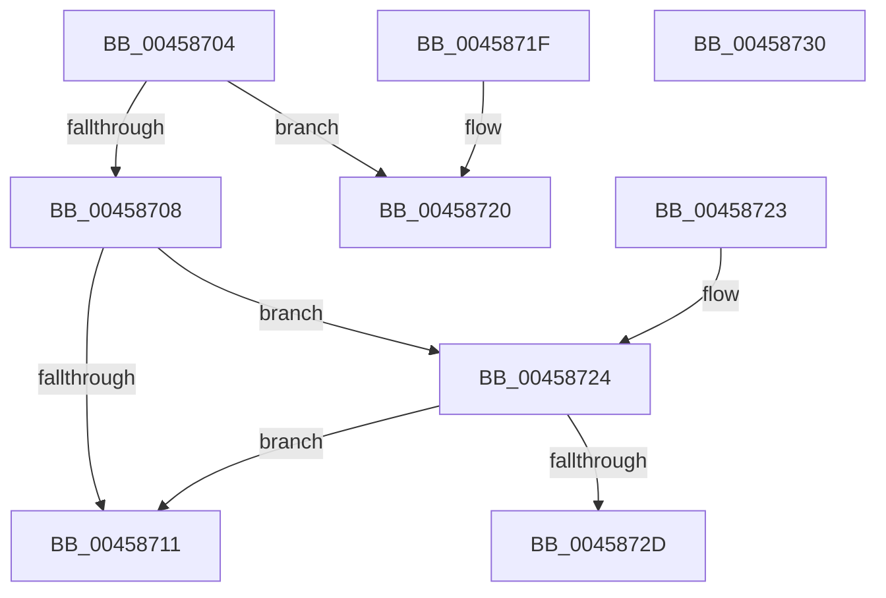

# SepIsSandboxedToken

- RVA: `0x00458704`–`0x00458731` (길이 `45` bytes)
- VA: `0x0000000140458704`
- 실행 섹션: `.text`
- PDB 이름 있음: `예`; PDB Function 태그: `아니요`
- unwind 정보 RVA: `0x000DB714`
- 디코드: `18`개 명령, `45/45` bytes 표시
- 미해석 바이트: `0` (있으면 어셈블리에 `.byte`로 보존)

> 이 문서는 커널 이미지의 기계어와 PDB 기호를 분석해 생성했습니다. 4번과 5번은 함수 원형과 자료형을 바이너리 사용 방식에서 추정한 C 해석이며 원본 소스 복구 결과는 아닙니다.

## 1. Dependencies

- 직접 호출 지점: **0**; 고유 호출 대상: **0**
- 직접 호출자로 확인된 함수: **2**
- RIP 상대 이미지 참조: **0**

### Outgoing calls
- 직접 디코드된 call 명령이 없습니다.

### Direct callers
- [SeQueryInformationToken](../../page/8B/SeQueryInformationToken_function_008B5090.md) at `0x008B6357`
- [NtQueryInformationToken](../../page/AE/NtQueryInformationToken_function_00AECDD0.md) at `0x00AF045A`

### Static image references
- 디코드된 RIP-relative 메모리 참조가 없습니다.

## 2. Other-region calls and transfers

- 다른 실행 섹션으로 향하는 call: **0**
- 별도 외부 분기/꼬리 이동을 확인하지 못했습니다.

## 3. Assembly (complete function range)

```asm
00458704  84 D2                           test dl, dl
00458706  74 18                           je 0x140458720
00458708  83 B9 C0 00 00 00 02            cmp dword ptr [rcx + 0xc0], 2
0045870F  74 13                           je 0x140458724
00458711  8B 81 C8 00 00 00               mov eax, dword ptr [rcx + 0xc8]
00458717  C1 E8 0D                        shr eax, 0xd
0045871A  F6 D0                           not al
0045871C  24 01                           and al, 1
0045871E  C3                              ret
0045871F  CC                              int3
00458720  32 C0                           xor al, al
00458722  C3                              ret
00458723  CC                              int3
00458724  83 B9 C4 00 00 00 02            cmp dword ptr [rcx + 0xc4], 2
0045872B  7D E4                           jge 0x140458711
0045872D  B0 01                           mov al, 1
0045872F  C3                              ret
00458730  CC                              int3
```

## 4. C-style interpretation (structured pseudocode)

```c
__int64 __fastcall SepIsSandboxedToken(__int64 a1, unsigned __int8 a2)
{
    __int64 result;

    if (a2 == 0) goto loc_00458720;
    if ((*(unsigned int *)(a1 + 192)) == 2) goto loc_00458724;
loc_00458711:
    result = (unsigned int)(((unsigned int)(*(unsigned int *)(a1 + 200))) >> (13));
    result = (unsigned __int8)(~(result));
    result = (unsigned __int8)((result) & (1));
    return result;
loc_00458720:
    result = 0;
    return result;
loc_00458724:
    if ((*(unsigned int *)(a1 + 196)) >= 2) goto loc_00458711;
    return 1;
}
```

## 5. (Beta) C Style

```c
int64_t SepIsSandboxedToken(void *Arg1, uint8_t Arg2)
{
    uint8_t *arg1 = (uint8_t *)Arg1;

    int64_t result;

    if (Arg2 == 0) goto loc_00458720;
    if ((*(uint32_t *)(arg1 + 0xC0)) == 2) goto loc_00458724;
loc_00458711:
    result = (uint32_t)(((uint32_t)(*(uint32_t *)(arg1 + 0xC8))) >> (13));
    result = (uint8_t)(~(result));
    result = (uint8_t)((result) & (1));
    return result;
loc_00458720:
    result = 0;
    return result;
loc_00458724:
    if ((*(uint32_t *)(arg1 + 0xC4)) >= 2) goto loc_00458711;
    return 1;
}
```

### 관측된 메모리 오프셋

구조체 형식이 확인되지 않은 접근은 인자 기준의 오프셋으로만 기록했습니다.

| 기준 인자 | 오프셋 표현 | 폭 (bit) | 접근 |
|---|---:|---:|---|
| `Arg1` | `+ 0xC0` | `32` | `R` |
| `Arg1` | `+ 0xC4` | `32` | `R` |
| `Arg1` | `+ 0xC8` | `32` | `R` |

## 6. Execution-region graph

[열기: 2D/3D 그래프와 함수 탐색 컨트롤 패널](../../../control-panel.html?section=text&rva=0x00458704&view=graph)

- 2D 그래프는 위에서 아래로 흐르고, 3D 그래프는 빈 공간을 드래그해 회전합니다. Shift+드래그는 이동, 휠은 확대·축소, 함수 노드 선택은 대상 보고서 이동입니다.

### Static fallback


