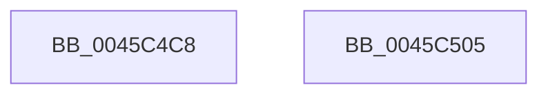

# SepReleaseOrderedReadLocks

- RVA: `0x0045C4C8`–`0x0045C506` (길이 `62` bytes)
- VA: `0x000000014045C4C8`
- 실행 섹션: `.text`
- PDB 이름 있음: `예`; PDB Function 태그: `아니요`
- unwind 정보 RVA: `0x0005CF00`
- 디코드: `15`개 명령, `62/62` bytes 표시
- 미해석 바이트: `0` (있으면 어셈블리에 `.byte`로 보존)

> 이 문서는 커널 이미지의 기계어와 PDB 기호를 분석해 생성했습니다. 4번과 5번은 함수 원형과 자료형을 바이너리 사용 방식에서 추정한 C 해석이며 원본 소스 복구 결과는 아닙니다.

## 1. Dependencies

- 직접 호출 지점: **4**; 고유 호출 대상: **2**
- 직접 호출자로 확인된 함수: **2**
- RIP 상대 이미지 참조: **0**

### Outgoing calls
- `0x0045C4D5` → [ExReleaseResourceLite](../25/ExReleaseResourceLite_function_0025FA10.md) (function, `0x0025FA10`)
- `0x0045C4E3` → [KeLeaveCriticalRegionThread](../25/KeLeaveCriticalRegionThread_function_0025EFF0.md) (function, `0x0025EFF0`)
- `0x0045C4EC` → [ExReleaseResourceLite](../25/ExReleaseResourceLite_function_0025FA10.md) (function, `0x0025FA10`)
- `0x0045C4FA` → [KeLeaveCriticalRegionThread](../25/KeLeaveCriticalRegionThread_function_0025EFF0.md) (function, `0x0025EFF0`)

### Direct callers
- [SeCompareTokens](../../page/8F/SeCompareTokens_function_008F6F40.md) at `0x008F70D1`
- [SepIsSiblingTokenByPointer](../../page/A3/SepIsSiblingTokenByPointer_function_00A3B514.md) at `0x00A3B604`

### Static image references
- 디코드된 RIP-relative 메모리 참조가 없습니다.

## 2. Other-region calls and transfers

- 다른 실행 섹션으로 향하는 call: **0**
- 별도 외부 분기/꼬리 이동을 확인하지 못했습니다.

## 3. Assembly (complete function range)

```asm
0045C4C8  40 53                           push rbx
0045C4CA  48 83 EC 20                     sub rsp, 0x20
0045C4CE  48 8B 49 30                     mov rcx, qword ptr [rcx + 0x30]
0045C4D2  48 8B DA                        mov rbx, rdx
0045C4D5  E8 36 35 E0 FF                  call 0x14025fa10
0045C4DA  65 48 8B 0C 25 88 01 00 00      mov rcx, qword ptr gs:[0x188]
0045C4E3  E8 08 2B E0 FF                  call 0x14025eff0
0045C4E8  48 8B 4B 30                     mov rcx, qword ptr [rbx + 0x30]
0045C4EC  E8 1F 35 E0 FF                  call 0x14025fa10
0045C4F1  65 48 8B 0C 25 88 01 00 00      mov rcx, qword ptr gs:[0x188]
0045C4FA  E8 F1 2A E0 FF                  call 0x14025eff0
0045C4FF  48 83 C4 20                     add rsp, 0x20
0045C503  5B                              pop rbx
0045C504  C3                              ret
0045C505  CC                              int3
```

## 4. C-style interpretation (structured pseudocode)

```c
__int64 __fastcall SepReleaseOrderedReadLocks(__int64 a1, __int64 a2)
{
    __int64 result;
    __int64 v_rsp;

    v_rsp = (v_rsp) - (32);
    result = ExReleaseResourceLite(*(unsigned __int64 *)(a1 + 48), a2, a3, a4);
    result = KeLeaveCriticalRegionThread(*(unsigned __int64 *)(gs_base + (0 + 392)), a2, a3, a4);
    result = ExReleaseResourceLite(*(unsigned __int64 *)(a2 + 48), a2, a3, a4);
    result = KeLeaveCriticalRegionThread(*(unsigned __int64 *)(gs_base + (0 + 392)), a2, a3, a4);
    v_rsp = (v_rsp) + (32);
    return result;
}
```

## 5. (Beta) C Style

```c
int64_t SepReleaseOrderedReadLocks(void *Arg1, void *Arg2)
{
    uint8_t *arg1 = (uint8_t *)Arg1;
    uint8_t *arg2 = (uint8_t *)Arg2;

    int64_t result;
    int64_t local_rsp;

    local_rsp = (local_rsp) - (32);
    result = ExReleaseResourceLite(*(uint64_t *)(arg1 + 0x30), Arg2, a3, a4);
    result = KeLeaveCriticalRegionThread(*(uint64_t *)(gs_base + (0 + 0x188)), Arg2, a3, a4);
    result = ExReleaseResourceLite(*(uint64_t *)(arg2 + 0x30), Arg2, a3, a4);
    result = KeLeaveCriticalRegionThread(*(uint64_t *)(gs_base + (0 + 0x188)), Arg2, a3, a4);
    local_rsp = (local_rsp) + (32);
    return result;
}
```

### 관측된 메모리 오프셋

구조체 형식이 확인되지 않은 접근은 인자 기준의 오프셋으로만 기록했습니다.

| 기준 인자 | 오프셋 표현 | 폭 (bit) | 접근 |
|---|---:|---:|---|
| `Arg1` | `+ 0x30` | `64` | `R` |
| `Arg2` | `+ 0x30` | `64` | `R` |

## 6. Execution-region graph

[열기: 2D/3D 그래프와 함수 탐색 컨트롤 패널](../../../control-panel.html?section=text&rva=0x0045C4C8&view=graph)

- 2D 그래프는 위에서 아래로 흐르고, 3D 그래프는 빈 공간을 드래그해 회전합니다. Shift+드래그는 이동, 휠은 확대·축소, 함수 노드 선택은 대상 보고서 이동입니다.

### Static fallback


