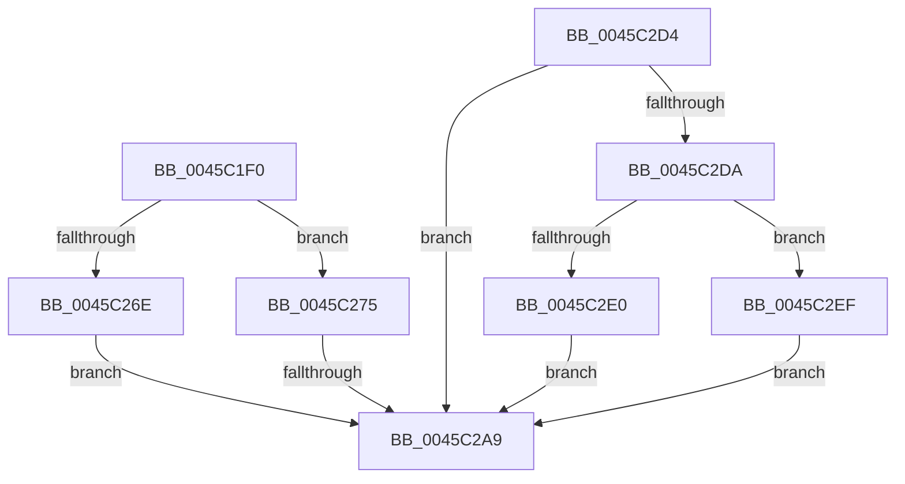

# SepVerifyDesktopAppPolicyOverrideCaller

- RVA: `0x0045C1F0`–`0x0045C316` (길이 `294` bytes)
- VA: `0x000000014045C1F0`
- 실행 섹션: `.text`
- PDB 이름 있음: `예`; PDB Function 태그: `예`
- unwind 정보 RVA: `0x000A94AC`
- 디코드: `67`개 명령, `294/294` bytes 표시
- 미해석 바이트: `0` (있으면 어셈블리에 `.byte`로 보존)

> 이 문서는 커널 이미지의 기계어와 PDB 기호를 분석해 생성했습니다. 4번과 5번은 함수 원형과 자료형을 바이너리 사용 방식에서 추정한 C 해석이며 원본 소스 복구 결과는 아닙니다.

## 1. Dependencies

- 직접 호출 지점: **5**; 고유 호출 대상: **5**
- 직접 호출자로 확인된 함수: **1**
- RIP 상대 이미지 참조: **2**

### Outgoing calls
- `0x0045C265` → [SeSinglePrivilegeCheck](../../page/87/SeSinglePrivilegeCheck_function_00871E20.md) (function, `0x00871E20`)
- `0x0045C29C` → [RtlQueryPackageClaims](RtlQueryPackageClaims_function_0045C3F0.md) (function, `0x0045C3F0`)
- `0x0045C2B6` → [_security_check_cookie](../6A/_security_check_cookie_function_006AC640.md) (function, `0x006AC640`)
- `0x0045C2E8` → [ObfDereferenceObjectWithTag](../2F/ObfDereferenceObjectWithTag_function_002F78E0.md) (function, `0x002F78E0`)
- `0x0045C30F` → [ObFastDereferenceObject](../3E/ObFastDereferenceObject_function_003ED5F0.md) (function, `0x003ED5F0`)

### Direct callers
- [SepDesktopAppxSubProcessToken](SepDesktopAppxSubProcessToken_function_0045BD90.md) at `0x0045BF5B`

### Static image references
- `0x0045C20E` → RVA `0x00E0A740` (`.data`; read)
- `0x0045C24E` → RVA `0x00FD9A78` (`PAGEDATA`; read)

## 2. Other-region calls and transfers

- 다른 실행 섹션으로 향하는 call: **1**
  - `0x0045C265` → [SeSinglePrivilegeCheck](../../page/87/SeSinglePrivilegeCheck_function_00871E20.md) (`.text` → `PAGE`)
- call이 아닌 외부 분기/꼬리 이동: **1**
  - `0x0045C2A3` → [sub_006F1F12](../6F/Unknown_function_006F1F12.md) (`tail-transfer`)

## 3. Assembly (complete function range)

```asm
0045C1F0  48 8B C4                        mov rax, rsp
0045C1F3  48 89 58 10                     mov qword ptr [rax + 0x10], rbx
0045C1F7  48 89 70 18                     mov qword ptr [rax + 0x18], rsi
0045C1FB  48 89 78 20                     mov qword ptr [rax + 0x20], rdi
0045C1FF  55                              push rbp
0045C200  48 8D A8 58 FE FF FF            lea rbp, [rax - 0x1a8]
0045C207  48 81 EC A0 02 00 00            sub rsp, 0x2a0
0045C20E  48 8B 05 2B E5 9A 00            mov rax, qword ptr [rip + 0x9ae52b]
0045C215  48 33 C4                        xor rax, rsp
0045C218  48 89 85 90 01 00 00            mov qword ptr [rbp + 0x190], rax
0045C21F  48 83 64 24 48 00               and qword ptr [rsp + 0x48], 0
0045C225  B8 00 01 00 00                  mov eax, 0x100
0045C22A  83 64 24 44 00                  and dword ptr [rsp + 0x44], 0
0045C22F  48 8B D9                        mov rbx, rcx
0045C232  48 89 44 24 58                  mov qword ptr [rsp + 0x58], rax
0045C237  0F 57 C0                        xorps xmm0, xmm0
0045C23A  48 89 44 24 50                  mov qword ptr [rsp + 0x50], rax
0045C23F  0F 57 C9                        xorps xmm1, xmm1
0045C242  65 48 8B 04 25 88 01 00 00      mov rax, qword ptr gs:[0x188]
0045C24B  40 32 FF                        xor dil, dil
0045C24E  48 8B 0D 23 D8 B7 00            mov rcx, qword ptr [rip + 0xb7d823]
0045C255  0F 11 44 24 60                  movups xmmword ptr [rsp + 0x60], xmm0
0045C25A  8A 90 32 02 00 00               mov dl, byte ptr [rax + 0x232]
0045C260  0F 11 4C 24 70                  movups xmmword ptr [rsp + 0x70], xmm1
0045C265  E8 B6 5B 41 00                  call 0x140871e20
0045C26A  84 C0                           test al, al
0045C26C  74 07                           je 0x14045c275
0045C26E  BF 01 00 00 00                  mov edi, 1
0045C273  EB 34                           jmp 0x14045c2a9
0045C275  48 83 64 24 38 00               and qword ptr [rsp + 0x38], 0
0045C27B  4C 8D 44 24 50                  lea r8, [rsp + 0x50]
0045C280  48 83 64 24 30 00               and qword ptr [rsp + 0x30], 0
0045C286  48 8D 55 90                     lea rdx, [rbp - 0x70]
0045C28A  48 83 64 24 28 00               and qword ptr [rsp + 0x28], 0
0045C290  45 33 C9                        xor r9d, r9d
0045C293  48 83 64 24 20 00               and qword ptr [rsp + 0x20], 0
0045C299  48 8B CB                        mov rcx, rbx
0045C29C  E8 4F 01 00 00                  call 0x14045c3f0
0045C2A1  85 C0                           test eax, eax
0045C2A3  0F 89 69 5C 29 00               jns 0x1406f1f12
0045C2A9  40 8A C7                        mov al, dil
0045C2AC  48 8B 8D 90 01 00 00            mov rcx, qword ptr [rbp + 0x190]
0045C2B3  48 33 CC                        xor rcx, rsp
0045C2B6  E8 85 03 25 00                  call 0x1406ac640
0045C2BB  4C 8D 9C 24 A0 02 00 00         lea r11, [rsp + 0x2a0]
0045C2C3  49 8B 5B 18                     mov rbx, qword ptr [r11 + 0x18]
0045C2C7  49 8B 73 20                     mov rsi, qword ptr [r11 + 0x20]
0045C2CB  49 8B 7B 28                     mov rdi, qword ptr [r11 + 0x28]
0045C2CF  49 8B E3                        mov rsp, r11
0045C2D2  5D                              pop rbp
0045C2D3  C3                              ret
0045C2D4  CC                              int3
0045C2D5  48 85 F6                        test rsi, rsi
0045C2D8  74 CF                           je 0x14045c2a9
0045C2DA  39 5C 24 44                     cmp dword ptr [rsp + 0x44], ebx
0045C2DE  74 0F                           je 0x14045c2ef
0045C2E0  BA 53 68 72 74                  mov edx, 0x74726853
0045C2E5  48 8B CE                        mov rcx, rsi
0045C2E8  E8 F3 B5 E9 FF                  call 0x1402f78e0
0045C2ED  EB BA                           jmp 0x14045c2a9
0045C2EF  65 48 8B 04 25 88 01 00 00      mov rax, qword ptr gs:[0x188]
0045C2F8  41 B8 53 68 72 74               mov r8d, 0x74726853
0045C2FE  48 8B D6                        mov rdx, rsi
0045C301  48 8B 88 B8 00 00 00            mov rcx, qword ptr [rax + 0xb8]
0045C308  48 81 C1 48 02 00 00            add rcx, 0x248
0045C30F  E8 DC 12 F9 FF                  call 0x1403ed5f0
0045C314  EB 93                           jmp 0x14045c2a9
```

## 4. C-style interpretation (structured pseudocode)

```c
__int64 __fastcall SepVerifyDesktopAppPolicyOverrideCaller(__int64 a1, __int64 a2, __int64 a3, int a4)
{
    __int64 result;
    __int64 v_rdi;
    __int64 v_rsp;
    unsigned __int64 v_stack_m238;
    unsigned __int64 v_stack_m248;
    unsigned __int64 v_stack_m250;
    unsigned __int64 v_stack_m258;
    unsigned int v_stack_m25C;
    unsigned __int64 v_stack_m260;
    unsigned int v_stack_m264;
    unsigned __int64 v_stack_m270;
    unsigned __int64 v_stack_m278;
    unsigned __int64 v_stack_m280;
    unsigned __int64 v_stack_m288;
    unsigned __int64 v_stack_m8;

    *(unsigned __int64 *)(v_rsp + 16) = v_rbx;
    *(unsigned __int64 *)(v_rsp + 24) = v_rsi;
    *(unsigned __int64 *)(v_rsp + 32) = v_rdi;
    v_rsp = (v_rsp) - (672);
    result = (*(unsigned __int64 *)(v_rip + 10151211)) ^ (v_rsp);
    *(unsigned __int64 *)(v_rsp - 424 + 400) = result;
    v_stack_m250 = 256;
    v_stack_m258 = 256;
    v_rdi = 0;
    v_stack_m248 = v_xmm0;
    v_stack_m238 = v_xmm1;
    result = SeSinglePrivilegeCheck(*(unsigned __int64 *)(v_rip + 12048419), *(unsigned __int8 *)(*(unsigned __int64 *)(gs_base + (0 + 392)) + 562), a3, a4);
    if ((unsigned __int8)(result) == 0) goto loc_0045C275;
    goto loc_0045C2A9;
loc_0045C275:
    a4 = 0;
    result = RtlQueryPackageClaims(a1, v_rsp - 424 - 112, v_stack_m258, a4);
loc_0045C2A9:
    a1 = (*(unsigned __int64 *)(v_rsp - 424 + 400)) ^ (v_rsp);
    result = _security_check_cookie(a1, v_rsp - 424 - 112, v_stack_m258, a4);
    return result;
}
```

## 5. (Beta) C Style

```c
int64_t SepVerifyDesktopAppPolicyOverrideCaller(int64_t Arg1, int64_t Arg2, int64_t Arg3, int32_t Arg4)
{
    int64_t result;
    int64_t local_rdi;
    int64_t local_rsp;
    uint64_t v_stack_m238;
    uint64_t v_stack_m248;
    uint64_t v_stack_m250;
    uint64_t v_stack_m258;
    uint32_t v_stack_m25C;
    uint64_t v_stack_m260;
    uint32_t v_stack_m264;
    uint64_t v_stack_m270;
    uint64_t v_stack_m278;
    uint64_t v_stack_m280;
    uint64_t v_stack_m288;
    uint64_t v_stack_m8;

    *(uint64_t *)(local_rsp + 0x10) = local_rbx;
    *(uint64_t *)(local_rsp + 0x18) = local_rsi;
    *(uint64_t *)(local_rsp + 0x20) = local_rdi;
    local_rsp = (local_rsp) - (672);
    result = (*(uint64_t *)(v_rip + 0x9AE52B)) ^ (local_rsp);
    *(uint64_t *)(local_rsp - 0x1A8 + 0x190) = result;
    v_stack_m250 = 256;
    v_stack_m258 = 256;
    local_rdi = 0;
    v_stack_m248 = v_xmm0;
    v_stack_m238 = v_xmm1;
    result = SeSinglePrivilegeCheck(*(uint64_t *)(v_rip + 0xB7D823), *(uint8_t *)(*(uint64_t *)(gs_base + (0 + 0x188)) + 0x232), Arg3, Arg4);
    if ((uint8_t)(result) == 0) goto loc_0045C275;
    goto loc_0045C2A9;
loc_0045C275:
    Arg4 = 0;
    result = RtlQueryPackageClaims(Arg1, local_rsp - 424 - 112, v_stack_m258, Arg4);
loc_0045C2A9:
    Arg1 = (*(uint64_t *)(local_rsp - 0x1A8 + 0x190)) ^ (local_rsp);
    result = _security_check_cookie(Arg1, local_rsp - 424 - 112, v_stack_m258, Arg4);
    return result;
}
```

## 6. Execution-region graph

[열기: 2D/3D 그래프와 함수 탐색 컨트롤 패널](../../../control-panel.html?section=text&rva=0x0045C1F0&view=graph)

- 2D 그래프는 위에서 아래로 흐르고, 3D 그래프는 빈 공간을 드래그해 회전합니다. Shift+드래그는 이동, 휠은 확대·축소, 함수 노드 선택은 대상 보고서 이동입니다.

### Static fallback


