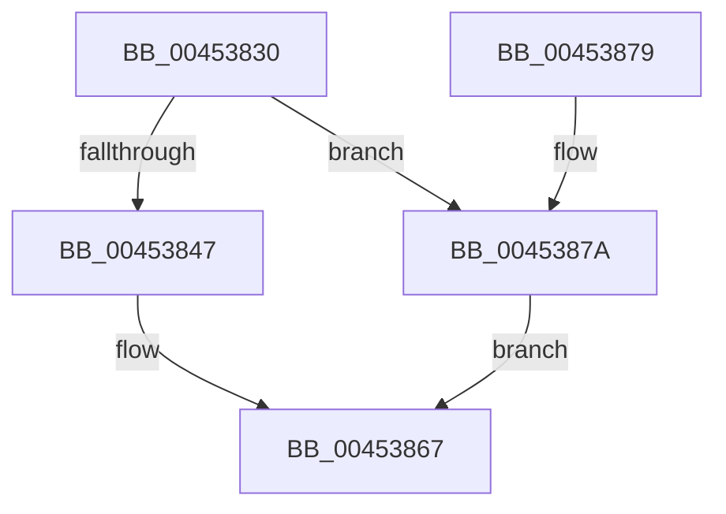

# SleepstudyHelperBlockerActiveDereference

- RVA: `0x00453830`–`0x00453881` (길이 `81` bytes)
- VA: `0x0000000140453830`
- 실행 섹션: `.text`
- PDB 이름 있음: `예`; PDB Function 태그: `아니요`
- unwind 정보 RVA: `0x0006383C`
- 디코드: `25`개 명령, `81/81` bytes 표시
- 미해석 바이트: `0` (있으면 어셈블리에 `.byte`로 보존)

> 이 문서는 커널 이미지의 기계어와 PDB 기호를 분석해 생성했습니다. 4번과 5번은 함수 원형과 자료형을 바이너리 사용 방식에서 추정한 C 해석이며 원본 소스 복구 결과는 아닙니다.

## 1. Dependencies

- 직접 호출 지점: **3**; 고유 호출 대상: **3**
- 직접 호출자로 확인된 함수: **5**
- RIP 상대 이미지 참조: **0**

### Outgoing calls
- `0x00453847` → [KeAcquireSpinLockRaiseToDpc](../20/KeAcquireSpinLockRaiseToDpc_function_00208470.md) (function, `0x00208470`)
- `0x00453856` → [SshpBlockerActiveDereference](SshpBlockerActiveDereference_function_00453888.md) (function, `0x00453888`)
- `0x00453862` → [KeReleaseSpinLock](../39/KeReleaseSpinLock_function_00392BA0.md) (function, `0x00392BA0`)

### Direct callers
- [PopPowerRequestStatsNotifyScenarioStateChange](PopPowerRequestStatsNotifyScenarioStateChange_function_00453794.md) at `0x004537B5`
- [PopSwitchUpdateUserShutdownScenarioState](../../page/75/PopSwitchUpdateUserShutdownScenarioState_function_0075F260.md) at `0x0075F374`
- [PopUserShutdownCalloutDelayTimerWorker](../../page/75/PopUserShutdownCalloutDelayTimerWorker_function_0075F3C0.md) at `0x0075F3DE`
- [PopDispatchShutdownEvent](../../page/76/PopDispatchShutdownEvent_function_00765C60.md) at `0x00765CD7`
- [PopPowerRequestStatsSetActive](../../page/A7/PopPowerRequestStatsSetActive_function_00A7DAC0.md) at `0x00A7DADF`

### Static image references
- 디코드된 RIP-relative 메모리 참조가 없습니다.

## 2. Other-region calls and transfers

- 다른 실행 섹션으로 향하는 call: **0**
- 별도 외부 분기/꼬리 이동을 확인하지 못했습니다.

## 3. Assembly (complete function range)

```asm
00453830  48 89 5C 24 08                  mov qword ptr [rsp + 8], rbx
00453835  48 89 74 24 10                  mov qword ptr [rsp + 0x10], rsi
0045383A  57                              push rdi
0045383B  48 83 EC 20                     sub rsp, 0x20
0045383F  48 8B F9                        mov rdi, rcx
00453842  48 85 C9                        test rcx, rcx
00453845  74 33                           je 0x14045387a
00453847  E8 24 4C DB FF                  call 0x140208470
0045384C  BA 01 00 00 00                  mov edx, 1
00453851  48 8B CF                        mov rcx, rdi
00453854  8A D8                           mov bl, al
00453856  E8 2D 00 00 00                  call 0x140453888
0045385B  8A D3                           mov dl, bl
0045385D  48 8B CF                        mov rcx, rdi
00453860  8B F0                           mov esi, eax
00453862  E8 39 F3 F3 FF                  call 0x140392ba0
00453867  48 8B 5C 24 30                  mov rbx, qword ptr [rsp + 0x30]
0045386C  8B C6                           mov eax, esi
0045386E  48 8B 74 24 38                  mov rsi, qword ptr [rsp + 0x38]
00453873  48 83 C4 20                     add rsp, 0x20
00453877  5F                              pop rdi
00453878  C3                              ret
00453879  CC                              int3
0045387A  BE 0D 00 00 C0                  mov esi, 0xc000000d
0045387F  EB E6                           jmp 0x140453867
```

## 4. C-style interpretation (structured pseudocode)

```c
__int64 __fastcall SleepstudyHelperBlockerActiveDereference(__int64 a1)
{
    __int64 result;
    __int64 v_rsp;
    unsigned __int64 v_stack_p10;
    unsigned __int64 v_stack_p8;

    v_stack_p8 = v_rbx;
    v_stack_p10 = v_rsi;
    v_rsp = (v_rsp) - (32);
    if (a1 == 0) goto loc_0045387A;
    result = KeAcquireSpinLockRaiseToDpc(a1, a2, a3, a4);
    result = SshpBlockerActiveDereference(a1, 1, a3, a4);
    result = KeReleaseSpinLock(a1, (unsigned __int8)((unsigned __int8)(result)), a3, a4);
loc_00453867:
    v_rsp = (v_rsp) + (32);
    return (unsigned int)((unsigned int)((unsigned int)((unsigned int)(result))));
loc_0045387A:
    goto loc_00453867;
}
```

## 5. (Beta) C Style

```c
int64_t SleepstudyHelperBlockerActiveDereference(int64_t Arg1)
{
    int64_t result;
    int64_t local_rsp;
    uint64_t v_stack_p10;
    uint64_t v_stack_p8;

    v_stack_p8 = local_rbx;
    v_stack_p10 = local_rsi;
    local_rsp = (local_rsp) - (32);
    if (Arg1 == 0) goto loc_0045387A;
    result = KeAcquireSpinLockRaiseToDpc(Arg1, a2, a3, a4);
    result = SshpBlockerActiveDereference(Arg1, 1, a3, a4);
    result = KeReleaseSpinLock(Arg1, (uint8_t)((uint8_t)(result)), a3, a4);
loc_00453867:
    local_rsp = (local_rsp) + (32);
    return (uint32_t)((uint32_t)((uint32_t)((uint32_t)(result))));
loc_0045387A:
    goto loc_00453867;
}
```

## 6. Execution-region graph

[열기: 2D/3D 그래프와 함수 탐색 컨트롤 패널](../../../control-panel.html?section=text&rva=0x00453830&view=graph)

- 2D 그래프는 위에서 아래로 흐르고, 3D 그래프는 빈 공간을 드래그해 회전합니다. Shift+드래그는 이동, 휠은 확대·축소, 함수 노드 선택은 대상 보고서 이동입니다.

### Static fallback


