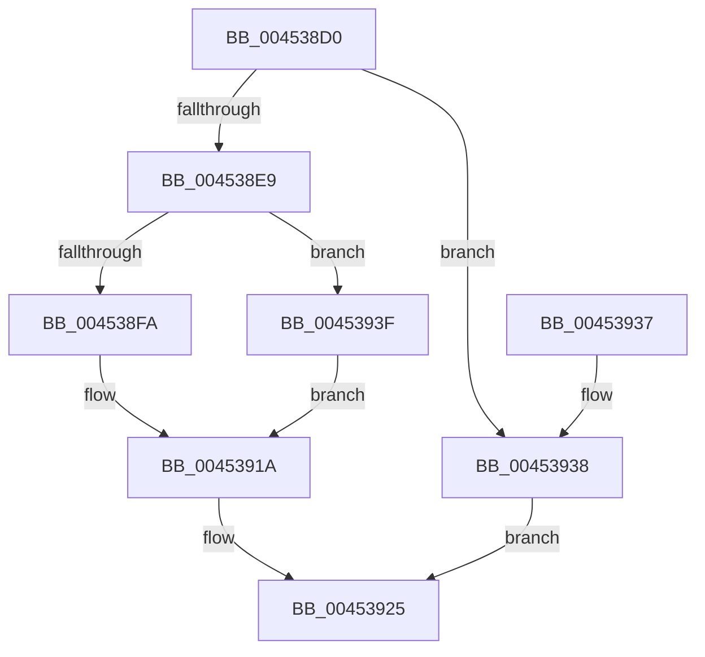

# SleepstudyHelperBlockerActiveReference

- RVA: `0x004538D0`–`0x00453946` (길이 `118` bytes)
- VA: `0x00000001404538D0`
- 실행 섹션: `.text`
- PDB 이름 있음: `예`; PDB Function 태그: `아니요`
- unwind 정보 RVA: `0x000A781C`
- 디코드: `32`개 명령, `118/118` bytes 표시
- 미해석 바이트: `0` (있으면 어셈블리에 `.byte`로 보존)

> 이 문서는 커널 이미지의 기계어와 PDB 기호를 분석해 생성했습니다. 4번과 5번은 함수 원형과 자료형을 바이너리 사용 방식에서 추정한 C 해석이며 원본 소스 복구 결과는 아닙니다.

## 1. Dependencies

- 직접 호출 지점: **3**; 고유 호출 대상: **3**
- 직접 호출자로 확인된 함수: **4**
- RIP 상대 이미지 참조: **0**

### Outgoing calls
- `0x004538E9` → [KeAcquireSpinLockRaiseToDpc](../20/KeAcquireSpinLockRaiseToDpc_function_00208470.md) (function, `0x00208470`)
- `0x00453915` → [SshpIterateParentBlockers](SshpIterateParentBlockers_function_0045394C.md) (function, `0x0045394C`)
- `0x00453920` → [KeReleaseSpinLock](../39/KeReleaseSpinLock_function_00392BA0.md) (function, `0x00392BA0`)

### Direct callers
- [PopPowerRequestStatsNotifyScenarioStateChange](PopPowerRequestStatsNotifyScenarioStateChange_function_00453794.md) at `0x004537BC`
- [PopSwitchUpdateUserShutdownScenarioState](../../page/75/PopSwitchUpdateUserShutdownScenarioState_function_0075F260.md) at `0x0075F31E`
- [PopDispatchShutdownEvent](../../page/76/PopDispatchShutdownEvent_function_00765C60.md) at `0x00765C91`
- [PopPowerRequestStatsSetActive](../../page/A7/PopPowerRequestStatsSetActive_function_00A7DAC0.md) at `0x00A7DAEA`

### Static image references
- 디코드된 RIP-relative 메모리 참조가 없습니다.

## 2. Other-region calls and transfers

- 다른 실행 섹션으로 향하는 call: **0**
- 별도 외부 분기/꼬리 이동을 확인하지 못했습니다.

## 3. Assembly (complete function range)

```asm
004538D0  48 89 5C 24 08                  mov qword ptr [rsp + 8], rbx
004538D5  48 89 74 24 10                  mov qword ptr [rsp + 0x10], rsi
004538DA  57                              push rdi
004538DB  48 83 EC 40                     sub rsp, 0x40
004538DF  33 DB                           xor ebx, ebx
004538E1  48 8B F9                        mov rdi, rcx
004538E4  48 85 C9                        test rcx, rcx
004538E7  74 4F                           je 0x140453938
004538E9  E8 82 4B DB FF                  call 0x140208470
004538EE  81 7F 14 FE FF FF 7F            cmp dword ptr [rdi + 0x14], 0x7ffffffe
004538F5  40 8A F0                        mov sil, al
004538F8  7F 45                           jg 0x14045393f
004538FA  4C 8D 44 24 20                  lea r8, [rsp + 0x20]
004538FF  48 89 5C 24 20                  mov qword ptr [rsp + 0x20], rbx
00453904  48 8B CF                        mov rcx, rdi
00453907  48 C7 44 24 30 01 00 00 00      mov qword ptr [rsp + 0x30], 1
00453910  48 89 7C 24 28                  mov qword ptr [rsp + 0x28], rdi
00453915  E8 32 00 00 00                  call 0x14045394c
0045391A  40 8A D6                        mov dl, sil
0045391D  48 8B CF                        mov rcx, rdi
00453920  E8 7B F2 F3 FF                  call 0x140392ba0
00453925  48 8B 74 24 58                  mov rsi, qword ptr [rsp + 0x58]
0045392A  8B C3                           mov eax, ebx
0045392C  48 8B 5C 24 50                  mov rbx, qword ptr [rsp + 0x50]
00453931  48 83 C4 40                     add rsp, 0x40
00453935  5F                              pop rdi
00453936  C3                              ret
00453937  CC                              int3
00453938  BB 0D 00 00 C0                  mov ebx, 0xc000000d
0045393D  EB E6                           jmp 0x140453925
0045393F  BB 95 00 00 C0                  mov ebx, 0xc0000095
00453944  EB D4                           jmp 0x14045391a
```

## 4. C-style interpretation (structured pseudocode)

```c
__int64 __fastcall SleepstudyHelperBlockerActiveReference(__int64 a1)
{
    __int64 result;
    __int64 v_rbx;
    __int64 v_rsp;
    unsigned __int64 v_stack_m18;
    unsigned __int64 v_stack_m20;
    unsigned __int64 v_stack_m28;
    unsigned __int64 v_stack_p10;
    unsigned __int64 v_stack_p8;

    v_stack_p8 = v_rbx;
    v_stack_p10 = v_rsi;
    v_rsp = (v_rsp) - (64);
    v_rbx = 0;
    if (a1 == 0) goto loc_00453938;
    result = KeAcquireSpinLockRaiseToDpc(a1, a2, a3, a4);
    if ((*(unsigned int *)(a1 + 20)) > 0x7FFFFFFEULL) goto loc_0045393F;
    v_stack_m28 = 0;
    v_stack_m18 = 1;
    v_stack_m20 = a1;
    result = SshpIterateParentBlockers(a1, a2, v_stack_m28, a4);
loc_0045391A:
    result = KeReleaseSpinLock(a1, (unsigned __int8)((unsigned __int8)(result)), v_stack_m28, a4);
loc_00453925:
    v_rsp = (v_rsp) + (64);
    return 0;
loc_00453938:
    goto loc_00453925;
loc_0045393F:
    goto loc_0045391A;
}
```

## 5. (Beta) C Style

```c
int64_t SleepstudyHelperBlockerActiveReference(void *Arg1)
{
    uint8_t *arg1 = (uint8_t *)Arg1;

    int64_t result;
    int64_t local_rbx;
    int64_t local_rsp;
    uint64_t v_stack_m18;
    uint64_t v_stack_m20;
    uint64_t v_stack_m28;
    uint64_t v_stack_p10;
    uint64_t v_stack_p8;

    v_stack_p8 = local_rbx;
    v_stack_p10 = local_rsi;
    local_rsp = (local_rsp) - (64);
    local_rbx = 0;
    if (Arg1 == NULL) goto loc_00453938;
    result = KeAcquireSpinLockRaiseToDpc(Arg1, a2, a3, a4);
    if ((*(uint32_t *)(arg1 + 0x14)) > 0x7FFFFFFEULL) goto loc_0045393F;
    v_stack_m28 = 0;
    v_stack_m18 = 1;
    v_stack_m20 = Arg1;
    result = SshpIterateParentBlockers(Arg1, a2, v_stack_m28, a4);
loc_0045391A:
    result = KeReleaseSpinLock(Arg1, (uint8_t)((uint8_t)(result)), v_stack_m28, a4);
loc_00453925:
    local_rsp = (local_rsp) + (64);
    return 0;
loc_00453938:
    goto loc_00453925;
loc_0045393F:
    goto loc_0045391A;
}
```

### 관측된 메모리 오프셋

구조체 형식이 확인되지 않은 접근은 인자 기준의 오프셋으로만 기록했습니다.

| 기준 인자 | 오프셋 표현 | 폭 (bit) | 접근 |
|---|---:|---:|---|
| `Arg1` | `+ 0x14` | `32` | `R` |

## 6. Execution-region graph

[열기: 2D/3D 그래프와 함수 탐색 컨트롤 패널](../../../control-panel.html?section=text&rva=0x004538D0&view=graph)

- 2D 그래프는 위에서 아래로 흐르고, 3D 그래프는 빈 공간을 드래그해 회전합니다. Shift+드래그는 이동, 휠은 확대·축소, 함수 노드 선택은 대상 보고서 이동입니다.

### Static fallback


