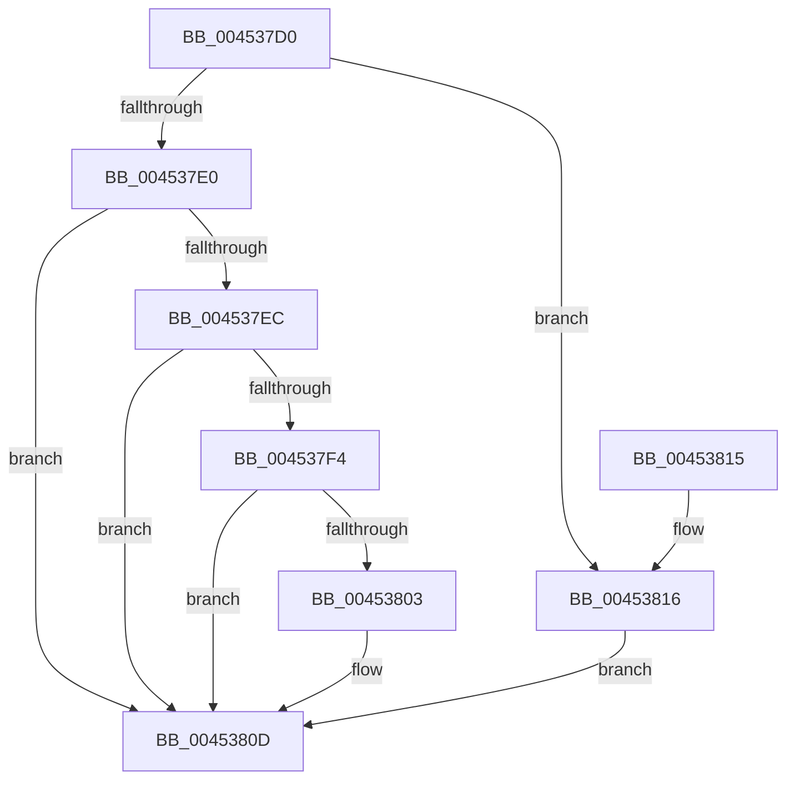

# SleepstudyHelper_ComponentActiveLocked

- RVA: `0x004537D0`–`0x0045381D` (길이 `77` bytes)
- VA: `0x00000001404537D0`
- 실행 섹션: `.text`
- PDB 이름 있음: `예`; PDB Function 태그: `아니요`
- unwind 정보 RVA: `0x0005DAC8`
- 디코드: `27`개 명령, `77/77` bytes 표시
- 미해석 바이트: `0` (있으면 어셈블리에 `.byte`로 보존)

> 이 문서는 커널 이미지의 기계어와 PDB 기호를 분석해 생성했습니다. 4번과 5번은 함수 원형과 자료형을 바이너리 사용 방식에서 추정한 C 해석이며 원본 소스 복구 결과는 아닙니다.

## 1. Dependencies

- 직접 호출 지점: **1**; 고유 호출 대상: **1**
- 직접 호출자로 확인된 함수: **1**
- RIP 상대 이미지 참조: **1**

### Outgoing calls
- `0x00453808` → [SshpSetBlockerActive](SshpSetBlockerActive_function_00453A90.md) (function, `0x00453A90`)

### Direct callers
- [SleepstudyHelper_ComponentActive](SleepstudyHelper_ComponentActive_function_00453730.md) at `0x00453772`

### Static image references
- `0x004537E0` → RVA `0x00F06B68` (`.data`; read)

## 2. Other-region calls and transfers

- 다른 실행 섹션으로 향하는 call: **0**
- 별도 외부 분기/꼬리 이동을 확인하지 못했습니다.

## 3. Assembly (complete function range)

```asm
004537D0  40 53                           push rbx
004537D2  48 83 EC 20                     sub rsp, 0x20
004537D6  33 DB                           xor ebx, ebx
004537D8  48 8B C1                        mov rax, rcx
004537DB  48 85 C9                        test rcx, rcx
004537DE  74 36                           je 0x140453816
004537E0  48 8D 0D 81 33 AB 00            lea rcx, [rip + 0xab3381]
004537E7  48 3B C1                        cmp rax, rcx
004537EA  74 21                           je 0x14045380d
004537EC  8B 48 08                        mov ecx, dword ptr [rax + 8]
004537EF  F6 C1 10                        test cl, 0x10
004537F2  75 19                           jne 0x14045380d
004537F4  FF 40 14                        inc dword ptr [rax + 0x14]
004537F7  83 C9 10                        or ecx, 0x10
004537FA  83 78 14 01                     cmp dword ptr [rax + 0x14], 1
004537FE  89 48 08                        mov dword ptr [rax + 8], ecx
00453801  75 0A                           jne 0x14045380d
00453803  B2 01                           mov dl, 1
00453805  48 8B C8                        mov rcx, rax
00453808  E8 83 02 00 00                  call 0x140453a90
0045380D  8B C3                           mov eax, ebx
0045380F  48 83 C4 20                     add rsp, 0x20
00453813  5B                              pop rbx
00453814  C3                              ret
00453815  CC                              int3
00453816  BB 0D 00 00 C0                  mov ebx, 0xc000000d
0045381B  EB F0                           jmp 0x14045380d
```

## 4. C-style interpretation (structured pseudocode)

```c
__int64 __fastcall SleepstudyHelper_ComponentActiveLocked(__int64 a1)
{
    __int64 result;
    __int64 v_rbx;
    __int64 v_rsp;

    v_rsp = (v_rsp) - (32);
    v_rbx = 0;
    if (a1 == 0) goto loc_00453816;
    if (a1 == (v_rip + 11219841)) goto loc_0045380D;
    if ((((unsigned __int8)((unsigned int)(*(unsigned int *)(a1 + 8)))) & (16)) != 0) goto loc_0045380D;
    a1 = (unsigned int)(((unsigned int)(*(unsigned int *)(a1 + 8))) | (16));
    *(unsigned int *)(a1 + 8) = (unsigned int)(a1);
    result = a1;
    if ((*(unsigned int *)(a1 + 20)) == 1) {
        a2 = 1;
        a1 = a1;
        result = SshpSetBlockerActive(a1, a2, a3, a4);
    }
    v_rsp = (v_rsp) + (32);
    return 0;
loc_00453816:
    goto loc_0045380D;
}
```

## 5. (Beta) C Style

```c
int64_t SleepstudyHelper_ComponentActiveLocked(int64_t Arg1)
{
    int64_t result;
    int64_t local_rbx;
    int64_t local_rsp;

    local_rsp = (local_rsp) - (32);
    local_rbx = 0;
    if (Arg1 == 0) goto loc_00453816;
    if (Arg1 == (v_rip + 11219841)) goto loc_0045380D;
    if ((((uint8_t)((uint32_t)(*(uint32_t *)(Arg1 + 0x8)))) & (16)) != 0) goto loc_0045380D;
    Arg1 = (uint32_t)(((uint32_t)(*(uint32_t *)(Arg1 + 0x8))) | (16));
    *(uint32_t *)(Arg1 + 0x8) = (uint32_t)(Arg1);
    result = Arg1;
    if ((*(uint32_t *)(Arg1 + 0x14)) == 1) {
        a2 = 1;
        Arg1 = Arg1;
        result = SshpSetBlockerActive(Arg1, a2, a3, a4);
    }
    local_rsp = (local_rsp) + (32);
    return 0;
loc_00453816:
    goto loc_0045380D;
}
```

## 6. Execution-region graph

[열기: 2D/3D 그래프와 함수 탐색 컨트롤 패널](../../../control-panel.html?section=text&rva=0x004537D0&view=graph)

- 2D 그래프는 위에서 아래로 흐르고, 3D 그래프는 빈 공간을 드래그해 회전합니다. Shift+드래그는 이동, 휠은 확대·축소, 함수 노드 선택은 대상 보고서 이동입니다.

### Static fallback


