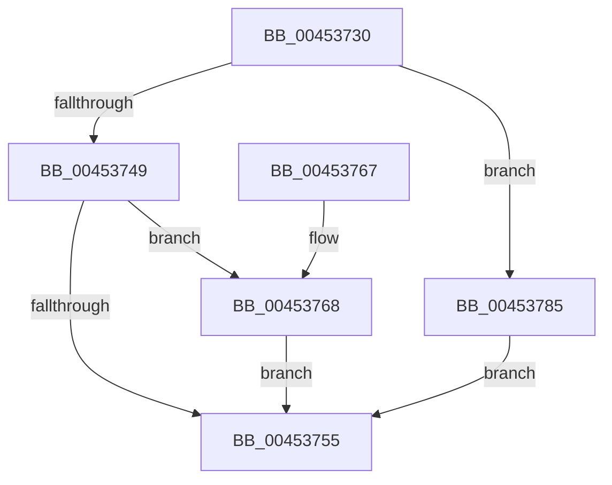

# SleepstudyHelper_ComponentActive

- RVA: `0x00453730`–`0x0045378C` (길이 `92` bytes)
- VA: `0x0000000140453730`
- 실행 섹션: `.text`
- PDB 이름 있음: `예`; PDB Function 태그: `아니요`
- unwind 정보 RVA: `0x0008D44C`
- 디코드: `29`개 명령, `92/92` bytes 표시
- 미해석 바이트: `0` (있으면 어셈블리에 `.byte`로 보존)

> 이 문서는 커널 이미지의 기계어와 PDB 기호를 분석해 생성했습니다. 4번과 5번은 함수 원형과 자료형을 바이너리 사용 방식에서 추정한 C 해석이며 원본 소스 복구 결과는 아닙니다.

## 1. Dependencies

- 직접 호출 지점: **3**; 고유 호출 대상: **3**
- 직접 호출자로 확인된 함수: **0**
- RIP 상대 이미지 참조: **1**

### Outgoing calls
- `0x00453768` → [KeAcquireSpinLockRaiseToDpc](../20/KeAcquireSpinLockRaiseToDpc_function_00208470.md) (function, `0x00208470`)
- `0x00453772` → [SleepstudyHelper_ComponentActiveLocked](SleepstudyHelper_ComponentActiveLocked_function_004537D0.md) (function, `0x004537D0`)
- `0x0045377E` → [KeReleaseSpinLock](../39/KeReleaseSpinLock_function_00392BA0.md) (function, `0x00392BA0`)

### Direct callers
- 이 함수 시작 RVA로 연결되는 직접 call은 확인되지 않았습니다. 간접 호출은 완전히 역산할 수 없습니다.

### Static image references
- `0x00453749` → RVA `0x00F06B68` (`.data`; read)

## 2. Other-region calls and transfers

- 다른 실행 섹션으로 향하는 call: **0**
- 별도 외부 분기/꼬리 이동을 확인하지 못했습니다.

## 3. Assembly (complete function range)

```asm
00453730  48 89 5C 24 08                  mov qword ptr [rsp + 8], rbx
00453735  48 89 74 24 10                  mov qword ptr [rsp + 0x10], rsi
0045373A  57                              push rdi
0045373B  48 83 EC 20                     sub rsp, 0x20
0045373F  33 FF                           xor edi, edi
00453741  48 8B F1                        mov rsi, rcx
00453744  48 85 C9                        test rcx, rcx
00453747  74 3C                           je 0x140453785
00453749  48 8D 05 18 34 AB 00            lea rax, [rip + 0xab3418]
00453750  48 3B C8                        cmp rcx, rax
00453753  75 13                           jne 0x140453768
00453755  48 8B 5C 24 30                  mov rbx, qword ptr [rsp + 0x30]
0045375A  8B C7                           mov eax, edi
0045375C  48 8B 74 24 38                  mov rsi, qword ptr [rsp + 0x38]
00453761  48 83 C4 20                     add rsp, 0x20
00453765  5F                              pop rdi
00453766  C3                              ret
00453767  CC                              int3
00453768  E8 03 4D DB FF                  call 0x140208470
0045376D  48 8B CE                        mov rcx, rsi
00453770  8A D8                           mov bl, al
00453772  E8 59 00 00 00                  call 0x1404537d0
00453777  8A D3                           mov dl, bl
00453779  48 8B CE                        mov rcx, rsi
0045377C  8B F8                           mov edi, eax
0045377E  E8 1D F4 F3 FF                  call 0x140392ba0
00453783  EB D0                           jmp 0x140453755
00453785  BF 0D 00 00 C0                  mov edi, 0xc000000d
0045378A  EB C9                           jmp 0x140453755
```

## 4. C-style interpretation (structured pseudocode)

```c
__int64 __fastcall SleepstudyHelper_ComponentActive(__int64 a1)
{
    __int64 result;
    __int64 v_rdi;
    __int64 v_rsp;
    unsigned __int64 v_stack_p10;
    unsigned __int64 v_stack_p8;

    v_stack_p8 = v_rbx;
    v_stack_p10 = v_rsi;
    v_rsp = (v_rsp) - (32);
    v_rdi = 0;
    if (a1 == 0) goto loc_00453785;
    if (a1 != (v_rip + 11219992)) goto loc_00453768;
loc_00453755:
    v_rsp = (v_rsp) + (32);
    return 0;
loc_00453768:
    result = KeAcquireSpinLockRaiseToDpc(a1, a2, a3, a4);
    result = SleepstudyHelper_ComponentActiveLocked(v_stack_p10, a2, a3, a4);
    result = KeReleaseSpinLock(v_stack_p10, (unsigned __int8)((unsigned __int8)(result)), a3, a4);
    goto loc_00453755;
loc_00453785:
    goto loc_00453755;
}
```

## 5. (Beta) C Style

```c
int64_t SleepstudyHelper_ComponentActive(int64_t Arg1)
{
    int64_t result;
    int64_t local_rdi;
    int64_t local_rsp;
    uint64_t v_stack_p10;
    uint64_t v_stack_p8;

    v_stack_p8 = local_rbx;
    v_stack_p10 = local_rsi;
    local_rsp = (local_rsp) - (32);
    local_rdi = 0;
    if (Arg1 == 0) goto loc_00453785;
    if (Arg1 != (v_rip + 11219992)) goto loc_00453768;
loc_00453755:
    local_rsp = (local_rsp) + (32);
    return 0;
loc_00453768:
    result = KeAcquireSpinLockRaiseToDpc(Arg1, a2, a3, a4);
    result = SleepstudyHelper_ComponentActiveLocked(v_stack_p10, a2, a3, a4);
    result = KeReleaseSpinLock(v_stack_p10, (uint8_t)((uint8_t)(result)), a3, a4);
    goto loc_00453755;
loc_00453785:
    goto loc_00453755;
}
```

## 6. Execution-region graph

[열기: 2D/3D 그래프와 함수 탐색 컨트롤 패널](../../../control-panel.html?section=text&rva=0x00453730&view=graph)

- 2D 그래프는 위에서 아래로 흐르고, 3D 그래프는 빈 공간을 드래그해 회전합니다. Shift+드래그는 이동, 휠은 확대·축소, 함수 노드 선택은 대상 보고서 이동입니다.

### Static fallback


