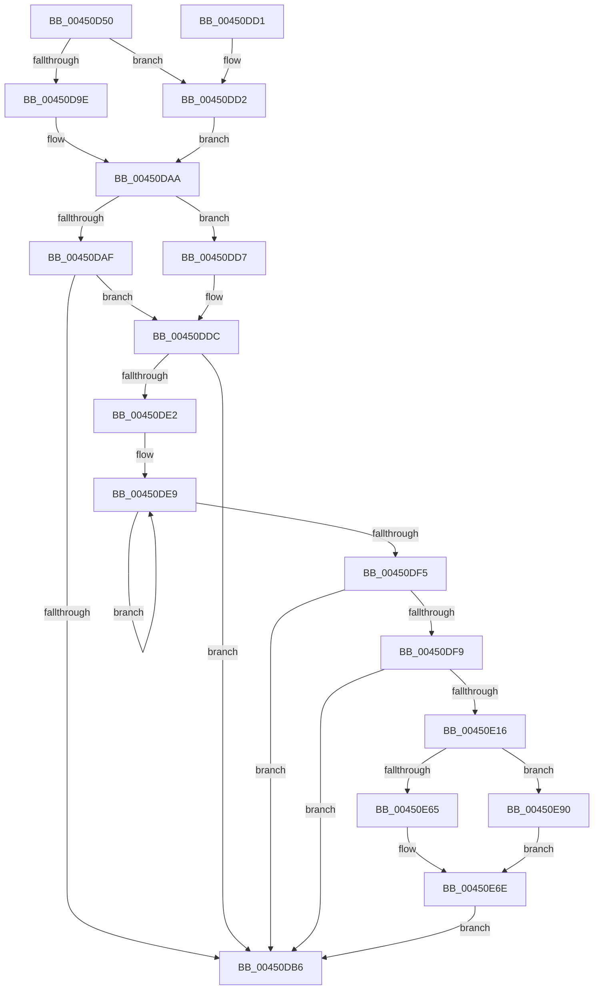

# SmKmStoreDeleteWhenEmpty

- RVA: `0x00450D50`–`0x00450E97` (길이 `327` bytes)
- VA: `0x0000000140450D50`
- 실행 섹션: `.text`
- PDB 이름 있음: `예`; PDB Function 태그: `아니요`
- unwind 정보 RVA: `0x000A7374`
- 디코드: `89`개 명령, `327/327` bytes 표시
- 미해석 바이트: `0` (있으면 어셈블리에 `.byte`로 보존)

> 이 문서는 커널 이미지의 기계어와 PDB 기호를 분석해 생성했습니다. 4번과 5번은 함수 원형과 자료형을 바이너리 사용 방식에서 추정한 C 해석이며 원본 소스 복구 결과는 아닙니다.

## 1. Dependencies

- 직접 호출 지점: **4**; 고유 호출 대상: **4**
- 직접 호출자로 확인된 함수: **2**
- RIP 상대 이미지 참조: **1**

### Outgoing calls
- `0x00450E0D` → [guard_dispatch_icall](../6B/guard_dispatch_icall_function_006BAAD0.md) (function, `0x006BAAD0`)
- `0x00450E69` → [ExQueueWorkItemToPartition](../35/ExQueueWorkItemToPartition_function_00356E2C.md) (function, `0x00356E2C`)
- `0x00450E81` → [KeWaitForSingleObject](../20/KeWaitForSingleObject_function_0020E6B0.md) (function, `0x0020E6B0`)
- `0x00450E90` → [ExQueueWorkItem](../2F/ExQueueWorkItem_function_002F9520.md) (function, `0x002F9520`)

### Direct callers
- [SmpKeyedStoreCreate](../../page/A5/SmpKeyedStoreCreate_function_00A50B64.md) at `0x00A50C96`
- [SmProcessDeleteNotification](../../page/A6/SmProcessDeleteNotification_function_00A686F4.md) at `0x00A6875F`

### Static image references
- `0x00450E2A` → RVA `0x00434130` (`SmKmStoreDeleteWhenEmptyWorker`; read)

## 2. Other-region calls and transfers

- 다른 실행 섹션으로 향하는 call: **0**
- 별도 외부 분기/꼬리 이동을 확인하지 못했습니다.

## 3. Assembly (complete function range)

```asm
00450D50  48 89 5C 24 10                  mov qword ptr [rsp + 0x10], rbx
00450D55  48 89 74 24 18                  mov qword ptr [rsp + 0x18], rsi
00450D5A  4C 89 74 24 20                  mov qword ptr [rsp + 0x20], r14
00450D5F  55                              push rbp
00450D60  48 8B EC                        mov rbp, rsp
00450D63  48 81 EC 80 00 00 00            sub rsp, 0x80
00450D6A  8B B2 90 1A 00 00               mov esi, dword ptr [rdx + 0x1a90]
00450D70  33 DB                           xor ebx, ebx
00450D72  81 E6 FF 03 00 00               and esi, 0x3ff
00450D78  48 89 5D B8                     mov qword ptr [rbp - 0x48], rbx
00450D7C  8B C6                           mov eax, esi
00450D7E  4C 8B D2                        mov r10, rdx
00450D81  48 C1 E8 05                     shr rax, 5
00450D85  4C 8B F1                        mov r14, rcx
00450D88  88 5D D3                        mov byte ptr [rbp - 0x2d], bl
00450D8B  89 5D F4                        mov dword ptr [rbp - 0xc], ebx
00450D8E  48 89 5D 10                     mov qword ptr [rbp + 0x10], rbx
00450D92  48 8B 14 C1                     mov rdx, qword ptr [rcx + rax*8]
00450D96  44 8B CE                        mov r9d, esi
00450D99  48 85 D2                        test rdx, rdx
00450D9C  74 34                           je 0x140450dd2
00450D9E  41 83 E1 1F                     and r9d, 0x1f
00450DA2  4B 8D 04 89                     lea rax, [r9 + r9*4]
00450DA6  48 8D 14 C2                     lea rdx, [rdx + rax*8]
00450DAA  45 85 C0                        test r8d, r8d
00450DAD  75 28                           jne 0x140450dd7
00450DAF  8A 42 22                        mov al, byte ptr [rdx + 0x22]
00450DB2  A8 01                           test al, 1
00450DB4  75 26                           jne 0x140450ddc
00450DB6  4C 8D 9C 24 80 00 00 00         lea r11, [rsp + 0x80]
00450DBE  8B C3                           mov eax, ebx
00450DC0  49 8B 5B 18                     mov rbx, qword ptr [r11 + 0x18]
00450DC4  49 8B 73 20                     mov rsi, qword ptr [r11 + 0x20]
00450DC8  4D 8B 73 28                     mov r14, qword ptr [r11 + 0x28]
00450DCC  49 8B E3                        mov rsp, r11
00450DCF  5D                              pop rbp
00450DD0  C3                              ret
00450DD1  CC                              int3
00450DD2  48 8B D3                        mov rdx, rbx
00450DD5  EB D3                           jmp 0x140450daa
00450DD7  F0 80 4A 22 01                  lock or byte ptr [rdx + 0x22], 1
00450DDC  49 39 5A 58                     cmp qword ptr [r10 + 0x58], rbx
00450DE0  75 D4                           jne 0x140450db6
00450DE2  0F 0D 4A 22                     prefetchw byte ptr [rdx + 0x22]
00450DE6  8A 42 22                        mov al, byte ptr [rdx + 0x22]
00450DE9  8A C8                           mov cl, al
00450DEB  80 C9 02                        or cl, 2
00450DEE  F0 0F B0 4A 22                  lock cmpxchg byte ptr [rdx + 0x22], cl
00450DF3  75 F4                           jne 0x140450de9
00450DF5  A8 02                           test al, 2
00450DF7  75 BD                           jne 0x140450db6
00450DF9  49 8B 86 00 01 00 00            mov rax, qword ptr [r14 + 0x100]
00450E00  48 8D 55 10                     lea rdx, [rbp + 0x10]
00450E04  41 B8 08 00 00 00               mov r8d, 8
00450E0A  49 8B CE                        mov rcx, r14
00450E0D  E8 BE 9C 26 00                  call 0x1406baad0
00450E12  85 C0                           test eax, eax
00450E14  78 A0                           js 0x140450db6
00450E16  4C 8B 4D 10                     mov r9, qword ptr [rbp + 0x10]
00450E1A  48 8D 45 D8                     lea rax, [rbp - 0x28]
00450E1E  48 89 45 E0                     mov qword ptr [rbp - 0x20], rax
00450E22  48 8D 45 D8                     lea rax, [rbp - 0x28]
00450E26  48 89 45 D8                     mov qword ptr [rbp - 0x28], rax
00450E2A  48 8D 05 FF 32 FE FF            lea rax, [rip - 0x1cd01]
00450E31  48 89 45 C0                     mov qword ptr [rbp - 0x40], rax
00450E35  48 8D 45 B0                     lea rax, [rbp - 0x50]
00450E39  48 89 45 C8                     mov qword ptr [rbp - 0x38], rax
00450E3D  BA 01 00 00 00                  mov edx, 1
00450E42  48 89 5D B8                     mov qword ptr [rbp - 0x48], rbx
00450E46  48 8D 4D B0                     lea rcx, [rbp - 0x50]
00450E4A  48 C7 45 D0 00 00 06 00         mov qword ptr [rbp - 0x30], 0x60000
00450E52  89 5D F4                        mov dword ptr [rbp - 0xc], ebx
00450E55  4C 89 75 E8                     mov qword ptr [rbp - 0x18], r14
00450E59  89 75 F0                        mov dword ptr [rbp - 0x10], esi
00450E5C  48 89 5D B0                     mov qword ptr [rbp - 0x50], rbx
00450E60  4D 85 C9                        test r9, r9
00450E63  74 2B                           je 0x140450e90
00450E65  41 83 C8 FF                     or r8d, 0xffffffff
00450E69  E8 BE 5F F0 FF                  call 0x140356e2c
00450E6E  45 33 C9                        xor r9d, r9d
00450E71  48 89 5C 24 20                  mov qword ptr [rsp + 0x20], rbx
00450E76  45 33 C0                        xor r8d, r8d
00450E79  48 8D 4D D0                     lea rcx, [rbp - 0x30]
00450E7D  41 8D 51 1A                     lea edx, [r9 + 0x1a]
00450E81  E8 2A D8 DB FF                  call 0x14020e6b0
00450E86  BB 01 00 00 00                  mov ebx, 1
00450E8B  E9 26 FF FF FF                  jmp 0x140450db6
00450E90  E8 8B 86 EA FF                  call 0x1402f9520
00450E95  EB D7                           jmp 0x140450e6e
```

## 4. C-style interpretation (structured pseudocode)

```c
__int64 __fastcall SmKmStoreDeleteWhenEmpty(__int64 a1, __int64 a2, int a3)
{
    __int64 result;
    __int64 v_rbx;
    __int64 v_rsi;
    __int64 v_rsp;
    unsigned int v_stack_m14;
    unsigned int v_stack_m18;
    unsigned __int64 v_stack_m20;
    unsigned __int64 v_stack_m28;
    unsigned __int64 v_stack_m30;
    unsigned __int8 v_stack_m35;
    unsigned __int64 v_stack_m38;
    unsigned __int64 v_stack_m40;
    unsigned __int64 v_stack_m48;
    unsigned __int64 v_stack_m50;
    unsigned __int64 v_stack_m58;
    unsigned __int64 v_stack_m60;
    unsigned __int64 v_stack_m8;
    unsigned __int64 v_stack_p10;
    unsigned __int64 v_stack_p18;
    unsigned __int64 v_stack_p20;
    unsigned __int64 v_stack_p8;

    v_stack_p10 = v_rbx;
    v_stack_p18 = v_rsi;
    v_stack_p20 = v_r14;
    v_rsp = (v_rsp) - (128);
    v_rbx = 0;
    v_rsi = (unsigned int)(((unsigned int)(*(unsigned int *)(a2 + 6800))) & (0x3FFULL));
    v_stack_m50 = 0;
    result = ((unsigned int)((unsigned int)(v_rsi))) >> (5);
    v_stack_m35 = 0;
    v_stack_m14 = 0;
    v_stack_p8 = 0;
    if (*(unsigned __int64 *)(a1 + result * 8) == 0) goto loc_00450DD2;
    a4 = (unsigned int)(((unsigned int)((unsigned int)(v_rsi))) & (31));
loc_00450DAA:
    if (a3 != 0) goto loc_00450DD7;
    if ((((unsigned __int8)(*(unsigned __int8 *)(*(unsigned __int64 *)(a1 + result * 8) + a4 + a4 * 4 * 8 + 34))) & (1)) != 0) goto loc_00450DDC;
loc_00450DB6:
    return 0;
loc_00450DD2:
    goto loc_00450DAA;
loc_00450DD7:
loc_00450DDC:
    if ((*(unsigned __int64 *)(a2 + 88)) != (*(unsigned __int64 *)(v_stack_m8 + 24))) goto loc_00450DB6;
loc_00450DE9:
    a1 = (unsigned __int8)(((unsigned __int8)(*(unsigned __int8 *)(*(unsigned __int64 *)(v_stack_m8 + 24) + 34))) | (2));
    if (condition_is_not_equal) goto loc_00450DE9;
    if ((((unsigned __int8)(*(unsigned __int8 *)(*(unsigned __int64 *)(v_stack_m8 + 24) + 34))) & (2)) != 0) goto loc_00450DB6;
    result = guard_dispatch_icall(*(unsigned __int64 *)(v_stack_m8 + 40), v_stack_p8, 8, a4);
    if (sign_flag) goto loc_00450DB6;
    v_stack_m28 = v_stack_m30;
    v_stack_m30 = v_stack_m30;
    v_stack_m48 = v_rip - 118017;
    v_stack_m40 = v_stack_m58;
    v_stack_m50 = *(unsigned __int64 *)(v_stack_m8 + 24);
    v_stack_m38 = 0x60000ULL;
    v_stack_m14 = (unsigned int)(*(unsigned __int64 *)(v_stack_m8 + 24));
    v_stack_m20 = *(unsigned __int64 *)(v_stack_m8 + 40);
    v_stack_m18 = (unsigned int)(*(unsigned __int64 *)(v_stack_m8 + 32));
    v_stack_m58 = *(unsigned __int64 *)(v_stack_m8 + 24);
    if (v_stack_p8 == 0) goto loc_00450E90;
    a3 = (unsigned int)((8) | (0xFFFFFFFFULL));
    result = ExQueueWorkItemToPartition(v_stack_m58, 1, a3, v_stack_p8);
loc_00450E6E:
    a4 = 0;
    v_stack_m60 = *(unsigned __int64 *)(v_stack_m8 + 24);
    a3 = 0;
    result = KeWaitForSingleObject(v_stack_m38, a4 + 26, a3, a4);
    goto loc_00450DB6;
loc_00450E90:
    result = ExQueueWorkItem(v_stack_m38, a4 + 26, a3, a4);
    goto loc_00450E6E;
}
```

## 5. (Beta) C Style

```c
int64_t SmKmStoreDeleteWhenEmpty(void *Arg1, void *Arg2, int32_t Arg3)
{
    uint8_t *arg1 = (uint8_t *)Arg1;
    uint8_t *arg2 = (uint8_t *)Arg2;

    int64_t result;
    int64_t local_rbx;
    int64_t local_rsi;
    int64_t local_rsp;
    uint32_t v_stack_m14;
    uint32_t v_stack_m18;
    uint64_t v_stack_m20;
    uint64_t v_stack_m28;
    uint64_t v_stack_m30;
    uint8_t v_stack_m35;
    uint64_t v_stack_m38;
    uint64_t v_stack_m40;
    uint64_t v_stack_m48;
    uint64_t v_stack_m50;
    uint64_t v_stack_m58;
    uint64_t v_stack_m60;
    uint64_t v_stack_m8;
    uint64_t v_stack_p10;
    uint64_t v_stack_p18;
    uint64_t v_stack_p20;
    uint64_t v_stack_p8;

    v_stack_p10 = local_rbx;
    v_stack_p18 = local_rsi;
    v_stack_p20 = local_r14;
    local_rsp = (local_rsp) - (128);
    local_rbx = 0;
    local_rsi = (uint32_t)(((uint32_t)(*(uint32_t *)(arg2 + 0x1A90))) & (0x3FFULL));
    v_stack_m50 = 0;
    result = ((uint32_t)((uint32_t)(local_rsi))) >> (5);
    v_stack_m35 = 0;
    v_stack_m14 = 0;
    v_stack_p8 = 0;
    if (*(uint64_t *)(arg1 + result * 8) == 0) goto loc_00450DD2;
    a4 = (uint32_t)(((uint32_t)((uint32_t)(local_rsi))) & (31));
loc_00450DAA:
    if (Arg3 != 0) goto loc_00450DD7;
    if ((((uint8_t)(*(uint8_t *)(*(uint64_t *)(arg1 + result * 8) + a4 + a4 * 4 * 8 + 0x22))) & (1)) != 0) goto loc_00450DDC;
loc_00450DB6:
    return 0;
loc_00450DD2:
    goto loc_00450DAA;
loc_00450DD7:
loc_00450DDC:
    if ((*(uint64_t *)(arg2 + 0x58)) != (*(uint64_t *)(v_stack_m8 + 0x18))) goto loc_00450DB6;
loc_00450DE9:
    Arg1 = (uint8_t)(((uint8_t)(*(uint8_t *)(*(uint64_t *)(v_stack_m8 + 0x18) + 0x22))) | (2));
    if (condition_is_not_equal) goto loc_00450DE9;
    if ((((uint8_t)(*(uint8_t *)(*(uint64_t *)(v_stack_m8 + 0x18) + 0x22))) & (2)) != 0) goto loc_00450DB6;
    result = guard_dispatch_icall(*(uint64_t *)(v_stack_m8 + 0x28), v_stack_p8, 8, a4);
    if (sign_flag) goto loc_00450DB6;
    v_stack_m28 = v_stack_m30;
    v_stack_m30 = v_stack_m30;
    v_stack_m48 = v_rip - 118017;
    v_stack_m40 = v_stack_m58;
    v_stack_m50 = *(uint64_t *)(v_stack_m8 + 0x18);
    v_stack_m38 = 0x60000ULL;
    v_stack_m14 = (uint32_t)(*(uint64_t *)(v_stack_m8 + 0x18));
    v_stack_m20 = *(uint64_t *)(v_stack_m8 + 0x28);
    v_stack_m18 = (uint32_t)(*(uint64_t *)(v_stack_m8 + 0x20));
    v_stack_m58 = *(uint64_t *)(v_stack_m8 + 0x18);
    if (v_stack_p8 == 0) goto loc_00450E90;
    Arg3 = (uint32_t)((8) | (0xFFFFFFFFULL));
    result = ExQueueWorkItemToPartition(v_stack_m58, 1, Arg3, v_stack_p8);
loc_00450E6E:
    a4 = 0;
    v_stack_m60 = *(uint64_t *)(v_stack_m8 + 0x18);
    Arg3 = 0;
    result = KeWaitForSingleObject(v_stack_m38, a4 + 26, Arg3, a4);
    goto loc_00450DB6;
loc_00450E90:
    result = ExQueueWorkItem(v_stack_m38, a4 + 26, Arg3, a4);
    goto loc_00450E6E;
}
```

### 관측된 메모리 오프셋

구조체 형식이 확인되지 않은 접근은 인자 기준의 오프셋으로만 기록했습니다.

| 기준 인자 | 오프셋 표현 | 폭 (bit) | 접근 |
|---|---:|---:|---|
| `Arg1` | `+ 0x0 + rax*8` | `64` | `R` |
| `Arg1` | `+ 0x100` | `64` | `R` |
| `Arg2` | `+ 0x58` | `64` | `R` |
| `Arg2` | `+ 0x1A90` | `32` | `R` |

## 6. Execution-region graph

[열기: 2D/3D 그래프와 함수 탐색 컨트롤 패널](../../../control-panel.html?section=text&rva=0x00450D50&view=graph)

- 2D 그래프는 위에서 아래로 흐르고, 3D 그래프는 빈 공간을 드래그해 회전합니다. Shift+드래그는 이동, 휠은 확대·축소, 함수 노드 선택은 대상 보고서 이동입니다.

### Static fallback


