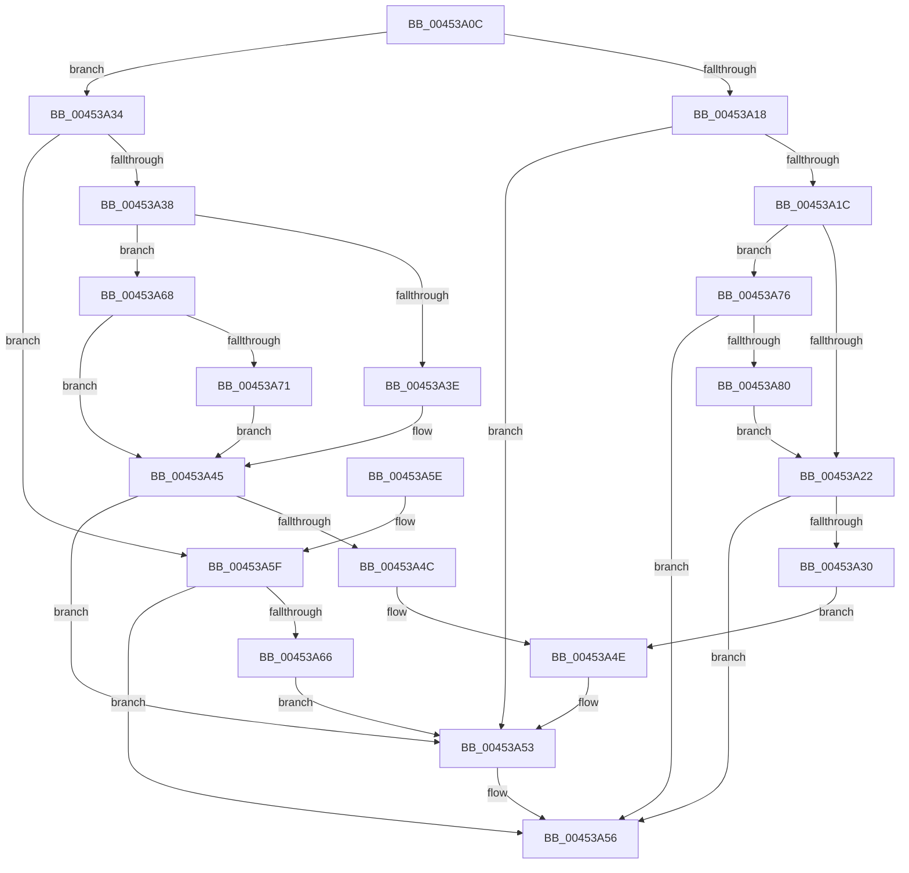

# SshpBlockerActiveReferenceOperationCallback

- RVA: `0x00453A0C`–`0x00453A8A` (길이 `126` bytes)
- VA: `0x0000000140453A0C`
- 실행 섹션: `.text`
- PDB 이름 있음: `예`; PDB Function 태그: `아니요`
- unwind 정보 RVA: `0x00066F5C`
- 디코드: `46`개 명령, `126/126` bytes 표시
- 미해석 바이트: `0` (있으면 어셈블리에 `.byte`로 보존)

> 이 문서는 커널 이미지의 기계어와 PDB 기호를 분석해 생성했습니다. 4번과 5번은 함수 원형과 자료형을 바이너리 사용 방식에서 추정한 C 해석이며 원본 소스 복구 결과는 아닙니다.

## 1. Dependencies

- 직접 호출 지점: **1**; 고유 호출 대상: **1**
- 직접 호출자로 확인된 함수: **1**
- RIP 상대 이미지 참조: **0**

### Outgoing calls
- `0x00453A4E` → [SshpSetBlockerActive](SshpSetBlockerActive_function_00453A90.md) (function, `0x00453A90`)

### Direct callers
- [SshpIterateParentBlockers](SshpIterateParentBlockers_function_0045394C.md) at `0x0045398E`
- [SshpIterateParentBlockers](SshpIterateParentBlockers_function_0045394C.md) at `0x004539C2`

### Static image references
- 디코드된 RIP-relative 메모리 참조가 없습니다.

## 2. Other-region calls and transfers

- 다른 실행 섹션으로 향하는 call: **0**
- 별도 외부 분기/꼬리 이동을 확인하지 못했습니다.

## 3. Assembly (complete function range)

```asm
00453A0C  48 83 EC 28                     sub rsp, 0x28
00453A10  45 33 C9                        xor r9d, r9d
00453A13  45 39 08                        cmp dword ptr [r8], r9d
00453A16  74 1C                           je 0x140453a34
00453A18  84 D2                           test dl, dl
00453A1A  74 37                           je 0x140453a53
00453A1C  49 3B 48 08                     cmp rcx, qword ptr [r8 + 8]
00453A20  75 54                           jne 0x140453a76
00453A22  41 8B 40 10                     mov eax, dword ptr [r8 + 0x10]
00453A26  29 41 14                        sub dword ptr [rcx + 0x14], eax
00453A29  8B 41 14                        mov eax, dword ptr [rcx + 0x14]
00453A2C  85 C0                           test eax, eax
00453A2E  7F 26                           jg 0x140453a56
00453A30  33 D2                           xor edx, edx
00453A32  EB 1A                           jmp 0x140453a4e
00453A34  84 D2                           test dl, dl
00453A36  75 27                           jne 0x140453a5f
00453A38  49 3B 48 08                     cmp rcx, qword ptr [r8 + 8]
00453A3C  75 2A                           jne 0x140453a68
00453A3E  41 8B 40 10                     mov eax, dword ptr [r8 + 0x10]
00453A42  01 41 14                        add dword ptr [rcx + 0x14], eax
00453A45  8B 41 08                        mov eax, dword ptr [rcx + 8]
00453A48  A8 01                           test al, 1
00453A4A  75 07                           jne 0x140453a53
00453A4C  B2 01                           mov dl, 1
00453A4E  E8 3D 00 00 00                  call 0x140453a90
00453A53  41 B1 01                        mov r9b, 1
00453A56  41 8A C1                        mov al, r9b
00453A59  48 83 C4 28                     add rsp, 0x28
00453A5D  C3                              ret
00453A5E  CC                              int3
00453A5F  8B 41 08                        mov eax, dword ptr [rcx + 8]
00453A62  A8 01                           test al, 1
00453A64  75 F0                           jne 0x140453a56
00453A66  EB EB                           jmp 0x140453a53
00453A68  FF 41 18                        inc dword ptr [rcx + 0x18]
00453A6B  83 79 18 01                     cmp dword ptr [rcx + 0x18], 1
00453A6F  75 D4                           jne 0x140453a45
00453A71  FF 41 14                        inc dword ptr [rcx + 0x14]
00453A74  EB CF                           jmp 0x140453a45
00453A76  FF 49 18                        dec dword ptr [rcx + 0x18]
00453A79  8B 41 18                        mov eax, dword ptr [rcx + 0x18]
00453A7C  85 C0                           test eax, eax
00453A7E  7F D6                           jg 0x140453a56
00453A80  41 C7 40 10 01 00 00 00         mov dword ptr [r8 + 0x10], 1
00453A88  EB 98                           jmp 0x140453a22
```

## 4. C-style interpretation (structured pseudocode)

```c
__int64 __fastcall SshpBlockerActiveReferenceOperationCallback(__int64 a1, int a2, __int64 a3, int a4)
{
    __int64 result;
    __int64 v_rsp;

    v_rsp = (v_rsp) - (40);
    a4 = 0;
    if ((*(unsigned int *)(a3)) == 0) goto loc_00453A34;
    if ((unsigned __int8)(a2) == 0) goto loc_00453A53;
    if (a1 != (*(unsigned __int64 *)(a3 + 8))) goto loc_00453A76;
loc_00453A22:
    if (condition_is_greater) goto loc_00453A56;
    a2 = 0;
    goto loc_00453A4E;
loc_00453A34:
    if (0 != 0) goto loc_00453A5F;
    if (a1 != (*(unsigned __int64 *)(a3 + 8))) goto loc_00453A68;
loc_00453A45:
    if ((((unsigned __int8)((unsigned int)(*(unsigned int *)(a1 + 8)))) & (1)) != 0) goto loc_00453A53;
loc_00453A4E:
    result = SshpSetBlockerActive(a1, 1, a3, a4);
loc_00453A53:
loc_00453A56:
    v_rsp = (v_rsp) + (40);
    return 1;
loc_00453A5F:
    if ((((unsigned __int8)((unsigned int)(*(unsigned int *)(a1 + 8)))) & (1)) != 0) goto loc_00453A56;
    goto loc_00453A53;
loc_00453A68:
    if ((*(unsigned int *)(a1 + 24)) != 1) goto loc_00453A45;
    goto loc_00453A45;
loc_00453A76:
    if (condition_is_greater) goto loc_00453A56;
    *(unsigned int *)(a3 + 16) = 1;
    goto loc_00453A22;
}
```

## 5. (Beta) C Style

```c
int64_t SshpBlockerActiveReferenceOperationCallback(void *Arg1, int32_t Arg2, void *Arg3, int32_t Arg4)
{
    uint8_t *arg1 = (uint8_t *)Arg1;
    uint8_t *arg3 = (uint8_t *)Arg3;

    int64_t result;
    int64_t local_rsp;

    local_rsp = (local_rsp) - (40);
    Arg4 = 0;
    if ((*(uint32_t *)(arg3)) == 0) goto loc_00453A34;
    if ((uint8_t)(Arg2) == 0) goto loc_00453A53;
    if (Arg1 != (*(uint64_t *)(arg3 + 0x8))) goto loc_00453A76;
loc_00453A22:
    if (condition_is_greater) goto loc_00453A56;
    Arg2 = 0;
    goto loc_00453A4E;
loc_00453A34:
    if (0 != 0) goto loc_00453A5F;
    if (Arg1 != (*(uint64_t *)(arg3 + 0x8))) goto loc_00453A68;
loc_00453A45:
    if ((((uint8_t)((uint32_t)(*(uint32_t *)(arg1 + 0x8)))) & (1)) != 0) goto loc_00453A53;
loc_00453A4E:
    result = SshpSetBlockerActive(Arg1, 1, Arg3, Arg4);
loc_00453A53:
loc_00453A56:
    local_rsp = (local_rsp) + (40);
    return 1;
loc_00453A5F:
    if ((((uint8_t)((uint32_t)(*(uint32_t *)(arg1 + 0x8)))) & (1)) != 0) goto loc_00453A56;
    goto loc_00453A53;
loc_00453A68:
    if ((*(uint32_t *)(arg1 + 0x18)) != 1) goto loc_00453A45;
    goto loc_00453A45;
loc_00453A76:
    if (condition_is_greater) goto loc_00453A56;
    *(uint32_t *)(arg3 + 0x10) = 1;
    goto loc_00453A22;
}
```

### 관측된 메모리 오프셋

구조체 형식이 확인되지 않은 접근은 인자 기준의 오프셋으로만 기록했습니다.

| 기준 인자 | 오프셋 표현 | 폭 (bit) | 접근 |
|---|---:|---:|---|
| `Arg1` | `+ 0x8` | `32` | `R` |
| `Arg3` | `+ 0x0` | `32` | `R` |
| `Arg3` | `+ 0x8` | `64` | `R` |
| `Arg3` | `+ 0x10` | `32` | `R` |
| `Arg3` | `+ 0x10` | `32` | `W` |

## 6. Execution-region graph

[열기: 2D/3D 그래프와 함수 탐색 컨트롤 패널](../../../control-panel.html?section=text&rva=0x00453A0C&view=graph)

- 2D 그래프는 위에서 아래로 흐르고, 3D 그래프는 빈 공간을 드래그해 회전합니다. Shift+드래그는 이동, 휠은 확대·축소, 함수 노드 선택은 대상 보고서 이동입니다.

### Static fallback


