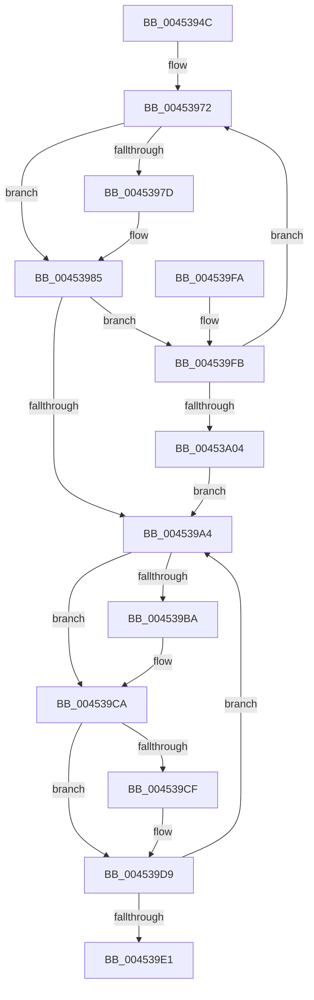

# SshpIterateParentBlockers

- RVA: `0x0045394C`–`0x00453A06` (길이 `186` bytes)
- VA: `0x000000014045394C`
- 실행 섹션: `.text`
- PDB 이름 있음: `예`; PDB Function 태그: `아니요`
- unwind 정보 RVA: `0x000A7830`
- 디코드: `57`개 명령, `186/186` bytes 표시
- 미해석 바이트: `0` (있으면 어셈블리에 `.byte`로 보존)

> 이 문서는 커널 이미지의 기계어와 PDB 기호를 분석해 생성했습니다. 4번과 5번은 함수 원형과 자료형을 바이너리 사용 방식에서 추정한 C 해석이며 원본 소스 복구 결과는 아닙니다.

## 1. Dependencies

- 직접 호출 지점: **4**; 고유 호출 대상: **3**
- 직접 호출자로 확인된 함수: **2**
- RIP 상대 이미지 참조: **0**

### Outgoing calls
- `0x00453980` → [KeAcquireSpinLockRaiseToDpc](../20/KeAcquireSpinLockRaiseToDpc_function_00208470.md) (function, `0x00208470`)
- `0x0045398E` → [SshpBlockerActiveReferenceOperationCallback](SshpBlockerActiveReferenceOperationCallback_function_00453A0C.md) (function, `0x00453A0C`)
- `0x004539C2` → [SshpBlockerActiveReferenceOperationCallback](SshpBlockerActiveReferenceOperationCallback_function_00453A0C.md) (function, `0x00453A0C`)
- `0x004539D4` → [KeReleaseSpinLock](../39/KeReleaseSpinLock_function_00392BA0.md) (function, `0x00392BA0`)

### Direct callers
- [SshpBlockerActiveDereference](SshpBlockerActiveDereference_function_00453888.md) at `0x004538AD`
- [SleepstudyHelperBlockerActiveReference](SleepstudyHelperBlockerActiveReference_function_004538D0.md) at `0x00453915`

### Static image references
- 디코드된 RIP-relative 메모리 참조가 없습니다.

## 2. Other-region calls and transfers

- 다른 실행 섹션으로 향하는 call: **0**
- 별도 외부 분기/꼬리 이동을 확인하지 못했습니다.

## 3. Assembly (complete function range)

```asm
0045394C  48 89 5C 24 08                  mov qword ptr [rsp + 8], rbx
00453951  48 89 6C 24 10                  mov qword ptr [rsp + 0x10], rbp
00453956  48 89 74 24 18                  mov qword ptr [rsp + 0x18], rsi
0045395B  57                              push rdi
0045395C  41 56                           push r14
0045395E  41 57                           push r15
00453960  48 83 EC 20                     sub rsp, 0x20
00453964  4D 8B F8                        mov r15, r8
00453967  48 8B F1                        mov rsi, rcx
0045396A  48 8B F9                        mov rdi, rcx
0045396D  33 DB                           xor ebx, ebx
0045396F  41 B6 01                        mov r14b, 1
00453972  48 8B EB                        mov rbp, rbx
00453975  48 8B DF                        mov rbx, rdi
00453978  48 3B FE                        cmp rdi, rsi
0045397B  74 08                           je 0x140453985
0045397D  48 8B CF                        mov rcx, rdi
00453980  E8 EB 4A DB FF                  call 0x140208470
00453985  4D 8B C7                        mov r8, r15
00453988  41 8A D6                        mov dl, r14b
0045398B  48 8B CF                        mov rcx, rdi
0045398E  E8 79 00 00 00                  call 0x140453a0c
00453993  48 8D 8F 28 01 00 00            lea rcx, [rdi + 0x128]
0045399A  48 8B 39                        mov rdi, qword ptr [rcx]
0045399D  48 89 29                        mov qword ptr [rcx], rbp
004539A0  84 C0                           test al, al
004539A2  75 57                           jne 0x1404539fb
004539A4  48 8B AB 28 01 00 00            mov rbp, qword ptr [rbx + 0x128]
004539AB  48 89 BB 28 01 00 00            mov qword ptr [rbx + 0x128], rdi
004539B2  48 8B FB                        mov rdi, rbx
004539B5  45 84 F6                        test r14b, r14b
004539B8  74 10                           je 0x1404539ca
004539BA  4D 8B C7                        mov r8, r15
004539BD  33 D2                           xor edx, edx
004539BF  48 8B CB                        mov rcx, rbx
004539C2  E8 45 00 00 00                  call 0x140453a0c
004539C7  44 8A F0                        mov r14b, al
004539CA  48 3B DE                        cmp rbx, rsi
004539CD  74 0A                           je 0x1404539d9
004539CF  B2 02                           mov dl, 2
004539D1  48 8B CB                        mov rcx, rbx
004539D4  E8 C7 F1 F3 FF                  call 0x140392ba0
004539D9  48 8B DD                        mov rbx, rbp
004539DC  48 85 ED                        test rbp, rbp
004539DF  75 C3                           jne 0x1404539a4
004539E1  48 8B 5C 24 40                  mov rbx, qword ptr [rsp + 0x40]
004539E6  48 8B 6C 24 48                  mov rbp, qword ptr [rsp + 0x48]
004539EB  48 8B 74 24 50                  mov rsi, qword ptr [rsp + 0x50]
004539F0  48 83 C4 20                     add rsp, 0x20
004539F4  41 5F                           pop r15
004539F6  41 5E                           pop r14
004539F8  5F                              pop rdi
004539F9  C3                              ret
004539FA  CC                              int3
004539FB  48 85 FF                        test rdi, rdi
004539FE  0F 85 6E FF FF FF               jne 0x140453972
00453A04  EB 9E                           jmp 0x1404539a4
```

## 4. C-style interpretation (structured pseudocode)

```c
__int64 __fastcall SshpIterateParentBlockers(__int64 a1, __int64 a2, __int64 a3)
{
    __int64 result;
    __int64 v_r14;
    __int64 v_rbx;
    __int64 v_rsp;
    unsigned __int64 v_stack_p10;
    unsigned __int64 v_stack_p18;
    unsigned __int64 v_stack_p8;

    v_stack_p8 = v_rbx;
    v_stack_p10 = v_rbp;
    v_stack_p18 = v_rsi;
    v_rsp = (v_rsp) - (32);
    v_rbx = 0;
loc_00453972:
    if (a1 != a1) {
        a1 = a1;
        result = KeAcquireSpinLockRaiseToDpc(a1, a2, a3, a4);
    }
    result = SshpBlockerActiveReferenceOperationCallback(a1, 1, a3, a4);
    *(unsigned __int64 *)(a1 + 296) = 0;
    if ((unsigned __int8)(result) != 0) goto loc_004539FB;
loc_004539A4:
    *(unsigned __int64 *)(a1 + 296) = *(unsigned __int64 *)(a1 + 296);
    v_r14 = 1;
    if (1 != 0) {
        a3 = a3;
        a2 = 0;
        a1 = a1;
        result = SshpBlockerActiveReferenceOperationCallback(a1, a2, a3, a4);
        v_r14 = (unsigned __int8)(result);
    }
    if (a1 != a1) {
        a2 = 2;
        a1 = a1;
        result = KeReleaseSpinLock(a1, a2, a3, a4);
    }
    if (*(unsigned __int64 *)(a1 + 296) != 0) goto loc_004539A4;
    v_rsp = (v_rsp) + (32);
    return result;
loc_004539FB:
    if (a1 != 0) goto loc_00453972;
    goto loc_004539A4;
}
```

## 5. (Beta) C Style

```c
int64_t SshpIterateParentBlockers(int64_t Arg1, int64_t Arg2, int64_t Arg3)
{
    int64_t result;
    int64_t local_r14;
    int64_t local_rbx;
    int64_t local_rsp;
    uint64_t v_stack_p10;
    uint64_t v_stack_p18;
    uint64_t v_stack_p8;

    v_stack_p8 = local_rbx;
    v_stack_p10 = local_rbp;
    v_stack_p18 = local_rsi;
    local_rsp = (local_rsp) - (32);
    local_rbx = 0;
loc_00453972:
    if (Arg1 != Arg1) {
        Arg1 = Arg1;
        result = KeAcquireSpinLockRaiseToDpc(Arg1, Arg2, Arg3, a4);
    }
    result = SshpBlockerActiveReferenceOperationCallback(Arg1, 1, Arg3, a4);
    *(uint64_t *)(Arg1 + 0x128) = 0;
    if ((uint8_t)(result) != 0) goto loc_004539FB;
loc_004539A4:
    *(uint64_t *)(Arg1 + 0x128) = *(uint64_t *)(Arg1 + 0x128);
    local_r14 = 1;
    if (1 != 0) {
        Arg3 = Arg3;
        Arg2 = 0;
        Arg1 = Arg1;
        result = SshpBlockerActiveReferenceOperationCallback(Arg1, Arg2, Arg3, a4);
        local_r14 = (uint8_t)(result);
    }
    if (Arg1 != Arg1) {
        Arg2 = 2;
        Arg1 = Arg1;
        result = KeReleaseSpinLock(Arg1, Arg2, Arg3, a4);
    }
    if (*(uint64_t *)(Arg1 + 0x128) != 0) goto loc_004539A4;
    local_rsp = (local_rsp) + (32);
    return result;
loc_004539FB:
    if (Arg1 != 0) goto loc_00453972;
    goto loc_004539A4;
}
```

## 6. Execution-region graph

[열기: 2D/3D 그래프와 함수 탐색 컨트롤 패널](../../../control-panel.html?section=text&rva=0x0045394C&view=graph)

- 2D 그래프는 위에서 아래로 흐르고, 3D 그래프는 빈 공간을 드래그해 회전합니다. Shift+드래그는 이동, 휠은 확대·축소, 함수 노드 선택은 대상 보고서 이동입니다.

### Static fallback


