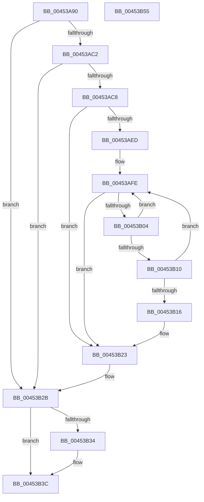

# SshpSetBlockerActive

- RVA: `0x00453A90`–`0x00453B56` (길이 `198` bytes)
- VA: `0x0000000140453A90`
- 실행 섹션: `.text`
- PDB 이름 있음: `예`; PDB Function 태그: `아니요`
- unwind 정보 RVA: `0x00060BC4`
- 디코드: `60`개 명령, `198/198` bytes 표시
- 미해석 바이트: `0` (있으면 어셈블리에 `.byte`로 보존)

> 이 문서는 커널 이미지의 기계어와 PDB 기호를 분석해 생성했습니다. 4번과 5번은 함수 원형과 자료형을 바이너리 사용 방식에서 추정한 C 해석이며 원본 소스 복구 결과는 아닙니다.

## 1. Dependencies

- 직접 호출 지점: **1**; 고유 호출 대상: **1**
- 직접 호출자로 확인된 함수: **3**
- RIP 상대 이미지 참조: **1**

### Outgoing calls
- `0x00453B37` → [SshpTracingWriteBlockerStateChange](SshpTracingWriteBlockerStateChange_function_00453B5C.md) (function, `0x00453B5C`)

### Direct callers
- [SleepstudyHelper_ComponentActiveLocked](SleepstudyHelper_ComponentActiveLocked_function_004537D0.md) at `0x00453808`
- [SshpBlockerActiveReferenceOperationCallback](SshpBlockerActiveReferenceOperationCallback_function_00453A0C.md) at `0x00453A4E`
- [SleepstudyHelper_ComponentInactive](../4B/SleepstudyHelper_ComponentInactive_function_004B5AB0.md) at `0x004B5B1C`

### Static image references
- `0x00453AF0` → RVA `0x000294D8` (`.rdata`; read)

## 2. Other-region calls and transfers

- 다른 실행 섹션으로 향하는 call: **0**
- 별도 외부 분기/꼬리 이동을 확인하지 못했습니다.

## 3. Assembly (complete function range)

```asm
00453A90  48 89 5C 24 08                  mov qword ptr [rsp + 8], rbx
00453A95  48 89 74 24 10                  mov qword ptr [rsp + 0x10], rsi
00453A9A  57                              push rdi
00453A9B  48 83 EC 20                     sub rsp, 0x20
00453A9F  45 33 C0                        xor r8d, r8d
00453AA2  4C 8D 49 08                     lea r9, [rcx + 8]
00453AA6  45 8B 11                        mov r10d, dword ptr [r9]
00453AA9  84 D2                           test dl, dl
00453AAB  41 8B F8                        mov edi, r8d
00453AAE  41 8B C2                        mov eax, r10d
00453AB1  40 0F 95 C7                     setne dil
00453AB5  40 8A F2                        mov sil, dl
00453AB8  83 E0 01                        and eax, 1
00453ABB  49 8B D9                        mov rbx, r9
00453ABE  3B F8                           cmp edi, eax
00453AC0  74 69                           je 0x140453b2b
00453AC2  41 F6 C2 02                     test r10b, 2
00453AC6  74 63                           je 0x140453b2b
00453AC8  49 BB 08 00 00 00 80 F7 FF FF   movabs r11, 0xfffff78000000008
00453AD2  4D 8B 1B                        mov r11, qword ptr [r11]
00453AD5  41 8B 11                        mov edx, dword ptr [r9]
00453AD8  48 8B 41 20                     mov rax, qword ptr [rcx + 0x20]
00453ADC  F7 D2                           not edx
00453ADE  83 E2 01                        and edx, 1
00453AE1  48 C1 E2 07                     shl rdx, 7
00453AE5  48 03 D1                        add rdx, rcx
00453AE8  4C 3B D8                        cmp r11, rax
00453AEB  72 36                           jb 0x140453b23
00453AED  4D 8B D3                        mov r10, r11
00453AF0  48 8D 1D E1 59 BD FF            lea rbx, [rip - 0x42a61f]
00453AF7  4C 2B D0                        sub r10, rax
00453AFA  4C 01 52 28                     add qword ptr [rdx + 0x28], r10
00453AFE  41 83 F8 05                     cmp r8d, 5
00453B02  73 1F                           jae 0x140453b23
00453B04  45 8B C8                        mov r9d, r8d
00453B07  41 FF C0                        inc r8d
00453B0A  4E 3B 14 CB                     cmp r10, qword ptr [rbx + r9*8]
00453B0E  72 EE                           jb 0x140453afe
00453B10  4E 3B 14 C3                     cmp r10, qword ptr [rbx + r8*8]
00453B14  73 E8                           jae 0x140453afe
00453B16  42 FF 84 8A 80 00 00 00         inc dword ptr [rdx + r9*4 + 0x80]
00453B1E  4E 01 54 CA 30                  add qword ptr [rdx + r9*8 + 0x30], r10
00453B23  4C 89 59 20                     mov qword ptr [rcx + 0x20], r11
00453B27  48 8D 59 08                     lea rbx, [rcx + 8]
00453B2B  8B 03                           mov eax, dword ptr [rbx]
00453B2D  83 E0 01                        and eax, 1
00453B30  3B F8                           cmp edi, eax
00453B32  74 08                           je 0x140453b3c
00453B34  40 8A D6                        mov dl, sil
00453B37  E8 20 00 00 00                  call 0x140453b5c
00453B3C  8B 03                           mov eax, dword ptr [rbx]
00453B3E  48 8B 74 24 38                  mov rsi, qword ptr [rsp + 0x38]
00453B43  83 E0 FE                        and eax, 0xfffffffe
00453B46  0B C7                           or eax, edi
00453B48  89 03                           mov dword ptr [rbx], eax
00453B4A  48 8B 5C 24 30                  mov rbx, qword ptr [rsp + 0x30]
00453B4F  48 83 C4 20                     add rsp, 0x20
00453B53  5F                              pop rdi
00453B54  C3                              ret
00453B55  CC                              int3
```

## 4. C-style interpretation (structured pseudocode)

```c
__int64 __fastcall SshpSetBlockerActive(__int64 a1, unsigned __int8 a2, int a3)
{
    __int64 result;
    __int64 v_r10;
    __int64 v_rdi;
    __int64 v_rsp;
    unsigned __int64 v_stack_p10;
    unsigned __int64 v_stack_p8;

    v_stack_p8 = v_rbx;
    v_stack_p10 = v_rsi;
    v_rsp = (v_rsp) - (32);
    a3 = 0;
    v_rdi = (a2 != 0) ? 1 : 0;
    result = (unsigned int)(((unsigned int)((unsigned int)((unsigned int)(*(unsigned int *)(a1 + 8))))) & (1));
    if (((unsigned int)(v_rdi)) == ((unsigned int)(result))) goto loc_00453B2B;
    if ((((unsigned __int8)((unsigned int)(*(unsigned int *)(a1 + 8)))) & (2)) == 0) goto loc_00453B2B;
    a2 = (unsigned int)(~((unsigned int)(*(unsigned int *)(a1 + 8))));
    a2 = (unsigned int)((a2) & (1));
    a2 = (a2) << (7);
    a2 = (a2) + (a1);
    if ((*(unsigned __int64 *)(v_r11)) < (*(unsigned __int64 *)(a1 + 32))) goto loc_00453B23;
    v_r10 = (*(unsigned __int64 *)(v_r11)) - (*(unsigned __int64 *)(a1 + 32));
loc_00453AFE:
    if (0 >= 5) goto loc_00453B23;
    a3 = (unsigned int)((a3) + 1);
    if (v_r10 < (*(unsigned __int64 *)(v_rip - 4367903 + 0 * 8))) goto loc_00453AFE;
    if (v_r10 >= (*(unsigned __int64 *)(v_rip - 4367903 + a3 * 8))) goto loc_00453AFE;
loc_00453B23:
    *(unsigned __int64 *)(a1 + 32) = *(unsigned __int64 *)(v_r11);
loc_00453B2B:
    result = (unsigned int)(((unsigned int)(*(unsigned int *)(a1 + 8))) & (1));
    if (((unsigned int)(v_rdi)) != ((unsigned int)(result))) {
        a2 = a2;
        result = SshpTracingWriteBlockerStateChange(a1, a2, a3, 0);
    }
    result = (unsigned int)(((unsigned int)(*(unsigned int *)(a1 + 8))) & (0xFFFFFFFEULL));
    result = (unsigned int)((result) | ((unsigned int)(v_rdi)));
    *(unsigned int *)(a1 + 8) = (unsigned int)(result);
    v_rsp = (v_rsp) + (32);
    return result;
}
```

## 5. (Beta) C Style

```c
int64_t SshpSetBlockerActive(void *Arg1, uint8_t Arg2, int32_t Arg3)
{
    uint8_t *arg1 = (uint8_t *)Arg1;

    int64_t result;
    int64_t local_r10;
    int64_t local_rdi;
    int64_t local_rsp;
    uint64_t v_stack_p10;
    uint64_t v_stack_p8;

    v_stack_p8 = local_rbx;
    v_stack_p10 = local_rsi;
    local_rsp = (local_rsp) - (32);
    Arg3 = 0;
    local_rdi = (Arg2 != 0) ? 1 : 0;
    result = (uint32_t)(((uint32_t)((uint32_t)((uint32_t)(*(uint32_t *)(arg1 + 0x8))))) & (1));
    if (((uint32_t)(local_rdi)) == ((uint32_t)(result))) goto loc_00453B2B;
    if ((((uint8_t)((uint32_t)(*(uint32_t *)(arg1 + 0x8)))) & (2)) == 0) goto loc_00453B2B;
    Arg2 = (uint32_t)(~((uint32_t)(*(uint32_t *)(arg1 + 0x8))));
    Arg2 = (uint32_t)((Arg2) & (1));
    Arg2 = (Arg2) << (7);
    Arg2 = (Arg2) + (Arg1);
    if ((*(uint64_t *)(local_r11)) < (*(uint64_t *)(arg1 + 0x20))) goto loc_00453B23;
    local_r10 = (*(uint64_t *)(local_r11)) - (*(uint64_t *)(arg1 + 0x20));
loc_00453AFE:
    if (0 >= 5) goto loc_00453B23;
    Arg3 = (uint32_t)((Arg3) + 1);
    if (local_r10 < (*(uint64_t *)(v_rip - 0x42A61F + 0x0 * 8))) goto loc_00453AFE;
    if (local_r10 >= (*(uint64_t *)(v_rip - 0x42A61F + Arg3 * 8))) goto loc_00453AFE;
loc_00453B23:
    *(uint64_t *)(arg1 + 0x20) = *(uint64_t *)(local_r11);
loc_00453B2B:
    result = (uint32_t)(((uint32_t)(*(uint32_t *)(arg1 + 0x8))) & (1));
    if (((uint32_t)(local_rdi)) != ((uint32_t)(result))) {
        Arg2 = Arg2;
        result = SshpTracingWriteBlockerStateChange(Arg1, Arg2, Arg3, 0);
    }
    result = (uint32_t)(((uint32_t)(*(uint32_t *)(arg1 + 0x8))) & (0xFFFFFFFEULL));
    result = (uint32_t)((result) | ((uint32_t)(local_rdi)));
    *(uint32_t *)(arg1 + 0x8) = (uint32_t)(result);
    local_rsp = (local_rsp) + (32);
    return result;
}
```

### 관측된 메모리 오프셋

구조체 형식이 확인되지 않은 접근은 인자 기준의 오프셋으로만 기록했습니다.

| 기준 인자 | 오프셋 표현 | 폭 (bit) | 접근 |
|---|---:|---:|---|
| `Arg1` | `+ 0x0` | `32` | `R` |
| `Arg1` | `+ 0x0` | `32` | `W` |
| `Arg1` | `+ 0x8` | `64` | `R` |
| `Arg1` | `+ 0x20` | `64` | `R` |
| `Arg1` | `+ 0x20` | `64` | `W` |

## 6. Execution-region graph

[열기: 2D/3D 그래프와 함수 탐색 컨트롤 패널](../../../control-panel.html?section=text&rva=0x00453A90&view=graph)

- 2D 그래프는 위에서 아래로 흐르고, 3D 그래프는 빈 공간을 드래그해 회전합니다. Shift+드래그는 이동, 휠은 확대·축소, 함수 노드 선택은 대상 보고서 이동입니다.

### Static fallback


