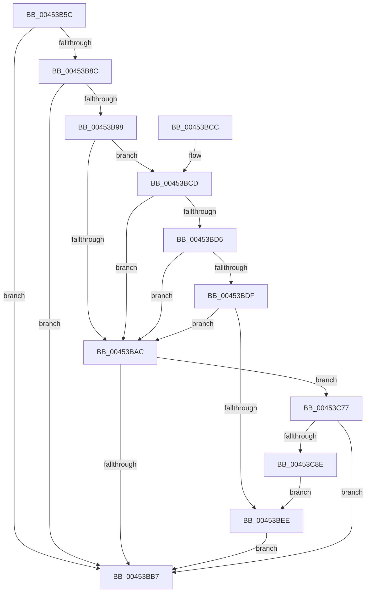

# SshpTracingWriteBlockerStateChange

- RVA: `0x00453B5C`–`0x00453C93` (길이 `311` bytes)
- VA: `0x0000000140453B5C`
- 실행 섹션: `.text`
- PDB 이름 있음: `예`; PDB Function 태그: `아니요`
- unwind 정보 RVA: `0x000A784C`
- 디코드: `74`개 명령, `311/311` bytes 표시
- 미해석 바이트: `0` (있으면 어셈블리에 `.byte`로 보존)

> 이 문서는 커널 이미지의 기계어와 PDB 기호를 분석해 생성했습니다. 4번과 5번은 함수 원형과 자료형을 바이너리 사용 방식에서 추정한 C 해석이며 원본 소스 복구 결과는 아닙니다.

## 1. Dependencies

- 직접 호출 지점: **3**; 고유 호출 대상: **3**
- 직접 호출자로 확인된 함수: **1**
- RIP 상대 이미지 참조: **4**

### Outgoing calls
- `0x00453BBE` → [_security_check_cookie](../6A/_security_check_cookie_function_006AC640.md) (function, `0x006AC640`)
- `0x00453C6D` → [EtwWriteEx](../25/EtwWriteEx_function_0025F0D0.md) (function, `0x0025F0D0`)
- `0x00453C81` → [EtwpLevelKeywordEnabled](../2F/EtwpLevelKeywordEnabled_function_002FD110.md) (function, `0x002FD110`)

### Direct callers
- [SshpSetBlockerActive](SshpSetBlockerActive_function_00453A90.md) at `0x00453B37`

### Static image references
- `0x00453B6E` → RVA `0x00E0A740` (`.data`; read)
- `0x00453B7C` → RVA `0x00F07038` (`.data`; read)
- `0x00453B8C` → RVA `0x00F07010` (`.data`; read)
- `0x00453BFE` → RVA `0x00014A40` (`.rdata`; read)

## 2. Other-region calls and transfers

- 다른 실행 섹션으로 향하는 call: **0**
- 별도 외부 분기/꼬리 이동을 확인하지 못했습니다.

## 3. Assembly (complete function range)

```asm
00453B5C  48 89 4C 24 08                  mov qword ptr [rsp + 8], rcx
00453B61  55                              push rbp
00453B62  48 8D 6C 24 A9                  lea rbp, [rsp - 0x57]
00453B67  48 81 EC 90 00 00 00            sub rsp, 0x90
00453B6E  48 8B 05 CB 6B 9B 00            mov rax, qword ptr [rip + 0x9b6bcb]
00453B75  48 33 C4                        xor rax, rsp
00453B78  48 89 45 47                     mov qword ptr [rbp + 0x47], rax
00453B7C  8B 05 B6 34 AB 00               mov eax, dword ptr [rip + 0xab34b6]
00453B82  45 33 DB                        xor r11d, r11d
00453B85  44 8A D2                        mov r10b, dl
00453B88  85 C0                           test eax, eax
00453B8A  74 2B                           je 0x140453bb7
00453B8C  4C 8B 0D 7D 34 AB 00            mov r9, qword ptr [rip + 0xab347d]
00453B93  4D 85 C9                        test r9, r9
00453B96  74 1F                           je 0x140453bb7
00453B98  49 8B 49 20                     mov rcx, qword ptr [r9 + 0x20]
00453B9C  49 B8 04 00 00 00 00 00 00 80   movabs r8, 0x8000000000000004
00453BA6  44 39 59 60                     cmp dword ptr [rcx + 0x60], r11d
00453BAA  75 21                           jne 0x140453bcd
00453BAC  66 45 39 59 66                  cmp word ptr [r9 + 0x66], r11w
00453BB1  0F 85 C0 00 00 00               jne 0x140453c77
00453BB7  48 8B 4D 47                     mov rcx, qword ptr [rbp + 0x47]
00453BBB  48 33 CC                        xor rcx, rsp
00453BBE  E8 7D 8A 25 00                  call 0x1406ac640
00453BC3  48 81 C4 90 00 00 00            add rsp, 0x90
00453BCA  5D                              pop rbp
00453BCB  C3                              ret
00453BCC  CC                              int3
00453BCD  8A 41 64                        mov al, byte ptr [rcx + 0x64]
00453BD0  FE C8                           dec al
00453BD2  3C 02                           cmp al, 2
00453BD4  76 D6                           jbe 0x140453bac
00453BD6  8B 41 68                        mov eax, dword ptr [rcx + 0x68]
00453BD9  4C 85 41 70                     test qword ptr [rcx + 0x70], r8
00453BDD  74 CD                           je 0x140453bac
00453BDF  48 8B 49 78                     mov rcx, qword ptr [rcx + 0x78]
00453BE3  48 8B C1                        mov rax, rcx
00453BE6  49 23 C0                        and rax, r8
00453BE9  48 3B C1                        cmp rax, rcx
00453BEC  75 BE                           jne 0x140453bac
00453BEE  48 8D 45 67                     lea rax, [rbp + 0x67]
00453BF2  48 C7 45 1F 08 00 00 00         mov qword ptr [rbp + 0x1f], 8
00453BFA  48 89 45 17                     mov qword ptr [rbp + 0x17], rax
00453BFE  48 8D 15 3B 0E BC FF            lea rdx, [rip - 0x43f1c5]
00453C05  45 84 D2                        test r10b, r10b
00453C08  48 B8 08 00 00 00 80 F7 FF FF   movabs rax, 0xfffff78000000008
00453C12  41 B9 01 00 00 00               mov r9d, 1
00453C18  48 8B 00                        mov rax, qword ptr [rax]
00453C1B  48 8B 0D EE 33 AB 00            mov rcx, qword ptr [rip + 0xab33ee]
00453C22  48 89 45 0F                     mov qword ptr [rbp + 0xf], rax
00453C26  48 8D 45 0F                     lea rax, [rbp + 0xf]
00453C2A  48 89 45 27                     mov qword ptr [rbp + 0x27], rax
00453C2E  41 8B C3                        mov eax, r11d
00453C31  0F 95 C0                        setne al
00453C34  48 C7 45 2F 08 00 00 00         mov qword ptr [rbp + 0x2f], 8
00453C3C  89 45 07                        mov dword ptr [rbp + 7], eax
00453C3F  45 33 C0                        xor r8d, r8d
00453C42  48 8D 45 07                     lea rax, [rbp + 7]
00453C46  48 C7 45 3F 04 00 00 00         mov qword ptr [rbp + 0x3f], 4
00453C4E  48 89 45 37                     mov qword ptr [rbp + 0x37], rax
00453C52  48 8D 45 17                     lea rax, [rbp + 0x17]
00453C56  48 89 44 24 38                  mov qword ptr [rsp + 0x38], rax
00453C5B  C7 44 24 30 03 00 00 00         mov dword ptr [rsp + 0x30], 3
00453C63  4C 89 5C 24 28                  mov qword ptr [rsp + 0x28], r11
00453C68  4C 89 5C 24 20                  mov qword ptr [rsp + 0x20], r11
00453C6D  E8 5E B4 E0 FF                  call 0x14025f0d0
00453C72  E9 40 FF FF FF                  jmp 0x140453bb7
00453C77  49 8B 49 28                     mov rcx, qword ptr [r9 + 0x28]
00453C7B  B2 04                           mov dl, 4
00453C7D  48 83 C1 60                     add rcx, 0x60
00453C81  E8 8A 94 EA FF                  call 0x1402fd110
00453C86  84 C0                           test al, al
00453C88  0F 84 29 FF FF FF               je 0x140453bb7
00453C8E  E9 5B FF FF FF                  jmp 0x140453bee
```

## 4. C-style interpretation (structured pseudocode)

```c
__int64 __fastcall SshpTracingWriteBlockerStateChange(__int64 a1, unsigned __int8 a2)
{
    __int64 result;
    __int64 v_r11;
    __int64 v_rsp;
    unsigned __int64 v_stack_m18;
    unsigned __int64 v_stack_m20;
    unsigned __int64 v_stack_m28;
    unsigned __int64 v_stack_m30;
    unsigned __int64 v_stack_m38;
    unsigned __int64 v_stack_m40;
    unsigned __int64 v_stack_m48;
    unsigned __int64 v_stack_m50;
    unsigned int v_stack_m58;
    unsigned __int64 v_stack_m5F;
    unsigned __int64 v_stack_p20;
    unsigned __int64 v_stack_p28;
    unsigned int v_stack_p30;
    unsigned __int64 v_stack_p38;
    unsigned __int64 v_stack_p8;

    v_stack_p8 = a1;
    v_rsp = (v_rsp) - (144);
    result = (*(unsigned __int64 *)(v_rip + 10185675)) ^ (v_rsp);
    v_stack_m18 = result;
    v_r11 = 0;
    if ((unsigned int)((unsigned int)(*(unsigned int *)(v_rip + 11220150))) == 0) goto loc_00453BB7;
    if (*(unsigned __int64 *)(v_rip + 11220093) == 0) goto loc_00453BB7;
    if ((*(unsigned int *)(*(unsigned __int64 *)(*(unsigned __int64 *)(v_rip + 11220093) + 32) + 96)) != 0) goto loc_00453BCD;
loc_00453BAC:
    if ((*(unsigned __int16 *)(*(unsigned __int64 *)(v_rip + 11220093) + 102)) != 0) goto loc_00453C77;
loc_00453BB7:
    a1 = (v_stack_m18) ^ (v_rsp);
    result = _security_check_cookie(a1, a2, a3, *(unsigned __int64 *)(v_rip + 11220093));
    v_rsp = (v_rsp) + (144);
    return result;
loc_00453BCD:
    result = (unsigned __int8)((*(unsigned __int8 *)(a1 + 100)) - 1);
    if (((unsigned __int8)(result)) <= 2) goto loc_00453BAC;
    if (((*(unsigned __int64 *)(a1 + 112)) & (a3)) == 0) goto loc_00453BAC;
    result = (*(unsigned __int64 *)(a1 + 120)) & (a3);
    if (result != (*(unsigned __int64 *)(a1 + 120))) goto loc_00453BAC;
loc_00453BEE:
    v_stack_m40 = 8;
    v_stack_m48 = v_stack_p8;
    v_stack_m50 = *(unsigned __int64 *)(v_stack_p8);
    v_stack_m38 = v_stack_m50;
    result = (a2 != 0) ? 1 : 0;
    v_stack_m30 = 8;
    v_stack_m58 = (unsigned int)(result);
    a3 = 0;
    v_stack_m20 = 4;
    v_stack_m28 = v_stack_m58;
    v_stack_p38 = v_stack_m48;
    v_stack_p30 = 3;
    v_stack_p28 = 0;
    v_stack_p20 = 0;
    result = EtwWriteEx(*(unsigned __int64 *)(v_rip + 11219950), v_rip - 4452805, a3, 1);
    goto loc_00453BB7;
loc_00453C77:
    a1 = (*(unsigned __int64 *)(1 + 40)) + (96);
    result = EtwpLevelKeywordEnabled(a1, 4, a3, 1);
    if ((unsigned __int8)(result) == 0) goto loc_00453BB7;
    goto loc_00453BEE;
}
```

## 5. (Beta) C Style

```c
int64_t SshpTracingWriteBlockerStateChange(int64_t Arg1, uint8_t Arg2)
{
    int64_t result;
    int64_t local_r11;
    int64_t local_rsp;
    uint64_t v_stack_m18;
    uint64_t v_stack_m20;
    uint64_t v_stack_m28;
    uint64_t v_stack_m30;
    uint64_t v_stack_m38;
    uint64_t v_stack_m40;
    uint64_t v_stack_m48;
    uint64_t v_stack_m50;
    uint32_t v_stack_m58;
    uint64_t v_stack_m5F;
    uint64_t v_stack_p20;
    uint64_t v_stack_p28;
    uint32_t v_stack_p30;
    uint64_t v_stack_p38;
    uint64_t v_stack_p8;

    v_stack_p8 = Arg1;
    local_rsp = (local_rsp) - (144);
    result = (*(uint64_t *)(v_rip + 0x9B6BCB)) ^ (local_rsp);
    v_stack_m18 = result;
    local_r11 = 0;
    if ((uint32_t)((uint32_t)(*(uint32_t *)(v_rip + 0xAB34B6))) == 0) goto loc_00453BB7;
    if (*(uint64_t *)(v_rip + 0xAB347D) == 0) goto loc_00453BB7;
    if ((*(uint32_t *)(*(uint64_t *)(*(uint64_t *)(v_rip + 0xAB347D) + 0x20) + 0x60)) != 0) goto loc_00453BCD;
loc_00453BAC:
    if ((*(uint16_t *)(*(uint64_t *)(v_rip + 0xAB347D) + 0x66)) != 0) goto loc_00453C77;
loc_00453BB7:
    Arg1 = (v_stack_m18) ^ (local_rsp);
    result = _security_check_cookie(Arg1, Arg2, a3, *(uint64_t *)(v_rip + 0xAB347D));
    local_rsp = (local_rsp) + (144);
    return result;
loc_00453BCD:
    result = (uint8_t)((*(uint8_t *)(Arg1 + 0x64)) - 1);
    if (((uint8_t)(result)) <= 2) goto loc_00453BAC;
    if (((*(uint64_t *)(Arg1 + 0x70)) & (a3)) == 0) goto loc_00453BAC;
    result = (*(uint64_t *)(Arg1 + 0x78)) & (a3);
    if (result != (*(uint64_t *)(Arg1 + 0x78))) goto loc_00453BAC;
loc_00453BEE:
    v_stack_m40 = 8;
    v_stack_m48 = v_stack_p8;
    v_stack_m50 = *(uint64_t *)(v_stack_p8);
    v_stack_m38 = v_stack_m50;
    result = (Arg2 != 0) ? 1 : 0;
    v_stack_m30 = 8;
    v_stack_m58 = (uint32_t)(result);
    a3 = 0;
    v_stack_m20 = 4;
    v_stack_m28 = v_stack_m58;
    v_stack_p38 = v_stack_m48;
    v_stack_p30 = 3;
    v_stack_p28 = 0;
    v_stack_p20 = 0;
    result = EtwWriteEx(*(uint64_t *)(v_rip + 0xAB33EE), v_rip - 4452805, a3, 1);
    goto loc_00453BB7;
loc_00453C77:
    Arg1 = (*(uint64_t *)(1 + 0x28)) + (96);
    result = EtwpLevelKeywordEnabled(Arg1, 4, a3, 1);
    if ((uint8_t)(result) == 0) goto loc_00453BB7;
    goto loc_00453BEE;
}
```

## 6. Execution-region graph

[열기: 2D/3D 그래프와 함수 탐색 컨트롤 패널](../../../control-panel.html?section=text&rva=0x00453B5C&view=graph)

- 2D 그래프는 위에서 아래로 흐르고, 3D 그래프는 빈 공간을 드래그해 회전합니다. Shift+드래그는 이동, 휠은 확대·축소, 함수 노드 선택은 대상 보고서 이동입니다.

### Static fallback


