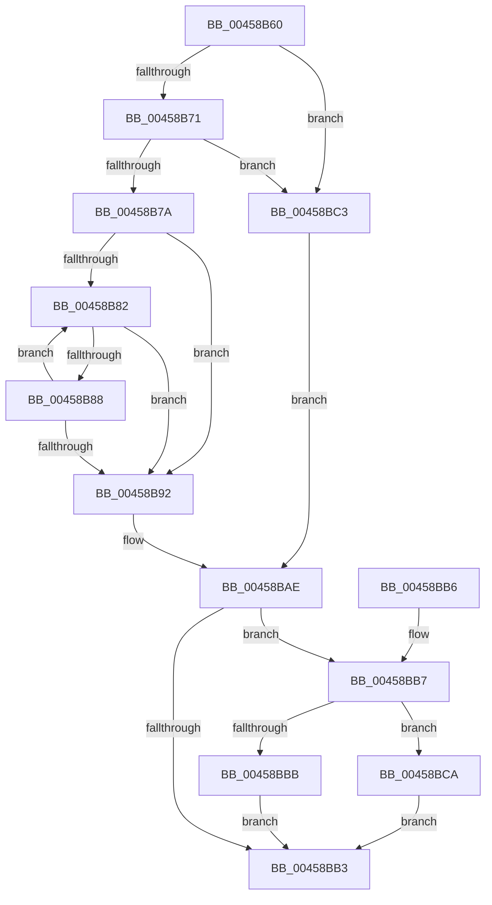

# StringCbLengthW

- RVA: `0x00458B60`–`0x00458BCF` (길이 `111` bytes)
- VA: `0x0000000140458B60`
- 실행 섹션: `.text`
- PDB 이름 있음: `예`; PDB Function 태그: `아니요`
- unwind 정보 RVA: `0x000DB714`
- 디코드: `39`개 명령, `111/111` bytes 표시
- 미해석 바이트: `0` (있으면 어셈블리에 `.byte`로 보존)

> 이 문서는 커널 이미지의 기계어와 PDB 기호를 분석해 생성했습니다. 4번과 5번은 함수 원형과 자료형을 바이너리 사용 방식에서 추정한 C 해석이며 원본 소스 복구 결과는 아닙니다.

## 1. Dependencies

- 직접 호출 지점: **0**; 고유 호출 대상: **0**
- 직접 호출자로 확인된 함수: **6**
- RIP 상대 이미지 참조: **0**

### Outgoing calls
- 직접 디코드된 call 명령이 없습니다.

### Direct callers
- [PfVerifyScenarioBuffer](../../page/8A/PfVerifyScenarioBuffer_function_008AF9A0.md) at `0x008B013B`
- [sub_00AD1D78](../../page/AD/Unknown_function_00AD1D78.md) at `0x00AD1EC4`
- [sub_00AD777C](../../page/AD/Unknown_function_00AD777C.md) at `0x00AD78EA`
- [sub_00AD777C](../../page/AD/Unknown_function_00AD777C.md) at `0x00AD79D0`
- [sub_00AD7D60](../../page/AD/Unknown_function_00AD7D60.md) at `0x00AD7E8C`
- [sub_00AD9930](../../page/AD/Unknown_function_00AD9930.md) at `0x00AD9A42`
- [sub_00AD9930](../../page/AD/Unknown_function_00AD9930.md) at `0x00AD9B23`
- [sub_00ADAAF4](../../page/AD/Unknown_function_00ADAAF4.md) at `0x00ADAC0B`

### Static image references
- 디코드된 RIP-relative 메모리 참조가 없습니다.

## 2. Other-region calls and transfers

- 다른 실행 섹션으로 향하는 call: **0**
- 별도 외부 분기/꼬리 이동을 확인하지 못했습니다.

## 3. Assembly (complete function range)

```asm
00458B60  45 33 D2                        xor r10d, r10d
00458B63  48 D1 EA                        shr rdx, 1
00458B66  4D 8B C8                        mov r9, r8
00458B69  41 8B C2                        mov eax, r10d
00458B6C  48 85 C9                        test rcx, rcx
00458B6F  74 52                           je 0x140458bc3
00458B71  48 81 FA FF FF FF 7F            cmp rdx, 0x7fffffff
00458B78  77 49                           ja 0x140458bc3
00458B7A  4C 8B C2                        mov r8, rdx
00458B7D  48 85 D2                        test rdx, rdx
00458B80  74 10                           je 0x140458b92
00458B82  66 44 39 11                     cmp word ptr [rcx], r10w
00458B86  74 0A                           je 0x140458b92
00458B88  48 83 C1 02                     add rcx, 2
00458B8C  49 83 E8 01                     sub r8, 1
00458B90  75 F0                           jne 0x140458b82
00458B92  49 8B C0                        mov rax, r8
00458B95  48 F7 D8                        neg rax
00458B98  1B C9                           sbb ecx, ecx
00458B9A  49 2B D0                        sub rdx, r8
00458B9D  F7 D1                           not ecx
00458B9F  81 E1 57 00 07 80               and ecx, 0x80070057
00458BA5  49 F7 D8                        neg r8
00458BA8  48 1B C0                        sbb rax, rax
00458BAB  48 23 C2                        and rax, rdx
00458BAE  4D 85 C9                        test r9, r9
00458BB1  75 04                           jne 0x140458bb7
00458BB3  8B C1                           mov eax, ecx
00458BB5  C3                              ret
00458BB6  CC                              int3
00458BB7  85 C9                           test ecx, ecx
00458BB9  78 0F                           js 0x140458bca
00458BBB  48 03 C0                        add rax, rax
00458BBE  49 89 01                        mov qword ptr [r9], rax
00458BC1  EB F0                           jmp 0x140458bb3
00458BC3  B9 57 00 07 80                  mov ecx, 0x80070057
00458BC8  EB E4                           jmp 0x140458bae
00458BCA  4D 89 11                        mov qword ptr [r9], r10
00458BCD  EB E4                           jmp 0x140458bb3
```

## 4. C-style interpretation (structured pseudocode)

```c
__int64 __fastcall StringCbLengthW(__int64 a1, __int64 a2, __int64 a3)
{
    __int64 result;
    __int64 v_r10;

    v_r10 = 0;
    a2 = (a2) >> (1);
    if (a1 == 0) goto loc_00458BC3;
    if (a2 > 0x7FFFFFFFULL) goto loc_00458BC3;
    if (a2 == 0) goto loc_00458B92;
loc_00458B82:
    if ((*(unsigned __int16 *)(a1)) == 0) goto loc_00458B92;
    a1 = (a1) + (2);
    a3 = (a2) - (1);
    if (condition_is_not_equal) goto loc_00458B82;
loc_00458B92:
    result = -(a3);
    a2 = (a2) - (a3);
    a1 = (unsigned int)(~(a1));
    a1 = (unsigned int)((a1) & (0x80070057ULL));
    a3 = -(a3);
    result = (result) & (a2);
loc_00458BAE:
    if (a3 != 0) goto loc_00458BB7;
loc_00458BB3:
    return (unsigned int)((unsigned int)(a1));
loc_00458BB7:
    if (sign_flag) goto loc_00458BCA;
    result = ((unsigned int)((unsigned int)(a1))) + ((unsigned int)((unsigned int)(a1)));
    *(unsigned __int64 *)(a3) = result;
    goto loc_00458BB3;
loc_00458BC3:
    goto loc_00458BAE;
loc_00458BCA:
    *(unsigned __int64 *)(a3) = 0;
    goto loc_00458BB3;
}
```

## 5. (Beta) C Style

```c
int64_t StringCbLengthW(int64_t Arg1, int64_t Arg2, int64_t Arg3)
{
    int64_t result;
    int64_t local_r10;

    local_r10 = 0;
    Arg2 = (Arg2) >> (1);
    if (Arg1 == 0) goto loc_00458BC3;
    if (Arg2 > 0x7FFFFFFFULL) goto loc_00458BC3;
    if (Arg2 == 0) goto loc_00458B92;
loc_00458B82:
    if ((*(uint16_t *)(Arg1)) == 0) goto loc_00458B92;
    Arg1 = (Arg1) + (2);
    Arg3 = (Arg2) - (1);
    if (condition_is_not_equal) goto loc_00458B82;
loc_00458B92:
    result = -(Arg3);
    Arg2 = (Arg2) - (Arg3);
    Arg1 = (uint32_t)(~(Arg1));
    Arg1 = (uint32_t)((Arg1) & (0x80070057ULL));
    Arg3 = -(Arg3);
    result = (result) & (Arg2);
loc_00458BAE:
    if (Arg3 != 0) goto loc_00458BB7;
loc_00458BB3:
    return (uint32_t)((uint32_t)(Arg1));
loc_00458BB7:
    if (sign_flag) goto loc_00458BCA;
    result = ((uint32_t)((uint32_t)(Arg1))) + ((uint32_t)((uint32_t)(Arg1)));
    *(uint64_t *)(Arg3) = result;
    goto loc_00458BB3;
loc_00458BC3:
    goto loc_00458BAE;
loc_00458BCA:
    *(uint64_t *)(Arg3) = 0;
    goto loc_00458BB3;
}
```

## 6. Execution-region graph

[열기: 2D/3D 그래프와 함수 탐색 컨트롤 패널](../../../control-panel.html?section=text&rva=0x00458B60&view=graph)

- 2D 그래프는 위에서 아래로 흐르고, 3D 그래프는 빈 공간을 드래그해 회전합니다. Shift+드래그는 이동, 휠은 확대·축소, 함수 노드 선택은 대상 보고서 이동입니다.

### Static fallback


