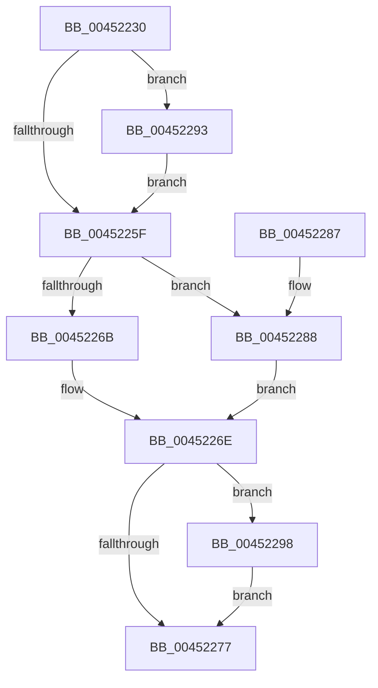

# TimeToDaysAndFraction

- RVA: `0x00452230`–`0x0045229D` (길이 `109` bytes)
- VA: `0x0000000140452230`
- 실행 섹션: `.text`
- PDB 이름 있음: `예`; PDB Function 태그: `예`
- unwind 정보 RVA: `0x000DB714`
- 디코드: `35`개 명령, `109/109` bytes 표시
- 미해석 바이트: `0` (있으면 어셈블리에 `.byte`로 보존)

> 이 문서는 커널 이미지의 기계어와 PDB 기호를 분석해 생성했습니다. 4번과 5번은 함수 원형과 자료형을 바이너리 사용 방식에서 추정한 C 해석이며 원본 소스 복구 결과는 아닙니다.

## 1. Dependencies

- 직접 호출 지점: **0**; 고유 호출 대상: **0**
- 직접 호출자로 확인된 함수: **1**
- RIP 상대 이미지 참조: **2**

### Outgoing calls
- 직접 디코드된 call 명령이 없습니다.

### Direct callers
- [RtlTimeToElapsedTimeFields](../../page/78/RtlTimeToElapsedTimeFields_function_0078B330.md) at `0x0078B34F`

### Static image references
- `0x00452249` → RVA `0x00014570` (`.rdata`; read)
- `0x0045225F` → RVA `0x00014568` (`.rdata`; read)

## 2. Other-region calls and transfers

- 다른 실행 섹션으로 향하는 call: **0**
- 별도 외부 분기/꼬리 이동을 확인하지 못했습니다.

## 3. Assembly (complete function range)

```asm
00452230  48 8B 09                        mov rcx, qword ptr [rcx]
00452233  4D 8B D0                        mov r10, r8
00452236  48 8B C1                        mov rax, rcx
00452239  4C 8B C9                        mov r9, rcx
0045223C  48 F7 D8                        neg rax
0045223F  4C 8B DA                        mov r11, rdx
00452242  48 85 C9                        test rcx, rcx
00452245  4C 0F 48 C8                     cmovs r9, rax
00452249  48 8B 05 20 23 BC FF            mov rax, qword ptr [rip - 0x43dce0]
00452250  49 F7 E1                        mul r9
00452253  4C 8B C2                        mov r8, rdx
00452256  49 C1 E8 0D                     shr r8, 0xd
0045225A  48 85 C9                        test rcx, rcx
0045225D  78 34                           js 0x140452293
0045225F  48 8B 05 02 23 BC FF            mov rax, qword ptr [rip - 0x43dcfe]
00452266  4D 85 C0                        test r8, r8
00452269  78 1D                           js 0x140452288
0045226B  49 F7 E0                        mul r8
0045226E  48 C1 EA 1A                     shr rdx, 0x1a
00452272  4D 85 C0                        test r8, r8
00452275  78 21                           js 0x140452298
00452277  69 C2 00 5C 26 05               imul eax, edx, 0x5265c00
0045227D  41 89 13                        mov dword ptr [r11], edx
00452280  44 2B C0                        sub r8d, eax
00452283  45 89 02                        mov dword ptr [r10], r8d
00452286  C3                              ret
00452287  CC                              int3
00452288  49 8B C8                        mov rcx, r8
0045228B  48 F7 D9                        neg rcx
0045228E  48 F7 E1                        mul rcx
00452291  EB DB                           jmp 0x14045226e
00452293  49 F7 D8                        neg r8
00452296  EB C7                           jmp 0x14045225f
00452298  48 F7 DA                        neg rdx
0045229B  EB DA                           jmp 0x140452277
```

## 4. C-style interpretation (structured pseudocode)

```c
__int64 __fastcall TimeToDaysAndFraction(__int64 a1, __int64 a2, __int64 a3)
{
    __int64 result;

    result = -(*(unsigned __int64 *)(a1));
    a4 = *(unsigned __int64 *)(a1);
    if (sign_flag) { a4 = result; }
    a3 = (a2) >> (13);
    if (sign_flag) goto loc_00452293;
loc_0045225F:
    if (sign_flag) goto loc_00452288;
loc_0045226E:
    a2 = (a2) >> (26);
    if (sign_flag) goto loc_00452298;
loc_00452277:
    result = (unsigned int)((*(unsigned __int64 *)(v_rip - 4447486)) * ((unsigned int)(a2)));
    *(unsigned int *)(a2) = (unsigned int)(a2);
    a3 = (unsigned int)((a3) - ((unsigned int)(result)));
    *(unsigned int *)(a3) = (unsigned int)(a3);
    return result;
loc_00452288:
    a1 = -(a3);
    goto loc_0045226E;
loc_00452293:
    a3 = -(a3);
    goto loc_0045225F;
loc_00452298:
    a2 = -(a2);
    goto loc_00452277;
}
```

## 5. (Beta) C Style

```c
int64_t TimeToDaysAndFraction(void *Arg1, void *Arg2, void *Arg3)
{
    uint8_t *arg1 = (uint8_t *)Arg1;
    uint8_t *arg2 = (uint8_t *)Arg2;
    uint8_t *arg3 = (uint8_t *)Arg3;

    int64_t result;

    result = -(*(uint64_t *)(arg1));
    a4 = *(uint64_t *)(arg1);
    if (sign_flag) { a4 = result; }
    Arg3 = (Arg2) >> (13);
    if (sign_flag) goto loc_00452293;
loc_0045225F:
    if (sign_flag) goto loc_00452288;
loc_0045226E:
    Arg2 = (Arg2) >> (26);
    if (sign_flag) goto loc_00452298;
loc_00452277:
    result = (uint32_t)((*(uint64_t *)(v_rip - 0x43DCFE)) * ((uint32_t)(Arg2)));
    *(uint32_t *)(arg2) = (uint32_t)(Arg2);
    Arg3 = (uint32_t)((Arg3) - ((uint32_t)(result)));
    *(uint32_t *)(arg3) = (uint32_t)(Arg3);
    return result;
loc_00452288:
    Arg1 = -(Arg3);
    goto loc_0045226E;
loc_00452293:
    Arg3 = -(Arg3);
    goto loc_0045225F;
loc_00452298:
    Arg2 = -(Arg2);
    goto loc_00452277;
}
```

### 관측된 메모리 오프셋

구조체 형식이 확인되지 않은 접근은 인자 기준의 오프셋으로만 기록했습니다.

| 기준 인자 | 오프셋 표현 | 폭 (bit) | 접근 |
|---|---:|---:|---|
| `Arg1` | `+ 0x0` | `64` | `R` |
| `Arg2` | `+ 0x0` | `32` | `W` |
| `Arg3` | `+ 0x0` | `32` | `W` |

## 6. Execution-region graph

[열기: 2D/3D 그래프와 함수 탐색 컨트롤 패널](../../../control-panel.html?section=text&rva=0x00452230&view=graph)

- 2D 그래프는 위에서 아래로 흐르고, 3D 그래프는 빈 공간을 드래그해 회전합니다. Shift+드래그는 이동, 휠은 확대·축소, 함수 노드 선택은 대상 보고서 이동입니다.

### Static fallback


