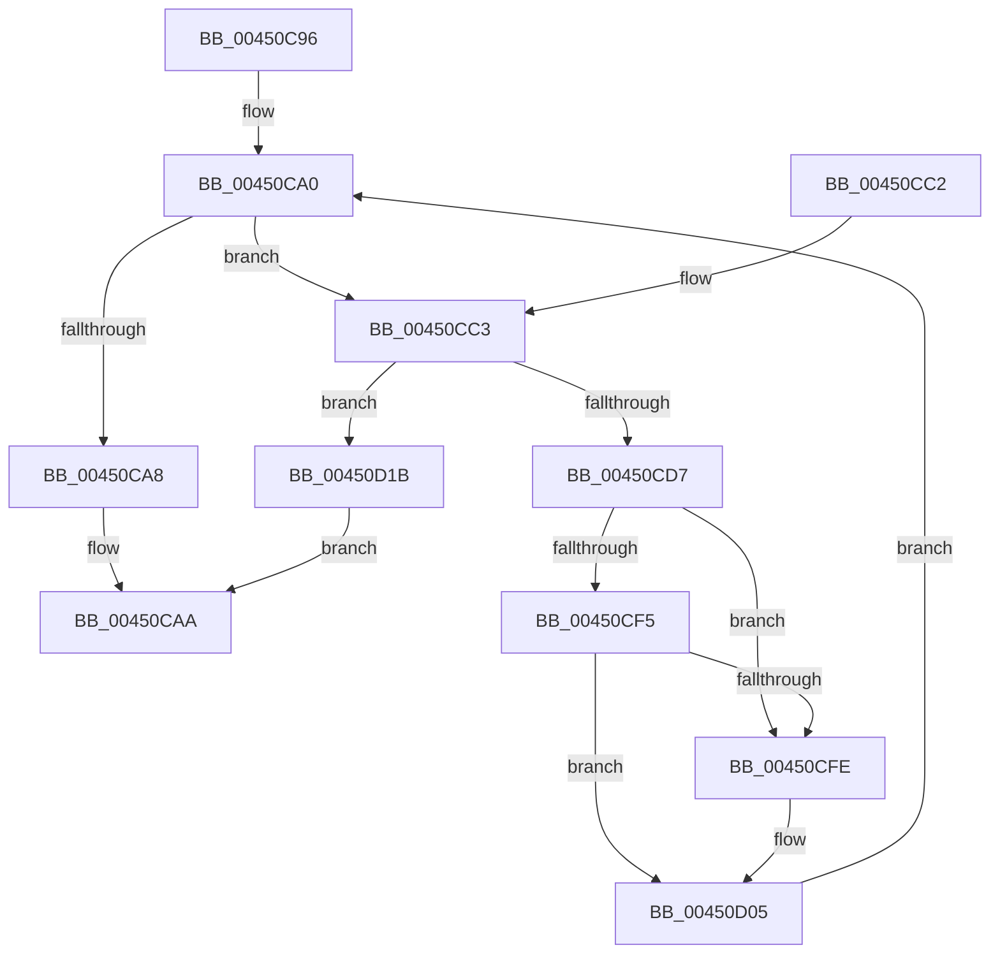

# sub_00450C96

- RVA: `0x00450C96`–`0x00450D22` (길이 `140` bytes)
- VA: `0x0000000140450C96`
- 실행 섹션: `.text`
- PDB 이름 있음: `아니요`; PDB Function 태그: `아니요`
- unwind 정보 RVA: `0x000A7348`
- 디코드: `42`개 명령, `140/140` bytes 표시
- 미해석 바이트: `0` (있으면 어셈블리에 `.byte`로 보존)

> 이 문서는 커널 이미지의 기계어와 PDB 기호를 분석해 생성했습니다. 4번과 5번은 함수 원형과 자료형을 바이너리 사용 방식에서 추정한 C 해석이며 원본 소스 복구 결과는 아닙니다.

## 1. Dependencies

- 직접 호출 지점: **3**; 고유 호출 대상: **3**
- 직접 호출자로 확인된 함수: **0**
- RIP 상대 이미지 참조: **0**

### Outgoing calls
- `0x00450CCB` → [KeAcquireSpinLockAtDpcLevel](../20/KeAcquireSpinLockAtDpcLevel_function_00208430.md) (function, `0x00208430`)
- `0x00450CDB` → [KxReleaseSpinLock](../20/KxReleaseSpinLock_function_00206670.md) (function, `0x00206670`)
- `0x00450D14` → [ExFreePoolWithTag](../../poolcode/B8/ExFreePoolWithTag_function_00B82870.md) (function, `0x00B82870`)

### Direct callers
- 이 함수 시작 RVA로 연결되는 직접 call은 확인되지 않았습니다. 간접 호출은 완전히 역산할 수 없습니다.

### Static image references
- 디코드된 RIP-relative 메모리 참조가 없습니다.

## 2. Other-region calls and transfers

- 다른 실행 섹션으로 향하는 call: **1**
  - `0x00450D14` → [ExFreePoolWithTag](../../poolcode/B8/ExFreePoolWithTag_function_00B82870.md) (`.text` → `POOLCODE`)
- 별도 외부 분기/꼬리 이동을 확인하지 못했습니다.

## 3. Assembly (complete function range)

```asm
00450C96  48 89 6C 24 40                  mov qword ptr [rsp + 0x40], rbp
00450C9B  4C 89 7C 24 48                  mov qword ptr [rsp + 0x48], r15
00450CA0  4C 8B 37                        mov r14, qword ptr [rdi]
00450CA3  4C 3B F3                        cmp r14, rbx
00450CA6  75 1B                           jne 0x140450cc3
00450CA8  32 C0                           xor al, al
00450CAA  4C 8B 7C 24 48                  mov r15, qword ptr [rsp + 0x48]
00450CAF  48 8B 6C 24 40                  mov rbp, qword ptr [rsp + 0x40]
00450CB4  48 8B 5C 24 50                  mov rbx, qword ptr [rsp + 0x50]
00450CB9  48 83 C4 20                     add rsp, 0x20
00450CBD  41 5E                           pop r14
00450CBF  5F                              pop rdi
00450CC0  5E                              pop rsi
00450CC1  C3                              ret
00450CC2  CC                              int3
00450CC3  49 8D 6E E0                     lea rbp, [r14 - 0x20]
00450CC7  48 8D 4D 08                     lea rcx, [rbp + 8]
00450CCB  E8 60 77 DB FF                  call 0x140208430
00450CD0  8B 45 10                        mov eax, dword ptr [rbp + 0x10]
00450CD3  A8 08                           test al, 8
00450CD5  75 44                           jne 0x140450d1b
00450CD7  48 8D 4D 08                     lea rcx, [rbp + 8]
00450CDB  E8 90 59 DB FF                  call 0x140206670
00450CE0  83 65 10 FB                     and dword ptr [rbp + 0x10], 0xfffffffb
00450CE4  48 C7 45 18 00 00 00 00         mov qword ptr [rbp + 0x18], 0
00450CEC  49 8B 0E                        mov rcx, qword ptr [r14]
00450CEF  4C 39 71 08                     cmp qword ptr [rcx + 8], r14
00450CF3  75 09                           jne 0x140450cfe
00450CF5  49 8B 46 08                     mov rax, qword ptr [r14 + 8]
00450CF9  4C 39 30                        cmp qword ptr [rax], r14
00450CFC  74 07                           je 0x140450d05
00450CFE  B9 03 00 00 00                  mov ecx, 3
00450D03  CD 29                           int 0x29
00450D05  48 89 08                        mov qword ptr [rax], rcx
00450D08  BA 50 46 58 4D                  mov edx, 0x4d584650
00450D0D  48 89 41 08                     mov qword ptr [rcx + 8], rax
00450D11  48 8B CD                        mov rcx, rbp
00450D14  E8 57 1B 73 00                  call 0x140b82870
00450D19  EB 85                           jmp 0x140450ca0
00450D1B  48 89 2E                        mov qword ptr [rsi], rbp
00450D1E  B0 01                           mov al, 1
00450D20  EB 88                           jmp 0x140450caa
```

## 4. C-style interpretation (structured pseudocode)

```c
__int64 __fastcall sub_00450C96(__int64 a1, __int64 a2, __int64 a3, __int64 a4, __int64 a5, __int64 a6, __int64 a7, __int64 a8, __int64 a9, __int64 a10)
{
    __int64 result;
    __int64 v_rsp;
    unsigned __int64 v_stack_p40;
    unsigned __int64 v_stack_p48;

    v_stack_p40 = v_rbp;
    v_stack_p48 = v_r15;
loc_00450CA0:
    if ((*(unsigned __int64 *)(v_rdi)) != v_rbx) goto loc_00450CC3;
    result = 0;
loc_00450CAA:
    v_rsp = (v_rsp) + (32);
    return result;
loc_00450CC3:
    result = KeAcquireSpinLockAtDpcLevel(*(unsigned __int64 *)(v_rdi) - 32 + 8, a2, a3, a4);
    if ((((unsigned __int8)((unsigned int)(*(unsigned int *)(*(unsigned __int64 *)(v_rdi) - 32 + 16)))) & (8)) != 0) goto loc_00450D1B;
    result = KxReleaseSpinLock(*(unsigned __int64 *)(v_rdi) - 32 + 8, a2, a3, a4);
    *(unsigned __int64 *)(*(unsigned __int64 *)(v_rdi) - 32 + 24) = 0;
    if ((*(unsigned __int64 *)(*(unsigned __int64 *)(*(unsigned __int64 *)(v_rdi)) + 8)) != (*(unsigned __int64 *)(v_rdi))) goto loc_00450CFE;
    if ((*(unsigned __int64 *)(*(unsigned __int64 *)(*(unsigned __int64 *)(v_rdi) + 8))) != (*(unsigned __int64 *)(v_rdi))) {
        a1 = 3;
    }
    *(unsigned __int64 *)(*(unsigned __int64 *)(*(unsigned __int64 *)(v_rdi) + 8)) = a1;
    *(unsigned __int64 *)(a1 + 8) = *(unsigned __int64 *)(*(unsigned __int64 *)(v_rdi) + 8);
    result = ExFreePoolWithTag(*(unsigned __int64 *)(v_rdi) - 32, (unsigned int)(0x4D584650ULL), a3, a4);
    goto loc_00450CA0;
loc_00450D1B:
    *(unsigned __int64 *)(v_rsi) = *(unsigned __int64 *)(v_rdi) - 32;
    goto loc_00450CAA;
}
```

## 5. (Beta) C Style

```c
int64_t sub_00450C96(int64_t Arg1, int64_t Arg2, int64_t Arg3, int64_t Arg4, uint64_t Arg5, uint64_t Arg6, uint64_t Arg7, int64_t Arg8, int64_t Arg9, int64_t Arg10)
{
    int64_t result;
    int64_t local_rsp;
    uint64_t v_stack_p40;
    uint64_t v_stack_p48;

    v_stack_p40 = local_rbp;
    v_stack_p48 = local_r15;
loc_00450CA0:
    if ((*(uint64_t *)(local_rdi)) != local_rbx) goto loc_00450CC3;
    result = 0;
loc_00450CAA:
    local_rsp = (local_rsp) + (32);
    return result;
loc_00450CC3:
    result = KeAcquireSpinLockAtDpcLevel(*(uint64_t *)(local_rdi) - 32 + 8, Arg2, Arg3, Arg4);
    if ((((uint8_t)((uint32_t)(*(uint32_t *)(*(uint64_t *)(local_rdi) - 0x20 + 0x10)))) & (8)) != 0) goto loc_00450D1B;
    result = KxReleaseSpinLock(*(uint64_t *)(local_rdi) - 32 + 8, Arg2, Arg3, Arg4);
    *(uint64_t *)(*(uint64_t *)(local_rdi) - 0x20 + 0x18) = 0;
    if ((*(uint64_t *)(*(uint64_t *)(*(uint64_t *)(local_rdi)) + 0x8)) != (*(uint64_t *)(local_rdi))) goto loc_00450CFE;
    if ((*(uint64_t *)(*(uint64_t *)(*(uint64_t *)(local_rdi) + 0x8))) != (*(uint64_t *)(local_rdi))) {
        Arg1 = 3;
    }
    *(uint64_t *)(*(uint64_t *)(*(uint64_t *)(local_rdi) + 0x8)) = Arg1;
    *(uint64_t *)(Arg1 + 0x8) = *(uint64_t *)(*(uint64_t *)(local_rdi) + 0x8);
    result = ExFreePoolWithTag(*(uint64_t *)(local_rdi) - 32, (uint32_t)(0x4D584650ULL), Arg3, Arg4);
    goto loc_00450CA0;
loc_00450D1B:
    *(uint64_t *)(local_rsi) = *(uint64_t *)(local_rdi) - 32;
    goto loc_00450CAA;
}
```

## 6. Execution-region graph

[열기: 2D/3D 그래프와 함수 탐색 컨트롤 패널](../../../control-panel.html?section=text&rva=0x00450C96&view=graph)

- 2D 그래프는 위에서 아래로 흐르고, 3D 그래프는 빈 공간을 드래그해 회전합니다. Shift+드래그는 이동, 휠은 확대·축소, 함수 노드 선택은 대상 보고서 이동입니다.

### Static fallback


