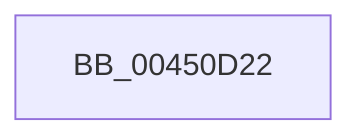

# sub_00450D22

- RVA: `0x00450D22`–`0x00450D34` (길이 `18` bytes)
- VA: `0x0000000140450D22`
- 실행 섹션: `.text`
- PDB 이름 있음: `아니요`; PDB Function 태그: `아니요`
- unwind 정보 RVA: `0x000A7364`
- 디코드: `4`개 명령, `18/18` bytes 표시
- 미해석 바이트: `0` (있으면 어셈블리에 `.byte`로 보존)

> 이 문서는 커널 이미지의 기계어와 PDB 기호를 분석해 생성했습니다. 4번과 5번은 함수 원형과 자료형을 바이너리 사용 방식에서 추정한 C 해석이며 원본 소스 복구 결과는 아닙니다.

## 1. Dependencies

- 직접 호출 지점: **1**; 고유 호출 대상: **1**
- 직접 호출자로 확인된 함수: **0**
- RIP 상대 이미지 참조: **0**

### Outgoing calls
- `0x00450D26` → [KxReleaseSpinLock](../20/KxReleaseSpinLock_function_00206670.md) (function, `0x00206670`)

### Direct callers
- 이 함수 시작 RVA로 연결되는 직접 call은 확인되지 않았습니다. 간접 호출은 완전히 역산할 수 없습니다.

### Static image references
- 디코드된 RIP-relative 메모리 참조가 없습니다.

## 2. Other-region calls and transfers

- 다른 실행 섹션으로 향하는 call: **0**
- call이 아닌 외부 분기/꼬리 이동: **1**
  - `0x00450D2F` → [sub_00450C96](Unknown_function_00450C96.md) (`tail-transfer`)

## 3. Assembly (complete function range)

```asm
00450D22  48 8D 4A 08                     lea rcx, [rdx + 8]
00450D26  E8 45 59 DB FF                  call 0x140206670
00450D2B  48 83 C7 20                     add rdi, 0x20
00450D2F  E9 62 FF FF FF                  jmp 0x140450c96
```

## 4. C-style interpretation (structured pseudocode)

```c
__int64 __fastcall sub_00450D22(__int64 a1, __int64 a2)
{
    __int64 result;
    __int64 v_rdi;

    result = KxReleaseSpinLock(a2 + 8, a2, a3, a4);
    v_rdi = (v_rdi) + (32);
}
```

## 5. (Beta) C Style

```c
int64_t sub_00450D22(int64_t Arg1, void *Arg2)
{
    uint8_t *arg2 = (uint8_t *)Arg2;

    int64_t result;
    int64_t local_rdi;

    result = KxReleaseSpinLock(Arg2 + 8, Arg2, a3, a4);
    local_rdi = (local_rdi) + (32);
}
```

### 관측된 메모리 오프셋

구조체 형식이 확인되지 않은 접근은 인자 기준의 오프셋으로만 기록했습니다.

| 기준 인자 | 오프셋 표현 | 폭 (bit) | 접근 |
|---|---:|---:|---|
| `Arg2` | `+ 0x8` | `64` | `R` |

## 6. Execution-region graph

[열기: 2D/3D 그래프와 함수 탐색 컨트롤 패널](../../../control-panel.html?section=text&rva=0x00450D22&view=graph)

- 2D 그래프는 위에서 아래로 흐르고, 3D 그래프는 빈 공간을 드래그해 회전합니다. Shift+드래그는 이동, 휠은 확대·축소, 함수 노드 선택은 대상 보고서 이동입니다.

### Static fallback


