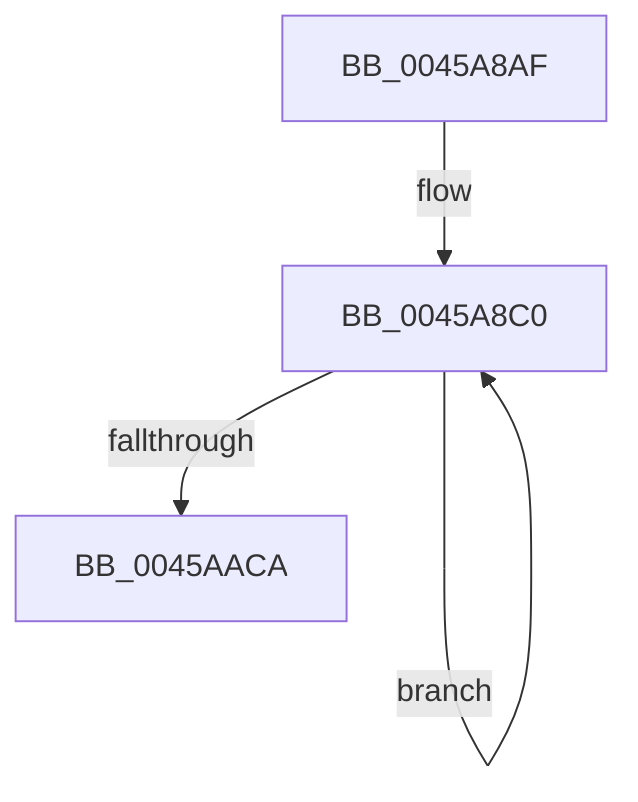

# sub_0045A8AF

- RVA: `0x0045A8AF`–`0x0045AAE2` (길이 `563` bytes)
- VA: `0x000000014045A8AF`
- 실행 섹션: `.text`
- PDB 이름 있음: `아니요`; PDB Function 태그: `아니요`
- unwind 정보 RVA: `0x000A9020`
- 디코드: `114`개 명령, `563/563` bytes 표시
- 미해석 바이트: `0` (있으면 어셈블리에 `.byte`로 보존)

> 이 문서는 커널 이미지의 기계어와 PDB 기호를 분석해 생성했습니다. 4번과 5번은 함수 원형과 자료형을 바이너리 사용 방식에서 추정한 C 해석이며 원본 소스 복구 결과는 아닙니다.

## 1. Dependencies

- 직접 호출 지점: **0**; 고유 호출 대상: **0**
- 직접 호출자로 확인된 함수: **0**
- RIP 상대 이미지 참조: **0**

### Outgoing calls
- 직접 디코드된 call 명령이 없습니다.

### Direct callers
- 이 함수 시작 RVA로 연결되는 직접 call은 확인되지 않았습니다. 간접 호출은 완전히 역산할 수 없습니다.

### Static image references
- 디코드된 RIP-relative 메모리 참조가 없습니다.

## 2. Other-region calls and transfers

- 다른 실행 섹션으로 향하는 call: **0**
- 별도 외부 분기/꼬리 이동을 확인하지 못했습니다.

## 3. Assembly (complete function range)

```asm
0045A8AF  4C 89 34 24                     mov qword ptr [rsp], r14
0045A8B3  48 8B EB                        mov rbp, rbx
0045A8B6  4D 8B 77 10                     mov r14, qword ptr [r15 + 0x10]
0045A8BA  4C 8B FA                        mov r15, rdx
0045A8BD  0F 1F 00                        nop dword ptr [rax]
0045A8C0  0F 18 96 00 01 00 00            prefetcht1 byte ptr [rsi + 0x100]
0045A8C7  4C 33 66 08                     xor r12, qword ptr [rsi + 8]
0045A8CB  4C 33 6E 10                     xor r13, qword ptr [rsi + 0x10]
0045A8CF  4D 8B CC                        mov r9, r12
0045A8D2  48 33 6E 18                     xor rbp, qword ptr [rsi + 0x18]
0045A8D6  4D 8B D5                        mov r10, r13
0045A8D9  48 33 06                        xor rax, qword ptr [rsi]
0045A8DC  4C 8B DD                        mov r11, rbp
0045A8DF  4C 8B C0                        mov r8, rax
0045A8E2  41 0F B6 CC                     movzx ecx, r12b
0045A8E6  49 C1 E8 08                     shr r8, 8
0045A8EA  49 C1 E9 08                     shr r9, 8
0045A8EE  49 C1 EA 08                     shr r10, 8
0045A8F2  4D 8B A4 CE 00 38 00 00         mov r12, qword ptr [r14 + rcx*8 + 0x3800]
0045A8FA  41 0F B6 CD                     movzx ecx, r13b
0045A8FE  0F B6 C0                        movzx eax, al
0045A901  49 C1 EB 08                     shr r11, 8
0045A905  4D 8B AC CE 00 38 00 00         mov r13, qword ptr [r14 + rcx*8 + 0x3800]
0045A90D  49 8B 84 C6 00 38 00 00         mov rax, qword ptr [r14 + rax*8 + 0x3800]
0045A915  40 0F B6 CD                     movzx ecx, bpl
0045A919  49 8B AC CE 00 38 00 00         mov rbp, qword ptr [r14 + rcx*8 + 0x3800]
0045A921  41 0F B6 C8                     movzx ecx, r8b
0045A925  49 C1 E8 08                     shr r8, 8
0045A929  49 33 84 CE 00 30 00 00         xor rax, qword ptr [r14 + rcx*8 + 0x3000]
0045A931  41 0F B6 C9                     movzx ecx, r9b
0045A935  49 C1 E9 08                     shr r9, 8
0045A939  4D 33 A4 CE 00 30 00 00         xor r12, qword ptr [r14 + rcx*8 + 0x3000]
0045A941  41 0F B6 CA                     movzx ecx, r10b
0045A945  49 C1 EA 08                     shr r10, 8
0045A949  4D 33 AC CE 00 30 00 00         xor r13, qword ptr [r14 + rcx*8 + 0x3000]
0045A951  41 0F B6 CB                     movzx ecx, r11b
0045A955  49 C1 EB 08                     shr r11, 8
0045A959  49 33 AC CE 00 30 00 00         xor rbp, qword ptr [r14 + rcx*8 + 0x3000]
0045A961  41 0F B6 C8                     movzx ecx, r8b
0045A965  49 C1 E8 08                     shr r8, 8
0045A969  49 33 84 CE 00 28 00 00         xor rax, qword ptr [r14 + rcx*8 + 0x2800]
0045A971  41 0F B6 C9                     movzx ecx, r9b
0045A975  49 C1 E9 08                     shr r9, 8
0045A979  4D 33 A4 CE 00 28 00 00         xor r12, qword ptr [r14 + rcx*8 + 0x2800]
0045A981  41 0F B6 CA                     movzx ecx, r10b
0045A985  49 C1 EA 08                     shr r10, 8
0045A989  4D 33 AC CE 00 28 00 00         xor r13, qword ptr [r14 + rcx*8 + 0x2800]
0045A991  41 0F B6 CB                     movzx ecx, r11b
0045A995  49 C1 EB 08                     shr r11, 8
0045A999  49 33 AC CE 00 28 00 00         xor rbp, qword ptr [r14 + rcx*8 + 0x2800]
0045A9A1  41 0F B6 C8                     movzx ecx, r8b
0045A9A5  49 C1 E8 08                     shr r8, 8
0045A9A9  49 33 84 CE 00 20 00 00         xor rax, qword ptr [r14 + rcx*8 + 0x2000]
0045A9B1  41 0F B6 C9                     movzx ecx, r9b
0045A9B5  49 C1 E9 08                     shr r9, 8
0045A9B9  4D 33 A4 CE 00 20 00 00         xor r12, qword ptr [r14 + rcx*8 + 0x2000]
0045A9C1  41 0F B6 CA                     movzx ecx, r10b
0045A9C5  49 C1 EA 08                     shr r10, 8
0045A9C9  4D 33 AC CE 00 20 00 00         xor r13, qword ptr [r14 + rcx*8 + 0x2000]
0045A9D1  41 0F B6 CB                     movzx ecx, r11b
0045A9D5  49 C1 EB 08                     shr r11, 8
0045A9D9  49 33 AC CE 00 20 00 00         xor rbp, qword ptr [r14 + rcx*8 + 0x2000]
0045A9E1  41 0F B6 C8                     movzx ecx, r8b
0045A9E5  49 C1 E8 08                     shr r8, 8
0045A9E9  49 33 84 CE 00 18 00 00         xor rax, qword ptr [r14 + rcx*8 + 0x1800]
0045A9F1  41 0F B6 C9                     movzx ecx, r9b
0045A9F5  49 C1 E9 08                     shr r9, 8
0045A9F9  4D 33 A4 CE 00 18 00 00         xor r12, qword ptr [r14 + rcx*8 + 0x1800]
0045AA01  41 0F B6 CA                     movzx ecx, r10b
0045AA05  49 C1 EA 08                     shr r10, 8
0045AA09  4D 33 AC CE 00 18 00 00         xor r13, qword ptr [r14 + rcx*8 + 0x1800]
0045AA11  41 0F B6 CB                     movzx ecx, r11b
0045AA15  49 C1 EB 08                     shr r11, 8
0045AA19  49 33 AC CE 00 18 00 00         xor rbp, qword ptr [r14 + rcx*8 + 0x1800]
0045AA21  41 0F B6 C8                     movzx ecx, r8b
0045AA25  49 C1 E8 08                     shr r8, 8
0045AA29  41 0F B6 D0                     movzx edx, r8b
0045AA2D  49 33 84 CE 00 10 00 00         xor rax, qword ptr [r14 + rcx*8 + 0x1000]
0045AA35  41 0F B6 C9                     movzx ecx, r9b
0045AA39  49 C1 E9 08                     shr r9, 8
0045AA3D  4D 33 A4 CE 00 10 00 00         xor r12, qword ptr [r14 + rcx*8 + 0x1000]
0045AA45  41 0F B6 CA                     movzx ecx, r10b
0045AA49  49 C1 EA 08                     shr r10, 8
0045AA4D  4D 33 AC CE 00 10 00 00         xor r13, qword ptr [r14 + rcx*8 + 0x1000]
0045AA55  41 0F B6 CB                     movzx ecx, r11b
0045AA59  49 33 AC CE 00 10 00 00         xor rbp, qword ptr [r14 + rcx*8 + 0x1000]
0045AA61  49 C1 EB 08                     shr r11, 8
0045AA65  49 8B 94 D6 00 08 00 00         mov rdx, qword ptr [r14 + rdx*8 + 0x800]
0045AA6D  48 83 C6 20                     add rsi, 0x20
0045AA71  49 C1 E8 08                     shr r8, 8
0045AA75  4B 33 14 C6                     xor rdx, qword ptr [r14 + r8*8]
0045AA79  48 33 C2                        xor rax, rdx
0045AA7C  41 0F B6 D1                     movzx edx, r9b
0045AA80  49 C1 E9 08                     shr r9, 8
0045AA84  49 8B 94 D6 00 08 00 00         mov rdx, qword ptr [r14 + rdx*8 + 0x800]
0045AA8C  4B 33 14 CE                     xor rdx, qword ptr [r14 + r9*8]
0045AA90  4C 33 E2                        xor r12, rdx
0045AA93  41 0F B6 D2                     movzx edx, r10b
0045AA97  49 C1 EA 08                     shr r10, 8
0045AA9B  49 8B 94 D6 00 08 00 00         mov rdx, qword ptr [r14 + rdx*8 + 0x800]
0045AAA3  4B 33 14 D6                     xor rdx, qword ptr [r14 + r10*8]
0045AAA7  4C 33 EA                        xor r13, rdx
0045AAAA  41 0F B6 D3                     movzx edx, r11b
0045AAAE  49 C1 EB 08                     shr r11, 8
0045AAB2  49 8B 94 D6 00 08 00 00         mov rdx, qword ptr [r14 + rdx*8 + 0x800]
0045AABA  4B 33 14 DE                     xor rdx, qword ptr [r14 + r11*8]
0045AABE  48 33 EA                        xor rbp, rdx
0045AAC1  49 3B F7                        cmp rsi, r15
0045AAC4  0F 82 F6 FD FF FF               jb 0x14045a8c0
0045AACA  4C 8B 34 24                     mov r14, qword ptr [rsp]
0045AACE  4C 8B 7C 24 58                  mov r15, qword ptr [rsp + 0x58]
0045AAD3  48 89 6C 24 40                  mov qword ptr [rsp + 0x40], rbp
0045AAD8  4C 8B 44 24 40                  mov r8, qword ptr [rsp + 0x40]
0045AADD  48 8B 6C 24 48                  mov rbp, qword ptr [rsp + 0x48]
```

## 4. C-style interpretation (structured pseudocode)

```c
__int64 __fastcall sub_0045A8AF(__int64 a1, __int64 a2, __int64 a3, __int64 a4, __int64 a5, __int64 a6, __int64 a7, __int64 a8, __int64 a9, __int64 a10, __int64 a11)
{
    __int64 result;
    __int64 v_r10;
    __int64 v_r11;
    __int64 v_r12;
    __int64 v_r13;
    __int64 v_rbp;
    __int64 v_rsi;
    unsigned __int64 v_stack_p0;
    unsigned __int64 v_stack_p40;

    v_stack_p0 = v_r14;
loc_0045A8C0:
    v_r12 = (v_r12) ^ (*(unsigned __int64 *)(v_rsi + 8));
    v_r13 = (v_r13) ^ (*(unsigned __int64 *)(v_rsi + 16));
    v_rbp = (v_rbx) ^ (*(unsigned __int64 *)(v_rsi + 24));
    result = (result) ^ (*(unsigned __int64 *)(v_rsi));
    a3 = (result) >> (8);
    a4 = (v_r12) >> (8);
    v_r10 = (v_r13) >> (8);
    v_r11 = (v_rbp) >> (8);
    a3 = (a3) >> (8);
    result = (*(unsigned __int64 *)(*(unsigned __int64 *)(v_r15 + 16) + (unsigned __int8)(result) * 8 + 14336)) ^ (*(unsigned __int64 *)(*(unsigned __int64 *)(v_r15 + 16) + (unsigned __int8)(a3) * 8 + 12288));
    a4 = (a4) >> (8);
    v_r12 = (*(unsigned __int64 *)(*(unsigned __int64 *)(v_r15 + 16) + (unsigned __int8)(v_r12) * 8 + 14336)) ^ (*(unsigned __int64 *)(*(unsigned __int64 *)(v_r15 + 16) + (unsigned __int8)(a4) * 8 + 12288));
    v_r10 = (v_r10) >> (8);
    v_r13 = (*(unsigned __int64 *)(*(unsigned __int64 *)(v_r15 + 16) + (unsigned __int8)(v_r13) * 8 + 14336)) ^ (*(unsigned __int64 *)(*(unsigned __int64 *)(v_r15 + 16) + (unsigned __int8)(v_r10) * 8 + 12288));
    v_r11 = (v_r11) >> (8);
    v_rbp = (*(unsigned __int64 *)(*(unsigned __int64 *)(v_r15 + 16) + (unsigned __int8)(v_rbp) * 8 + 14336)) ^ (*(unsigned __int64 *)(*(unsigned __int64 *)(v_r15 + 16) + (unsigned __int8)(v_r11) * 8 + 12288));
    a3 = (a3) >> (8);
    result = (result) ^ (*(unsigned __int64 *)(*(unsigned __int64 *)(v_r15 + 16) + (unsigned __int8)(a3) * 8 + 10240));
    a4 = (a4) >> (8);
    v_r12 = (v_r12) ^ (*(unsigned __int64 *)(*(unsigned __int64 *)(v_r15 + 16) + (unsigned __int8)(a4) * 8 + 10240));
    v_r10 = (v_r10) >> (8);
    v_r13 = (v_r13) ^ (*(unsigned __int64 *)(*(unsigned __int64 *)(v_r15 + 16) + (unsigned __int8)(v_r10) * 8 + 10240));
    v_r11 = (v_r11) >> (8);
    v_rbp = (v_rbp) ^ (*(unsigned __int64 *)(*(unsigned __int64 *)(v_r15 + 16) + (unsigned __int8)(v_r11) * 8 + 10240));
    a3 = (a3) >> (8);
    result = (result) ^ (*(unsigned __int64 *)(*(unsigned __int64 *)(v_r15 + 16) + (unsigned __int8)(a3) * 8 + 8192));
    a4 = (a4) >> (8);
    v_r12 = (v_r12) ^ (*(unsigned __int64 *)(*(unsigned __int64 *)(v_r15 + 16) + (unsigned __int8)(a4) * 8 + 8192));
    v_r10 = (v_r10) >> (8);
    v_r13 = (v_r13) ^ (*(unsigned __int64 *)(*(unsigned __int64 *)(v_r15 + 16) + (unsigned __int8)(v_r10) * 8 + 8192));
    v_r11 = (v_r11) >> (8);
    v_rbp = (v_rbp) ^ (*(unsigned __int64 *)(*(unsigned __int64 *)(v_r15 + 16) + (unsigned __int8)(v_r11) * 8 + 8192));
    a3 = (a3) >> (8);
    result = (result) ^ (*(unsigned __int64 *)(*(unsigned __int64 *)(v_r15 + 16) + (unsigned __int8)(a3) * 8 + 6144));
    a4 = (a4) >> (8);
    v_r12 = (v_r12) ^ (*(unsigned __int64 *)(*(unsigned __int64 *)(v_r15 + 16) + (unsigned __int8)(a4) * 8 + 6144));
    v_r10 = (v_r10) >> (8);
    v_r13 = (v_r13) ^ (*(unsigned __int64 *)(*(unsigned __int64 *)(v_r15 + 16) + (unsigned __int8)(v_r10) * 8 + 6144));
    v_r11 = (v_r11) >> (8);
    v_rbp = (v_rbp) ^ (*(unsigned __int64 *)(*(unsigned __int64 *)(v_r15 + 16) + (unsigned __int8)(v_r11) * 8 + 6144));
    a3 = (a3) >> (8);
    result = (result) ^ (*(unsigned __int64 *)(*(unsigned __int64 *)(v_r15 + 16) + (unsigned __int8)(a3) * 8 + 4096));
    a4 = (a4) >> (8);
    v_r12 = (v_r12) ^ (*(unsigned __int64 *)(*(unsigned __int64 *)(v_r15 + 16) + (unsigned __int8)(a4) * 8 + 4096));
    v_r10 = (v_r10) >> (8);
    v_r13 = (v_r13) ^ (*(unsigned __int64 *)(*(unsigned __int64 *)(v_r15 + 16) + (unsigned __int8)(v_r10) * 8 + 4096));
    v_rbp = (v_rbp) ^ (*(unsigned __int64 *)(*(unsigned __int64 *)(v_r15 + 16) + (unsigned __int8)(v_r11) * 8 + 4096));
    v_r11 = (v_r11) >> (8);
    v_rsi = (v_rsi) + (32);
    a3 = (a3) >> (8);
    a2 = (*(unsigned __int64 *)(*(unsigned __int64 *)(v_r15 + 16) + (unsigned __int8)(a3) * 8 + 2048)) ^ (*(unsigned __int64 *)(*(unsigned __int64 *)(v_r15 + 16) + a3 * 8));
    result = (result) ^ (a2);
    a4 = (a4) >> (8);
    a2 = (*(unsigned __int64 *)(*(unsigned __int64 *)(v_r15 + 16) + (unsigned __int8)(a4) * 8 + 2048)) ^ (*(unsigned __int64 *)(*(unsigned __int64 *)(v_r15 + 16) + a4 * 8));
    v_r12 = (v_r12) ^ (a2);
    v_r10 = (v_r10) >> (8);
    a2 = (*(unsigned __int64 *)(*(unsigned __int64 *)(v_r15 + 16) + (unsigned __int8)(v_r10) * 8 + 2048)) ^ (*(unsigned __int64 *)(*(unsigned __int64 *)(v_r15 + 16) + v_r10 * 8));
    v_r13 = (v_r13) ^ (a2);
    v_r11 = (v_r11) >> (8);
    a2 = (*(unsigned __int64 *)(*(unsigned __int64 *)(v_r15 + 16) + (unsigned __int8)(v_r11) * 8 + 2048)) ^ (*(unsigned __int64 *)(*(unsigned __int64 *)(v_r15 + 16) + v_r11 * 8));
    v_rbp = (v_rbp) ^ (a2);
    if (v_rsi < a2) goto loc_0045A8C0;
    v_stack_p40 = v_rbp;
    return result;
}
```

## 5. (Beta) C Style

```c
int64_t sub_0045A8AF(int64_t Arg1, int64_t Arg2, int64_t Arg3, int64_t Arg4, uint64_t Arg5, uint64_t Arg6, uint64_t Arg7, int64_t Arg8, int64_t Arg9, uint64_t Arg10, int64_t Arg11)
{
    int64_t result;
    int64_t local_r10;
    int64_t local_r11;
    int64_t local_r12;
    int64_t local_r13;
    int64_t local_rbp;
    int64_t local_rsi;
    uint64_t v_stack_p0;
    uint64_t v_stack_p40;

    v_stack_p0 = local_r14;
loc_0045A8C0:
    local_r12 = (local_r12) ^ (*(uint64_t *)(local_rsi + 0x8));
    local_r13 = (local_r13) ^ (*(uint64_t *)(local_rsi + 0x10));
    local_rbp = (local_rbx) ^ (*(uint64_t *)(local_rsi + 0x18));
    result = (result) ^ (*(uint64_t *)(local_rsi));
    Arg3 = (result) >> (8);
    Arg4 = (local_r12) >> (8);
    local_r10 = (local_r13) >> (8);
    local_r11 = (local_rbp) >> (8);
    Arg3 = (Arg3) >> (8);
    result = (*(uint64_t *)(*(uint64_t *)(local_r15 + 0x10) + (uint8_t)(result) * 8 + 0x3800)) ^ (*(uint64_t *)(*(uint64_t *)(local_r15 + 0x10) + (uint8_t)(Arg3) * 8 + 0x3000));
    Arg4 = (Arg4) >> (8);
    local_r12 = (*(uint64_t *)(*(uint64_t *)(local_r15 + 0x10) + (uint8_t)(local_r12) * 8 + 0x3800)) ^ (*(uint64_t *)(*(uint64_t *)(local_r15 + 0x10) + (uint8_t)(Arg4) * 8 + 0x3000));
    local_r10 = (local_r10) >> (8);
    local_r13 = (*(uint64_t *)(*(uint64_t *)(local_r15 + 0x10) + (uint8_t)(local_r13) * 8 + 0x3800)) ^ (*(uint64_t *)(*(uint64_t *)(local_r15 + 0x10) + (uint8_t)(local_r10) * 8 + 0x3000));
    local_r11 = (local_r11) >> (8);
    local_rbp = (*(uint64_t *)(*(uint64_t *)(local_r15 + 0x10) + (uint8_t)(local_rbp) * 8 + 0x3800)) ^ (*(uint64_t *)(*(uint64_t *)(local_r15 + 0x10) + (uint8_t)(local_r11) * 8 + 0x3000));
    Arg3 = (Arg3) >> (8);
    result = (result) ^ (*(uint64_t *)(*(uint64_t *)(local_r15 + 0x10) + (uint8_t)(Arg3) * 8 + 0x2800));
    Arg4 = (Arg4) >> (8);
    local_r12 = (local_r12) ^ (*(uint64_t *)(*(uint64_t *)(local_r15 + 0x10) + (uint8_t)(Arg4) * 8 + 0x2800));
    local_r10 = (local_r10) >> (8);
    local_r13 = (local_r13) ^ (*(uint64_t *)(*(uint64_t *)(local_r15 + 0x10) + (uint8_t)(local_r10) * 8 + 0x2800));
    local_r11 = (local_r11) >> (8);
    local_rbp = (local_rbp) ^ (*(uint64_t *)(*(uint64_t *)(local_r15 + 0x10) + (uint8_t)(local_r11) * 8 + 0x2800));
    Arg3 = (Arg3) >> (8);
    result = (result) ^ (*(uint64_t *)(*(uint64_t *)(local_r15 + 0x10) + (uint8_t)(Arg3) * 8 + 0x2000));
    Arg4 = (Arg4) >> (8);
    local_r12 = (local_r12) ^ (*(uint64_t *)(*(uint64_t *)(local_r15 + 0x10) + (uint8_t)(Arg4) * 8 + 0x2000));
    local_r10 = (local_r10) >> (8);
    local_r13 = (local_r13) ^ (*(uint64_t *)(*(uint64_t *)(local_r15 + 0x10) + (uint8_t)(local_r10) * 8 + 0x2000));
    local_r11 = (local_r11) >> (8);
    local_rbp = (local_rbp) ^ (*(uint64_t *)(*(uint64_t *)(local_r15 + 0x10) + (uint8_t)(local_r11) * 8 + 0x2000));
    Arg3 = (Arg3) >> (8);
    result = (result) ^ (*(uint64_t *)(*(uint64_t *)(local_r15 + 0x10) + (uint8_t)(Arg3) * 8 + 0x1800));
    Arg4 = (Arg4) >> (8);
    local_r12 = (local_r12) ^ (*(uint64_t *)(*(uint64_t *)(local_r15 + 0x10) + (uint8_t)(Arg4) * 8 + 0x1800));
    local_r10 = (local_r10) >> (8);
    local_r13 = (local_r13) ^ (*(uint64_t *)(*(uint64_t *)(local_r15 + 0x10) + (uint8_t)(local_r10) * 8 + 0x1800));
    local_r11 = (local_r11) >> (8);
    local_rbp = (local_rbp) ^ (*(uint64_t *)(*(uint64_t *)(local_r15 + 0x10) + (uint8_t)(local_r11) * 8 + 0x1800));
    Arg3 = (Arg3) >> (8);
    result = (result) ^ (*(uint64_t *)(*(uint64_t *)(local_r15 + 0x10) + (uint8_t)(Arg3) * 8 + 0x1000));
    Arg4 = (Arg4) >> (8);
    local_r12 = (local_r12) ^ (*(uint64_t *)(*(uint64_t *)(local_r15 + 0x10) + (uint8_t)(Arg4) * 8 + 0x1000));
    local_r10 = (local_r10) >> (8);
    local_r13 = (local_r13) ^ (*(uint64_t *)(*(uint64_t *)(local_r15 + 0x10) + (uint8_t)(local_r10) * 8 + 0x1000));
    local_rbp = (local_rbp) ^ (*(uint64_t *)(*(uint64_t *)(local_r15 + 0x10) + (uint8_t)(local_r11) * 8 + 0x1000));
    local_r11 = (local_r11) >> (8);
    local_rsi = (local_rsi) + (32);
    Arg3 = (Arg3) >> (8);
    Arg2 = (*(uint64_t *)(*(uint64_t *)(local_r15 + 0x10) + (uint8_t)(Arg3) * 8 + 0x800)) ^ (*(uint64_t *)(*(uint64_t *)(local_r15 + 0x10) + Arg3 * 8));
    result = (result) ^ (Arg2);
    Arg4 = (Arg4) >> (8);
    Arg2 = (*(uint64_t *)(*(uint64_t *)(local_r15 + 0x10) + (uint8_t)(Arg4) * 8 + 0x800)) ^ (*(uint64_t *)(*(uint64_t *)(local_r15 + 0x10) + Arg4 * 8));
    local_r12 = (local_r12) ^ (Arg2);
    local_r10 = (local_r10) >> (8);
    Arg2 = (*(uint64_t *)(*(uint64_t *)(local_r15 + 0x10) + (uint8_t)(local_r10) * 8 + 0x800)) ^ (*(uint64_t *)(*(uint64_t *)(local_r15 + 0x10) + local_r10 * 8));
    local_r13 = (local_r13) ^ (Arg2);
    local_r11 = (local_r11) >> (8);
    Arg2 = (*(uint64_t *)(*(uint64_t *)(local_r15 + 0x10) + (uint8_t)(local_r11) * 8 + 0x800)) ^ (*(uint64_t *)(*(uint64_t *)(local_r15 + 0x10) + local_r11 * 8));
    local_rbp = (local_rbp) ^ (Arg2);
    if (local_rsi < Arg2) goto loc_0045A8C0;
    v_stack_p40 = local_rbp;
    return result;
}
```

## 6. Execution-region graph

[열기: 2D/3D 그래프와 함수 탐색 컨트롤 패널](../../../control-panel.html?section=text&rva=0x0045A8AF&view=graph)

- 2D 그래프는 위에서 아래로 흐르고, 3D 그래프는 빈 공간을 드래그해 회전합니다. Shift+드래그는 이동, 휠은 확대·축소, 함수 노드 선택은 대상 보고서 이동입니다.

### Static fallback


