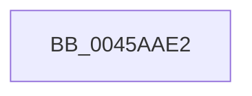

# sub_0045AAE2

- RVA: `0x0045AAE2`–`0x0045AC71` (길이 `399` bytes)
- VA: `0x000000014045AAE2`
- 실행 섹션: `.text`
- PDB 이름 있음: `아니요`; PDB Function 태그: `아니요`
- unwind 정보 RVA: `0x000A9034`
- 디코드: `108`개 명령, `399/399` bytes 표시
- 미해석 바이트: `0` (있으면 어셈블리에 `.byte`로 보존)

> 이 문서는 커널 이미지의 기계어와 PDB 기호를 분석해 생성했습니다. 4번과 5번은 함수 원형과 자료형을 바이너리 사용 방식에서 추정한 C 해석이며 원본 소스 복구 결과는 아닙니다.

## 1. Dependencies

- 직접 호출 지점: **0**; 고유 호출 대상: **0**
- 직접 호출자로 확인된 함수: **0**
- RIP 상대 이미지 참조: **0**

### Outgoing calls
- 직접 디코드된 call 명령이 없습니다.

### Direct callers
- 이 함수 시작 RVA로 연결되는 직접 call은 확인되지 않았습니다. 간접 호출은 완전히 역산할 수 없습니다.

### Static image references
- 디코드된 RIP-relative 메모리 참조가 없습니다.

## 2. Other-region calls and transfers

- 다른 실행 섹션으로 향하는 call: **0**
- call이 아닌 외부 분기/꼬리 이동: **1**
  - `0x0045AC6C` → [RtlpComputeCrcInternal + 0x4B](RtlpComputeCrcInternal_function_0045A800.md) (`tail-transfer`)

## 3. Assembly (complete function range)

```asm
0045AAE2  48 33 06                        xor rax, qword ptr [rsi]
0045AAE5  49 8B 57 08                     mov rdx, qword ptr [r15 + 8]
0045AAE9  0F B6 C8                        movzx ecx, al
0045AAEC  48 C1 E8 08                     shr rax, 8
0045AAF0  48 33 04 CA                     xor rax, qword ptr [rdx + rcx*8]
0045AAF4  0F B6 C8                        movzx ecx, al
0045AAF7  48 C1 E8 08                     shr rax, 8
0045AAFB  48 33 04 CA                     xor rax, qword ptr [rdx + rcx*8]
0045AAFF  0F B6 C8                        movzx ecx, al
0045AB02  48 C1 E8 08                     shr rax, 8
0045AB06  48 33 04 CA                     xor rax, qword ptr [rdx + rcx*8]
0045AB0A  0F B6 C8                        movzx ecx, al
0045AB0D  48 C1 E8 08                     shr rax, 8
0045AB11  48 33 04 CA                     xor rax, qword ptr [rdx + rcx*8]
0045AB15  0F B6 C8                        movzx ecx, al
0045AB18  48 C1 E8 08                     shr rax, 8
0045AB1C  48 33 04 CA                     xor rax, qword ptr [rdx + rcx*8]
0045AB20  0F B6 C8                        movzx ecx, al
0045AB23  48 C1 E8 08                     shr rax, 8
0045AB27  48 33 04 CA                     xor rax, qword ptr [rdx + rcx*8]
0045AB2B  0F B6 C8                        movzx ecx, al
0045AB2E  48 C1 E8 08                     shr rax, 8
0045AB32  48 33 04 CA                     xor rax, qword ptr [rdx + rcx*8]
0045AB36  0F B6 C8                        movzx ecx, al
0045AB39  48 C1 E8 08                     shr rax, 8
0045AB3D  48 33 04 CA                     xor rax, qword ptr [rdx + rcx*8]
0045AB41  48 33 46 08                     xor rax, qword ptr [rsi + 8]
0045AB45  49 33 C4                        xor rax, r12
0045AB48  0F B6 C8                        movzx ecx, al
0045AB4B  48 C1 E8 08                     shr rax, 8
0045AB4F  48 33 04 CA                     xor rax, qword ptr [rdx + rcx*8]
0045AB53  0F B6 C8                        movzx ecx, al
0045AB56  48 C1 E8 08                     shr rax, 8
0045AB5A  48 33 04 CA                     xor rax, qword ptr [rdx + rcx*8]
0045AB5E  0F B6 C8                        movzx ecx, al
0045AB61  48 C1 E8 08                     shr rax, 8
0045AB65  48 33 04 CA                     xor rax, qword ptr [rdx + rcx*8]
0045AB69  0F B6 C8                        movzx ecx, al
0045AB6C  48 C1 E8 08                     shr rax, 8
0045AB70  48 33 04 CA                     xor rax, qword ptr [rdx + rcx*8]
0045AB74  0F B6 C8                        movzx ecx, al
0045AB77  48 C1 E8 08                     shr rax, 8
0045AB7B  48 33 04 CA                     xor rax, qword ptr [rdx + rcx*8]
0045AB7F  0F B6 C8                        movzx ecx, al
0045AB82  48 C1 E8 08                     shr rax, 8
0045AB86  48 33 04 CA                     xor rax, qword ptr [rdx + rcx*8]
0045AB8A  0F B6 C8                        movzx ecx, al
0045AB8D  48 C1 E8 08                     shr rax, 8
0045AB91  48 33 04 CA                     xor rax, qword ptr [rdx + rcx*8]
0045AB95  0F B6 C8                        movzx ecx, al
0045AB98  48 C1 E8 08                     shr rax, 8
0045AB9C  48 33 04 CA                     xor rax, qword ptr [rdx + rcx*8]
0045ABA0  48 33 46 10                     xor rax, qword ptr [rsi + 0x10]
0045ABA4  49 33 C5                        xor rax, r13
0045ABA7  0F B6 C8                        movzx ecx, al
0045ABAA  48 C1 E8 08                     shr rax, 8
0045ABAE  48 33 04 CA                     xor rax, qword ptr [rdx + rcx*8]
0045ABB2  0F B6 C8                        movzx ecx, al
0045ABB5  48 C1 E8 08                     shr rax, 8
0045ABB9  48 33 04 CA                     xor rax, qword ptr [rdx + rcx*8]
0045ABBD  0F B6 C8                        movzx ecx, al
0045ABC0  48 C1 E8 08                     shr rax, 8
0045ABC4  48 33 04 CA                     xor rax, qword ptr [rdx + rcx*8]
0045ABC8  0F B6 C8                        movzx ecx, al
0045ABCB  48 C1 E8 08                     shr rax, 8
0045ABCF  48 33 04 CA                     xor rax, qword ptr [rdx + rcx*8]
0045ABD3  0F B6 C8                        movzx ecx, al
0045ABD6  48 C1 E8 08                     shr rax, 8
0045ABDA  48 33 04 CA                     xor rax, qword ptr [rdx + rcx*8]
0045ABDE  0F B6 C8                        movzx ecx, al
0045ABE1  48 C1 E8 08                     shr rax, 8
0045ABE5  48 33 04 CA                     xor rax, qword ptr [rdx + rcx*8]
0045ABE9  0F B6 C8                        movzx ecx, al
0045ABEC  48 C1 E8 08                     shr rax, 8
0045ABF0  48 33 04 CA                     xor rax, qword ptr [rdx + rcx*8]
0045ABF4  0F B6 C8                        movzx ecx, al
0045ABF7  48 C1 E8 08                     shr rax, 8
0045ABFB  48 33 04 CA                     xor rax, qword ptr [rdx + rcx*8]
0045ABFF  48 33 46 18                     xor rax, qword ptr [rsi + 0x18]
0045AC03  49 33 C0                        xor rax, r8
0045AC06  0F B6 C8                        movzx ecx, al
0045AC09  4C 8B 6C 24 08                  mov r13, qword ptr [rsp + 8]
0045AC0E  4C 8B 64 24 50                  mov r12, qword ptr [rsp + 0x50]
0045AC13  48 C1 E8 08                     shr rax, 8
0045AC17  48 33 04 CA                     xor rax, qword ptr [rdx + rcx*8]
0045AC1B  0F B6 C8                        movzx ecx, al
0045AC1E  48 C1 E8 08                     shr rax, 8
0045AC22  48 33 04 CA                     xor rax, qword ptr [rdx + rcx*8]
0045AC26  0F B6 C8                        movzx ecx, al
0045AC29  48 C1 E8 08                     shr rax, 8
0045AC2D  48 33 04 CA                     xor rax, qword ptr [rdx + rcx*8]
0045AC31  0F B6 C8                        movzx ecx, al
0045AC34  48 C1 E8 08                     shr rax, 8
0045AC38  48 33 04 CA                     xor rax, qword ptr [rdx + rcx*8]
0045AC3C  0F B6 C8                        movzx ecx, al
0045AC3F  48 C1 E8 08                     shr rax, 8
0045AC43  48 33 04 CA                     xor rax, qword ptr [rdx + rcx*8]
0045AC47  0F B6 C8                        movzx ecx, al
0045AC4A  48 C1 E8 08                     shr rax, 8
0045AC4E  48 33 04 CA                     xor rax, qword ptr [rdx + rcx*8]
0045AC52  0F B6 C8                        movzx ecx, al
0045AC55  48 C1 E8 08                     shr rax, 8
0045AC59  48 33 04 CA                     xor rax, qword ptr [rdx + rcx*8]
0045AC5D  0F B6 C8                        movzx ecx, al
0045AC60  48 C1 E8 08                     shr rax, 8
0045AC64  48 33 04 CA                     xor rax, qword ptr [rdx + rcx*8]
0045AC68  48 83 C6 20                     add rsi, 0x20
0045AC6C  E9 DA FB FF FF                  jmp 0x14045a84b
```

## 4. C-style interpretation (structured pseudocode)

```c
__int64 __fastcall sub_0045AAE2(__int64 a1, __int64 a2, __int64 a3, __int64 a4, __int64 a5, __int64 a6, __int64 a7, __int64 a8, __int64 a9, __int64 a10)
{
    __int64 result;
    __int64 v_rsi;
    unsigned __int64 v_stack_p8;

    result = (result) ^ (*(unsigned __int64 *)(v_rsi));
    result = (result) >> (8);
    result = (result) ^ (*(unsigned __int64 *)(*(unsigned __int64 *)(v_r15 + 8) + (unsigned __int8)(result) * 8));
    result = (result) >> (8);
    result = (result) ^ (*(unsigned __int64 *)(*(unsigned __int64 *)(v_r15 + 8) + (unsigned __int8)(result) * 8));
    result = (result) >> (8);
    result = (result) ^ (*(unsigned __int64 *)(*(unsigned __int64 *)(v_r15 + 8) + (unsigned __int8)(result) * 8));
    result = (result) >> (8);
    result = (result) ^ (*(unsigned __int64 *)(*(unsigned __int64 *)(v_r15 + 8) + (unsigned __int8)(result) * 8));
    result = (result) >> (8);
    result = (result) ^ (*(unsigned __int64 *)(*(unsigned __int64 *)(v_r15 + 8) + (unsigned __int8)(result) * 8));
    result = (result) >> (8);
    result = (result) ^ (*(unsigned __int64 *)(*(unsigned __int64 *)(v_r15 + 8) + (unsigned __int8)(result) * 8));
    result = (result) >> (8);
    result = (result) ^ (*(unsigned __int64 *)(*(unsigned __int64 *)(v_r15 + 8) + (unsigned __int8)(result) * 8));
    result = (result) >> (8);
    result = (result) ^ (*(unsigned __int64 *)(*(unsigned __int64 *)(v_r15 + 8) + (unsigned __int8)(result) * 8));
    result = (result) ^ (*(unsigned __int64 *)(v_rsi + 8));
    result = (result) ^ (v_r12);
    result = (result) >> (8);
    result = (result) ^ (*(unsigned __int64 *)(*(unsigned __int64 *)(v_r15 + 8) + (unsigned __int8)(result) * 8));
    result = (result) >> (8);
    result = (result) ^ (*(unsigned __int64 *)(*(unsigned __int64 *)(v_r15 + 8) + (unsigned __int8)(result) * 8));
    result = (result) >> (8);
    result = (result) ^ (*(unsigned __int64 *)(*(unsigned __int64 *)(v_r15 + 8) + (unsigned __int8)(result) * 8));
    result = (result) >> (8);
    result = (result) ^ (*(unsigned __int64 *)(*(unsigned __int64 *)(v_r15 + 8) + (unsigned __int8)(result) * 8));
    result = (result) >> (8);
    result = (result) ^ (*(unsigned __int64 *)(*(unsigned __int64 *)(v_r15 + 8) + (unsigned __int8)(result) * 8));
    result = (result) >> (8);
    result = (result) ^ (*(unsigned __int64 *)(*(unsigned __int64 *)(v_r15 + 8) + (unsigned __int8)(result) * 8));
    result = (result) >> (8);
    result = (result) ^ (*(unsigned __int64 *)(*(unsigned __int64 *)(v_r15 + 8) + (unsigned __int8)(result) * 8));
    result = (result) >> (8);
    result = (result) ^ (*(unsigned __int64 *)(*(unsigned __int64 *)(v_r15 + 8) + (unsigned __int8)(result) * 8));
    result = (result) ^ (*(unsigned __int64 *)(v_rsi + 16));
    result = (result) ^ (v_r13);
    result = (result) >> (8);
    result = (result) ^ (*(unsigned __int64 *)(*(unsigned __int64 *)(v_r15 + 8) + (unsigned __int8)(result) * 8));
    result = (result) >> (8);
    result = (result) ^ (*(unsigned __int64 *)(*(unsigned __int64 *)(v_r15 + 8) + (unsigned __int8)(result) * 8));
    result = (result) >> (8);
    result = (result) ^ (*(unsigned __int64 *)(*(unsigned __int64 *)(v_r15 + 8) + (unsigned __int8)(result) * 8));
    result = (result) >> (8);
    result = (result) ^ (*(unsigned __int64 *)(*(unsigned __int64 *)(v_r15 + 8) + (unsigned __int8)(result) * 8));
    result = (result) >> (8);
    result = (result) ^ (*(unsigned __int64 *)(*(unsigned __int64 *)(v_r15 + 8) + (unsigned __int8)(result) * 8));
    result = (result) >> (8);
    result = (result) ^ (*(unsigned __int64 *)(*(unsigned __int64 *)(v_r15 + 8) + (unsigned __int8)(result) * 8));
    result = (result) >> (8);
    result = (result) ^ (*(unsigned __int64 *)(*(unsigned __int64 *)(v_r15 + 8) + (unsigned __int8)(result) * 8));
    result = (result) >> (8);
    result = (result) ^ (*(unsigned __int64 *)(*(unsigned __int64 *)(v_r15 + 8) + (unsigned __int8)(result) * 8));
    result = (result) ^ (*(unsigned __int64 *)(v_rsi + 24));
    result = (result) ^ (a3);
    result = (result) >> (8);
    result = (result) ^ (*(unsigned __int64 *)(*(unsigned __int64 *)(v_r15 + 8) + (unsigned __int8)(result) * 8));
    result = (result) >> (8);
    result = (result) ^ (*(unsigned __int64 *)(*(unsigned __int64 *)(v_r15 + 8) + (unsigned __int8)(result) * 8));
    result = (result) >> (8);
    result = (result) ^ (*(unsigned __int64 *)(*(unsigned __int64 *)(v_r15 + 8) + (unsigned __int8)(result) * 8));
    result = (result) >> (8);
    result = (result) ^ (*(unsigned __int64 *)(*(unsigned __int64 *)(v_r15 + 8) + (unsigned __int8)(result) * 8));
    result = (result) >> (8);
    result = (result) ^ (*(unsigned __int64 *)(*(unsigned __int64 *)(v_r15 + 8) + (unsigned __int8)(result) * 8));
    result = (result) >> (8);
    result = (result) ^ (*(unsigned __int64 *)(*(unsigned __int64 *)(v_r15 + 8) + (unsigned __int8)(result) * 8));
    result = (result) >> (8);
    result = (result) ^ (*(unsigned __int64 *)(*(unsigned __int64 *)(v_r15 + 8) + (unsigned __int8)(result) * 8));
    result = (result) >> (8);
    result = (result) ^ (*(unsigned __int64 *)(*(unsigned __int64 *)(v_r15 + 8) + (unsigned __int8)(result) * 8));
    v_rsi = (v_rsi) + (32);
}
```

## 5. (Beta) C Style

```c
int64_t sub_0045AAE2(int64_t Arg1, int64_t Arg2, int64_t Arg3, int64_t Arg4, uint64_t Arg5, uint64_t Arg6, uint64_t Arg7, uint64_t Arg8, uint64_t Arg9, int64_t Arg10)
{
    int64_t result;
    int64_t local_rsi;
    uint64_t v_stack_p8;

    result = (result) ^ (*(uint64_t *)(local_rsi));
    result = (result) >> (8);
    result = (result) ^ (*(uint64_t *)(*(uint64_t *)(local_r15 + 0x8) + (uint8_t)(result) * 8));
    result = (result) >> (8);
    result = (result) ^ (*(uint64_t *)(*(uint64_t *)(local_r15 + 0x8) + (uint8_t)(result) * 8));
    result = (result) >> (8);
    result = (result) ^ (*(uint64_t *)(*(uint64_t *)(local_r15 + 0x8) + (uint8_t)(result) * 8));
    result = (result) >> (8);
    result = (result) ^ (*(uint64_t *)(*(uint64_t *)(local_r15 + 0x8) + (uint8_t)(result) * 8));
    result = (result) >> (8);
    result = (result) ^ (*(uint64_t *)(*(uint64_t *)(local_r15 + 0x8) + (uint8_t)(result) * 8));
    result = (result) >> (8);
    result = (result) ^ (*(uint64_t *)(*(uint64_t *)(local_r15 + 0x8) + (uint8_t)(result) * 8));
    result = (result) >> (8);
    result = (result) ^ (*(uint64_t *)(*(uint64_t *)(local_r15 + 0x8) + (uint8_t)(result) * 8));
    result = (result) >> (8);
    result = (result) ^ (*(uint64_t *)(*(uint64_t *)(local_r15 + 0x8) + (uint8_t)(result) * 8));
    result = (result) ^ (*(uint64_t *)(local_rsi + 0x8));
    result = (result) ^ (local_r12);
    result = (result) >> (8);
    result = (result) ^ (*(uint64_t *)(*(uint64_t *)(local_r15 + 0x8) + (uint8_t)(result) * 8));
    result = (result) >> (8);
    result = (result) ^ (*(uint64_t *)(*(uint64_t *)(local_r15 + 0x8) + (uint8_t)(result) * 8));
    result = (result) >> (8);
    result = (result) ^ (*(uint64_t *)(*(uint64_t *)(local_r15 + 0x8) + (uint8_t)(result) * 8));
    result = (result) >> (8);
    result = (result) ^ (*(uint64_t *)(*(uint64_t *)(local_r15 + 0x8) + (uint8_t)(result) * 8));
    result = (result) >> (8);
    result = (result) ^ (*(uint64_t *)(*(uint64_t *)(local_r15 + 0x8) + (uint8_t)(result) * 8));
    result = (result) >> (8);
    result = (result) ^ (*(uint64_t *)(*(uint64_t *)(local_r15 + 0x8) + (uint8_t)(result) * 8));
    result = (result) >> (8);
    result = (result) ^ (*(uint64_t *)(*(uint64_t *)(local_r15 + 0x8) + (uint8_t)(result) * 8));
    result = (result) >> (8);
    result = (result) ^ (*(uint64_t *)(*(uint64_t *)(local_r15 + 0x8) + (uint8_t)(result) * 8));
    result = (result) ^ (*(uint64_t *)(local_rsi + 0x10));
    result = (result) ^ (local_r13);
    result = (result) >> (8);
    result = (result) ^ (*(uint64_t *)(*(uint64_t *)(local_r15 + 0x8) + (uint8_t)(result) * 8));
    result = (result) >> (8);
    result = (result) ^ (*(uint64_t *)(*(uint64_t *)(local_r15 + 0x8) + (uint8_t)(result) * 8));
    result = (result) >> (8);
    result = (result) ^ (*(uint64_t *)(*(uint64_t *)(local_r15 + 0x8) + (uint8_t)(result) * 8));
    result = (result) >> (8);
    result = (result) ^ (*(uint64_t *)(*(uint64_t *)(local_r15 + 0x8) + (uint8_t)(result) * 8));
    result = (result) >> (8);
    result = (result) ^ (*(uint64_t *)(*(uint64_t *)(local_r15 + 0x8) + (uint8_t)(result) * 8));
    result = (result) >> (8);
    result = (result) ^ (*(uint64_t *)(*(uint64_t *)(local_r15 + 0x8) + (uint8_t)(result) * 8));
    result = (result) >> (8);
    result = (result) ^ (*(uint64_t *)(*(uint64_t *)(local_r15 + 0x8) + (uint8_t)(result) * 8));
    result = (result) >> (8);
    result = (result) ^ (*(uint64_t *)(*(uint64_t *)(local_r15 + 0x8) + (uint8_t)(result) * 8));
    result = (result) ^ (*(uint64_t *)(local_rsi + 0x18));
    result = (result) ^ (Arg3);
    result = (result) >> (8);
    result = (result) ^ (*(uint64_t *)(*(uint64_t *)(local_r15 + 0x8) + (uint8_t)(result) * 8));
    result = (result) >> (8);
    result = (result) ^ (*(uint64_t *)(*(uint64_t *)(local_r15 + 0x8) + (uint8_t)(result) * 8));
    result = (result) >> (8);
    result = (result) ^ (*(uint64_t *)(*(uint64_t *)(local_r15 + 0x8) + (uint8_t)(result) * 8));
    result = (result) >> (8);
    result = (result) ^ (*(uint64_t *)(*(uint64_t *)(local_r15 + 0x8) + (uint8_t)(result) * 8));
    result = (result) >> (8);
    result = (result) ^ (*(uint64_t *)(*(uint64_t *)(local_r15 + 0x8) + (uint8_t)(result) * 8));
    result = (result) >> (8);
    result = (result) ^ (*(uint64_t *)(*(uint64_t *)(local_r15 + 0x8) + (uint8_t)(result) * 8));
    result = (result) >> (8);
    result = (result) ^ (*(uint64_t *)(*(uint64_t *)(local_r15 + 0x8) + (uint8_t)(result) * 8));
    result = (result) >> (8);
    result = (result) ^ (*(uint64_t *)(*(uint64_t *)(local_r15 + 0x8) + (uint8_t)(result) * 8));
    local_rsi = (local_rsi) + (32);
}
```

## 6. Execution-region graph

[열기: 2D/3D 그래프와 함수 탐색 컨트롤 패널](../../../control-panel.html?section=text&rva=0x0045AAE2&view=graph)

- 2D 그래프는 위에서 아래로 흐르고, 3D 그래프는 빈 공간을 드래그해 회전합니다. Shift+드래그는 이동, 휠은 확대·축소, 함수 노드 선택은 대상 보고서 이동입니다.

### Static fallback


