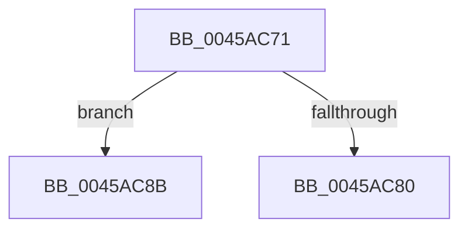

# sub_0045AC71

- RVA: `0x0045AC71`–`0x0045AC94` (길이 `35` bytes)
- VA: `0x000000014045AC71`
- 실행 섹션: `.text`
- PDB 이름 있음: `아니요`; PDB Function 태그: `아니요`
- unwind 정보 RVA: `0x000A9044`
- 디코드: `10`개 명령, `35/35` bytes 표시
- 미해석 바이트: `0` (있으면 어셈블리에 `.byte`로 보존)

> 이 문서는 커널 이미지의 기계어와 PDB 기호를 분석해 생성했습니다. 4번과 5번은 함수 원형과 자료형을 바이너리 사용 방식에서 추정한 C 해석이며 원본 소스 복구 결과는 아닙니다.

## 1. Dependencies

- 직접 호출 지점: **0**; 고유 호출 대상: **0**
- 직접 호출자로 확인된 함수: **0**
- RIP 상대 이미지 참조: **0**

### Outgoing calls
- 직접 디코드된 call 명령이 없습니다.

### Direct callers
- 이 함수 시작 RVA로 연결되는 직접 call은 확인되지 않았습니다. 간접 호출은 완전히 역산할 수 없습니다.

### Static image references
- 디코드된 RIP-relative 메모리 참조가 없습니다.

## 2. Other-region calls and transfers

- 다른 실행 섹션으로 향하는 call: **0**
- call이 아닌 외부 분기/꼬리 이동: **2**
  - `0x0045AC86` → [RtlpComputeCrcInternal + 0x39](RtlpComputeCrcInternal_function_0045A800.md) (`tail-transfer`)
  - `0x0045AC8F` → [sub_006F1DFE](../6F/Unknown_function_006F1DFE.md) (`tail-transfer`)

## 3. Assembly (complete function range)

```asm
0045AC71  4C 3B C7                        cmp r8, rdi
0045AC74  4C 8B CB                        mov r9, rbx
0045AC77  4C 0F 47 C7                     cmova r8, rdi
0045AC7B  4D 85 C0                        test r8, r8
0045AC7E  75 0B                           jne 0x14045ac8b
0045AC80  49 2B F8                        sub rdi, r8
0045AC83  49 03 F0                        add rsi, r8
0045AC86  E9 AE FB FF FF                  jmp 0x14045a839
0045AC8B  4D 8B 57 08                     mov r10, qword ptr [r15 + 8]
0045AC8F  E9 6A 71 29 00                  jmp 0x1406f1dfe
```

## 4. C-style interpretation (structured pseudocode)

```c
void __fastcall sub_0045AC71(__int64 a1, __int64 a2, __int64 a3)
{
    __int64 v_rdi;
    __int64 v_rsi;

    if (a3 > v_rdi) { a3 = v_rdi; }
    if (a3 != 0) goto loc_0045AC8B;
    v_rdi = (v_rdi) - (a3);
    v_rsi = (v_rsi) + (a3);
loc_0045AC8B:
}
```

## 5. (Beta) C Style

```c
void sub_0045AC71(int64_t Arg1, int64_t Arg2, int64_t Arg3)
{
    int64_t local_rdi;
    int64_t local_rsi;

    if (Arg3 > local_rdi) { Arg3 = local_rdi; }
    if (Arg3 != 0) goto loc_0045AC8B;
    local_rdi = (local_rdi) - (Arg3);
    local_rsi = (local_rsi) + (Arg3);
loc_0045AC8B:
}
```

## 6. Execution-region graph

[열기: 2D/3D 그래프와 함수 탐색 컨트롤 패널](../../../control-panel.html?section=text&rva=0x0045AC71&view=graph)

- 2D 그래프는 위에서 아래로 흐르고, 3D 그래프는 빈 공간을 드래그해 회전합니다. Shift+드래그는 이동, 휠은 확대·축소, 함수 노드 선택은 대상 보고서 이동입니다.

### Static fallback


