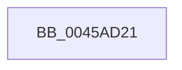

# sub_0045AD21

- RVA: `0x0045AD21`–`0x0045AD48` (길이 `39` bytes)
- VA: `0x000000014045AD21`
- 실행 섹션: `.text`
- PDB 이름 있음: `아니요`; PDB Function 태그: `아니요`
- unwind 정보 RVA: `0x000A9070`
- 디코드: `9`개 명령, `39/39` bytes 표시
- 미해석 바이트: `0` (있으면 어셈블리에 `.byte`로 보존)

> 이 문서는 커널 이미지의 기계어와 PDB 기호를 분석해 생성했습니다. 4번과 5번은 함수 원형과 자료형을 바이너리 사용 방식에서 추정한 C 해석이며 원본 소스 복구 결과는 아닙니다.

## 1. Dependencies

- 직접 호출 지점: **0**; 고유 호출 대상: **0**
- 직접 호출자로 확인된 함수: **0**
- RIP 상대 이미지 참조: **0**

### Outgoing calls
- 직접 디코드된 call 명령이 없습니다.

### Direct callers
- 이 함수 시작 RVA로 연결되는 직접 call은 확인되지 않았습니다. 간접 호출은 완전히 역산할 수 없습니다.

### Static image references
- 디코드된 RIP-relative 메모리 참조가 없습니다.

## 2. Other-region calls and transfers

- 다른 실행 섹션으로 향하는 call: **0**
- call이 아닌 외부 분기/꼬리 이동: **1**
  - `0x0045AD43` → [sub_006F1E1E](../6F/Unknown_function_006F1E1E.md) (`tail-transfer`)

## 3. Assembly (complete function range)

```asm
0045AD21  48 89 5C 24 18                  mov qword ptr [rsp + 0x18], rbx
0045AD26  48 89 74 24 20                  mov qword ptr [rsp + 0x20], rsi
0045AD2B  48 89 7C 24 28                  mov qword ptr [rsp + 0x28], rdi
0045AD30  4C 89 7C 24 30                  mov qword ptr [rsp + 0x30], r15
0045AD35  4C 8B FD                        mov r15, rbp
0045AD38  49 C1 EF 06                     shr r15, 6
0045AD3C  49 6B C7 C0                     imul rax, r15, -0x40
0045AD40  48 03 E8                        add rbp, rax
0045AD43  E9 D6 70 29 00                  jmp 0x1406f1e1e
```

## 4. C-style interpretation (structured pseudocode)

```c
__int64 __fastcall sub_0045AD21(void)
{
    __int64 result;
    __int64 v_r15;
    __int64 v_rbp;
    unsigned __int64 v_stack_p18;
    unsigned __int64 v_stack_p20;
    unsigned __int64 v_stack_p28;
    unsigned __int64 v_stack_p30;

    v_stack_p18 = v_rbx;
    v_stack_p20 = v_rsi;
    v_stack_p28 = v_rdi;
    v_stack_p30 = v_r15;
    v_r15 = (v_rbp) >> (6);
    result = (result) * (v_r15);
    v_rbp = (v_rbp) + (result);
}
```

## 5. (Beta) C Style

```c
void sub_0045AD21(void)
{
    int64_t result;
    int64_t local_r15;
    int64_t local_rbp;
    uint64_t v_stack_p18;
    uint64_t v_stack_p20;
    uint64_t v_stack_p28;
    uint64_t v_stack_p30;

    v_stack_p18 = local_rbx;
    v_stack_p20 = local_rsi;
    v_stack_p28 = local_rdi;
    v_stack_p30 = local_r15;
    local_r15 = (local_rbp) >> (6);
    result = (result) * (local_r15);
    local_rbp = (local_rbp) + (result);
}
```

## 6. Execution-region graph

[열기: 2D/3D 그래프와 함수 탐색 컨트롤 패널](../../../control-panel.html?section=text&rva=0x0045AD21&view=graph)

- 2D 그래프는 위에서 아래로 흐르고, 3D 그래프는 빈 공간을 드래그해 회전합니다. Shift+드래그는 이동, 휠은 확대·축소, 함수 노드 선택은 대상 보고서 이동입니다.

### Static fallback


