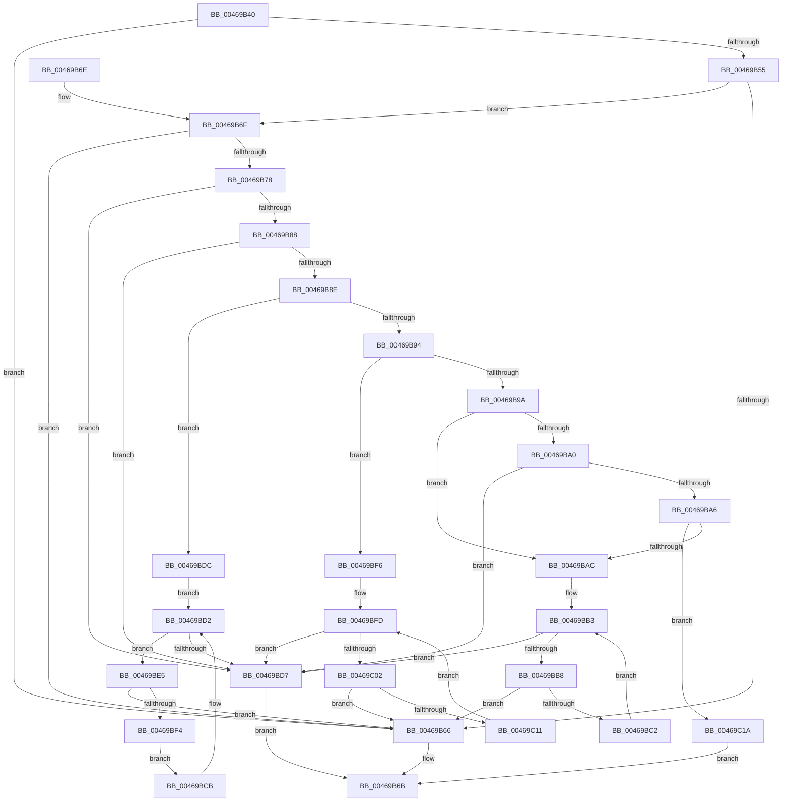

# AuthzBasepGetInternalSecurityAttributeValueCopyoutBufferSize

- RVA: `0x00469B40`–`0x00469C24` (길이 `228` bytes)
- VA: `0x0000000140469B40`
- 실행 섹션: `.text`
- PDB 이름 있음: `예`; PDB Function 태그: `아니요`
- unwind 정보 RVA: `0x000DB714`
- 디코드: `77`개 명령, `228/228` bytes 표시
- 미해석 바이트: `0` (있으면 어셈블리에 `.byte`로 보존)

> 이 문서는 커널 이미지의 기계어와 PDB 기호를 분석해 생성했습니다. 4번과 5번은 함수 원형과 자료형을 바이너리 사용 방식에서 추정한 C 해석이며 원본 소스 복구 결과는 아닙니다.

## 1. Dependencies

- 직접 호출 지점: **0**; 고유 호출 대상: **0**
- 직접 호출자로 확인된 함수: **2**
- RIP 상대 이미지 참조: **0**

### Outgoing calls
- 직접 디코드된 call 명령이 없습니다.

### Direct callers
- [SepGetTokenAccessInformationBufferSize](../../page/9E/SepGetTokenAccessInformationBufferSize_function_009E995C.md) at `0x009E9AEA`
- [SepCopyTokenAccessInformation](../../page/9E/SepCopyTokenAccessInformation_function_009E9C0C.md) at `0x009EA1EC`

### Static image references
- 디코드된 RIP-relative 메모리 참조가 없습니다.

## 2. Other-region calls and transfers

- 다른 실행 섹션으로 향하는 call: **0**
- 별도 외부 분기/꼬리 이동을 확인하지 못했습니다.

## 3. Assembly (complete function range)

```asm
00469B40  8B 02                           mov eax, dword ptr [rdx]
00469B42  4C 8B DA                        mov r11, rdx
00469B45  4C 8B D1                        mov r10, rcx
00469B48  44 8D 40 07                     lea r8d, [rax + 7]
00469B4C  41 83 E0 F8                     and r8d, 0xfffffff8
00469B50  44 3B C0                        cmp r8d, eax
00469B53  72 11                           jb 0x140469b66
00469B55  8B 41 3C                        mov eax, dword ptr [rcx + 0x3c]
00469B58  B9 FF FF FF FF                  mov ecx, 0xffffffff
00469B5D  48 C1 E0 06                     shl rax, 6
00469B61  48 3B C1                        cmp rax, rcx
00469B64  76 09                           jbe 0x140469b6f
00469B66  B9 95 00 00 C0                  mov ecx, 0xc0000095
00469B6B  8B C1                           mov eax, ecx
00469B6D  C3                              ret
00469B6E  CC                              int3
00469B6F  45 8D 0C 00                     lea r9d, [r8 + rax]
00469B73  45 3B C8                        cmp r9d, r8d
00469B76  72 EE                           jb 0x140469b66
00469B78  45 0F B7 42 30                  movzx r8d, word ptr [r10 + 0x30]
00469B7D  33 C9                           xor ecx, ecx
00469B7F  41 8B D1                        mov edx, r9d
00469B82  41 83 E8 01                     sub r8d, 1
00469B86  74 4F                           je 0x140469bd7
00469B88  41 83 E8 01                     sub r8d, 1
00469B8C  74 49                           je 0x140469bd7
00469B8E  41 83 E8 01                     sub r8d, 1
00469B92  74 48                           je 0x140469bdc
00469B94  41 83 E8 01                     sub r8d, 1
00469B98  74 5C                           je 0x140469bf6
00469B9A  41 83 E8 01                     sub r8d, 1
00469B9E  74 0C                           je 0x140469bac
00469BA0  41 83 E8 01                     sub r8d, 1
00469BA4  74 31                           je 0x140469bd7
00469BA6  41 83 F8 0A                     cmp r8d, 0xa
00469BAA  75 6E                           jne 0x140469c1a
00469BAC  49 83 C2 48                     add r10, 0x48
00469BB0  4D 8B 02                        mov r8, qword ptr [r10]
00469BB3  4D 3B C2                        cmp r8, r10
00469BB6  74 1F                           je 0x140469bd7
00469BB8  41 8B 48 30                     mov ecx, dword ptr [r8 + 0x30]
00469BBC  03 CA                           add ecx, edx
00469BBE  3B CA                           cmp ecx, edx
00469BC0  72 A4                           jb 0x140469b66
00469BC2  4D 8B 00                        mov r8, qword ptr [r8]
00469BC5  8B D1                           mov edx, ecx
00469BC7  33 C9                           xor ecx, ecx
00469BC9  EB E8                           jmp 0x140469bb3
00469BCB  4D 8B 00                        mov r8, qword ptr [r8]
00469BCE  8B D1                           mov edx, ecx
00469BD0  33 C9                           xor ecx, ecx
00469BD2  4D 3B C2                        cmp r8, r10
00469BD5  75 0E                           jne 0x140469be5
00469BD7  41 89 13                        mov dword ptr [r11], edx
00469BDA  EB 8F                           jmp 0x140469b6b
00469BDC  49 83 C2 48                     add r10, 0x48
00469BE0  4D 8B 02                        mov r8, qword ptr [r10]
00469BE3  EB ED                           jmp 0x140469bd2
00469BE5  41 0F B7 48 28                  movzx ecx, word ptr [r8 + 0x28]
00469BEA  03 CA                           add ecx, edx
00469BEC  3B CA                           cmp ecx, edx
00469BEE  0F 82 72 FF FF FF               jb 0x140469b66
00469BF4  EB D5                           jmp 0x140469bcb
00469BF6  49 83 C2 48                     add r10, 0x48
00469BFA  4D 8B 02                        mov r8, qword ptr [r10]
00469BFD  4D 3B C2                        cmp r8, r10
00469C00  74 D5                           je 0x140469bd7
00469C02  41 0F B7 48 30                  movzx ecx, word ptr [r8 + 0x30]
00469C07  03 CA                           add ecx, edx
00469C09  3B CA                           cmp ecx, edx
00469C0B  0F 82 55 FF FF FF               jb 0x140469b66
00469C11  4D 8B 00                        mov r8, qword ptr [r8]
00469C14  8B D1                           mov edx, ecx
00469C16  33 C9                           xor ecx, ecx
00469C18  EB E3                           jmp 0x140469bfd
00469C1A  B9 0D 00 00 C0                  mov ecx, 0xc000000d
00469C1F  E9 47 FF FF FF                  jmp 0x140469b6b
```

## 4. C-style interpretation (structured pseudocode)

```c
__int64 __fastcall AuthzBasepGetInternalSecurityAttributeValueCopyoutBufferSize(__int64 a1, __int64 a2)
{
    __int64 result;
    __int64 v_r10;

    a3 = (unsigned int)(((unsigned int)(*(unsigned int *)(a2)) + 7) & (0xFFFFFFF8ULL));
    if (((unsigned int)(a3)) < ((unsigned int)((unsigned int)(*(unsigned int *)(a2))))) goto loc_00469B66;
    result = ((unsigned int)(*(unsigned int *)(a1 + 60))) << (6);
    if (result <= ((unsigned int)(0xFFFFFFFFULL))) goto loc_00469B6F;
loc_00469B66:
loc_00469B6B:
    return (unsigned int)((unsigned int)((unsigned int)(0xC0000095ULL)));
loc_00469B6F:
    if (((unsigned int)(a3 + (unsigned int)((unsigned int)((unsigned int)(0xC0000095ULL))) * 1)) < ((unsigned int)(a3))) goto loc_00469B66;
    a1 = 0;
    a3 = (unsigned int)((*(unsigned __int16 *)(a1 + 48)) - (1));
    if (condition_is_equal) goto loc_00469BD7;
    a3 = (unsigned int)((a3) - (1));
    if (condition_is_equal) goto loc_00469BD7;
    a3 = (unsigned int)((a3) - (1));
    if (condition_is_equal) goto loc_00469BDC;
    a3 = (unsigned int)((a3) - (1));
    if (condition_is_equal) goto loc_00469BF6;
    a3 = (unsigned int)((a3) - (1));
    if (condition_is_equal) goto loc_00469BAC;
    a3 = (unsigned int)((a3) - (1));
    if (condition_is_equal) goto loc_00469BD7;
    if (((unsigned int)(a3)) != 10) goto loc_00469C1A;
loc_00469BAC:
    v_r10 = (a1) + (72);
loc_00469BB3:
    if ((*(unsigned __int64 *)(v_r10)) == v_r10) goto loc_00469BD7;
    a1 = (unsigned int)(((unsigned int)(*(unsigned int *)(*(unsigned __int64 *)(v_r10) + 48))) + ((unsigned int)((unsigned int)((unsigned int)(a3 + (unsigned int)((unsigned int)((unsigned int)(0xC0000095ULL))) * 1)))));
    if (((unsigned int)(a1)) < ((unsigned int)((unsigned int)((unsigned int)(a3 + (unsigned int)((unsigned int)((unsigned int)(0xC0000095ULL))) * 1))))) goto loc_00469B66;
    a1 = 0;
    goto loc_00469BB3;
loc_00469BCB:
    a1 = 0;
loc_00469BD2:
    if ((*(unsigned __int64 *)(*(unsigned __int64 *)(*(unsigned __int64 *)(v_r10)))) != v_r10) goto loc_00469BE5;
loc_00469BD7:
    *(unsigned int *)(a2) = 0;
    goto loc_00469B6B;
loc_00469BDC:
    v_r10 = (v_r10) + (72);
    goto loc_00469BD2;
loc_00469BE5:
    a1 = (unsigned int)((*(unsigned __int16 *)(*(unsigned __int64 *)(v_r10) + 40)) + (0));
    if (((unsigned int)(a1)) < 0) goto loc_00469B66;
    goto loc_00469BCB;
loc_00469BF6:
    v_r10 = (v_r10) + (72);
loc_00469BFD:
    if ((*(unsigned __int64 *)(v_r10)) == v_r10) goto loc_00469BD7;
    a1 = (unsigned int)((*(unsigned __int16 *)(*(unsigned __int64 *)(v_r10) + 48)) + (0));
    if (((unsigned int)(a1)) < 0) goto loc_00469B66;
    a1 = 0;
    goto loc_00469BFD;
loc_00469C1A:
    goto loc_00469B6B;
}
```

## 5. (Beta) C Style

```c
int64_t AuthzBasepGetInternalSecurityAttributeValueCopyoutBufferSize(void *Arg1, void *Arg2)
{
    uint8_t *arg1 = (uint8_t *)Arg1;
    uint8_t *arg2 = (uint8_t *)Arg2;

    int64_t result;
    int64_t local_r10;

    a3 = (uint32_t)(((uint32_t)(*(uint32_t *)(arg2)) + 7) & (0xFFFFFFF8ULL));
    if (((uint32_t)(a3)) < ((uint32_t)((uint32_t)(*(uint32_t *)(arg2))))) goto loc_00469B66;
    result = ((uint32_t)(*(uint32_t *)(arg1 + 0x3C))) << (6);
    if (result <= ((uint32_t)(0xFFFFFFFFULL))) goto loc_00469B6F;
loc_00469B66:
loc_00469B6B:
    return (uint32_t)((uint32_t)((uint32_t)(0xC0000095ULL)));
loc_00469B6F:
    if (((uint32_t)(a3 + (uint32_t)((uint32_t)((uint32_t)(0xC0000095ULL))) * 1)) < ((uint32_t)(a3))) goto loc_00469B66;
    Arg1 = 0;
    a3 = (uint32_t)((*(uint16_t *)(arg1 + 0x30)) - (1));
    if (condition_is_equal) goto loc_00469BD7;
    a3 = (uint32_t)((a3) - (1));
    if (condition_is_equal) goto loc_00469BD7;
    a3 = (uint32_t)((a3) - (1));
    if (condition_is_equal) goto loc_00469BDC;
    a3 = (uint32_t)((a3) - (1));
    if (condition_is_equal) goto loc_00469BF6;
    a3 = (uint32_t)((a3) - (1));
    if (condition_is_equal) goto loc_00469BAC;
    a3 = (uint32_t)((a3) - (1));
    if (condition_is_equal) goto loc_00469BD7;
    if (((uint32_t)(a3)) != 10) goto loc_00469C1A;
loc_00469BAC:
    local_r10 = (Arg1) + (72);
loc_00469BB3:
    if ((*(uint64_t *)(local_r10)) == local_r10) goto loc_00469BD7;
    Arg1 = (uint32_t)(((uint32_t)(*(uint32_t *)(*(uint64_t *)(local_r10) + 0x30))) + ((uint32_t)((uint32_t)((uint32_t)(a3 + (uint32_t)((uint32_t)((uint32_t)(0xC0000095ULL))) * 1)))));
    if (((uint32_t)(Arg1)) < ((uint32_t)((uint32_t)((uint32_t)(a3 + (uint32_t)((uint32_t)((uint32_t)(0xC0000095ULL))) * 1))))) goto loc_00469B66;
    Arg1 = 0;
    goto loc_00469BB3;
loc_00469BCB:
    Arg1 = 0;
loc_00469BD2:
    if ((*(uint64_t *)(*(uint64_t *)(*(uint64_t *)(local_r10)))) != local_r10) goto loc_00469BE5;
loc_00469BD7:
    *(uint32_t *)(arg2) = 0;
    goto loc_00469B6B;
loc_00469BDC:
    local_r10 = (local_r10) + (72);
    goto loc_00469BD2;
loc_00469BE5:
    Arg1 = (uint32_t)((*(uint16_t *)(*(uint64_t *)(local_r10) + 0x28)) + (0));
    if (((uint32_t)(Arg1)) < 0) goto loc_00469B66;
    goto loc_00469BCB;
loc_00469BF6:
    local_r10 = (local_r10) + (72);
loc_00469BFD:
    if ((*(uint64_t *)(local_r10)) == local_r10) goto loc_00469BD7;
    Arg1 = (uint32_t)((*(uint16_t *)(*(uint64_t *)(local_r10) + 0x30)) + (0));
    if (((uint32_t)(Arg1)) < 0) goto loc_00469B66;
    Arg1 = 0;
    goto loc_00469BFD;
loc_00469C1A:
    goto loc_00469B6B;
}
```

### 관측된 메모리 오프셋

구조체 형식이 확인되지 않은 접근은 인자 기준의 오프셋으로만 기록했습니다.

| 기준 인자 | 오프셋 표현 | 폭 (bit) | 접근 |
|---|---:|---:|---|
| `Arg1` | `+ 0x0` | `64` | `R` |
| `Arg1` | `+ 0x30` | `16` | `R` |
| `Arg1` | `+ 0x3C` | `32` | `R` |
| `Arg2` | `+ 0x0` | `32` | `R` |
| `Arg2` | `+ 0x0` | `32` | `W` |

## 6. Execution-region graph

[열기: 2D/3D 그래프와 함수 탐색 컨트롤 패널](../../../control-panel.html?section=text&rva=0x00469B40&view=graph)

- 2D 그래프는 위에서 아래로 흐르고, 3D 그래프는 빈 공간을 드래그해 회전합니다. Shift+드래그는 이동, 휠은 확대·축소, 함수 노드 선택은 대상 보고서 이동입니다.

### Static fallback


