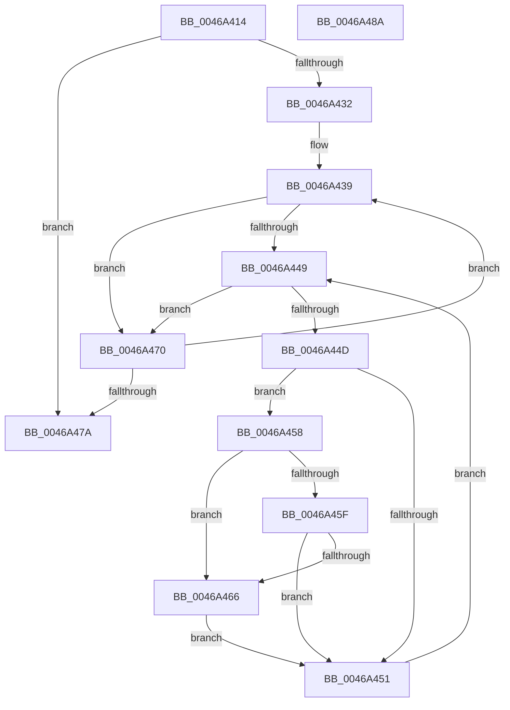

# AuthzBasepSetTypeListAccessReasons

- RVA: `0x0046A414`–`0x0046A48B` (길이 `119` bytes)
- VA: `0x000000014046A414`
- 실행 섹션: `.text`
- PDB 이름 있음: `예`; PDB Function 태그: `아니요`
- unwind 정보 RVA: `0x00069588`
- 디코드: `39`개 명령, `119/119` bytes 표시
- 미해석 바이트: `0` (있으면 어셈블리에 `.byte`로 보존)

> 이 문서는 커널 이미지의 기계어와 PDB 기호를 분석해 생성했습니다. 4번과 5번은 함수 원형과 자료형을 바이너리 사용 방식에서 추정한 C 해석이며 원본 소스 복구 결과는 아닙니다.

## 1. Dependencies

- 직접 호출 지점: **0**; 고유 호출 대상: **0**
- 직접 호출자로 확인된 함수: **1**
- RIP 상대 이미지 참조: **0**

### Outgoing calls
- 직접 디코드된 call 명령이 없습니다.

### Direct callers
- [sub_006E89DA](../6E/Unknown_function_006E89DA.md) at `0x006E89FE`
- [sub_006E89DA](../6E/Unknown_function_006E89DA.md) at `0x006E8A22`
- [sub_006E89DA](../6E/Unknown_function_006E89DA.md) at `0x006E8A98`
- [sub_006E89DA](../6E/Unknown_function_006E89DA.md) at `0x006E8C0C`
- [sub_006E89DA](../6E/Unknown_function_006E89DA.md) at `0x006E8D6C`
- [sub_006E89DA](../6E/Unknown_function_006E89DA.md) at `0x006E8D9E`
- [sub_006E89DA](../6E/Unknown_function_006E89DA.md) at `0x006E8DD9`

### Static image references
- 디코드된 RIP-relative 메모리 참조가 없습니다.

## 2. Other-region calls and transfers

- 다른 실행 섹션으로 향하는 call: **0**
- 별도 외부 분기/꼬리 이동을 확인하지 못했습니다.

## 3. Assembly (complete function range)

```asm
0046A414  48 89 5C 24 08                  mov qword ptr [rsp + 8], rbx
0046A419  48 89 74 24 10                  mov qword ptr [rsp + 0x10], rsi
0046A41E  48 89 7C 24 18                  mov qword ptr [rsp + 0x18], rdi
0046A423  8B 44 24 28                     mov eax, dword ptr [rsp + 0x28]
0046A427  41 8B F8                        mov edi, r8d
0046A42A  8B F2                           mov esi, edx
0046A42C  8B D9                           mov ebx, ecx
0046A42E  85 C0                           test eax, eax
0046A430  74 48                           je 0x14046a47a
0046A432  49 83 C1 28                     add r9, 0x28
0046A436  44 8B D8                        mov r11d, eax
0046A439  4D 8B 11                        mov r10, qword ptr [r9]
0046A43C  45 33 C0                        xor r8d, r8d
0046A43F  BA 01 00 00 00                  mov edx, 1
0046A444  4D 85 D2                        test r10, r10
0046A447  74 27                           je 0x14046a470
0046A449  85 D2                           test edx, edx
0046A44B  74 23                           je 0x14046a470
0046A44D  85 D3                           test ebx, edx
0046A44F  75 07                           jne 0x14046a458
0046A451  41 FF C0                        inc r8d
0046A454  03 D2                           add edx, edx
0046A456  EB F1                           jmp 0x14046a449
0046A458  80 7C 24 30 00                  cmp byte ptr [rsp + 0x30], 0
0046A45D  75 07                           jne 0x14046a466
0046A45F  43 83 3C 82 00                  cmp dword ptr [r10 + r8*4], 0
0046A464  75 EB                           jne 0x14046a451
0046A466  8B CE                           mov ecx, esi
0046A468  0B CF                           or ecx, edi
0046A46A  43 89 0C 82                     mov dword ptr [r10 + r8*4], ecx
0046A46E  EB E1                           jmp 0x14046a451
0046A470  49 83 C1 30                     add r9, 0x30
0046A474  49 83 EB 01                     sub r11, 1
0046A478  75 BF                           jne 0x14046a439
0046A47A  48 8B 5C 24 08                  mov rbx, qword ptr [rsp + 8]
0046A47F  48 8B 74 24 10                  mov rsi, qword ptr [rsp + 0x10]
0046A484  48 8B 7C 24 18                  mov rdi, qword ptr [rsp + 0x18]
0046A489  C3                              ret
0046A48A  CC                              int3
```

## 4. C-style interpretation (structured pseudocode)

```c
__int64 __fastcall AuthzBasepSetTypeListAccessReasons(int a1, int a2, int a3, __int64 a4, unsigned int a5, unsigned __int8 a6)
{
    __int64 v_r11;
    unsigned __int64 v_stack_p10;
    unsigned __int64 v_stack_p18;
    unsigned __int64 v_stack_p8;

    v_stack_p8 = v_rbx;
    v_stack_p10 = v_rsi;
    v_stack_p18 = v_rdi;
    if ((unsigned int)((unsigned int)(a5)) == 0) goto loc_0046A47A;
    a4 = (a4) + (40);
loc_0046A439:
    a3 = 0;
    if (*(unsigned __int64 *)(a4) == 0) goto loc_0046A470;
loc_0046A449:
    if (1 == 0) goto loc_0046A470;
    if ((((unsigned int)((unsigned int)(a1))) & (1)) != 0) goto loc_0046A458;
loc_0046A451:
    a3 = (unsigned int)((a3) + 1);
    a2 = (unsigned int)((1) + (1));
    goto loc_0046A449;
loc_0046A458:
    if (a6 != 0) goto loc_0046A466;
    if ((*(unsigned int *)(*(unsigned __int64 *)(a4) + a3 * 4)) != 0) goto loc_0046A451;
loc_0046A466:
    a1 = (unsigned int)(((unsigned int)((unsigned int)((unsigned int)(a2)))) | ((unsigned int)((unsigned int)(a3))));
    *(unsigned int *)(*(unsigned __int64 *)(a4) + a3 * 4) = a1;
    goto loc_0046A451;
loc_0046A470:
    a4 = (a4) + (48);
    v_r11 = ((unsigned int)((unsigned int)((unsigned int)(a5)))) - (1);
    if (condition_is_not_equal) goto loc_0046A439;
loc_0046A47A:
    return (unsigned int)(a5);
}
```

## 5. (Beta) C Style

```c
int64_t AuthzBasepSetTypeListAccessReasons(int32_t Arg1, int32_t Arg2, int32_t Arg3, void *Arg4, uint32_t Arg5, uint8_t Arg6)
{
    uint8_t *arg4 = (uint8_t *)Arg4;

    int64_t local_r11;
    uint64_t v_stack_p10;
    uint64_t v_stack_p18;
    uint64_t v_stack_p8;

    v_stack_p8 = local_rbx;
    v_stack_p10 = local_rsi;
    v_stack_p18 = local_rdi;
    if ((uint32_t)((uint32_t)(Arg5)) == 0) goto loc_0046A47A;
    Arg4 = (Arg4) + (40);
loc_0046A439:
    Arg3 = 0;
    if (*(uint64_t *)(arg4) == 0) goto loc_0046A470;
loc_0046A449:
    if (1 == 0) goto loc_0046A470;
    if ((((uint32_t)((uint32_t)(Arg1))) & (1)) != 0) goto loc_0046A458;
loc_0046A451:
    Arg3 = (uint32_t)((Arg3) + 1);
    Arg2 = (uint32_t)((1) + (1));
    goto loc_0046A449;
loc_0046A458:
    if (Arg6 != 0) goto loc_0046A466;
    if ((*(uint32_t *)(*(uint64_t *)(arg4) + Arg3 * 4)) != 0) goto loc_0046A451;
loc_0046A466:
    Arg1 = (uint32_t)(((uint32_t)((uint32_t)((uint32_t)(Arg2)))) | ((uint32_t)((uint32_t)(Arg3))));
    *(uint32_t *)(*(uint64_t *)(arg4) + Arg3 * 4) = Arg1;
    goto loc_0046A451;
loc_0046A470:
    Arg4 = (Arg4) + (48);
    local_r11 = ((uint32_t)((uint32_t)((uint32_t)(Arg5)))) - (1);
    if (condition_is_not_equal) goto loc_0046A439;
loc_0046A47A:
    return (uint32_t)(Arg5);
}
```

### 관측된 메모리 오프셋

구조체 형식이 확인되지 않은 접근은 인자 기준의 오프셋으로만 기록했습니다.

| 기준 인자 | 오프셋 표현 | 폭 (bit) | 접근 |
|---|---:|---:|---|
| `Arg4` | `+ 0x0` | `64` | `R` |

## 6. Execution-region graph

[열기: 2D/3D 그래프와 함수 탐색 컨트롤 패널](../../../control-panel.html?section=text&rva=0x0046A414&view=graph)

- 2D 그래프는 위에서 아래로 흐르고, 3D 그래프는 빈 공간을 드래그해 회전합니다. Shift+드래그는 이동, 휠은 확대·축소, 함수 노드 선택은 대상 보고서 이동입니다.

### Static fallback


