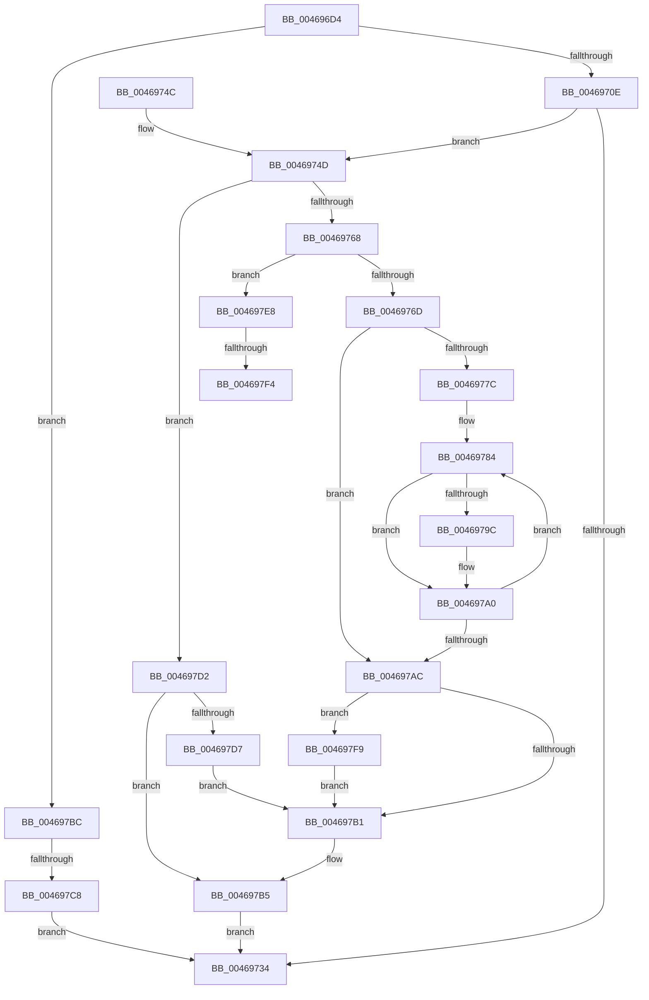

# BgpGxConvertRectangleEx

- RVA: `0x004696D4`–`0x004697FF` (길이 `299` bytes)
- VA: `0x00000001404696D4`
- 실행 섹션: `.text`
- PDB 이름 있음: `예`; PDB Function 태그: `예`
- unwind 정보 RVA: `0x000AB170`
- 디코드: `96`개 명령, `299/299` bytes 표시
- 미해석 바이트: `0` (있으면 어셈블리에 `.byte`로 보존)

> 이 문서는 커널 이미지의 기계어와 PDB 기호를 분석해 생성했습니다. 4번과 5번은 함수 원형과 자료형을 바이너리 사용 방식에서 추정한 C 해석이며 원본 소스 복구 결과는 아닙니다.

## 1. Dependencies

- 직접 호출 지점: **2**; 고유 호출 대상: **2**
- 직접 호출자로 확인된 함수: **5**
- RIP 상대 이미지 참조: **0**

### Outgoing calls
- `0x0046972B` → [BgpGxRectangleCreate](../../pagebgfx/BC/BgpGxRectangleCreate_function_00BC3E78.md) (function, `0x00BC3E78`)
- `0x004697E1` → [memcpy](../6C/memcpy_function_006C6840.md) (function, `0x006C6840`)

### Direct callers
- [BgpTxtDisplayCharacter](../47/BgpTxtDisplayCharacter_function_0047F120.md) at `0x0047F2D4`
- [BgpGxDrawRectangle](../48/BgpGxDrawRectangle_function_0048C91C.md) at `0x0048C98F`
- [BgpGxConvertRectangle](../69/BgpGxConvertRectangle_function_0069F190.md) at `0x0069F1B4`
- [sub_006F6564](../6F/Unknown_function_006F6564.md) at `0x006F6574`
- [AnFwDisplayFade](../../pagebgfx/BC/AnFwDisplayFade_function_00BC36EC.md) at `0x00BC3896`

### Static image references
- 디코드된 RIP-relative 메모리 참조가 없습니다.

## 2. Other-region calls and transfers

- 다른 실행 섹션으로 향하는 call: **1**
  - `0x0046972B` → [BgpGxRectangleCreate](../../pagebgfx/BC/BgpGxRectangleCreate_function_00BC3E78.md) (`.text` → `PAGEBGFX`)
- call이 아닌 외부 분기/꼬리 이동: **3**
  - `0x004697C2` → [sub_006F2EEA](../6F/Unknown_function_006F2EEA.md) (`tail-transfer`)
  - `0x004697EE` → [sub_006F2EEA + 0x27](../6F/Unknown_function_006F2EEA.md) (`tail-transfer`)
  - `0x004697F4` → [sub_006F2EEA + 0x83](../6F/Unknown_function_006F2EEA.md) (`tail-transfer`)

## 3. Assembly (complete function range)

```asm
004696D4  4C 8B DC                        mov r11, rsp
004696D7  49 89 5B 10                     mov qword ptr [r11 + 0x10], rbx
004696DB  4D 89 43 18                     mov qword ptr [r11 + 0x18], r8
004696DF  49 89 4B 08                     mov qword ptr [r11 + 8], rcx
004696E3  55                              push rbp
004696E4  56                              push rsi
004696E5  57                              push rdi
004696E6  41 54                           push r12
004696E8  41 55                           push r13
004696EA  41 56                           push r14
004696EC  41 57                           push r15
004696EE  48 83 EC 40                     sub rsp, 0x40
004696F2  83 64 24 30 00                  and dword ptr [rsp + 0x30], 0
004696F7  4D 8B E0                        mov r12, r8
004696FA  41 C6 43 20 00                  mov byte ptr [r11 + 0x20], 0
004696FF  8B EA                           mov ebp, edx
00469701  48 8B F1                        mov rsi, rcx
00469704  41 F6 C1 01                     test r9b, 1
00469708  0F 85 AE 00 00 00               jne 0x1404697bc
0046970E  8B 01                           mov eax, dword ptr [rcx]
00469710  4D 8D 43 A8                     lea r8, [r11 - 0x58]
00469714  49 83 63 A8 00                  and qword ptr [r11 - 0x58], 0
00469719  45 32 FF                        xor r15b, r15b
0046971C  89 44 24 2C                     mov dword ptr [rsp + 0x2c], eax
00469720  8B 41 04                        mov eax, dword ptr [rcx + 4]
00469723  49 8D 4B B0                     lea rcx, [r11 - 0x50]
00469727  89 44 24 28                     mov dword ptr [rsp + 0x28], eax
0046972B  E8 48 A7 75 00                  call 0x140bc3e78
00469730  85 C0                           test eax, eax
00469732  79 19                           jns 0x14046974d
00469734  48 8B 9C 24 88 00 00 00         mov rbx, qword ptr [rsp + 0x88]
0046973C  48 83 C4 40                     add rsp, 0x40
00469740  41 5F                           pop r15
00469742  41 5E                           pop r14
00469744  41 5D                           pop r13
00469746  41 5C                           pop r12
00469748  5F                              pop rdi
00469749  5E                              pop rsi
0046974A  5D                              pop rbp
0046974B  C3                              ret
0046974C  CC                              int3
0046974D  48 8B 7C 24 20                  mov rdi, qword ptr [rsp + 0x20]
00469752  8B 46 08                        mov eax, dword ptr [rsi + 8]
00469755  44 8B E8                        mov r13d, eax
00469758  48 8B 5F 18                     mov rbx, qword ptr [rdi + 0x18]
0046975C  4C 8B 76 18                     mov r14, qword ptr [rsi + 0x18]
00469760  41 C1 ED 03                     shr r13d, 3
00469764  3B C5                           cmp eax, ebp
00469766  74 6A                           je 0x1404697d2
00469768  83 FD 04                        cmp ebp, 4
0046976B  74 7B                           je 0x1404697e8
0046976D  8B 47 04                        mov eax, dword ptr [rdi + 4]
00469770  8B CD                           mov ecx, ebp
00469772  0F AF 07                        imul eax, dword ptr [rdi]
00469775  C1 E9 03                        shr ecx, 3
00469778  85 C0                           test eax, eax
0046977A  74 30                           je 0x1404697ac
0046977C  44 8B C1                        mov r8d, ecx
0046977F  8B C8                           mov ecx, eax
00469781  41 8B D5                        mov edx, r13d
00469784  41 8A 46 02                     mov al, byte ptr [r14 + 2]
00469788  88 43 02                        mov byte ptr [rbx + 2], al
0046978B  41 8A 46 01                     mov al, byte ptr [r14 + 1]
0046978F  88 43 01                        mov byte ptr [rbx + 1], al
00469792  41 8A 06                        mov al, byte ptr [r14]
00469795  88 03                           mov byte ptr [rbx], al
00469797  83 FD 20                        cmp ebp, 0x20
0046979A  75 04                           jne 0x1404697a0
0046979C  C6 43 03 00                     mov byte ptr [rbx + 3], 0
004697A0  4C 03 F2                        add r14, rdx
004697A3  49 03 D8                        add rbx, r8
004697A6  48 83 E9 01                     sub rcx, 1
004697AA  75 D8                           jne 0x140469784
004697AC  45 84 FF                        test r15b, r15b
004697AF  75 48                           jne 0x1404697f9
004697B1  49 89 3C 24                     mov qword ptr [r12], rdi
004697B5  33 C0                           xor eax, eax
004697B7  E9 78 FF FF FF                  jmp 0x140469734
004697BC  41 B7 01                        mov r15b, 1
004697BF  3B 69 08                        cmp ebp, dword ptr [rcx + 8]
004697C2  0F 86 22 97 28 00               jbe 0x1406f2eea
004697C8  B8 0D 00 00 C0                  mov eax, 0xc000000d
004697CD  E9 62 FF FF FF                  jmp 0x140469734
004697D2  45 84 FF                        test r15b, r15b
004697D5  75 DE                           jne 0x1404697b5
004697D7  44 8B 46 0C                     mov r8d, dword ptr [rsi + 0xc]
004697DB  49 8B D6                        mov rdx, r14
004697DE  48 8B CB                        mov rcx, rbx
004697E1  E8 5A D0 25 00                  call 0x1406c6840
004697E6  EB C9                           jmp 0x1404697b1
004697E8  45 33 E4                        xor r12d, r12d
004697EB  44 39 27                        cmp dword ptr [rdi], r12d
004697EE  0F 87 1D 97 28 00               ja 0x1406f2f11
004697F4  E9 74 97 28 00                  jmp 0x1406f2f6d
004697F9  83 4E 10 10                     or dword ptr [rsi + 0x10], 0x10
004697FD  EB B2                           jmp 0x1404697b1
```

## 4. C-style interpretation (structured pseudocode)

```c
__int64 __fastcall BgpGxConvertRectangleEx(__int64 a1, int a2, __int64 a3, unsigned __int8 a4)
{
    __int64 result;
    __int64 v_r12;
    __int64 v_r13;
    __int64 v_r14;
    __int64 v_r15;
    __int64 v_rbx;
    __int64 v_rsp;
    unsigned int v_stack_m48;
    unsigned int v_stack_m4C;
    unsigned int v_stack_m50;
    unsigned __int64 v_stack_p10;
    unsigned __int64 v_stack_p20;

    *(unsigned __int64 *)(v_rsp + 16) = v_rbx;
    *(unsigned __int64 *)(v_rsp + 24) = a3;
    *(unsigned __int64 *)(v_rsp + 8) = a1;
    v_rsp = (v_rsp) - (64);
    *(unsigned __int8 *)(v_rsp + 32) = 0;
    if (((a4) & (1)) != 0) goto loc_004697BC;
    v_r15 = 0;
    v_stack_m4C = (unsigned int)((unsigned int)(*(unsigned int *)(a1)));
    v_stack_m50 = (unsigned int)((unsigned int)(*(unsigned int *)(a1 + 4)));
    result = BgpGxRectangleCreate(v_rsp - 80, a2, v_rsp - 88, a4);
    if (!sign_flag) goto loc_0046974D;
loc_00469734:
    v_rsp = (v_rsp) + (64);
    return result;
loc_0046974D:
    v_r13 = (unsigned int)(((unsigned int)((unsigned int)((unsigned int)(*(unsigned int *)(a1 + 8))))) >> (3));
    if (((unsigned int)((unsigned int)(*(unsigned int *)(a1 + 8)))) == ((unsigned int)((unsigned int)(a2)))) goto loc_004697D2;
    if (((unsigned int)((unsigned int)(a2))) == 4) goto loc_004697E8;
    result = (unsigned int)(((unsigned int)(*(unsigned int *)(v_stack_p20 + 4))) * (*(unsigned int *)(v_stack_p20)));
    a1 = (unsigned int)(((unsigned int)((unsigned int)((unsigned int)(a2)))) >> (3));
    if ((unsigned int)(result) == 0) goto loc_004697AC;
loc_00469784:
    *(unsigned __int8 *)(*(unsigned __int64 *)(v_stack_p20 + 24) + 2) = (unsigned __int8)(*(unsigned __int8 *)(*(unsigned __int64 *)(a1 + 24) + 2));
    *(unsigned __int8 *)(*(unsigned __int64 *)(v_stack_p20 + 24) + 1) = (unsigned __int8)(*(unsigned __int8 *)(*(unsigned __int64 *)(a1 + 24) + 1));
    *(unsigned __int8 *)(*(unsigned __int64 *)(v_stack_p20 + 24)) = (unsigned __int8)(*(unsigned __int8 *)(*(unsigned __int64 *)(a1 + 24)));
    if (((unsigned int)((unsigned int)(a2))) == 32) {
        *(unsigned __int8 *)(*(unsigned __int64 *)(v_stack_p20 + 24) + 3) = 0;
    }
    v_r14 = (*(unsigned __int64 *)(a1 + 24)) + ((unsigned int)((unsigned int)(v_r13)));
    v_rbx = (*(unsigned __int64 *)(v_stack_p20 + 24)) + ((unsigned int)((unsigned int)(a1)));
    a1 = ((unsigned int)((unsigned int)(result))) - (1);
    if (condition_is_not_equal) goto loc_00469784;
loc_004697AC:
    if (0 != 0) goto loc_004697F9;
loc_004697B1:
    *(unsigned __int64 *)(a3) = v_stack_p20;
loc_004697B5:
    result = 0;
    goto loc_00469734;
loc_004697BC:
    goto loc_00469734;
loc_004697D2:
    if (1 != 0) goto loc_004697B5;
    result = memcpy(v_rbx, v_r14, (unsigned int)(*(unsigned int *)(a1 + 12)), a4);
    goto loc_004697B1;
loc_004697E8:
    v_r12 = 0;
loc_004697F9:
    goto loc_004697B1;
}
```

## 5. (Beta) C Style

```c
int64_t BgpGxConvertRectangleEx(void *Arg1, int32_t Arg2, void *Arg3, uint8_t Arg4)
{
    uint8_t *arg1 = (uint8_t *)Arg1;
    uint8_t *arg3 = (uint8_t *)Arg3;

    int64_t result;
    int64_t local_r12;
    int64_t local_r13;
    int64_t local_r14;
    int64_t local_r15;
    int64_t local_rbx;
    int64_t local_rsp;
    uint32_t v_stack_m48;
    uint32_t v_stack_m4C;
    uint32_t v_stack_m50;
    uint64_t v_stack_p10;
    uint64_t v_stack_p20;

    *(uint64_t *)(local_rsp + 0x10) = local_rbx;
    *(void **)(local_rsp + 0x18) = Arg3;
    *(void **)(local_rsp + 0x8) = Arg1;
    local_rsp = (local_rsp) - (64);
    *(uint8_t *)(local_rsp + 0x20) = 0;
    if (((Arg4) & (1)) != 0) goto loc_004697BC;
    local_r15 = 0;
    v_stack_m4C = (uint32_t)((uint32_t)(*(uint32_t *)(arg1)));
    v_stack_m50 = (uint32_t)((uint32_t)(*(uint32_t *)(arg1 + 0x4)));
    result = BgpGxRectangleCreate(local_rsp - 80, Arg2, local_rsp - 88, Arg4);
    if (!sign_flag) goto loc_0046974D;
loc_00469734:
    local_rsp = (local_rsp) + (64);
    return result;
loc_0046974D:
    local_r13 = (uint32_t)(((uint32_t)((uint32_t)((uint32_t)(*(uint32_t *)(arg1 + 0x8))))) >> (3));
    if (((uint32_t)((uint32_t)(*(uint32_t *)(arg1 + 0x8)))) == ((uint32_t)((uint32_t)(Arg2)))) goto loc_004697D2;
    if (((uint32_t)((uint32_t)(Arg2))) == 4) goto loc_004697E8;
    result = (uint32_t)(((uint32_t)(*(uint32_t *)(v_stack_p20 + 0x4))) * (*(uint32_t *)(v_stack_p20)));
    Arg1 = (uint32_t)(((uint32_t)((uint32_t)((uint32_t)(Arg2)))) >> (3));
    if ((uint32_t)(result) == 0) goto loc_004697AC;
loc_00469784:
    *(uint8_t *)(*(uint64_t *)(v_stack_p20 + 0x18) + 0x2) = (uint8_t)(*(uint8_t *)(*(uint64_t *)(arg1 + 0x18) + 0x2));
    *(uint8_t *)(*(uint64_t *)(v_stack_p20 + 0x18) + 0x1) = (uint8_t)(*(uint8_t *)(*(uint64_t *)(arg1 + 0x18) + 0x1));
    *(uint8_t *)(*(uint64_t *)(v_stack_p20 + 0x18)) = (uint8_t)(*(uint8_t *)(*(uint64_t *)(arg1 + 0x18)));
    if (((uint32_t)((uint32_t)(Arg2))) == 32) {
        *(uint8_t *)(*(uint64_t *)(v_stack_p20 + 0x18) + 0x3) = 0;
    }
    local_r14 = (*(uint64_t *)(arg1 + 0x18)) + ((uint32_t)((uint32_t)(local_r13)));
    local_rbx = (*(uint64_t *)(v_stack_p20 + 0x18)) + ((uint32_t)((uint32_t)(Arg1)));
    Arg1 = ((uint32_t)((uint32_t)(result))) - (1);
    if (condition_is_not_equal) goto loc_00469784;
loc_004697AC:
    if (0 != 0) goto loc_004697F9;
loc_004697B1:
    *(uint64_t *)(arg3) = v_stack_p20;
loc_004697B5:
    result = 0;
    goto loc_00469734;
loc_004697BC:
    goto loc_00469734;
loc_004697D2:
    if (1 != 0) goto loc_004697B5;
    result = memcpy(local_rbx, local_r14, (uint32_t)(*(uint32_t *)(arg1 + 0xC)), Arg4);
    goto loc_004697B1;
loc_004697E8:
    local_r12 = 0;
loc_004697F9:
    goto loc_004697B1;
}
```

### 관측된 메모리 오프셋

구조체 형식이 확인되지 않은 접근은 인자 기준의 오프셋으로만 기록했습니다.

| 기준 인자 | 오프셋 표현 | 폭 (bit) | 접근 |
|---|---:|---:|---|
| `Arg1` | `+ 0x0` | `32` | `R` |
| `Arg1` | `+ 0x4` | `32` | `R` |
| `Arg1` | `+ 0x8` | `32` | `R` |
| `Arg1` | `+ 0xC` | `32` | `R` |
| `Arg1` | `+ 0x10` | `32` | `R/W` |
| `Arg1` | `+ 0x18` | `64` | `R` |
| `Arg3` | `+ 0x0` | `64` | `W` |

## 6. Execution-region graph

[열기: 2D/3D 그래프와 함수 탐색 컨트롤 패널](../../../control-panel.html?section=text&rva=0x004696D4&view=graph)

- 2D 그래프는 위에서 아래로 흐르고, 3D 그래프는 빈 공간을 드래그해 회전합니다. Shift+드래그는 이동, 휠은 확대·축소, 함수 노드 선택은 대상 보고서 이동입니다.

### Static fallback


