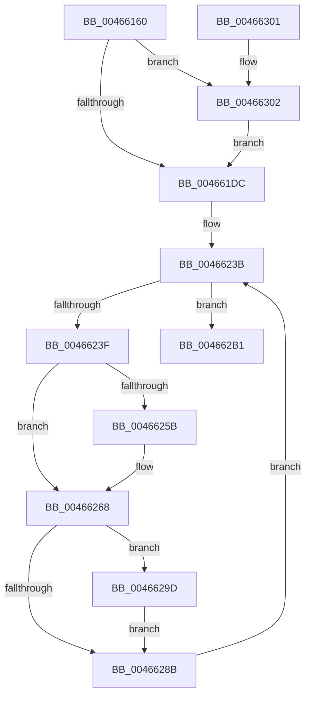

# CcMapDataForOverwrite

- RVA: `0x00466160`–`0x0046632F` (길이 `463` bytes)
- VA: `0x0000000140466160`
- 실행 섹션: `.text`
- PDB 이름 있음: `예`; PDB Function 태그: `아니요`
- unwind 정보 RVA: `0x000AAC60`
- 디코드: `109`개 명령, `463/463` bytes 표시
- 미해석 바이트: `0` (있으면 어셈블리에 `.byte`로 보존)

> 이 문서는 커널 이미지의 기계어와 PDB 기호를 분석해 생성했습니다. 4번과 5번은 함수 원형과 자료형을 바이너리 사용 방식에서 추정한 C 해석이며 원본 소스 복구 결과는 아닙니다.

## 1. Dependencies

- 직접 호출 지점: **5**; 고유 호출 대상: **4**
- 직접 호출자로 확인된 함수: **1**
- RIP 상대 이미지 참조: **0**

### Outgoing calls
- `0x0046621E` → [CcMapDataCommon](../../page/99/CcMapDataCommon_function_0099E560.md) (function, `0x0099E560`)
- `0x0046627C` → [MmCheckCachedPageStates](../2F/MmCheckCachedPageStates_function_002F6C60.md) (function, `0x002F6C60`)
- `0x004662AA` → [MmCheckCachedPageStates](../2F/MmCheckCachedPageStates_function_002F6C60.md) (function, `0x002F6C60`)
- `0x00466315` → [KeAcquireInStackQueuedSpinLock](../27/KeAcquireInStackQueuedSpinLock_function_002757A0.md) (function, `0x002757A0`)
- `0x00466325` → [KeReleaseInStackQueuedSpinLock](../34/KeReleaseInStackQueuedSpinLock_function_00342CE0.md) (function, `0x00342CE0`)

### Direct callers
- [CcPreparePinWrite](../../page/A4/CcPreparePinWrite_function_00A4C1C0.md) at `0x00A4C232`

### Static image references
- 디코드된 RIP-relative 메모리 참조가 없습니다.

## 2. Other-region calls and transfers

- 다른 실행 섹션으로 향하는 call: **1**
  - `0x0046621E` → [CcMapDataCommon](../../page/99/CcMapDataCommon_function_0099E560.md) (`.text` → `PAGE`)
- 별도 외부 분기/꼬리 이동을 확인하지 못했습니다.

## 3. Assembly (complete function range)

```asm
00466160  4C 8B DC                        mov r11, rsp
00466163  4D 89 4B 20                     mov qword ptr [r11 + 0x20], r9
00466167  53                              push rbx
00466168  56                              push rsi
00466169  57                              push rdi
0046616A  41 54                           push r12
0046616C  41 55                           push r13
0046616E  41 56                           push r14
00466170  41 57                           push r15
00466172  48 83 EC 60                     sub rsp, 0x60
00466176  45 8B F8                        mov r15d, r8d
00466179  4C 8B E2                        mov r12, rdx
0046617C  4C 8B E9                        mov r13, rcx
0046617F  49 83 63 10 00                  and qword ptr [r11 + 0x10], 0
00466184  44 8B 12                        mov r10d, dword ptr [rdx]
00466187  41 81 E2 FF 0F 00 00            and r10d, 0xfff
0046618E  41 8B C0                        mov eax, r8d
00466191  48 05 FF 0F 00 00               add rax, 0xfff
00466197  4C 03 D0                        add r10, rax
0046619A  49 C1 EA 0C                     shr r10, 0xc
0046619E  45 89 53 98                     mov dword ptr [r11 - 0x68], r10d
004661A2  65 48 8B 34 25 88 01 00 00      mov rsi, qword ptr gs:[0x188]
004661AB  48 89 74 24 40                  mov qword ptr [rsp + 0x40], rsi
004661B0  41 C6 43 18 01                  mov byte ptr [r11 + 0x18], 1
004661B5  0F 57 C0                        xorps xmm0, xmm0
004661B8  33 C0                           xor eax, eax
004661BA  0F 11 44 24 48                  movups xmmword ptr [rsp + 0x48], xmm0
004661BF  49 89 43 C0                     mov qword ptr [r11 - 0x40], rax
004661C3  48 8B 41 28                     mov rax, qword ptr [rcx + 0x28]
004661C7  48 8B 58 08                     mov rbx, qword ptr [rax + 8]
004661CB  BF 00 00 02 00                  mov edi, 0x20000
004661D0  85 BB 98 00 00 00               test dword ptr [rbx + 0x98], edi
004661D6  0F 84 26 01 00 00               je 0x140466302
004661DC  8B 8E 98 05 00 00               mov ecx, dword ptr [rsi + 0x598]
004661E2  0F B6 86 AC 05 00 00            movzx eax, byte ptr [rsi + 0x5ac]
004661E9  44 8D 34 48                     lea r14d, [rax + rcx*2]
004661ED  44 89 B4 24 A0 00 00 00         mov dword ptr [rsp + 0xa0], r14d
004661F5  48 8B BC 24 C0 00 00 00         mov rdi, qword ptr [rsp + 0xc0]
004661FD  48 89 7C 24 28                  mov qword ptr [rsp + 0x28], rdi
00466202  48 8D 84 24 A8 00 00 00         lea rax, [rsp + 0xa8]
0046620A  48 89 44 24 20                  mov qword ptr [rsp + 0x20], rax
0046620F  41 B9 01 00 00 00               mov r9d, 1
00466215  45 8B C7                        mov r8d, r15d
00466218  49 8B D4                        mov rdx, r12
0046621B  49 8B CD                        mov rcx, r13
0046621E  E8 3D 83 53 00                  call 0x14099e560
00466223  90                              nop
00466224  48 8B 3F                        mov rdi, qword ptr [rdi]
00466227  48 89 7C 24 38                  mov qword ptr [rsp + 0x38], rdi
0046622C  41 BC 0F 00 00 00               mov r12d, 0xf
00466232  8B 5C 24 30                     mov ebx, dword ptr [rsp + 0x30]
00466236  45 8D 7C 24 F2                  lea r15d, [r12 - 0xe]
0046623B  85 DB                           test ebx, ebx
0046623D  74 72                           je 0x1404662b1
0046623F  44 88 BC 24 B0 00 00 00         mov byte ptr [rsp + 0xb0], r15b
00466247  44 88 BE AC 05 00 00            mov byte ptr [rsi + 0x5ac], r15b
0046624E  8D 43 FF                        lea eax, [rbx - 1]
00466251  8B D8                           mov ebx, eax
00466253  3B 86 98 05 00 00               cmp eax, dword ptr [rsi + 0x598]
00466259  76 0D                           jbe 0x140466268
0046625B  41 3B C4                        cmp eax, r12d
0046625E  41 0F 47 C4                     cmova eax, r12d
00466262  89 86 98 05 00 00               mov dword ptr [rsi + 0x598], eax
00466268  4C 8D 8C 24 B0 00 00 00         lea r9, [rsp + 0xb0]
00466270  41 B8 05 00 00 00               mov r8d, 5
00466276  49 8B D7                        mov rdx, r15
00466279  48 8B CF                        mov rcx, rdi
0046627C  E8 DF 09 E9 FF                  call 0x1402f6c60
00466281  80 BC 24 B0 00 00 00 00         cmp byte ptr [rsp + 0xb0], 0
00466289  74 12                           je 0x14046629d
0046628B  48 81 C7 00 10 00 00            add rdi, 0x1000
00466292  48 89 7C 24 38                  mov qword ptr [rsp + 0x38], rdi
00466297  89 5C 24 30                     mov dword ptr [rsp + 0x30], ebx
0046629B  EB 9E                           jmp 0x14046623b
0046629D  45 33 C9                        xor r9d, r9d
004662A0  45 8D 41 04                     lea r8d, [r9 + 4]
004662A4  49 8B D7                        mov rdx, r15
004662A7  48 8B CF                        mov rcx, rdi
004662AA  E8 B1 09 E9 FF                  call 0x1402f6c60
004662AF  EB DA                           jmp 0x14046628b
004662B1  41 8A C6                        mov al, r14b
004662B4  41 22 C7                        and al, r15b
004662B7  88 86 AC 05 00 00               mov byte ptr [rsi + 0x5ac], al
004662BD  41 D1 EE                        shr r14d, 1
004662C0  44 89 B6 98 05 00 00            mov dword ptr [rsi + 0x598], r14d
004662C7  65 48 8B 04 25 88 01 00 00      mov rax, qword ptr gs:[0x188]
004662D0  8B 88 DC 05 00 00               mov ecx, dword ptr [rax + 0x5dc]
004662D6  65 01 0C 25 90 89 00 00         add dword ptr gs:[0x8990], ecx
004662DE  48 8B 84 24 A8 00 00 00         mov rax, qword ptr [rsp + 0xa8]
004662E6  48 8B 8C 24 B8 00 00 00         mov rcx, qword ptr [rsp + 0xb8]
004662EE  48 89 01                        mov qword ptr [rcx], rax
004662F1  48 83 C4 60                     add rsp, 0x60
004662F5  41 5F                           pop r15
004662F7  41 5E                           pop r14
004662F9  41 5D                           pop r13
004662FB  41 5C                           pop r12
004662FD  5F                              pop rdi
004662FE  5E                              pop rsi
004662FF  5B                              pop rbx
00466300  C3                              ret
00466301  CC                              int3
00466302  48 8B 8B 18 02 00 00            mov rcx, qword ptr [rbx + 0x218]
00466309  48 81 C1 00 03 00 00            add rcx, 0x300
00466310  48 8D 54 24 48                  lea rdx, [rsp + 0x48]
00466315  E8 86 F4 E0 FF                  call 0x1402757a0
0046631A  09 BB 98 00 00 00               or dword ptr [rbx + 0x98], edi
00466320  48 8D 4C 24 48                  lea rcx, [rsp + 0x48]
00466325  E8 B6 C9 ED FF                  call 0x140342ce0
0046632A  E9 AD FE FF FF                  jmp 0x1404661dc
```

## 4. C-style interpretation (structured pseudocode)

```c
__int64 __fastcall CcMapDataForOverwrite(__int64 a1, __int64 a2, int a3, __int64 a4, __int64 a5)
{
    __int64 result;
    __int64 v_r10;
    __int64 v_r14;
    __int64 v_rdi;
    __int64 v_rsp;
    unsigned __int64 v_stack_m50;
    unsigned __int64 v_stack_m58;
    unsigned __int64 v_stack_m60;
    unsigned int v_stack_m68;
    unsigned __int64 v_stack_m70;
    unsigned __int64 v_stack_m78;
    unsigned __int64 v_stack_p10;
    unsigned __int8 v_stack_p18;
    unsigned __int64 v_stack_p20;
    unsigned __int64 v_stack_p48;
    unsigned int v_stack_p8;

    *(unsigned __int64 *)(v_rsp + 32) = a4;
    v_rsp = (v_rsp) - (96);
    v_r10 = (unsigned int)(((unsigned int)(*(unsigned int *)(a2))) & (0xFFFULL));
    result = ((unsigned int)(a3)) + (0xFFFULL);
    v_r10 = (v_r10) + (result);
    v_r10 = (v_r10) >> (12);
    *(unsigned int *)(v_rsp - 104) = (unsigned int)(v_r10);
    v_stack_m58 = *(unsigned __int64 *)(gs_base + (0 + 392));
    *(unsigned __int8 *)(v_rsp + 24) = 1;
    result = 0;
    v_stack_m50 = v_xmm0;
    *(unsigned __int64 *)(v_rsp - 64) = 0;
    if (((*(unsigned int *)(*(unsigned __int64 *)(*(unsigned __int64 *)(a1 + 40) + 8) + 152)) & ((unsigned int)((unsigned int)(0x20000ULL)))) == 0) goto loc_00466302;
loc_004661DC:
    v_stack_p8 = (unsigned int)(*(unsigned __int8 *)(*(unsigned __int64 *)(gs_base + (0 + 392)) + 1452) + (unsigned int)(*(unsigned int *)(*(unsigned __int64 *)(gs_base + (0 + 392)) + 1432)) * 2);
    v_stack_m70 = a5;
    v_stack_m78 = v_stack_p10;
    result = CcMapDataCommon(a1, a2, (unsigned int)((unsigned int)((unsigned int)(a3))), 1);
    v_stack_m60 = *(unsigned __int64 *)(a5);
loc_0046623B:
    if ((unsigned int)((unsigned int)(v_stack_m68)) == 0) goto loc_004662B1;
    v_stack_p18 = (unsigned __int8)(15 - 14);
    *(unsigned __int8 *)(*(unsigned __int64 *)(gs_base + (0 + 392)) + 1452) = (unsigned __int8)(15 - 14);
    result = (unsigned int)(v_stack_m68) - 1;
    if (((unsigned int)((unsigned int)(v_stack_m68) - 1)) >= = (*(unsigned int *)(*(unsigned __int64 *)(gs_base + (0 + 392)) + 1432))) {
        result = (unsigned int)(v_stack_m68) - 1;
        if (((unsigned int)((unsigned int)(v_stack_m68) - 1)) > 15) { result = 15; }
        *(unsigned int *)(*(unsigned __int64 *)(gs_base + (0 + 392)) + 1432) = (unsigned int)(result);
    }
    result = MmCheckCachedPageStates(*(unsigned __int64 *)(a5), 15 - 14, 5, v_stack_p18);
    if (v_stack_p18 == 0) goto loc_0046629D;
loc_0046628B:
    v_rdi = (*(unsigned __int64 *)(a5)) + (0x1000ULL);
    v_stack_m60 = v_rdi;
    v_stack_m68 = (unsigned int)((unsigned int)((unsigned int)((unsigned int)(v_stack_m68) - 1)));
    goto loc_0046623B;
loc_0046629D:
    a4 = 0;
    result = MmCheckCachedPageStates(v_rdi, 15 - 14, a4 + 4, a4);
    goto loc_0046628B;
loc_004662B1:
    result = (unsigned __int8)(((unsigned __int8)(*(unsigned __int8 *)(*(unsigned __int64 *)(gs_base + (0 + 392)) + 1452) + (unsigned int)(*(unsigned int *)(*(unsigned __int64 *)(gs_base + (0 + 392)) + 1432)) * 2)) & ((unsigned __int8)(15 - 14)));
    *(unsigned __int8 *)(*(unsigned __int64 *)(gs_base + (0 + 392)) + 1452) = (unsigned __int8)(result);
    v_r14 = (unsigned int)((*(unsigned __int8 *)(*(unsigned __int64 *)(gs_base + (0 + 392)) + 1452) + (unsigned int)(*(unsigned int *)(*(unsigned __int64 *)(gs_base + (0 + 392)) + 1432)) * 2) >> (1));
    *(unsigned int *)(*(unsigned __int64 *)(gs_base + (0 + 392)) + 1432) = (unsigned int)(v_r14);
    *(unsigned __int64 *)(v_stack_p20) = v_stack_p10;
    v_rsp = (v_rsp) + (96);
    return v_stack_p10;
loc_00466302:
    a1 = (*(unsigned __int64 *)((unsigned int)((unsigned int)((unsigned int)(v_stack_m68) - 1)) + 536)) + (768);
    result = KeAcquireInStackQueuedSpinLock(a1, v_stack_p48, a4 + 4, a4);
    result = KeReleaseInStackQueuedSpinLock(v_stack_p48, v_stack_p48, a4 + 4, a4);
    goto loc_004661DC;
}
```

## 5. (Beta) C Style

```c
int64_t CcMapDataForOverwrite(void *Arg1, void *Arg2, int32_t Arg3, int64_t Arg4, void *Arg5)
{
    uint8_t *arg1 = (uint8_t *)Arg1;
    uint8_t *arg2 = (uint8_t *)Arg2;
    uint8_t *arg5 = (uint8_t *)Arg5;

    int64_t result;
    int64_t local_r10;
    int64_t local_r14;
    int64_t local_rdi;
    int64_t local_rsp;
    uint64_t v_stack_m50;
    uint64_t v_stack_m58;
    uint64_t v_stack_m60;
    uint32_t v_stack_m68;
    uint64_t v_stack_m70;
    uint64_t v_stack_m78;
    uint64_t v_stack_p10;
    uint8_t v_stack_p18;
    uint64_t v_stack_p20;
    uint64_t v_stack_p48;
    uint32_t v_stack_p8;

    *(uint64_t *)(local_rsp + 0x20) = Arg4;
    local_rsp = (local_rsp) - (96);
    local_r10 = (uint32_t)(((uint32_t)(*(uint32_t *)(arg2))) & (0xFFFULL));
    result = ((uint32_t)(Arg3)) + (0xFFFULL);
    local_r10 = (local_r10) + (result);
    local_r10 = (local_r10) >> (12);
    *(uint32_t *)(local_rsp - 0x68) = (uint32_t)(local_r10);
    v_stack_m58 = *(uint64_t *)(gs_base + (0 + 0x188));
    *(uint8_t *)(local_rsp + 0x18) = 1;
    result = 0;
    v_stack_m50 = v_xmm0;
    *(uint64_t *)(local_rsp - 0x40) = 0;
    if (((*(uint32_t *)(*(uint64_t *)(*(uint64_t *)(arg1 + 0x28) + 0x8) + 0x98)) & ((uint32_t)((uint32_t)(0x20000ULL)))) == 0) goto loc_00466302;
loc_004661DC:
    v_stack_p8 = (uint32_t)(*(uint8_t *)(*(uint64_t *)(gs_base + (0 + 0x188)) + 0x5AC) + (uint32_t)(*(uint32_t *)(*(uint64_t *)(gs_base + (0 + 0x188)) + 0x598)) * 2);
    v_stack_m70 = Arg5;
    v_stack_m78 = v_stack_p10;
    result = CcMapDataCommon(Arg1, Arg2, (uint32_t)((uint32_t)((uint32_t)(Arg3))), 1);
    v_stack_m60 = *(uint64_t *)(arg5);
loc_0046623B:
    if ((uint32_t)((uint32_t)(v_stack_m68)) == 0) goto loc_004662B1;
    v_stack_p18 = (uint8_t)(15 - 14);
    *(uint8_t *)(*(uint64_t *)(gs_base + (0 + 0x188)) + 0x5AC) = (uint8_t)(15 - 14);
    result = (uint32_t)(v_stack_m68) - 1;
    if (((uint32_t)((uint32_t)(v_stack_m68) - 1)) >= = (*(uint32_t *)(*(uint64_t *)(gs_base + (0 + 0x188)) + 0x598))) {
        result = (uint32_t)(v_stack_m68) - 1;
        if (((uint32_t)((uint32_t)(v_stack_m68) - 1)) > 15) { result = 15; }
        *(uint32_t *)(*(uint64_t *)(gs_base + (0 + 0x188)) + 0x598) = (uint32_t)(result);
    }
    result = MmCheckCachedPageStates(*(uint64_t *)(arg5), 15 - 14, 5, v_stack_p18);
    if (v_stack_p18 == 0) goto loc_0046629D;
loc_0046628B:
    local_rdi = (*(uint64_t *)(arg5)) + (0x1000ULL);
    v_stack_m60 = local_rdi;
    v_stack_m68 = (uint32_t)((uint32_t)((uint32_t)((uint32_t)(v_stack_m68) - 1)));
    goto loc_0046623B;
loc_0046629D:
    Arg4 = 0;
    result = MmCheckCachedPageStates(local_rdi, 15 - 14, Arg4 + 4, Arg4);
    goto loc_0046628B;
loc_004662B1:
    result = (uint8_t)(((uint8_t)(*(uint8_t *)(*(uint64_t *)(gs_base + (0 + 0x188)) + 0x5AC) + (uint32_t)(*(uint32_t *)(*(uint64_t *)(gs_base + (0 + 0x188)) + 0x598)) * 2)) & ((uint8_t)(15 - 14)));
    *(uint8_t *)(*(uint64_t *)(gs_base + (0 + 0x188)) + 0x5AC) = (uint8_t)(result);
    local_r14 = (uint32_t)((*(uint8_t *)(*(uint64_t *)(gs_base + (0 + 0x188)) + 0x5AC) + (uint32_t)(*(uint32_t *)(*(uint64_t *)(gs_base + (0 + 0x188)) + 0x598)) * 2) >> (1));
    *(uint32_t *)(*(uint64_t *)(gs_base + (0 + 0x188)) + 0x598) = (uint32_t)(local_r14);
    *(uint64_t *)(v_stack_p20) = v_stack_p10;
    local_rsp = (local_rsp) + (96);
    return v_stack_p10;
loc_00466302:
    Arg1 = (*(uint64_t *)((uint32_t)((uint32_t)((uint32_t)(v_stack_m68) - 0x1)) + 0x218)) + (768);
    result = KeAcquireInStackQueuedSpinLock(Arg1, v_stack_p48, Arg4 + 4, Arg4);
    result = KeReleaseInStackQueuedSpinLock(v_stack_p48, v_stack_p48, Arg4 + 4, Arg4);
    goto loc_004661DC;
}
```

### 관측된 메모리 오프셋

구조체 형식이 확인되지 않은 접근은 인자 기준의 오프셋으로만 기록했습니다.

| 기준 인자 | 오프셋 표현 | 폭 (bit) | 접근 |
|---|---:|---:|---|
| `Arg1` | `+ 0x28` | `64` | `R` |
| `Arg2` | `+ 0x0` | `32` | `R` |
| `Arg5` | `+ 0x0` | `64` | `R` |

## 6. Execution-region graph

[열기: 2D/3D 그래프와 함수 탐색 컨트롤 패널](../../../control-panel.html?section=text&rva=0x00466160&view=graph)

- 2D 그래프는 위에서 아래로 흐르고, 3D 그래프는 빈 공간을 드래그해 회전합니다. Shift+드래그는 이동, 휠은 확대·축소, 함수 노드 선택은 대상 보고서 이동입니다.

### Static fallback


