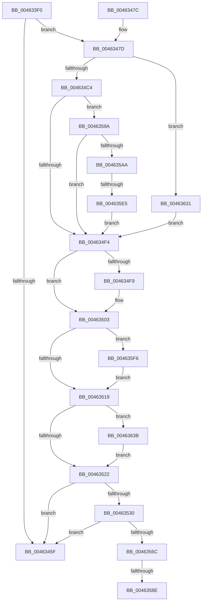

# CcWaitForUninitializeCacheMap

- RVA: `0x004633F0`–`0x00463648` (길이 `600` bytes)
- VA: `0x00000001404633F0`
- 실행 섹션: `.text`
- PDB 이름 있음: `예`; PDB Function 태그: `예`
- unwind 정보 RVA: `0x000AA688`
- 디코드: `133`개 명령, `600/600` bytes 표시
- 미해석 바이트: `0` (있으면 어셈블리에 `.byte`로 보존)

> 이 문서는 커널 이미지의 기계어와 PDB 기호를 분석해 생성했습니다. 4번과 5번은 함수 원형과 자료형을 바이너리 사용 방식에서 추정한 C 해석이며 원본 소스 복구 결과는 아닙니다.

## 1. Dependencies

- 직접 호출 지점: **9**; 고유 호출 대상: **8**
- 직접 호출자로 확인된 함수: **1**
- RIP 상대 이미지 참조: **1**

### Outgoing calls
- `0x004634AE` → [KeAcquireInStackQueuedSpinLock](../27/KeAcquireInStackQueuedSpinLock_function_002757A0.md) (function, `0x002757A0`)
- `0x004634D7` → [KeAcquireInStackQueuedSpinLockAtDpcLevel](../27/KeAcquireInStackQueuedSpinLockAtDpcLevel_function_00275740.md) (function, `0x00275740`)
- `0x004634FE` → [KeReleaseInStackQueuedSpinLockFromDpcLevel](../21/KeReleaseInStackQueuedSpinLockFromDpcLevel_function_002171B0.md) (function, `0x002171B0`)
- `0x0046350B` → [KeReleaseInStackQueuedSpinLock](../34/KeReleaseInStackQueuedSpinLock_function_00342CE0.md) (function, `0x00342CE0`)
- `0x0046355C` → [KeWaitForSingleObject](../20/KeWaitForSingleObject_function_0020E6B0.md) (function, `0x0020E6B0`)
- `0x00463578` → [KeAcquireInStackQueuedSpinLock](../27/KeAcquireInStackQueuedSpinLock_function_002757A0.md) (function, `0x002757A0`)
- `0x00463621` → [CcWriteBehind](../35/CcWriteBehind_function_00356EAC.md) (function, `0x00356EAC`)
- `0x00463627` → [KeLeaveCriticalRegion](../25/KeLeaveCriticalRegion_function_0025D8B0.md) (function, `0x0025D8B0`)
- `0x0046363E` → [CcFreeWorkQueueEntry](../35/CcFreeWorkQueueEntry_function_0035723C.md) (function, `0x0035723C`)

### Direct callers
- [sub_00984B34](../../page/98/Unknown_function_00984B34.md) at `0x00984BDB`
- [sub_00984B34](../../page/98/Unknown_function_00984B34.md) at `0x00984CC7`

### Static image references
- `0x004634A7` → RVA `0x00E11CC0` (`.data`; read)

## 2. Other-region calls and transfers

- 다른 실행 섹션으로 향하는 call: **0**
- call이 아닌 외부 분기/꼬리 이동: **3**
  - `0x00463588` → [sub_006F2A56 + 0xB2](../6F/Unknown_function_006F2A56.md) (`tail-transfer`)
  - `0x00463595` → [sub_006F2A56 + 0x74](../6F/Unknown_function_006F2A56.md) (`tail-transfer`)
  - `0x004635DF` → [sub_006F2A56](../6F/Unknown_function_006F2A56.md) (`tail-transfer`)

## 3. Assembly (complete function range)

```asm
004633F0  4C 8B DC                        mov r11, rsp
004633F3  49 89 5B 18                     mov qword ptr [r11 + 0x18], rbx
004633F7  49 89 73 20                     mov qword ptr [r11 + 0x20], rsi
004633FB  57                              push rdi
004633FC  41 54                           push r12
004633FE  41 55                           push r13
00463400  41 56                           push r14
00463402  41 57                           push r15
00463404  48 81 EC B0 00 00 00            sub rsp, 0xb0
0046340B  4C 8B E9                        mov r13, rcx
0046340E  33 F6                           xor esi, esi
00463410  48 89 74 24 30                  mov qword ptr [rsp + 0x30], rsi
00463415  40 88 74 24 3B                  mov byte ptr [rsp + 0x3b], sil
0046341A  40 88 B4 24 E0 00 00 00         mov byte ptr [rsp + 0xe0], sil
00463422  44 8A F6                        mov r14b, sil
00463425  8B FE                           mov edi, esi
00463427  0F 57 C0                        xorps xmm0, xmm0
0046342A  0F 11 44 24 68                  movups xmmword ptr [rsp + 0x68], xmm0
0046342F  0F 57 C9                        xorps xmm1, xmm1
00463432  33 C0                           xor eax, eax
00463434  41 0F 11 4B B8                  movups xmmword ptr [r11 - 0x48], xmm1
00463439  49 89 43 C8                     mov qword ptr [r11 - 0x38], rax
0046343D  0F 11 44 24 50                  movups xmmword ptr [rsp + 0x50], xmm0
00463442  49 89 43 88                     mov qword ptr [r11 - 0x78], rax
00463446  0F 11 4C 24 78                  movups xmmword ptr [rsp + 0x78], xmm1
0046344B  49 89 43 B0                     mov qword ptr [r11 - 0x50], rax
0046344F  44 8B FE                        mov r15d, esi
00463452  44 8A E6                        mov r12b, sil
00463455  48 8B 41 28                     mov rax, qword ptr [rcx + 0x28]
00463459  48 39 70 08                     cmp qword ptr [rax + 8], rsi
0046345D  75 1E                           jne 0x14046347d
0046345F  4C 8D 9C 24 B0 00 00 00         lea r11, [rsp + 0xb0]
00463467  49 8B 5B 40                     mov rbx, qword ptr [r11 + 0x40]
0046346B  49 8B 73 48                     mov rsi, qword ptr [r11 + 0x48]
0046346F  49 8B E3                        mov rsp, r11
00463472  41 5F                           pop r15
00463474  41 5E                           pop r14
00463476  41 5D                           pop r13
00463478  41 5C                           pop r12
0046347A  5F                              pop rdi
0046347B  C3                              ret
0046347C  CC                              int3
0046347D  66 89 74 24 38                  mov word ptr [rsp + 0x38], si
00463482  C6 44 24 3A 06                  mov byte ptr [rsp + 0x3a], 6
00463487  89 74 24 3C                     mov dword ptr [rsp + 0x3c], esi
0046348B  48 8D 44 24 40                  lea rax, [rsp + 0x40]
00463490  48 89 44 24 48                  mov qword ptr [rsp + 0x48], rax
00463495  48 8D 44 24 40                  lea rax, [rsp + 0x40]
0046349A  48 89 44 24 40                  mov qword ptr [rsp + 0x40], rax
0046349F  48 8D 94 24 90 00 00 00         lea rdx, [rsp + 0x90]
004634A7  48 8D 0D 12 E8 9A 00            lea rcx, [rip + 0x9ae812]
004634AE  E8 ED 22 E1 FF                  call 0x1402757a0
004634B3  49 8B 45 28                     mov rax, qword ptr [r13 + 0x28]
004634B7  48 8B 58 08                     mov rbx, qword ptr [rax + 8]
004634BB  48 85 DB                        test rbx, rbx
004634BE  0F 84 6D 01 00 00               je 0x140463631
004634C4  4C 8B BB 18 02 00 00            mov r15, qword ptr [rbx + 0x218]
004634CB  49 8D 8F 00 03 00 00            lea rcx, [r15 + 0x300]
004634D2  48 8D 54 24 50                  lea rdx, [rsp + 0x50]
004634D7  E8 64 22 E1 FF                  call 0x140275740
004634DC  BE 01 00 00 00                  mov esi, 1
004634E1  44 8A E6                        mov r12b, sil
004634E4  48 8D 83 E8 00 00 00            lea rax, [rbx + 0xe8]
004634EB  48 39 00                        cmp qword ptr [rax], rax
004634EE  0F 84 A6 00 00 00               je 0x14046359a
004634F4  45 84 E4                        test r12b, r12b
004634F7  74 0A                           je 0x140463503
004634F9  48 8D 4C 24 50                  lea rcx, [rsp + 0x50]
004634FE  E8 AD 3C DB FF                  call 0x1402171b0
00463503  48 8D 8C 24 90 00 00 00         lea rcx, [rsp + 0x90]
0046350B  E8 D0 F7 ED FF                  call 0x140342ce0
00463510  45 84 F6                        test r14b, r14b
00463513  0F 85 DD 00 00 00               jne 0x1404635f6
00463519  48 85 FF                        test rdi, rdi
0046351C  0F 85 19 01 00 00               jne 0x14046363b
00463522  80 BC 24 E0 00 00 00 00         cmp byte ptr [rsp + 0xe0], 0
0046352A  0F 84 2F FF FF FF               je 0x14046345f
00463530  48 B8 00 44 5F 9A FE FF FF FF   movabs rax, 0xfffffffe9a5f4400
0046353A  48 89 84 24 E8 00 00 00         mov qword ptr [rsp + 0xe8], rax
00463542  48 8D 84 24 E8 00 00 00         lea rax, [rsp + 0xe8]
0046354A  48 89 44 24 20                  mov qword ptr [rsp + 0x20], rax
0046354F  45 33 C9                        xor r9d, r9d
00463552  45 33 C0                        xor r8d, r8d
00463555  33 D2                           xor edx, edx
00463557  48 8D 4C 24 38                  lea rcx, [rsp + 0x38]
0046355C  E8 4F B1 DA FF                  call 0x14020e6b0
00463561  3D 02 01 00 00                  cmp eax, 0x102
00463566  0F 85 F3 FE FF FF               jne 0x14046345f
0046356C  49 8D 8F 00 03 00 00            lea rcx, [r15 + 0x300]
00463573  48 8D 54 24 50                  lea rdx, [rsp + 0x50]
00463578  E8 23 22 E1 FF                  call 0x1402757a0
0046357D  49 8B 45 28                     mov rax, qword ptr [r13 + 0x28]
00463581  48 8B 50 08                     mov rdx, qword ptr [rax + 8]
00463585  48 85 D2                        test rdx, rdx
00463588  0F 84 7A F5 28 00               je 0x1406f2b08
0046358E  48 8D 8A 18 01 00 00            lea rcx, [rdx + 0x118]
00463595  E9 30 F5 28 00                  jmp 0x1406f2aca
0046359A  8B 83 98 00 00 00               mov eax, dword ptr [rbx + 0x98]
004635A0  0F BA E0 08                     bt eax, 8
004635A4  0F 82 4A FF FF FF               jb 0x1404634f4
004635AA  40 88 B4 24 E0 00 00 00         mov byte ptr [rsp + 0xe0], sil
004635B2  0F BA E8 10                     bts eax, 0x10
004635B6  89 83 98 00 00 00               mov dword ptr [rbx + 0x98], eax
004635BC  48 8B 83 18 01 00 00            mov rax, qword ptr [rbx + 0x118]
004635C3  48 89 44 24 30                  mov qword ptr [rsp + 0x30], rax
004635C8  48 8D 44 24 30                  lea rax, [rsp + 0x30]
004635CD  48 0B C6                        or rax, rsi
004635D0  48 89 83 18 01 00 00            mov qword ptr [rbx + 0x118], rax
004635D7  8B 83 98 00 00 00               mov eax, dword ptr [rbx + 0x98]
004635DD  A8 20                           test al, 0x20
004635DF  0F 85 71 F4 28 00               jne 0x1406f2a56
004635E5  83 C8 20                        or eax, 0x20
004635E8  89 83 98 00 00 00               mov dword ptr [rbx + 0x98], eax
004635EE  44 8A F6                        mov r14b, sil
004635F1  E9 FE FE FF FF                  jmp 0x1404634f4
004635F6  65 48 8B 14 25 88 01 00 00      mov rdx, qword ptr gs:[0x188]
004635FF  0F B7 82 E4 01 00 00            movzx eax, word ptr [rdx + 0x1e4]
00463606  66 2B C6                        sub ax, si
00463609  66 89 82 E4 01 00 00            mov word ptr [rdx + 0x1e4], ax
00463610  90                              nop
00463611  48 89 7C 24 70                  mov qword ptr [rsp + 0x70], rdi
00463616  45 33 C0                        xor r8d, r8d
00463619  48 8D 54 24 68                  lea rdx, [rsp + 0x68]
0046361E  48 8B CB                        mov rcx, rbx
00463621  E8 86 38 EF FF                  call 0x140356eac
00463626  90                              nop
00463627  E8 84 A2 DF FF                  call 0x14025d8b0
0046362C  E9 E8 FE FF FF                  jmp 0x140463519
00463631  BE 01 00 00 00                  mov esi, 1
00463636  E9 B9 FE FF FF                  jmp 0x1404634f4
0046363B  48 8B CF                        mov rcx, rdi
0046363E  E8 F9 3B EF FF                  call 0x14035723c
00463643  E9 DA FE FF FF                  jmp 0x140463522
```

## 4. C-style interpretation (structured pseudocode)

```c
__int64 __fastcall CcWaitForUninitializeCacheMap(__int64 a1, __int64 a2, int a3, int a4)
{
    __int64 result;
    __int64 v_rsi;
    __int64 v_rsp;
    unsigned __int64 v_stack_m20;
    unsigned __int64 v_stack_m28;
    unsigned __int64 v_stack_m40;
    unsigned __int64 v_stack_m48;
    unsigned __int64 v_stack_m60;
    unsigned __int64 v_stack_m68;
    unsigned __int64 v_stack_m70;
    unsigned int v_stack_m74;
    unsigned __int8 v_stack_m76;
    unsigned __int16 v_stack_m78;
    unsigned __int64 v_stack_m80;
    unsigned __int64 v_stack_m88;
    unsigned __int64 v_stack_m90;
    unsigned __int8 v_stack_m9D;
    unsigned __int64 v_stack_mA8;
    unsigned __int8 v_stack_p30;
    unsigned __int64 v_stack_p38;
    unsigned __int8 v_stack_p8;

    *(unsigned __int64 *)(v_rsp + 24) = v_rbx;
    *(unsigned __int64 *)(v_rsp + 32) = v_rsi;
    v_rsp = (v_rsp) - (176);
    v_rsi = 0;
    v_stack_mA8 = 0;
    v_stack_m9D = 0;
    v_stack_p8 = 0;
    v_stack_m70 = v_xmm0;
    result = 0;
    *(unsigned __int64 *)(v_rsp - 72) = v_xmm1;
    *(unsigned __int64 *)(v_rsp - 56) = 0;
    v_stack_m88 = v_xmm0;
    *(unsigned __int64 *)(v_rsp - 120) = 0;
    v_stack_m60 = v_xmm1;
    *(unsigned __int64 *)(v_rsp - 80) = 0;
    if ((*(unsigned __int64 *)(*(unsigned __int64 *)(a1 + 40) + 8)) != 0) goto loc_0046347D;
loc_0046345F:
    return *(unsigned __int64 *)(a1 + 40);
loc_0046347D:
    v_stack_m78 = (unsigned __int16)(*(unsigned __int64 *)(v_stack_m28 + 72));
    v_stack_m76 = 6;
    v_stack_m74 = (unsigned int)(*(unsigned __int64 *)(v_stack_m28 + 72));
    v_stack_m68 = v_stack_m70;
    v_stack_m70 = v_stack_m70;
    result = KeAcquireInStackQueuedSpinLock(v_rip + 10151954, v_stack_m20, a3, a4);
    if (*(unsigned __int64 *)(*(unsigned __int64 *)(a1 + 40) + 8) == 0) goto loc_00463631;
    result = KeAcquireInStackQueuedSpinLockAtDpcLevel(*(unsigned __int64 *)(*(unsigned __int64 *)(*(unsigned __int64 *)(a1 + 40) + 8) + 536) + 768, v_stack_m60, a3, a4);
    if ((*(unsigned __int64 *)(*(unsigned __int64 *)(*(unsigned __int64 *)(a1 + 40) + 8) + 232)) == (*(unsigned __int64 *)(*(unsigned __int64 *)(a1 + 40) + 8) + 232)) goto loc_0046359A;
loc_004634F4:
    result = *(unsigned __int64 *)(*(unsigned __int64 *)(a1 + 40) + 8) + 232;
    if (1 != 0) {
        a1 = v_stack_m60;
        result = KeReleaseInStackQueuedSpinLockFromDpcLevel(a1, v_stack_m60, a3, a4);
    }
    result = KeReleaseInStackQueuedSpinLock(v_stack_m20, v_stack_m60, a3, a4);
    if (0 != 0) goto loc_004635F6;
loc_00463519:
    if (0 != 0) goto loc_0046363B;
loc_00463522:
    if (v_stack_p30 == 0) goto loc_0046345F;
    v_stack_p38 = result;
    v_stack_m90 = v_stack_p38;
    a4 = 0;
    a3 = 0;
    a2 = 0;
    result = KeWaitForSingleObject(v_stack_m78, a2, a3, a4);
    if (((unsigned int)(result)) != 258) goto loc_0046345F;
    result = KeAcquireInStackQueuedSpinLock(*(unsigned __int64 *)(*(unsigned __int64 *)(*(unsigned __int64 *)(a1 + 40) + 8) + 536) + 768, v_stack_m60, a3, a4);
loc_0046359A:
    if (condition_is_below) goto loc_004634F4;
    v_stack_p30 = 1;
    *(unsigned int *)(*(unsigned __int64 *)(*(unsigned __int64 *)(a1 + 40) + 8) + 152) = (unsigned int)((unsigned int)(*(unsigned int *)(*(unsigned __int64 *)(*(unsigned __int64 *)(a1 + 40) + 8) + 152)));
    v_stack_m80 = *(unsigned __int64 *)(*(unsigned __int64 *)(*(unsigned __int64 *)(a1 + 40) + 8) + 280);
    result = (v_stack_m80) | (1);
    *(unsigned __int64 *)(*(unsigned __int64 *)(*(unsigned __int64 *)(a1 + 40) + 8) + 280) = result;
    result = (unsigned int)(((unsigned int)(*(unsigned int *)(*(unsigned __int64 *)(*(unsigned __int64 *)(a1 + 40) + 8) + 152))) | (32));
    *(unsigned int *)(*(unsigned __int64 *)(*(unsigned __int64 *)(a1 + 40) + 8) + 152) = (unsigned int)(result);
    goto loc_004634F4;
loc_004635F6:
    result = (unsigned __int16)((*(unsigned __int16 *)(*(unsigned __int64 *)(gs_base + (0 + 392)) + 484)) - (1));
    *(unsigned __int16 *)(*(unsigned __int64 *)(gs_base + (0 + 392)) + 484) = (unsigned __int16)(result);
    v_stack_m40 = 0;
    a3 = 0;
    result = CcWriteBehind(*(unsigned __int64 *)(*(unsigned __int64 *)(a1 + 40) + 8), v_stack_m48, a3, a4);
    result = KeLeaveCriticalRegion(*(unsigned __int64 *)(*(unsigned __int64 *)(a1 + 40) + 8), v_stack_m48, a3, a4);
    goto loc_00463519;
loc_00463631:
    goto loc_004634F4;
loc_0046363B:
    result = CcFreeWorkQueueEntry(0, v_stack_m48, a3, a4);
    goto loc_00463522;
}
```

## 5. (Beta) C Style

```c
int64_t CcWaitForUninitializeCacheMap(void *Arg1, int64_t Arg2, int32_t Arg3, int32_t Arg4)
{
    uint8_t *arg1 = (uint8_t *)Arg1;

    int64_t result;
    int64_t local_rsi;
    int64_t local_rsp;
    uint64_t v_stack_m20;
    uint64_t v_stack_m28;
    uint64_t v_stack_m40;
    uint64_t v_stack_m48;
    uint64_t v_stack_m60;
    uint64_t v_stack_m68;
    uint64_t v_stack_m70;
    uint32_t v_stack_m74;
    uint8_t v_stack_m76;
    uint16_t v_stack_m78;
    uint64_t v_stack_m80;
    uint64_t v_stack_m88;
    uint64_t v_stack_m90;
    uint8_t v_stack_m9D;
    uint64_t v_stack_mA8;
    uint8_t v_stack_p30;
    uint64_t v_stack_p38;
    uint8_t v_stack_p8;

    *(uint64_t *)(local_rsp + 0x18) = local_rbx;
    *(uint64_t *)(local_rsp + 0x20) = local_rsi;
    local_rsp = (local_rsp) - (176);
    local_rsi = 0;
    v_stack_mA8 = 0;
    v_stack_m9D = 0;
    v_stack_p8 = 0;
    v_stack_m70 = v_xmm0;
    result = 0;
    *(uint64_t *)(local_rsp - 0x48) = v_xmm1;
    *(uint64_t *)(local_rsp - 0x38) = 0;
    v_stack_m88 = v_xmm0;
    *(uint64_t *)(local_rsp - 0x78) = 0;
    v_stack_m60 = v_xmm1;
    *(uint64_t *)(local_rsp - 0x50) = 0;
    if ((*(uint64_t *)(*(uint64_t *)(arg1 + 0x28) + 0x8)) != 0) goto loc_0046347D;
loc_0046345F:
    return *(uint64_t *)(arg1 + 0x28);
loc_0046347D:
    v_stack_m78 = (uint16_t)(*(uint64_t *)(v_stack_m28 + 0x48));
    v_stack_m76 = 6;
    v_stack_m74 = (uint32_t)(*(uint64_t *)(v_stack_m28 + 0x48));
    v_stack_m68 = v_stack_m70;
    v_stack_m70 = v_stack_m70;
    result = KeAcquireInStackQueuedSpinLock(v_rip + 10151954, v_stack_m20, Arg3, Arg4);
    if (*(uint64_t *)(*(uint64_t *)(arg1 + 0x28) + 0x8) == 0) goto loc_00463631;
    result = KeAcquireInStackQueuedSpinLockAtDpcLevel(*(uint64_t *)(*(uint64_t *)(*(uint64_t *)(arg1 + 0x28) + 0x8) + 0x218) + 768, v_stack_m60, Arg3, Arg4);
    if ((*(uint64_t *)(*(uint64_t *)(*(uint64_t *)(arg1 + 0x28) + 0x8) + 0xE8)) == (*(uint64_t *)(*(uint64_t *)(arg1 + 0x28) + 0x8) + 232)) goto loc_0046359A;
loc_004634F4:
    result = *(uint64_t *)(*(uint64_t *)(arg1 + 0x28) + 0x8) + 232;
    if (1 != 0) {
        Arg1 = v_stack_m60;
        result = KeReleaseInStackQueuedSpinLockFromDpcLevel(Arg1, v_stack_m60, Arg3, Arg4);
    }
    result = KeReleaseInStackQueuedSpinLock(v_stack_m20, v_stack_m60, Arg3, Arg4);
    if (0 != 0) goto loc_004635F6;
loc_00463519:
    if (0 != 0) goto loc_0046363B;
loc_00463522:
    if (v_stack_p30 == 0) goto loc_0046345F;
    v_stack_p38 = result;
    v_stack_m90 = v_stack_p38;
    Arg4 = 0;
    Arg3 = 0;
    Arg2 = 0;
    result = KeWaitForSingleObject(v_stack_m78, Arg2, Arg3, Arg4);
    if (((uint32_t)(result)) != 258) goto loc_0046345F;
    result = KeAcquireInStackQueuedSpinLock(*(uint64_t *)(*(uint64_t *)(*(uint64_t *)(arg1 + 0x28) + 0x8) + 0x218) + 768, v_stack_m60, Arg3, Arg4);
loc_0046359A:
    if (condition_is_below) goto loc_004634F4;
    v_stack_p30 = 1;
    *(uint32_t *)(*(uint64_t *)(*(uint64_t *)(arg1 + 0x28) + 0x8) + 0x98) = (uint32_t)((uint32_t)(*(uint32_t *)(*(uint64_t *)(*(uint64_t *)(arg1 + 0x28) + 0x8) + 0x98)));
    v_stack_m80 = *(uint64_t *)(*(uint64_t *)(*(uint64_t *)(arg1 + 0x28) + 0x8) + 0x118);
    result = (v_stack_m80) | (1);
    *(uint64_t *)(*(uint64_t *)(*(uint64_t *)(arg1 + 0x28) + 0x8) + 0x118) = result;
    result = (uint32_t)(((uint32_t)(*(uint32_t *)(*(uint64_t *)(*(uint64_t *)(arg1 + 0x28) + 0x8) + 0x98))) | (32));
    *(uint32_t *)(*(uint64_t *)(*(uint64_t *)(arg1 + 0x28) + 0x8) + 0x98) = (uint32_t)(result);
    goto loc_004634F4;
loc_004635F6:
    result = (uint16_t)((*(uint16_t *)(*(uint64_t *)(gs_base + (0 + 0x188)) + 0x1E4)) - (1));
    *(uint16_t *)(*(uint64_t *)(gs_base + (0 + 0x188)) + 0x1E4) = (uint16_t)(result);
    v_stack_m40 = 0;
    Arg3 = 0;
    result = CcWriteBehind(*(uint64_t *)(*(uint64_t *)(arg1 + 0x28) + 0x8), v_stack_m48, Arg3, Arg4);
    result = KeLeaveCriticalRegion(*(uint64_t *)(*(uint64_t *)(arg1 + 0x28) + 0x8), v_stack_m48, Arg3, Arg4);
    goto loc_00463519;
loc_00463631:
    goto loc_004634F4;
loc_0046363B:
    result = CcFreeWorkQueueEntry(0, v_stack_m48, Arg3, Arg4);
    goto loc_00463522;
}
```

### 관측된 메모리 오프셋

구조체 형식이 확인되지 않은 접근은 인자 기준의 오프셋으로만 기록했습니다.

| 기준 인자 | 오프셋 표현 | 폭 (bit) | 접근 |
|---|---:|---:|---|
| `Arg1` | `+ 0x28` | `64` | `R` |

## 6. Execution-region graph

[열기: 2D/3D 그래프와 함수 탐색 컨트롤 패널](../../../control-panel.html?section=text&rva=0x004633F0&view=graph)

- 2D 그래프는 위에서 아래로 흐르고, 3D 그래프는 빈 공간을 드래그해 회전합니다. Shift+드래그는 이동, 휠은 확대·축소, 함수 노드 선택은 대상 보고서 이동입니다.

### Static fallback


