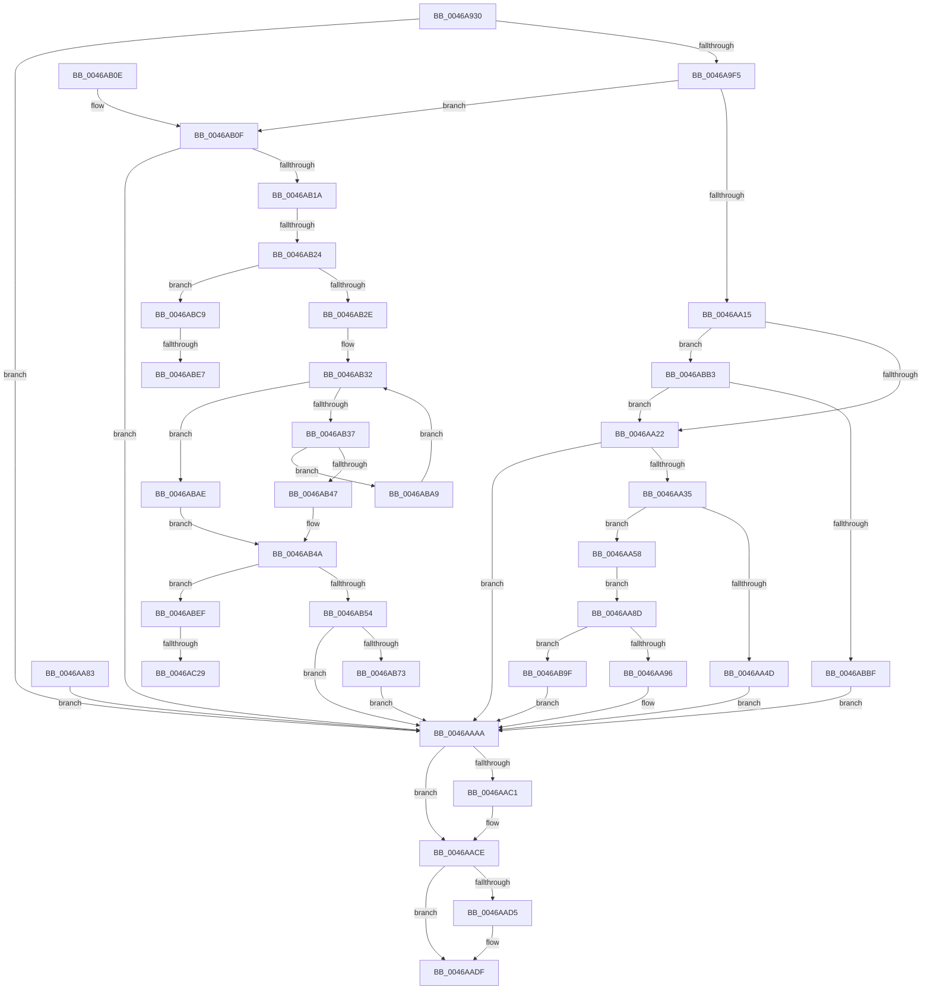

# CmQueryLayeredKey

- RVA: `0x0046A930`–`0x0046AC3A` (길이 `778` bytes)
- VA: `0x000000014046A930`
- 실행 섹션: `.text`
- PDB 이름 있음: `예`; PDB Function 태그: `예`
- unwind 정보 RVA: `0x000AB344`
- 디코드: `196`개 명령, `778/778` bytes 표시
- 미해석 바이트: `0` (있으면 어셈블리에 `.byte`로 보존)

> 이 문서는 커널 이미지의 기계어와 PDB 기호를 분석해 생성했습니다. 4번과 5번은 함수 원형과 자료형을 바이너리 사용 방식에서 추정한 C 해석이며 원본 소스 복구 결과는 아닙니다.

## 1. Dependencies

- 직접 호출 지점: **20**; 고유 호출 대상: **19**
- 직접 호출자로 확인된 함수: **1**
- RIP 상대 이미지 참조: **1**

### Outgoing calls
- `0x0046A99A` → [memset](../6C/memset_function_006C6C40.md) (function, `0x006C6C40`)
- `0x0046A9B1` → [CmpInitializeKcbStack](../../page/9A/CmpInitializeKcbStack_function_009A2CD0.md) (function, `0x009A2CD0`)
- `0x0046A9C5` → [CmpInitializeKeyNodeStack](../../page/94/CmpInitializeKeyNodeStack_function_00946804.md) (function, `0x00946804`)
- `0x0046A9E6` → [CmpStartKcbStackForTopLayerKcb](../../page/84/CmpStartKcbStackForTopLayerKcb_function_00848390.md) (function, `0x00848390`)
- `0x0046A9FA` → [CmpLockKcbStackShared](../../page/94/CmpLockKcbStackShared_function_00948000.md) (function, `0x00948000`)
- `0x0046AA15` → [CmpIsKeyDeletedForKeyBody](../../pagecmrc/BC/CmpIsKeyDeletedForKeyBody_function_00BC9480.md) (function, `0x00BC9480`)
- `0x0046AA2A` → [CmpConstructNameWithStatus](../../page/85/CmpConstructNameWithStatus_function_008562A0.md) (function, `0x008562A0`)
- `0x0046AA7C` → [memcpy](../6C/memcpy_function_006C6840.md) (function, `0x006C6840`)
- `0x0046AA9B` → [CmpIsKeyDeletedForKeyBody](../../pagecmrc/BC/CmpIsKeyDeletedForKeyBody_function_00BC9480.md) (function, `0x00BC9480`)
- `0x0046AAB2` → [CmpCleanupKeyNodeStack](../../page/94/CmpCleanupKeyNodeStack_function_00946A5C.md) (function, `0x00946A5C`)
- `0x0046AAC9` → [ExFreePoolWithTag](../../poolcode/B8/ExFreePoolWithTag_function_00B82870.md) (function, `0x00B82870`)
- `0x0046AADA` → [CmpUnlockKcbStack](../../page/84/CmpUnlockKcbStack_function_00848460.md) (function, `0x00848460`)
- `0x0046AAE4` → [CmpCleanupKcbStack](../../page/94/CmpCleanupKcbStack_function_009470A0.md) (function, `0x009470A0`)
- `0x0046AAF6` → [_security_check_cookie](../6A/_security_check_cookie_function_006AC640.md) (function, `0x006AC640`)
- `0x0046AB0F` → [CmpPerformKeyBodyDeletionCheck](../../pagecmrc/BC/CmpPerformKeyBodyDeletionCheck_function_00BC97D0.md) (function, `0x00BC97D0`)
- `0x0046AB3C` → [CmpGetKcbAtLayerHeight](../../page/94/CmpGetKcbAtLayerHeight_function_00949210.md) (function, `0x00949210`)
- `0x0046AB64` → [CmpStartKeyNodeStackFromKcbStack](../../page/94/CmpStartKeyNodeStackFromKcbStack_function_00945254.md) (function, `0x00945254`)
- `0x0046AB8E` → [CmpQueryKeyDataFromKeyNodeStack](CmpQueryKeyDataFromKeyNodeStack_function_0046AC40.md) (function, `0x0046AC40`)
- `0x0046ABF4` → [CmGetKeyFlags](../../page/AA/CmGetKeyFlags_function_00AA23A4.md) (function, `0x00AA23A4`)
- `0x0046AC1C` → [CmpIsKeyStackSymlink](../../page/9A/CmpIsKeyStackSymlink_function_009A8CE0.md) (function, `0x009A8CE0`)

### Direct callers
- [CmQueryKey](../../page/85/CmQueryKey_function_00858240.md) at `0x00858DBD`

### Static image references
- `0x0046A943` → RVA `0x00E0A740` (`.data`; read)

## 2. Other-region calls and transfers

- 다른 실행 섹션으로 향하는 call: **16**
  - `0x0046A9B1` → [CmpInitializeKcbStack](../../page/9A/CmpInitializeKcbStack_function_009A2CD0.md) (`.text` → `PAGE`)
  - `0x0046A9C5` → [CmpInitializeKeyNodeStack](../../page/94/CmpInitializeKeyNodeStack_function_00946804.md) (`.text` → `PAGE`)
  - `0x0046A9E6` → [CmpStartKcbStackForTopLayerKcb](../../page/84/CmpStartKcbStackForTopLayerKcb_function_00848390.md) (`.text` → `PAGE`)
  - `0x0046A9FA` → [CmpLockKcbStackShared](../../page/94/CmpLockKcbStackShared_function_00948000.md) (`.text` → `PAGE`)
  - `0x0046AA15` → [CmpIsKeyDeletedForKeyBody](../../pagecmrc/BC/CmpIsKeyDeletedForKeyBody_function_00BC9480.md) (`.text` → `PAGECMRC`)
  - `0x0046AA2A` → [CmpConstructNameWithStatus](../../page/85/CmpConstructNameWithStatus_function_008562A0.md) (`.text` → `PAGE`)
  - `0x0046AA9B` → [CmpIsKeyDeletedForKeyBody](../../pagecmrc/BC/CmpIsKeyDeletedForKeyBody_function_00BC9480.md) (`.text` → `PAGECMRC`)
  - `0x0046AAB2` → [CmpCleanupKeyNodeStack](../../page/94/CmpCleanupKeyNodeStack_function_00946A5C.md) (`.text` → `PAGE`)
  - `0x0046AAC9` → [ExFreePoolWithTag](../../poolcode/B8/ExFreePoolWithTag_function_00B82870.md) (`.text` → `POOLCODE`)
  - `0x0046AADA` → [CmpUnlockKcbStack](../../page/84/CmpUnlockKcbStack_function_00848460.md) (`.text` → `PAGE`)
  - `0x0046AAE4` → [CmpCleanupKcbStack](../../page/94/CmpCleanupKcbStack_function_009470A0.md) (`.text` → `PAGE`)
  - `0x0046AB0F` → [CmpPerformKeyBodyDeletionCheck](../../pagecmrc/BC/CmpPerformKeyBodyDeletionCheck_function_00BC97D0.md) (`.text` → `PAGECMRC`)
  - `0x0046AB3C` → [CmpGetKcbAtLayerHeight](../../page/94/CmpGetKcbAtLayerHeight_function_00949210.md) (`.text` → `PAGE`)
  - `0x0046AB64` → [CmpStartKeyNodeStackFromKcbStack](../../page/94/CmpStartKeyNodeStackFromKcbStack_function_00945254.md) (`.text` → `PAGE`)
  - `0x0046ABF4` → [CmGetKeyFlags](../../page/AA/CmGetKeyFlags_function_00AA23A4.md) (`.text` → `PAGE`)
  - `0x0046AC1C` → [CmpIsKeyStackSymlink](../../page/9A/CmpIsKeyStackSymlink_function_009A8CE0.md) (`.text` → `PAGE`)
- call이 아닌 외부 분기/꼬리 이동: **5**
  - `0x0046AB1E` → [sub_006F2FA4](../6F/Unknown_function_006F2FA4.md) (`tail-transfer`)
  - `0x0046ABE1` → [sub_006F2FA4 + 0xDB](../6F/Unknown_function_006F2FA4.md) (`tail-transfer`)
  - `0x0046ABEA` → [sub_006F2FA4 + 0xDD](../6F/Unknown_function_006F2FA4.md) (`tail-transfer`)
  - `0x0046AC23` → [sub_006F2FA4 + 0x10E](../6F/Unknown_function_006F2FA4.md) (`tail-transfer`)
  - `0x0046AC35` → [sub_006F2FA4 + 0x10E](../6F/Unknown_function_006F2FA4.md) (`tail-transfer`)

## 3. Assembly (complete function range)

```asm
0046A930  40 53                           push rbx
0046A932  56                              push rsi
0046A933  57                              push rdi
0046A934  41 54                           push r12
0046A936  41 55                           push r13
0046A938  41 56                           push r14
0046A93A  41 57                           push r15
0046A93C  48 81 EC 20 01 00 00            sub rsp, 0x120
0046A943  48 8B 05 F6 FD 99 00            mov rax, qword ptr [rip + 0x99fdf6]
0046A94A  48 33 C4                        xor rax, rsp
0046A94D  48 89 84 24 10 01 00 00         mov qword ptr [rsp + 0x110], rax
0046A955  45 8B F1                        mov r14d, r9d
0046A958  4D 8B F8                        mov r15, r8
0046A95B  44 8B E2                        mov r12d, edx
0046A95E  4C 8B E9                        mov r13, rcx
0046A961  48 8B 84 24 80 01 00 00         mov rax, qword ptr [rsp + 0x180]
0046A969  48 89 44 24 38                  mov qword ptr [rsp + 0x38], rax
0046A96E  0F 57 C0                        xorps xmm0, xmm0
0046A971  0F 11 44 24 48                  movups xmmword ptr [rsp + 0x48], xmm0
0046A976  0F 11 44 24 58                  movups xmmword ptr [rsp + 0x58], xmm0
0046A97B  33 C0                           xor eax, eax
0046A97D  89 84 24 C2 00 00 00            mov dword ptr [rsp + 0xc2], eax
0046A984  66 89 84 24 C6 00 00 00         mov word ptr [rsp + 0xc6], ax
0046A98C  33 D2                           xor edx, edx
0046A98E  44 8D 40 4A                     lea r8d, [rax + 0x4a]
0046A992  48 8D 8C 24 C0 00 00 00         lea rcx, [rsp + 0xc0]
0046A99A  E8 A1 C2 25 00                  call 0x1406c6c40
0046A99F  0F 57 C0                        xorps xmm0, xmm0
0046A9A2  0F 11 44 24 68                  movups xmmword ptr [rsp + 0x68], xmm0
0046A9A7  0F 11 44 24 78                  movups xmmword ptr [rsp + 0x78], xmm0
0046A9AC  48 8D 4C 24 48                  lea rcx, [rsp + 0x48]
0046A9B1  E8 1A 83 53 00                  call 0x1409a2cd0
0046A9B6  33 FF                           xor edi, edi
0046A9B8  40 88 7C 24 30                  mov byte ptr [rsp + 0x30], dil
0046A9BD  48 8D 8C 24 C0 00 00 00         lea rcx, [rsp + 0xc0]
0046A9C5  E8 3A BE 4D 00                  call 0x140946804
0046A9CA  48 89 7C 24 40                  mov qword ptr [rsp + 0x40], rdi
0046A9CF  0F 57 C0                        xorps xmm0, xmm0
0046A9D2  0F 11 84 24 88 00 00 00         movups xmmword ptr [rsp + 0x88], xmm0
0046A9DA  49 8B 75 08                     mov rsi, qword ptr [r13 + 8]
0046A9DE  48 8B D6                        mov rdx, rsi
0046A9E1  48 8D 4C 24 48                  lea rcx, [rsp + 0x48]
0046A9E6  E8 A5 D9 3D 00                  call 0x140848390
0046A9EB  8B D8                           mov ebx, eax
0046A9ED  85 C0                           test eax, eax
0046A9EF  0F 88 B5 00 00 00               js 0x14046aaaa
0046A9F5  48 8D 4C 24 48                  lea rcx, [rsp + 0x48]
0046A9FA  E8 01 D6 4D 00                  call 0x140948000
0046A9FF  8D 5F 01                        lea ebx, [rdi + 1]
0046AA02  88 5C 24 30                     mov byte ptr [rsp + 0x30], bl
0046AA06  33 D2                           xor edx, edx
0046AA08  49 8B CD                        mov rcx, r13
0046AA0B  41 83 FC 03                     cmp r12d, 3
0046AA0F  0F 85 FA 00 00 00               jne 0x14046ab0f
0046AA15  E8 66 EA 75 00                  call 0x140bc9480
0046AA1A  84 C0                           test al, al
0046AA1C  0F 85 91 01 00 00               jne 0x14046abb3
0046AA22  48 8D 54 24 40                  lea rdx, [rsp + 0x40]
0046AA27  48 8B CE                        mov rcx, rsi
0046AA2A  E8 71 B8 3E 00                  call 0x1408562a0
0046AA2F  8B D8                           mov ebx, eax
0046AA31  85 C0                           test eax, eax
0046AA33  78 75                           js 0x14046aaaa
0046AA35  48 8B 44 24 40                  mov rax, qword ptr [rsp + 0x40]
0046AA3A  0F B7 18                        movzx ebx, word ptr [rax]
0046AA3D  83 C3 04                        add ebx, 4
0046AA40  48 8B 4C 24 38                  mov rcx, qword ptr [rsp + 0x38]
0046AA45  89 19                           mov dword ptr [rcx], ebx
0046AA47  41 83 FE 04                     cmp r14d, 4
0046AA4B  73 0B                           jae 0x14046aa58
0046AA4D  BB 23 00 00 C0                  mov ebx, 0xc0000023
0046AA52  89 5C 24 34                     mov dword ptr [rsp + 0x34], ebx
0046AA56  EB 52                           jmp 0x14046aaaa
0046AA58  4C 8B 4C 24 40                  mov r9, qword ptr [rsp + 0x40]
0046AA5D  41 0F B7 01                     movzx eax, word ptr [r9]
0046AA61  41 89 07                        mov dword ptr [r15], eax
0046AA64  41 8D 4E FC                     lea ecx, [r14 - 4]
0046AA68  41 0F B7 01                     movzx eax, word ptr [r9]
0046AA6C  3B C8                           cmp ecx, eax
0046AA6E  0F 43 C8                        cmovae ecx, eax
0046AA71  44 8B C1                        mov r8d, ecx
0046AA74  49 8D 4F 04                     lea rcx, [r15 + 4]
0046AA78  49 8B 51 08                     mov rdx, qword ptr [r9 + 8]
0046AA7C  E8 BF BD 25 00                  call 0x1406c6840
0046AA81  EB 0A                           jmp 0x14046aa8d
0046AA83  8B D8                           mov ebx, eax
0046AA85  89 44 24 34                     mov dword ptr [rsp + 0x34], eax
0046AA89  33 FF                           xor edi, edi
0046AA8B  EB 1D                           jmp 0x14046aaaa
0046AA8D  41 3B DE                        cmp ebx, r14d
0046AA90  0F 87 09 01 00 00               ja 0x14046ab9f
0046AA96  33 D2                           xor edx, edx
0046AA98  49 8B CD                        mov rcx, r13
0046AA9B  E8 E0 E9 75 00                  call 0x140bc9480
0046AAA0  F6 D8                           neg al
0046AAA2  1B DB                           sbb ebx, ebx
0046AAA4  81 E3 7C 01 00 C0               and ebx, 0xc000017c
0046AAAA  48 8D 8C 24 C0 00 00 00         lea rcx, [rsp + 0xc0]
0046AAB2  E8 A5 BF 4D 00                  call 0x140946a5c
0046AAB7  4C 8B 4C 24 40                  mov r9, qword ptr [rsp + 0x40]
0046AABC  4D 85 C9                        test r9, r9
0046AABF  74 0D                           je 0x14046aace
0046AAC1  BA 43 4D 4E 62                  mov edx, 0x624e4d43
0046AAC6  49 8B C9                        mov rcx, r9
0046AAC9  E8 A2 7D 71 00                  call 0x140b82870
0046AACE  40 38 7C 24 30                  cmp byte ptr [rsp + 0x30], dil
0046AAD3  74 0A                           je 0x14046aadf
0046AAD5  48 8D 4C 24 48                  lea rcx, [rsp + 0x48]
0046AADA  E8 81 D9 3D 00                  call 0x140848460
0046AADF  48 8D 4C 24 48                  lea rcx, [rsp + 0x48]
0046AAE4  E8 B7 C5 4D 00                  call 0x1409470a0
0046AAE9  8B C3                           mov eax, ebx
0046AAEB  48 8B 8C 24 10 01 00 00         mov rcx, qword ptr [rsp + 0x110]
0046AAF3  48 33 CC                        xor rcx, rsp
0046AAF6  E8 45 1B 24 00                  call 0x1406ac640
0046AAFB  48 81 C4 20 01 00 00            add rsp, 0x120
0046AB02  41 5F                           pop r15
0046AB04  41 5E                           pop r14
0046AB06  41 5D                           pop r13
0046AB08  41 5C                           pop r12
0046AB0A  5F                              pop rdi
0046AB0B  5E                              pop rsi
0046AB0C  5B                              pop rbx
0046AB0D  C3                              ret
0046AB0E  CC                              int3
0046AB0F  E8 BC EC 75 00                  call 0x140bc97d0
0046AB14  8B D8                           mov ebx, eax
0046AB16  85 C0                           test eax, eax
0046AB18  78 90                           js 0x14046aaaa
0046AB1A  41 83 FC 06                     cmp r12d, 6
0046AB1E  0F 84 80 84 28 00               je 0x1406f2fa4
0046AB24  41 83 FC 08                     cmp r12d, 8
0046AB28  0F 84 9B 00 00 00               je 0x14046abc9
0046AB2E  0F B7 56 42                     movzx edx, word ptr [rsi + 0x42]
0046AB32  66 85 D2                        test dx, dx
0046AB35  78 77                           js 0x14046abae
0046AB37  48 8D 4C 24 48                  lea rcx, [rsp + 0x48]
0046AB3C  E8 CF E6 4D 00                  call 0x140949210
0046AB41  83 78 28 FF                     cmp dword ptr [rax + 0x28], -1
0046AB45  74 62                           je 0x14046aba9
0046AB47  48 8B D8                        mov rbx, rax
0046AB4A  41 83 FC 05                     cmp r12d, 5
0046AB4E  0F 84 9B 00 00 00               je 0x14046abef
0046AB54  4D 8B C5                        mov r8, r13
0046AB57  48 8D 54 24 48                  lea rdx, [rsp + 0x48]
0046AB5C  48 8D 8C 24 C0 00 00 00         lea rcx, [rsp + 0xc0]
0046AB64  E8 EB A6 4D 00                  call 0x140945254
0046AB69  8B D8                           mov ebx, eax
0046AB6B  85 C0                           test eax, eax
0046AB6D  0F 88 37 FF FF FF               js 0x14046aaaa
0046AB73  48 8B 4C 24 38                  mov rcx, qword ptr [rsp + 0x38]
0046AB78  48 89 4C 24 20                  mov qword ptr [rsp + 0x20], rcx
0046AB7D  45 8B CE                        mov r9d, r14d
0046AB80  4D 8B C7                        mov r8, r15
0046AB83  41 8B D4                        mov edx, r12d
0046AB86  48 8D 8C 24 C0 00 00 00         lea rcx, [rsp + 0xc0]
0046AB8E  E8 AD 00 00 00                  call 0x14046ac40
0046AB93  8B D8                           mov ebx, eax
0046AB95  85 C0                           test eax, eax
0046AB97  0F 49 DF                        cmovns ebx, edi
0046AB9A  E9 0B FF FF FF                  jmp 0x14046aaaa
0046AB9F  BB 05 00 00 80                  mov ebx, 0x80000005
0046ABA4  E9 01 FF FF FF                  jmp 0x14046aaaa
0046ABA9  66 FF CA                        dec dx
0046ABAC  EB 84                           jmp 0x14046ab32
0046ABAE  48 8B DF                        mov rbx, rdi
0046ABB1  EB 97                           jmp 0x14046ab4a
0046ABB3  41 8B 45 30                     mov eax, dword ptr [r13 + 0x30]
0046ABB7  84 C3                           test bl, al
0046ABB9  0F 84 63 FE FF FF               je 0x14046aa22
0046ABBF  BB 25 04 00 C0                  mov ebx, 0xc0000425
0046ABC4  E9 E1 FE FF FF                  jmp 0x14046aaaa
0046ABC9  48 8B 46 20                     mov rax, qword ptr [rsi + 0x20]
0046ABCD  8B 88 10 10 00 00               mov ecx, dword ptr [rax + 0x1010]
0046ABD3  BA 01 00 00 00                  mov edx, 1
0046ABD8  8B 84 24 88 00 00 00            mov eax, dword ptr [rsp + 0x88]
0046ABDF  84 CA                           test dl, cl
0046ABE1  0F 84 98 84 28 00               je 0x1406f307f
0046ABE7  83 E0 FE                        and eax, 0xfffffffe
0046ABEA  E9 92 84 28 00                  jmp 0x1406f3081
0046ABEF  33 D2                           xor edx, edx
0046ABF1  48 8B CB                        mov rcx, rbx
0046ABF4  E8 AB 77 63 00                  call 0x140aa23a4
0046ABF9  89 84 24 88 00 00 00            mov dword ptr [rsp + 0x88], eax
0046AC00  44 8B CF                        mov r9d, edi
0046AC03  39 7B 28                        cmp dword ptr [rbx + 0x28], edi
0046AC06  BA 01 00 00 00                  mov edx, 1
0046AC0B  44 0F 4C CA                     cmovl r9d, edx
0046AC0F  44 89 8C 24 8C 00 00 00         mov dword ptr [rsp + 0x8c], r9d
0046AC17  48 8D 4C 24 48                  lea rcx, [rsp + 0x48]
0046AC1C  E8 BF E0 53 00                  call 0x1409a8ce0
0046AC21  84 C0                           test al, al
0046AC23  0F 84 89 84 28 00               je 0x1406f30b2
0046AC29  41 83 C9 02                     or r9d, 2
0046AC2D  44 89 8C 24 8C 00 00 00         mov dword ptr [rsp + 0x8c], r9d
0046AC35  E9 78 84 28 00                  jmp 0x1406f30b2
```

## 4. C-style interpretation (structured pseudocode)

```c
__int64 __fastcall CmQueryLayeredKey(__int64 a1, int a2, __int64 a3, int a4, __int64 a5)
{
    __int64 result;
    __int64 v_rbx;
    __int64 v_rdi;
    __int64 v_rsp;
    unsigned __int64 v_stack_m100;
    unsigned __int64 v_stack_m110;
    unsigned __int64 v_stack_m118;
    unsigned __int64 v_stack_m120;
    unsigned int v_stack_m124;
    unsigned __int8 v_stack_m128;
    unsigned __int64 v_stack_m48;
    unsigned __int16 v_stack_m92;
    unsigned int v_stack_m96;
    unsigned __int64 v_stack_m98;
    unsigned __int64 v_stack_mD0;
    unsigned __int64 v_stack_mE0;
    unsigned __int64 v_stack_mF0;
    unsigned __int64 v_stack_p20;
    unsigned __int64 v_stack_p38;
    unsigned __int64 v_stack_p48;
    unsigned int v_stack_p88;
    unsigned int v_stack_p8C;
    unsigned __int64 v_stack_pC0;

    v_rsp = (v_rsp) - (288);
    result = (*(unsigned __int64 *)(v_rip + 10092022)) ^ (v_rsp);
    v_stack_m48 = result;
    v_stack_m120 = a5;
    v_stack_m110 = v_xmm0;
    v_stack_m100 = v_xmm0;
    result = 0;
    v_stack_m96 = 0;
    v_stack_m92 = 0;
    a2 = 0;
    result = memset(v_stack_m98, a2, result + 74, a4);
    v_stack_mF0 = v_xmm0;
    v_stack_mE0 = v_xmm0;
    result = CmpInitializeKcbStack(v_stack_m110, a2, result + 74, a4);
    v_rdi = 0;
    v_stack_m128 = 0;
    result = CmpInitializeKeyNodeStack(v_stack_m98, a2, result + 74, a4);
    v_stack_m118 = 0;
    v_stack_mD0 = v_xmm0;
    result = CmpStartKcbStackForTopLayerKcb(v_stack_m110, *(unsigned __int64 *)(a1 + 8), result + 74, a4);
    if (sign_flag) goto loc_0046AAAA;
    result = CmpLockKcbStackShared(v_stack_m110, *(unsigned __int64 *)(a1 + 8), result + 74, a4);
    v_stack_m128 = (unsigned __int8)(v_rdi + 1);
    a2 = 0;
    if (((unsigned int)((unsigned int)(a2))) != 3) goto loc_0046AB0F;
    result = CmpIsKeyDeletedForKeyBody(a1, a2, result + 74, a4);
    if ((unsigned __int8)(result) != 0) goto loc_0046ABB3;
loc_0046AA22:
    result = CmpConstructNameWithStatus(*(unsigned __int64 *)(a1 + 8), v_stack_m118, result + 74, a4);
    if (sign_flag) goto loc_0046AAAA;
    v_rbx = (unsigned int)((*(unsigned __int16 *)(v_stack_m118)) + (4));
    *(unsigned int *)(v_stack_m120) = (unsigned int)(v_rbx);
    if (((unsigned int)((unsigned int)(a4))) >= 4) goto loc_0046AA58;
    v_stack_m124 = (unsigned int)((unsigned int)(0xC0000023ULL));
    goto loc_0046AAAA;
loc_0046AA58:
    *(unsigned int *)(a3) = (unsigned int)(*(unsigned __int16 *)(v_stack_m118));
    a1 = (unsigned int)(a4) - 4;
    if (((unsigned int)((unsigned int)(a4) - 4)) >= ((unsigned int)(*(unsigned __int16 *)(v_stack_m118)))) { a1 = (unsigned int)(*(unsigned __int16 *)(v_stack_m118)); }
    result = memcpy(a3 + 4, *(unsigned __int64 *)(v_stack_m118 + 8), (unsigned int)((unsigned int)(a1)), v_stack_m118);
    goto loc_0046AA8D;
loc_0046AA8D:
    if (((unsigned int)((unsigned int)(0xC0000023ULL))) > ((unsigned int)((unsigned int)(a4)))) goto loc_0046AB9F;
    a2 = 0;
    result = CmpIsKeyDeletedForKeyBody(a1, a2, (unsigned int)((unsigned int)(a1)), v_stack_m118);
    result = (unsigned __int8)(-(result));
    v_rbx = (unsigned int)(((unsigned int)(0xC0000023ULL)) & (0xC000017CULL));
loc_0046AAAA:
    result = CmpCleanupKeyNodeStack(v_stack_m98, a2, (unsigned int)((unsigned int)(a1)), v_stack_m118);
    if (v_stack_m118 != 0) {
        a2 = 0x624E4D43ULL;
        a1 = v_stack_m118;
        result = ExFreePoolWithTag(a1, a2, (unsigned int)((unsigned int)(a1)), v_stack_m118);
    }
    if (v_stack_m128 != 0) {
        a1 = v_stack_m110;
        result = CmpUnlockKcbStack(a1, a2, (unsigned int)((unsigned int)(a1)), v_stack_m118);
    }
    result = CmpCleanupKcbStack(v_stack_m110, a2, (unsigned int)((unsigned int)(a1)), v_stack_m118);
    a1 = (v_stack_m48) ^ (v_rsp);
    result = _security_check_cookie(a1, a2, (unsigned int)((unsigned int)(a1)), v_stack_m118);
    v_rsp = (v_rsp) + (288);
    return result;
loc_0046AB0F:
    result = CmpPerformKeyBodyDeletionCheck(a1, a2, (unsigned int)((unsigned int)(a1)), v_stack_m118);
    if (sign_flag) goto loc_0046AAAA;
    if (((unsigned int)((unsigned int)(a2))) == 8) goto loc_0046ABC9;
loc_0046AB32:
    if (sign_flag) goto loc_0046ABAE;
    result = CmpGetKcbAtLayerHeight(v_stack_p48, *(unsigned __int16 *)(*(unsigned __int64 *)(a1 + 8) + 66), (unsigned int)((unsigned int)(a1)), v_stack_m118);
    if ((*(unsigned int *)(result + 40)) == -1) goto loc_0046ABA9;
loc_0046AB4A:
    if (((unsigned int)((unsigned int)(a2))) == 5) goto loc_0046ABEF;
    result = CmpStartKeyNodeStackFromKcbStack(v_stack_pC0, v_stack_p48, a1, v_stack_m118);
    if (sign_flag) goto loc_0046AAAA;
    v_stack_p20 = v_stack_p38;
    result = CmpQueryKeyDataFromKeyNodeStack(v_stack_pC0, (unsigned int)((unsigned int)((unsigned int)(a2))), a3, (unsigned int)((unsigned int)((unsigned int)(a4))));
    v_rbx = (unsigned int)((unsigned int)(result));
    if (!sign_flag) { v_rbx = 0; }
    goto loc_0046AAAA;
loc_0046AB9F:
    goto loc_0046AAAA;
loc_0046ABA9:
    a2 = (unsigned __int16)(((unsigned int)((unsigned int)((unsigned int)(a2)))) - 1);
    goto loc_0046AB32;
loc_0046ABAE:
    goto loc_0046AB4A;
loc_0046ABB3:
    if (((0) & ((unsigned __int8)((unsigned int)(*(unsigned int *)(a1 + 48))))) == 0) goto loc_0046AA22;
    goto loc_0046AAAA;
loc_0046ABC9:
    result = (unsigned int)(((unsigned int)(v_stack_p88)) & (0xFFFFFFFEULL));
loc_0046ABEF:
    a2 = 0;
    result = CmGetKeyFlags((unsigned int)(0xC0000425ULL), a2, a3, (unsigned int)((unsigned int)((unsigned int)(a4))));
    v_stack_p88 = (unsigned int)(result);
    a4 = 0;
    if ((*(unsigned int *)((unsigned int)(0xC0000425ULL) + 40)) < 0) { a4 = 1; }
    v_stack_p8C = a4;
    result = CmpIsKeyStackSymlink(v_stack_p48, 1, a3, a4);
    a4 = (unsigned int)((a4) | (2));
    v_stack_p8C = a4;
}
```

## 5. (Beta) C Style

```c
int64_t CmQueryLayeredKey(void *Arg1, int32_t Arg2, void *Arg3, int32_t Arg4, int64_t Arg5)
{
    uint8_t *arg1 = (uint8_t *)Arg1;
    uint8_t *arg3 = (uint8_t *)Arg3;

    int64_t result;
    int64_t local_rbx;
    int64_t local_rdi;
    int64_t local_rsp;
    uint64_t v_stack_m100;
    uint64_t v_stack_m110;
    uint64_t v_stack_m118;
    uint64_t v_stack_m120;
    uint32_t v_stack_m124;
    uint8_t v_stack_m128;
    uint64_t v_stack_m48;
    uint16_t v_stack_m92;
    uint32_t v_stack_m96;
    uint64_t v_stack_m98;
    uint64_t v_stack_mD0;
    uint64_t v_stack_mE0;
    uint64_t v_stack_mF0;
    uint64_t v_stack_p20;
    uint64_t v_stack_p38;
    uint64_t v_stack_p48;
    uint32_t v_stack_p88;
    uint32_t v_stack_p8C;
    uint64_t v_stack_pC0;

    local_rsp = (local_rsp) - (288);
    result = (*(uint64_t *)(v_rip + 0x99FDF6)) ^ (local_rsp);
    v_stack_m48 = result;
    v_stack_m120 = Arg5;
    v_stack_m110 = v_xmm0;
    v_stack_m100 = v_xmm0;
    result = 0;
    v_stack_m96 = 0;
    v_stack_m92 = 0;
    Arg2 = 0;
    result = memset(v_stack_m98, Arg2, result + 74, Arg4);
    v_stack_mF0 = v_xmm0;
    v_stack_mE0 = v_xmm0;
    result = CmpInitializeKcbStack(v_stack_m110, Arg2, result + 74, Arg4);
    local_rdi = 0;
    v_stack_m128 = 0;
    result = CmpInitializeKeyNodeStack(v_stack_m98, Arg2, result + 74, Arg4);
    v_stack_m118 = 0;
    v_stack_mD0 = v_xmm0;
    result = CmpStartKcbStackForTopLayerKcb(v_stack_m110, *(uint64_t *)(arg1 + 0x8), result + 74, Arg4);
    if (sign_flag) goto loc_0046AAAA;
    result = CmpLockKcbStackShared(v_stack_m110, *(uint64_t *)(arg1 + 0x8), result + 74, Arg4);
    v_stack_m128 = (uint8_t)(local_rdi + 1);
    Arg2 = 0;
    if (((uint32_t)((uint32_t)(Arg2))) != 3) goto loc_0046AB0F;
    result = CmpIsKeyDeletedForKeyBody(Arg1, Arg2, result + 74, Arg4);
    if ((uint8_t)(result) != 0) goto loc_0046ABB3;
loc_0046AA22:
    result = CmpConstructNameWithStatus(*(uint64_t *)(arg1 + 0x8), v_stack_m118, result + 74, Arg4);
    if (sign_flag) goto loc_0046AAAA;
    local_rbx = (uint32_t)((*(uint16_t *)(v_stack_m118)) + (4));
    *(uint32_t *)(v_stack_m120) = (uint32_t)(local_rbx);
    if (((uint32_t)((uint32_t)(Arg4))) >= 4) goto loc_0046AA58;
    v_stack_m124 = (uint32_t)((uint32_t)(0xC0000023ULL));
    goto loc_0046AAAA;
loc_0046AA58:
    *(uint32_t *)(arg3) = (uint32_t)(*(uint16_t *)(v_stack_m118));
    Arg1 = (uint32_t)(Arg4) - 4;
    if (((uint32_t)((uint32_t)(Arg4) - 4)) >= ((uint32_t)(*(uint16_t *)(v_stack_m118)))) { Arg1 = (uint32_t)(*(uint16_t *)(v_stack_m118)); }
    result = memcpy(Arg3 + 4, *(uint64_t *)(v_stack_m118 + 0x8), (uint32_t)((uint32_t)(Arg1)), v_stack_m118);
    goto loc_0046AA8D;
loc_0046AA8D:
    if (((uint32_t)((uint32_t)(0xC0000023ULL))) > ((uint32_t)((uint32_t)(Arg4)))) goto loc_0046AB9F;
    Arg2 = 0;
    result = CmpIsKeyDeletedForKeyBody(Arg1, Arg2, (uint32_t)((uint32_t)(Arg1)), v_stack_m118);
    result = (uint8_t)(-(result));
    local_rbx = (uint32_t)(((uint32_t)(0xC0000023ULL)) & (0xC000017CULL));
loc_0046AAAA:
    result = CmpCleanupKeyNodeStack(v_stack_m98, Arg2, (uint32_t)((uint32_t)(Arg1)), v_stack_m118);
    if (v_stack_m118 != 0) {
        Arg2 = 0x624E4D43ULL;
        Arg1 = v_stack_m118;
        result = ExFreePoolWithTag(Arg1, Arg2, (uint32_t)((uint32_t)(Arg1)), v_stack_m118);
    }
    if (v_stack_m128 != 0) {
        Arg1 = v_stack_m110;
        result = CmpUnlockKcbStack(Arg1, Arg2, (uint32_t)((uint32_t)(Arg1)), v_stack_m118);
    }
    result = CmpCleanupKcbStack(v_stack_m110, Arg2, (uint32_t)((uint32_t)(Arg1)), v_stack_m118);
    Arg1 = (v_stack_m48) ^ (local_rsp);
    result = _security_check_cookie(Arg1, Arg2, (uint32_t)((uint32_t)(Arg1)), v_stack_m118);
    local_rsp = (local_rsp) + (288);
    return result;
loc_0046AB0F:
    result = CmpPerformKeyBodyDeletionCheck(Arg1, Arg2, (uint32_t)((uint32_t)(Arg1)), v_stack_m118);
    if (sign_flag) goto loc_0046AAAA;
    if (((uint32_t)((uint32_t)(Arg2))) == 8) goto loc_0046ABC9;
loc_0046AB32:
    if (sign_flag) goto loc_0046ABAE;
    result = CmpGetKcbAtLayerHeight(v_stack_p48, *(uint16_t *)(*(uint64_t *)(arg1 + 0x8) + 0x42), (uint32_t)((uint32_t)(Arg1)), v_stack_m118);
    if ((*(uint32_t *)(result + 0x28)) == -1) goto loc_0046ABA9;
loc_0046AB4A:
    if (((uint32_t)((uint32_t)(Arg2))) == 5) goto loc_0046ABEF;
    result = CmpStartKeyNodeStackFromKcbStack(v_stack_pC0, v_stack_p48, Arg1, v_stack_m118);
    if (sign_flag) goto loc_0046AAAA;
    v_stack_p20 = v_stack_p38;
    result = CmpQueryKeyDataFromKeyNodeStack(v_stack_pC0, (uint32_t)((uint32_t)((uint32_t)(Arg2))), Arg3, (uint32_t)((uint32_t)((uint32_t)(Arg4))));
    local_rbx = (uint32_t)((uint32_t)(result));
    if (!sign_flag) { local_rbx = 0; }
    goto loc_0046AAAA;
loc_0046AB9F:
    goto loc_0046AAAA;
loc_0046ABA9:
    Arg2 = (uint16_t)(((uint32_t)((uint32_t)((uint32_t)(Arg2)))) - 1);
    goto loc_0046AB32;
loc_0046ABAE:
    goto loc_0046AB4A;
loc_0046ABB3:
    if (((0) & ((uint8_t)((uint32_t)(*(uint32_t *)(arg1 + 0x30))))) == 0) goto loc_0046AA22;
    goto loc_0046AAAA;
loc_0046ABC9:
    result = (uint32_t)(((uint32_t)(v_stack_p88)) & (0xFFFFFFFEULL));
loc_0046ABEF:
    Arg2 = 0;
    result = CmGetKeyFlags((uint32_t)(0xC0000425ULL), Arg2, Arg3, (uint32_t)((uint32_t)((uint32_t)(Arg4))));
    v_stack_p88 = (uint32_t)(result);
    Arg4 = 0;
    if ((*(uint32_t *)((uint32_t)(0xC0000425ULL) + 0x28)) < 0) { Arg4 = 1; }
    v_stack_p8C = Arg4;
    result = CmpIsKeyStackSymlink(v_stack_p48, 1, Arg3, Arg4);
    Arg4 = (uint32_t)((Arg4) | (2));
    v_stack_p8C = Arg4;
}
```

### 관측된 메모리 오프셋

구조체 형식이 확인되지 않은 접근은 인자 기준의 오프셋으로만 기록했습니다.

| 기준 인자 | 오프셋 표현 | 폭 (bit) | 접근 |
|---|---:|---:|---|
| `Arg1` | `+ 0x8` | `64` | `R` |
| `Arg1` | `+ 0x30` | `32` | `R` |
| `Arg3` | `+ 0x0` | `32` | `W` |
| `Arg3` | `+ 0x4` | `64` | `R` |

## 6. Execution-region graph

[열기: 2D/3D 그래프와 함수 탐색 컨트롤 패널](../../../control-panel.html?section=text&rva=0x0046A930&view=graph)

- 2D 그래프는 위에서 아래로 흐르고, 3D 그래프는 빈 공간을 드래그해 회전합니다. Shift+드래그는 이동, 휠은 확대·축소, 함수 노드 선택은 대상 보고서 이동입니다.

### Static fallback


