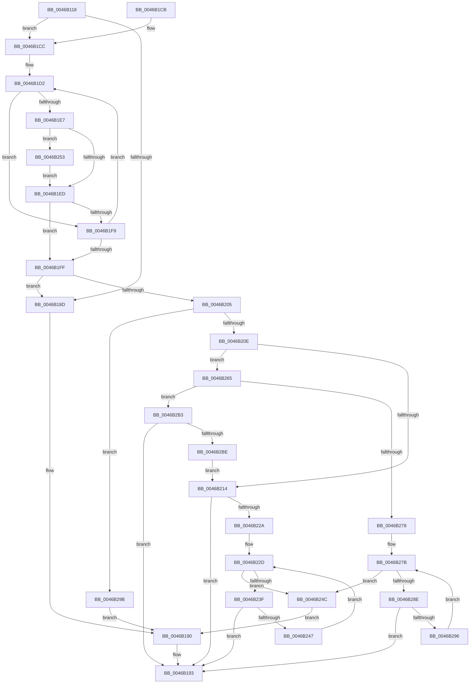

# CmpGetValueCountForKeyNodeStack

- RVA: `0x0046B118`–`0x0046B2D7` (길이 `447` bytes)
- VA: `0x000000014046B118`
- 실행 섹션: `.text`
- PDB 이름 있음: `예`; PDB Function 태그: `아니요`
- unwind 정보 RVA: `0x000AB430`
- 디코드: `125`개 명령, `447/447` bytes 표시
- 미해석 바이트: `0` (있으면 어셈블리에 `.byte`로 보존)

> 이 문서는 커널 이미지의 기계어와 PDB 기호를 분석해 생성했습니다. 4번과 5번은 함수 원형과 자료형을 바이너리 사용 방식에서 추정한 C 해석이며 원본 소스 복구 결과는 아닙니다.

## 1. Dependencies

- 직접 호출 지점: **16**; 고유 호출 대상: **12**
- 직접 호출자로 확인된 함수: **1**
- RIP 상대 이미지 참조: **1**

### Outgoing calls
- `0x0046B153` → [memset](../6C/memset_function_006C6C40.md) (function, `0x006C6C40`)
- `0x0046B161` → [memset](../6C/memset_function_006C6C40.md) (function, `0x006C6C40`)
- `0x0046B16B` → [CmpSortedValueEnumStackInitialize](../../page/A8/CmpSortedValueEnumStackInitialize_function_00A833B0.md) (function, `0x00A833B0`)
- `0x0046B174` → [CmpValueEnumStackInitialize](../../page/A6/CmpValueEnumStackInitialize_function_00A6B288.md) (function, `0x00A6B288`)
- `0x0046B197` → [CmpValueEnumStackCleanup](../../page/8B/CmpValueEnumStackCleanup_function_008B1F04.md) (function, `0x008B1F04`)
- `0x0046B1A1` → [CmpSortedValueEnumStackCleanup](../../page/A3/CmpSortedValueEnumStackCleanup_function_00A30C8C.md) (function, `0x00A30C8C`)
- `0x0046B1AF` → [_security_check_cookie](../6A/_security_check_cookie_function_006AC640.md) (function, `0x006AC640`)
- `0x0046B1D9` → [CmpKeyNodeStackGetEntryAtLayerHeight](../../page/94/CmpKeyNodeStackGetEntryAtLayerHeight_function_00946ABC.md) (function, `0x00946ABC`)
- `0x0046B1F0` → [CmpGetEffectiveKeyNodeSemantics](../../page/94/CmpGetEffectiveKeyNodeSemantics_function_00946D18.md) (function, `0x00946D18`)
- `0x0046B21B` → [CmpValueEnumStackStartFromKeyNodeStack](CmpValueEnumStackStartFromKeyNodeStack_function_0046B2E0.md) (function, `0x0046B2E0`)
- `0x0046B231` → [CmpValueEnumStackAdvance](../../page/8B/CmpValueEnumStackAdvance_function_008B256C.md) (function, `0x008B256C`)
- `0x0046B26D` → [CmpSortedValueEnumStackStartFromKeyNodeStack](../../page/A3/CmpSortedValueEnumStackStartFromKeyNodeStack_function_00A30CF0.md) (function, `0x00A30CF0`)
- `0x0046B280` → [CmpSortedValueEnumStackAdvance](../../page/A3/CmpSortedValueEnumStackAdvance_function_00A30DE4.md) (function, `0x00A30DE4`)
- `0x0046B2A0` → [CmpKeyNodeStackGetEntryAtLayerHeight](../../page/94/CmpKeyNodeStackGetEntryAtLayerHeight_function_00946ABC.md) (function, `0x00946ABC`)
- `0x0046B2C3` → [CmpSortedValueEnumStackCleanup](../../page/A3/CmpSortedValueEnumStackCleanup_function_00A30C8C.md) (function, `0x00A30C8C`)
- `0x0046B2CD` → [CmpSortedValueEnumStackInitialize](../../page/A8/CmpSortedValueEnumStackInitialize_function_00A833B0.md) (function, `0x00A833B0`)

### Direct callers
- [CmpQueryKeyDataFromKeyNodeStack](CmpQueryKeyDataFromKeyNodeStack_function_0046AC40.md) at `0x0046AD91`

### Static image references
- `0x0046B130` → RVA `0x00E0A740` (`.data`; read)

## 2. Other-region calls and transfers

- 다른 실행 섹션으로 향하는 call: **12**
  - `0x0046B16B` → [CmpSortedValueEnumStackInitialize](../../page/A8/CmpSortedValueEnumStackInitialize_function_00A833B0.md) (`.text` → `PAGE`)
  - `0x0046B174` → [CmpValueEnumStackInitialize](../../page/A6/CmpValueEnumStackInitialize_function_00A6B288.md) (`.text` → `PAGE`)
  - `0x0046B197` → [CmpValueEnumStackCleanup](../../page/8B/CmpValueEnumStackCleanup_function_008B1F04.md) (`.text` → `PAGE`)
  - `0x0046B1A1` → [CmpSortedValueEnumStackCleanup](../../page/A3/CmpSortedValueEnumStackCleanup_function_00A30C8C.md) (`.text` → `PAGE`)
  - `0x0046B1D9` → [CmpKeyNodeStackGetEntryAtLayerHeight](../../page/94/CmpKeyNodeStackGetEntryAtLayerHeight_function_00946ABC.md) (`.text` → `PAGE`)
  - `0x0046B1F0` → [CmpGetEffectiveKeyNodeSemantics](../../page/94/CmpGetEffectiveKeyNodeSemantics_function_00946D18.md) (`.text` → `PAGE`)
  - `0x0046B231` → [CmpValueEnumStackAdvance](../../page/8B/CmpValueEnumStackAdvance_function_008B256C.md) (`.text` → `PAGE`)
  - `0x0046B26D` → [CmpSortedValueEnumStackStartFromKeyNodeStack](../../page/A3/CmpSortedValueEnumStackStartFromKeyNodeStack_function_00A30CF0.md) (`.text` → `PAGE`)
  - `0x0046B280` → [CmpSortedValueEnumStackAdvance](../../page/A3/CmpSortedValueEnumStackAdvance_function_00A30DE4.md) (`.text` → `PAGE`)
  - `0x0046B2A0` → [CmpKeyNodeStackGetEntryAtLayerHeight](../../page/94/CmpKeyNodeStackGetEntryAtLayerHeight_function_00946ABC.md) (`.text` → `PAGE`)
  - `0x0046B2C3` → [CmpSortedValueEnumStackCleanup](../../page/A3/CmpSortedValueEnumStackCleanup_function_00A30C8C.md) (`.text` → `PAGE`)
  - `0x0046B2CD` → [CmpSortedValueEnumStackInitialize](../../page/A8/CmpSortedValueEnumStackInitialize_function_00A833B0.md) (`.text` → `PAGE`)
- 별도 외부 분기/꼬리 이동을 확인하지 못했습니다.

## 3. Assembly (complete function range)

```asm
0046B118  48 89 5C 24 18                  mov qword ptr [rsp + 0x18], rbx
0046B11D  55                              push rbp
0046B11E  56                              push rsi
0046B11F  57                              push rdi
0046B120  41 56                           push r14
0046B122  41 57                           push r15
0046B124  48 8D 6C 24 C9                  lea rbp, [rsp - 0x37]
0046B129  48 81 EC F0 00 00 00            sub rsp, 0xf0
0046B130  48 8B 05 09 F6 99 00            mov rax, qword ptr [rip + 0x99f609]
0046B137  48 33 C4                        xor rax, rsp
0046B13A  48 89 45 27                     mov qword ptr [rbp + 0x27], rax
0046B13E  48 8B F2                        mov rsi, rdx
0046B141  48 8B F9                        mov rdi, rcx
0046B144  BB 58 00 00 00                  mov ebx, 0x58
0046B149  48 8D 4C 24 20                  lea rcx, [rsp + 0x20]
0046B14E  44 8B C3                        mov r8d, ebx
0046B151  33 D2                           xor edx, edx
0046B153  E8 E8 BA 25 00                  call 0x1406c6c40
0046B158  44 8B C3                        mov r8d, ebx
0046B15B  48 8D 4D C7                     lea rcx, [rbp - 0x39]
0046B15F  33 D2                           xor edx, edx
0046B161  E8 DA BA 25 00                  call 0x1406c6c40
0046B166  48 8D 4C 24 20                  lea rcx, [rsp + 0x20]
0046B16B  E8 40 82 61 00                  call 0x140a833b0
0046B170  48 8D 4D C7                     lea rcx, [rbp - 0x39]
0046B174  E8 0F 01 60 00                  call 0x140a6b288
0046B179  44 0F B7 0F                     movzx r9d, word ptr [rdi]
0046B17D  45 33 F6                        xor r14d, r14d
0046B180  45 8A D6                        mov r10b, r14b
0046B183  45 0F B7 DE                     movzx r11d, r14w
0046B187  66 45 85 C9                     test r9w, r9w
0046B18B  79 3F                           jns 0x14046b1cc
0046B18D  44 89 36                        mov dword ptr [rsi], r14d
0046B190  41 8B DE                        mov ebx, r14d
0046B193  48 8D 4D C7                     lea rcx, [rbp - 0x39]
0046B197  E8 68 6D 44 00                  call 0x1408b1f04
0046B19C  48 8D 4C 24 20                  lea rcx, [rsp + 0x20]
0046B1A1  E8 E6 5A 5C 00                  call 0x140a30c8c
0046B1A6  8B C3                           mov eax, ebx
0046B1A8  48 8B 4D 27                     mov rcx, qword ptr [rbp + 0x27]
0046B1AC  48 33 CC                        xor rcx, rsp
0046B1AF  E8 8C 14 24 00                  call 0x1406ac640
0046B1B4  48 8B 9C 24 30 01 00 00         mov rbx, qword ptr [rsp + 0x130]
0046B1BC  48 81 C4 F0 00 00 00            add rsp, 0xf0
0046B1C3  41 5F                           pop r15
0046B1C5  41 5E                           pop r14
0046B1C7  5F                              pop rdi
0046B1C8  5E                              pop rsi
0046B1C9  5D                              pop rbp
0046B1CA  C3                              ret
0046B1CB  CC                              int3
0046B1CC  41 BF 01 00 00 00               mov r15d, 1
0046B1D2  41 0F B7 D1                     movzx edx, r9w
0046B1D6  48 8B CF                        mov rcx, rdi
0046B1D9  E8 DE B8 4D 00                  call 0x140946abc
0046B1DE  48 8B 50 10                     mov rdx, qword ptr [rax + 0x10]
0046B1E2  48 85 D2                        test rdx, rdx
0046B1E5  74 12                           je 0x14046b1f9
0046B1E7  44 39 72 24                     cmp dword ptr [rdx + 0x24], r14d
0046B1EB  75 66                           jne 0x14046b253
0046B1ED  48 8B 08                        mov rcx, qword ptr [rax]
0046B1F0  E8 23 BB 4D 00                  call 0x140946d18
0046B1F5  85 C0                           test eax, eax
0046B1F7  75 06                           jne 0x14046b1ff
0046B1F9  66 45 2B CF                     sub r9w, r15w
0046B1FD  79 D3                           jns 0x14046b1d2
0046B1FF  66 45 85 DB                     test r11w, r11w
0046B203  74 88                           je 0x14046b18d
0046B205  45 84 D2                        test r10b, r10b
0046B208  0F 84 8D 00 00 00               je 0x14046b29b
0046B20E  66 45 3B DF                     cmp r11w, r15w
0046B212  7F 51                           jg 0x14046b265
0046B214  48 8B D7                        mov rdx, rdi
0046B217  48 8D 4D C7                     lea rcx, [rbp - 0x39]
0046B21B  E8 C0 00 00 00                  call 0x14046b2e0
0046B220  8B D8                           mov ebx, eax
0046B222  85 C0                           test eax, eax
0046B224  0F 88 69 FF FF FF               js 0x14046b193
0046B22A  41 8B FE                        mov edi, r14d
0046B22D  48 8D 4D C7                     lea rcx, [rbp - 0x39]
0046B231  E8 36 73 44 00                  call 0x1408b256c
0046B236  8B D8                           mov ebx, eax
0046B238  3D 1A 00 00 80                  cmp eax, 0x8000001a
0046B23D  74 0D                           je 0x14046b24c
0046B23F  85 C0                           test eax, eax
0046B241  0F 88 4C FF FF FF               js 0x14046b193
0046B247  41 03 FF                        add edi, r15d
0046B24A  EB E1                           jmp 0x14046b22d
0046B24C  89 3E                           mov dword ptr [rsi], edi
0046B24E  E9 3D FF FF FF                  jmp 0x14046b190
0046B253  66 45 85 C9                     test r9w, r9w
0046B257  45 0F B6 D2                     movzx r10d, r10b
0046B25B  45 0F 45 D7                     cmovne r10d, r15d
0046B25F  66 45 03 DF                     add r11w, r15w
0046B263  EB 88                           jmp 0x14046b1ed
0046B265  48 8B D7                        mov rdx, rdi
0046B268  48 8D 4C 24 20                  lea rcx, [rsp + 0x20]
0046B26D  E8 7E 5A 5C 00                  call 0x140a30cf0
0046B272  8B D8                           mov ebx, eax
0046B274  85 C0                           test eax, eax
0046B276  78 3B                           js 0x14046b2b3
0046B278  41 8B FE                        mov edi, r14d
0046B27B  48 8D 4C 24 20                  lea rcx, [rsp + 0x20]
0046B280  E8 5F 5B 5C 00                  call 0x140a30de4
0046B285  8B D8                           mov ebx, eax
0046B287  3D 1A 00 00 80                  cmp eax, 0x8000001a
0046B28C  74 BE                           je 0x14046b24c
0046B28E  85 C0                           test eax, eax
0046B290  0F 88 FD FE FF FF               js 0x14046b193
0046B296  41 03 FF                        add edi, r15d
0046B299  EB E0                           jmp 0x14046b27b
0046B29B  33 D2                           xor edx, edx
0046B29D  48 8B CF                        mov rcx, rdi
0046B2A0  E8 17 B8 4D 00                  call 0x140946abc
0046B2A5  48 8B 48 10                     mov rcx, qword ptr [rax + 0x10]
0046B2A9  8B 41 24                        mov eax, dword ptr [rcx + 0x24]
0046B2AC  89 06                           mov dword ptr [rsi], eax
0046B2AE  E9 DD FE FF FF                  jmp 0x14046b190
0046B2B3  3D 9A 00 00 C0                  cmp eax, 0xc000009a
0046B2B8  0F 85 D5 FE FF FF               jne 0x14046b193
0046B2BE  48 8D 4C 24 20                  lea rcx, [rsp + 0x20]
0046B2C3  E8 C4 59 5C 00                  call 0x140a30c8c
0046B2C8  48 8D 4C 24 20                  lea rcx, [rsp + 0x20]
0046B2CD  E8 DE 80 61 00                  call 0x140a833b0
0046B2D2  E9 3D FF FF FF                  jmp 0x14046b214
```

## 4. C-style interpretation (structured pseudocode)

```c
__int64 __fastcall CmpGetValueCountForKeyNodeStack(__int64 a1, __int64 a2)
{
    __int64 result;
    __int64 v_r10;
    __int64 v_r11;
    __int64 v_r14;
    __int64 v_rdi;
    __int64 v_rsp;
    unsigned __int64 v_stack_m38;
    unsigned __int64 v_stack_m5F;
    unsigned __int64 v_stack_m98;
    unsigned __int64 v_stack_mF8;
    unsigned __int64 v_stack_p18;
    unsigned __int64 v_stack_p20;

    v_stack_p18 = v_rbx;
    v_rsp = (v_rsp) - (240);
    result = (*(unsigned __int64 *)(v_rip + 10089993)) ^ (v_rsp);
    v_stack_m38 = result;
    a2 = 0;
    result = memset(v_stack_mF8, a2, 88, a4);
    a2 = 0;
    result = memset(v_stack_m98, a2, 88, a4);
    result = CmpSortedValueEnumStackInitialize(v_stack_mF8, a2, 88, a4);
    result = CmpValueEnumStackInitialize(v_stack_m98, a2, 88, a4);
    v_r14 = 0;
    if (!sign_flag) goto loc_0046B1CC;
loc_0046B18D:
    *(unsigned int *)(a2) = 0;
loc_0046B190:
loc_0046B193:
    result = CmpValueEnumStackCleanup(v_stack_m98, a2, 88, *(unsigned __int16 *)(a1));
    result = CmpSortedValueEnumStackCleanup(v_stack_mF8, a2, 88, *(unsigned __int16 *)(a1));
    a1 = (v_stack_m38) ^ (v_rsp);
    result = _security_check_cookie(a1, a2, 88, *(unsigned __int16 *)(a1));
    v_rsp = (v_rsp) + (240);
    return result;
loc_0046B1CC:
loc_0046B1D2:
    result = CmpKeyNodeStackGetEntryAtLayerHeight(a1, (unsigned __int16)(*(unsigned __int16 *)(a1)), 88, *(unsigned __int16 *)(a1));
    if (*(unsigned __int64 *)(result + 16) == 0) goto loc_0046B1F9;
    if ((*(unsigned int *)(*(unsigned __int64 *)(result + 16) + 36)) != 0) goto loc_0046B253;
loc_0046B1ED:
    result = CmpGetEffectiveKeyNodeSemantics(*(unsigned __int64 *)(result), *(unsigned __int64 *)(result + 16), 88, *(unsigned __int16 *)(a1));
    if ((unsigned int)(result) != 0) goto loc_0046B1FF;
loc_0046B1F9:
    a4 = (unsigned __int16)((*(unsigned __int16 *)(a1)) - (1));
    if (!sign_flag) goto loc_0046B1D2;
loc_0046B1FF:
    if (0 == 0) goto loc_0046B18D;
    if (0 == 0) goto loc_0046B29B;
    if (0 > 1) goto loc_0046B265;
loc_0046B214:
    result = CmpValueEnumStackStartFromKeyNodeStack(v_stack_m98, a1, 88, a4);
    if (sign_flag) goto loc_0046B193;
loc_0046B22D:
    result = CmpValueEnumStackAdvance(v_stack_m98, a1, 88, a4);
    if (((unsigned int)(result)) == 0x8000001AULL) goto loc_0046B24C;
    if (sign_flag) goto loc_0046B193;
    v_rdi = (unsigned int)((0) + (1));
    goto loc_0046B22D;
loc_0046B24C:
    *(unsigned int *)(a2) = (unsigned int)(v_rdi);
    goto loc_0046B190;
loc_0046B253:
    v_r10 = 0;
    if ((unsigned __int16)(a4) != 0) { v_r10 = 1; }
    v_r11 = (unsigned __int16)((0) + (1));
    goto loc_0046B1ED;
loc_0046B265:
    result = CmpSortedValueEnumStackStartFromKeyNodeStack(v_stack_p20, v_rdi, 88, a4);
    if (sign_flag) goto loc_0046B2B3;
loc_0046B27B:
    result = CmpSortedValueEnumStackAdvance(v_stack_p20, v_rdi, 88, a4);
    if (((unsigned int)(result)) == 0x8000001AULL) goto loc_0046B24C;
    if (sign_flag) goto loc_0046B193;
    v_rdi = (unsigned int)((0) + (1));
    goto loc_0046B27B;
loc_0046B29B:
    a2 = 0;
    result = CmpKeyNodeStackGetEntryAtLayerHeight(v_rdi, a2, 88, a4);
    *(unsigned int *)(a2) = (unsigned int)((unsigned int)(*(unsigned int *)(*(unsigned __int64 *)(result + 16) + 36)));
    goto loc_0046B190;
loc_0046B2B3:
    if (((unsigned int)((unsigned int)(*(unsigned int *)(*(unsigned __int64 *)(result + 16) + 36)))) != 0xC000009AULL) goto loc_0046B193;
    result = CmpSortedValueEnumStackCleanup(v_stack_p20, a2, 88, a4);
    result = CmpSortedValueEnumStackInitialize(v_stack_p20, a2, 88, a4);
    goto loc_0046B214;
}
```

## 5. (Beta) C Style

```c
int64_t CmpGetValueCountForKeyNodeStack(void *Arg1, void *Arg2)
{
    uint8_t *arg1 = (uint8_t *)Arg1;
    uint8_t *arg2 = (uint8_t *)Arg2;

    int64_t result;
    int64_t local_r10;
    int64_t local_r11;
    int64_t local_r14;
    int64_t local_rdi;
    int64_t local_rsp;
    uint64_t v_stack_m38;
    uint64_t v_stack_m5F;
    uint64_t v_stack_m98;
    uint64_t v_stack_mF8;
    uint64_t v_stack_p18;
    uint64_t v_stack_p20;

    v_stack_p18 = local_rbx;
    local_rsp = (local_rsp) - (240);
    result = (*(uint64_t *)(v_rip + 0x99F609)) ^ (local_rsp);
    v_stack_m38 = result;
    Arg2 = 0;
    result = memset(v_stack_mF8, Arg2, 88, a4);
    Arg2 = 0;
    result = memset(v_stack_m98, Arg2, 88, a4);
    result = CmpSortedValueEnumStackInitialize(v_stack_mF8, Arg2, 88, a4);
    result = CmpValueEnumStackInitialize(v_stack_m98, Arg2, 88, a4);
    local_r14 = 0;
    if (!sign_flag) goto loc_0046B1CC;
loc_0046B18D:
    *(uint32_t *)(arg2) = 0;
loc_0046B190:
loc_0046B193:
    result = CmpValueEnumStackCleanup(v_stack_m98, Arg2, 88, *(uint16_t *)(arg1));
    result = CmpSortedValueEnumStackCleanup(v_stack_mF8, Arg2, 88, *(uint16_t *)(arg1));
    Arg1 = (v_stack_m38) ^ (local_rsp);
    result = _security_check_cookie(Arg1, Arg2, 88, *(uint16_t *)(arg1));
    local_rsp = (local_rsp) + (240);
    return result;
loc_0046B1CC:
loc_0046B1D2:
    result = CmpKeyNodeStackGetEntryAtLayerHeight(Arg1, (uint16_t)(*(uint16_t *)(arg1)), 88, *(uint16_t *)(arg1));
    if (*(uint64_t *)(result + 0x10) == 0) goto loc_0046B1F9;
    if ((*(uint32_t *)(*(uint64_t *)(result + 0x10) + 0x24)) != 0) goto loc_0046B253;
loc_0046B1ED:
    result = CmpGetEffectiveKeyNodeSemantics(*(uint64_t *)(result), *(uint64_t *)(result + 0x10), 88, *(uint16_t *)(arg1));
    if ((uint32_t)(result) != 0) goto loc_0046B1FF;
loc_0046B1F9:
    a4 = (uint16_t)((*(uint16_t *)(arg1)) - (1));
    if (!sign_flag) goto loc_0046B1D2;
loc_0046B1FF:
    if (0 == 0) goto loc_0046B18D;
    if (0 == 0) goto loc_0046B29B;
    if (0 > 1) goto loc_0046B265;
loc_0046B214:
    result = CmpValueEnumStackStartFromKeyNodeStack(v_stack_m98, Arg1, 88, a4);
    if (sign_flag) goto loc_0046B193;
loc_0046B22D:
    result = CmpValueEnumStackAdvance(v_stack_m98, Arg1, 88, a4);
    if (((uint32_t)(result)) == 0x8000001AULL) goto loc_0046B24C;
    if (sign_flag) goto loc_0046B193;
    local_rdi = (uint32_t)((0) + (1));
    goto loc_0046B22D;
loc_0046B24C:
    *(uint32_t *)(arg2) = (uint32_t)(local_rdi);
    goto loc_0046B190;
loc_0046B253:
    local_r10 = 0;
    if ((uint16_t)(a4) != 0) { local_r10 = 1; }
    local_r11 = (uint16_t)((0) + (1));
    goto loc_0046B1ED;
loc_0046B265:
    result = CmpSortedValueEnumStackStartFromKeyNodeStack(v_stack_p20, local_rdi, 88, a4);
    if (sign_flag) goto loc_0046B2B3;
loc_0046B27B:
    result = CmpSortedValueEnumStackAdvance(v_stack_p20, local_rdi, 88, a4);
    if (((uint32_t)(result)) == 0x8000001AULL) goto loc_0046B24C;
    if (sign_flag) goto loc_0046B193;
    local_rdi = (uint32_t)((0) + (1));
    goto loc_0046B27B;
loc_0046B29B:
    Arg2 = 0;
    result = CmpKeyNodeStackGetEntryAtLayerHeight(local_rdi, Arg2, 88, a4);
    *(uint32_t *)(arg2) = (uint32_t)((uint32_t)(*(uint32_t *)(*(uint64_t *)(result + 0x10) + 0x24)));
    goto loc_0046B190;
loc_0046B2B3:
    if (((uint32_t)((uint32_t)(*(uint32_t *)(*(uint64_t *)(result + 0x10) + 0x24)))) != 0xC000009AULL) goto loc_0046B193;
    result = CmpSortedValueEnumStackCleanup(v_stack_p20, Arg2, 88, a4);
    result = CmpSortedValueEnumStackInitialize(v_stack_p20, Arg2, 88, a4);
    goto loc_0046B214;
}
```

### 관측된 메모리 오프셋

구조체 형식이 확인되지 않은 접근은 인자 기준의 오프셋으로만 기록했습니다.

| 기준 인자 | 오프셋 표현 | 폭 (bit) | 접근 |
|---|---:|---:|---|
| `Arg1` | `+ 0x0` | `16` | `R` |
| `Arg2` | `+ 0x0` | `32` | `W` |

## 6. Execution-region graph

[열기: 2D/3D 그래프와 함수 탐색 컨트롤 패널](../../../control-panel.html?section=text&rva=0x0046B118&view=graph)

- 2D 그래프는 위에서 아래로 흐르고, 3D 그래프는 빈 공간을 드래그해 회전합니다. Shift+드래그는 이동, 휠은 확대·축소, 함수 노드 선택은 대상 보고서 이동입니다.

### Static fallback


