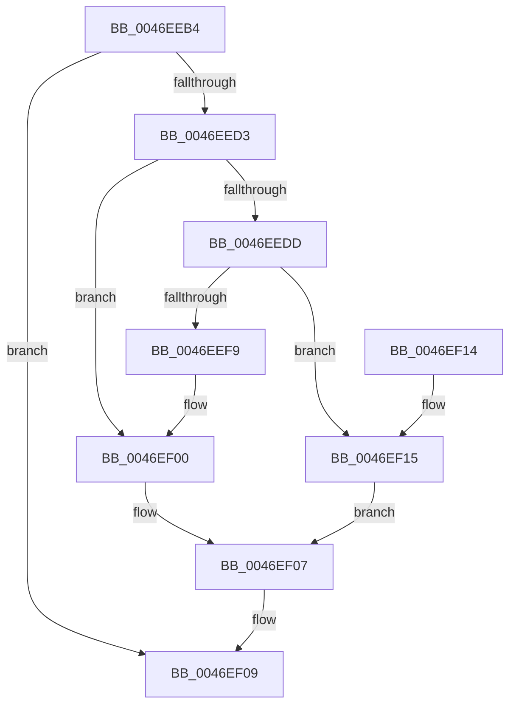

# CmpJoinClassOfTrust

- RVA: `0x0046EEB4`–`0x0046EF2A` (길이 `118` bytes)
- VA: `0x000000014046EEB4`
- 실행 섹션: `.text`
- PDB 이름 있음: `예`; PDB Function 태그: `아니요`
- unwind 정보 RVA: `0x0009F34C`
- 디코드: `34`개 명령, `118/118` bytes 표시
- 미해석 바이트: `0` (있으면 어셈블리에 `.byte`로 보존)

> 이 문서는 커널 이미지의 기계어와 PDB 기호를 분석해 생성했습니다. 4번과 5번은 함수 원형과 자료형을 바이너리 사용 방식에서 추정한 C 해석이며 원본 소스 복구 결과는 아닙니다.

## 1. Dependencies

- 직접 호출 지점: **3**; 고유 호출 대상: **3**
- 직접 호출자로 확인된 함수: **2**
- RIP 상대 이미지 참조: **0**

### Outgoing calls
- `0x0046EECA` → [CmpPerformTrustClassAccessCheck](CmpPerformTrustClassAccessCheck_function_0046EF30.md) (function, `0x0046EF30`)
- `0x0046EEDD` → [CmpLockHiveListExclusive](../../page/A7/CmpLockHiveListExclusive_function_00A72240.md) (function, `0x00A72240`)
- `0x0046EF23` → [CmpUnlockHiveList](../../page/84/CmpUnlockHiveList_function_0084E424.md) (function, `0x0084E424`)

### Direct callers
- [CmpLoadKeyCommon](CmpLoadKeyCommon_function_0046E9F8.md) at `0x0046EC5B`
- [sub_00B49062](../../page/B4/Unknown_function_00B49062.md) at `0x00B49194`

### Static image references
- 디코드된 RIP-relative 메모리 참조가 없습니다.

## 2. Other-region calls and transfers

- 다른 실행 섹션으로 향하는 call: **2**
  - `0x0046EEDD` → [CmpLockHiveListExclusive](../../page/A7/CmpLockHiveListExclusive_function_00A72240.md) (`.text` → `PAGE`)
  - `0x0046EF23` → [CmpUnlockHiveList](../../page/84/CmpUnlockHiveList_function_0084E424.md) (`.text` → `PAGE`)
- 별도 외부 분기/꼬리 이동을 확인하지 못했습니다.

## 3. Assembly (complete function range)

```asm
0046EEB4  48 89 5C 24 08                  mov qword ptr [rsp + 8], rbx
0046EEB9  57                              push rdi
0046EEBA  48 83 EC 20                     sub rsp, 0x20
0046EEBE  48 8B FA                        mov rdi, rdx
0046EEC1  48 8B D9                        mov rbx, rcx
0046EEC4  48 8B CF                        mov rcx, rdi
0046EEC7  41 8A D0                        mov dl, r8b
0046EECA  E8 61 00 00 00                  call 0x14046ef30
0046EECF  85 C0                           test eax, eax
0046EED1  78 36                           js 0x14046ef09
0046EED3  8B 87 10 10 00 00               mov eax, dword ptr [rdi + 0x1010]
0046EED9  A8 01                           test al, 1
0046EEDB  74 23                           je 0x14046ef00
0046EEDD  E8 5E 33 60 00                  call 0x140a72240
0046EEE2  48 8D 8F 18 10 00 00            lea rcx, [rdi + 0x1018]
0046EEE9  48 8B 51 08                     mov rdx, qword ptr [rcx + 8]
0046EEED  48 8D 83 18 10 00 00            lea rax, [rbx + 0x1018]
0046EEF4  48 39 0A                        cmp qword ptr [rdx], rcx
0046EEF7  74 1C                           je 0x14046ef15
0046EEF9  B9 03 00 00 00                  mov ecx, 3
0046EEFE  CD 29                           int 0x29
0046EF00  83 A3 10 10 00 00 FE            and dword ptr [rbx + 0x1010], 0xfffffffe
0046EF07  33 C0                           xor eax, eax
0046EF09  48 8B 5C 24 30                  mov rbx, qword ptr [rsp + 0x30]
0046EF0E  48 83 C4 20                     add rsp, 0x20
0046EF12  5F                              pop rdi
0046EF13  C3                              ret
0046EF14  CC                              int3
0046EF15  48 89 08                        mov qword ptr [rax], rcx
0046EF18  48 89 50 08                     mov qword ptr [rax + 8], rdx
0046EF1C  48 89 02                        mov qword ptr [rdx], rax
0046EF1F  48 89 41 08                     mov qword ptr [rcx + 8], rax
0046EF23  E8 FC F4 3D 00                  call 0x14084e424
0046EF28  EB DD                           jmp 0x14046ef07
```

## 4. C-style interpretation (structured pseudocode)

```c
__int64 __fastcall CmpJoinClassOfTrust(__int64 a1, __int64 a2, unsigned __int8 a3)
{
    __int64 result;
    __int64 v_rsp;
    unsigned __int64 v_stack_p8;

    v_stack_p8 = v_rbx;
    v_rsp = (v_rsp) - (32);
    result = CmpPerformTrustClassAccessCheck(a2, a3, a3, a4);
    if (sign_flag) goto loc_0046EF09;
    if ((((unsigned __int8)((unsigned int)(*(unsigned int *)(a2 + 4112)))) & (1)) == 0) goto loc_0046EF00;
    result = CmpLockHiveListExclusive(a2, a3, a3, a4);
    if ((*(unsigned __int64 *)(*(unsigned __int64 *)(a2 + 4120 + 8))) == (a2 + 4120)) goto loc_0046EF15;
loc_0046EF00:
loc_0046EF07:
    result = 0;
loc_0046EF09:
    v_rsp = (v_rsp) + (32);
    return result;
loc_0046EF15:
    *(unsigned __int64 *)(result) = 3;
    *(unsigned __int64 *)(result + 8) = *(unsigned __int64 *)(a2 + 4120 + 8);
    *(unsigned __int64 *)(*(unsigned __int64 *)(a2 + 4120 + 8)) = 0;
    *(unsigned __int64 *)(3 + 8) = 0;
    result = CmpUnlockHiveList(3, *(unsigned __int64 *)(a2 + 4120 + 8), a3, a4);
    goto loc_0046EF07;
}
```

## 5. (Beta) C Style

```c
int64_t CmpJoinClassOfTrust(void *Arg1, void *Arg2, uint8_t Arg3)
{
    uint8_t *arg1 = (uint8_t *)Arg1;
    uint8_t *arg2 = (uint8_t *)Arg2;

    int64_t result;
    int64_t local_rsp;
    uint64_t v_stack_p8;

    v_stack_p8 = local_rbx;
    local_rsp = (local_rsp) - (32);
    result = CmpPerformTrustClassAccessCheck(Arg2, Arg3, Arg3, a4);
    if (sign_flag) goto loc_0046EF09;
    if ((((uint8_t)((uint32_t)(*(uint32_t *)(arg2 + 0x1010)))) & (1)) == 0) goto loc_0046EF00;
    result = CmpLockHiveListExclusive(Arg2, Arg3, Arg3, a4);
    if ((*(uint64_t *)(*(uint64_t *)(arg2 + 0x1018 + 0x8))) == (Arg2 + 4120)) goto loc_0046EF15;
loc_0046EF00:
loc_0046EF07:
    result = 0;
loc_0046EF09:
    local_rsp = (local_rsp) + (32);
    return result;
loc_0046EF15:
    *(uint64_t *)(result) = 3;
    *(uint64_t *)(result + 0x8) = *(uint64_t *)(arg2 + 0x1018 + 0x8);
    *(uint64_t *)(*(uint64_t *)(arg2 + 0x1018 + 0x8)) = 0;
    *(uint64_t *)(3 + 0x8) = 0;
    result = CmpUnlockHiveList(3, *(uint64_t *)(arg2 + 0x1018 + 0x8), Arg3, a4);
    goto loc_0046EF07;
}
```

### 관측된 메모리 오프셋

구조체 형식이 확인되지 않은 접근은 인자 기준의 오프셋으로만 기록했습니다.

| 기준 인자 | 오프셋 표현 | 폭 (bit) | 접근 |
|---|---:|---:|---|
| `Arg1` | `+ 0x0` | `64` | `W` |
| `Arg1` | `+ 0x8` | `64` | `W` |
| `Arg1` | `+ 0x1010` | `32` | `R/W` |
| `Arg1` | `+ 0x1018` | `64` | `R` |
| `Arg2` | `+ 0x8` | `64` | `R` |
| `Arg2` | `+ 0x8` | `64` | `W` |
| `Arg2` | `+ 0x1010` | `32` | `R` |
| `Arg2` | `+ 0x1018` | `64` | `R` |

## 6. Execution-region graph

[열기: 2D/3D 그래프와 함수 탐색 컨트롤 패널](../../../control-panel.html?section=text&rva=0x0046EEB4&view=graph)

- 2D 그래프는 위에서 아래로 흐르고, 3D 그래프는 빈 공간을 드래그해 회전합니다. Shift+드래그는 이동, 휠은 확대·축소, 함수 노드 선택은 대상 보고서 이동입니다.

### Static fallback


